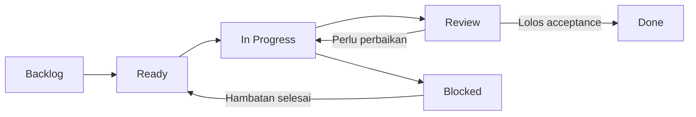

# Ngertiin

Sumber: [Notion](https://app.notion.com/p/3f8abdd6187381e39753f0d54ee2556b)

<!-- notion-content:start -->
Agent belajar personal yang mengubah materi menjadi Course dan menemani pengguna sampai selesai.

**Untuk:** pelajar SMA dan mahasiswa. **Status:** perencanaan implementasi v1.

**Visi jangka panjang:** agent belajar personal yang proaktif, terinspirasi oleh pola kerja Muse AI, Grok Bot, Hermes Agent, dan OpenClaw. Arah dan batas delivery dijelaskan pada [01 · Produk & Paket](product/01-produk-dan-paket.md).

**Target v1:** pengalaman belajar end-to-end dan fondasi agent personal sesuai backlog yang disepakati, termasuk proaktivitas terbatas dalam konteks belajar. Kesetaraan kemampuan dengan produk referensi bukan syarat kelulusan v1.

## Dokumentasi

- [01 · Produk & Paket](product/01-produk-dan-paket.md)
- [02 · User Flow](product/02-user-flow.md)
- [03 · Agent](product/03-agent.md)
- [04 · Arsitektur & Delivery](product/04-arsitektur-dan-delivery.md)

## Implementasi

Mulai dari view **Siap dikerjakan**. Dependencies dan acceptance criteria ada pada tiket.

- [05 · Backlog](backlog/README.md)

<!-- notion-content:end -->

## Salinan lokal

Isi halaman dan tiket disalin dari Notion pada **2026-10-13 11:37:14 UTC**. Tabel dan tautan native diubah menjadi Markdown; Mermaid dipertahankan. View backlog adalah snapshot statis.

Halaman Ngertiin, Produk & Paket, Agent, serta Arsitektur & Delivery diselaraskan kembali pada **14 Oktober 2026** untuk memperjelas visi jangka panjang dan batas v1. Waktu dan hash per halaman tercatat pada manifest.

[Bahan riset](research/README.md) melengkapi spesifikasi. [Manifest sinkronisasi](notion-manifest.json) mencatat sumber, versi snapshot, schema, konfigurasi view, dan hash isi.

Status backlog #01 dan #02 sudah **Done**, diselaraskan dengan readback Notion pada **15 Oktober 2026**. Fondasi #02 menggunakan MinIO lokal dan penerimaan manual melalui browser; [bukti penerimaan](engineering/foundation-02-manual-acceptance.md) serta [panduan development](engineering/development.md) tersedia di repo. Daftar Ready dan board lokal mengikuti perubahan tersebut.

Perubahan keputusan dan status dicatat di Notion lalu disalin kembali ke repo agar keduanya tetap selaras.

## Desain

[Walkthrough UX di pen.dev](walkthrough-ux.pen) — file desain untuk tiket #01 yang sudah **Done**.

Standar konten #003 sudah **Done** pada 15 Oktober 2026. [Kontrak konten](engineering/course-content-standard.md), [desain engine multi-worker](engineering/course-generation-design.md), dan [bukti penerimaan](engineering/content-03-manual-acceptance.md) tersedia. User Flow, Arsitektur, serta tiket #009/#011 diselaraskan dengan keputusan Lesson dapat dibaca sebelum Practice siap.

Chat #04 sudah **Done** pada **16 Oktober 2026**, berdasarkan readback Notion. [Implementasi dan penerimaan Chat](engineering/chat-04-implementation.md) serta [cleanup React](engineering/react-cleanup-2026-10-16.md) tersedia; status tiket, kanban, dan manifest lokal sudah diselaraskan.
