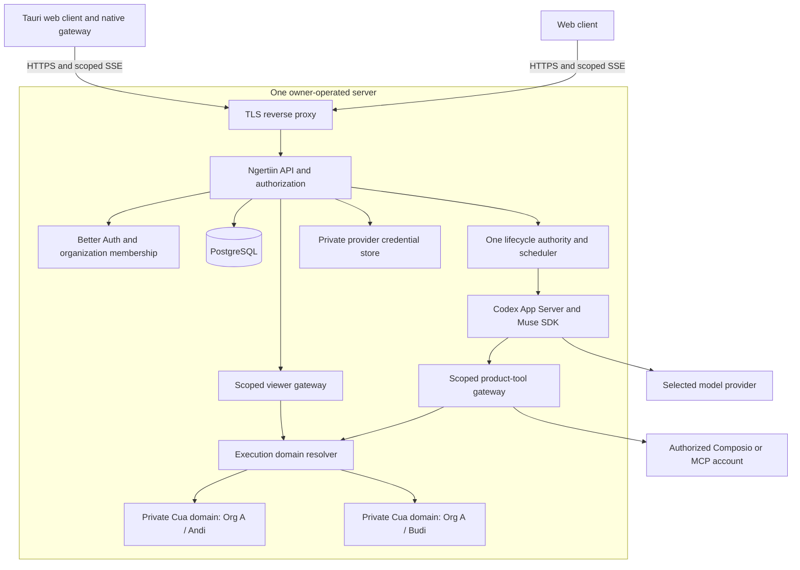
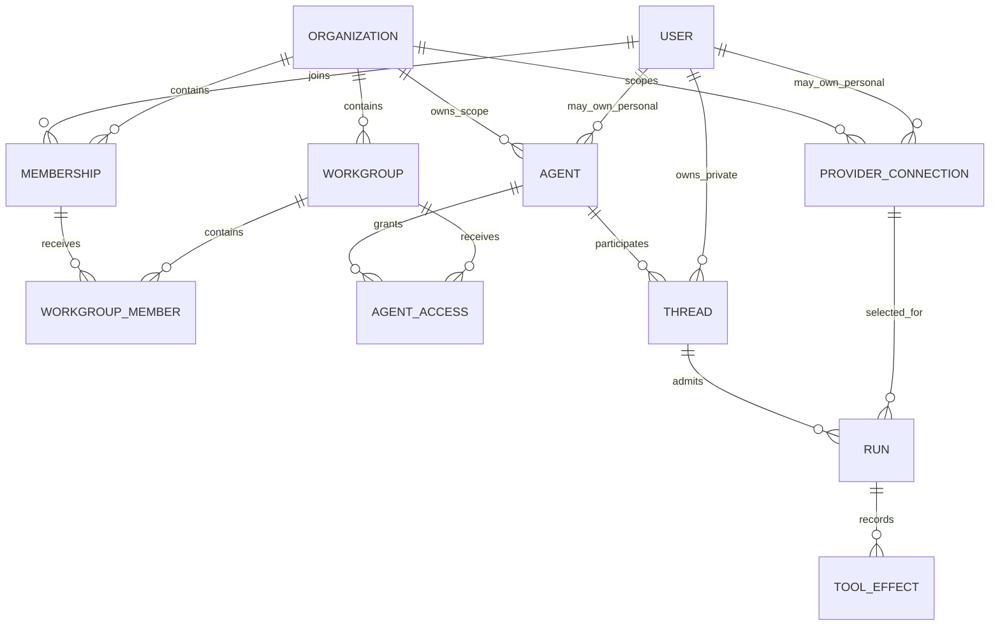
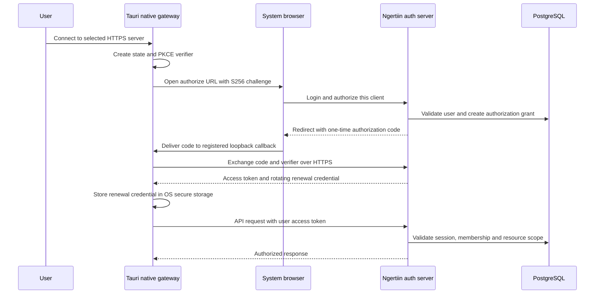
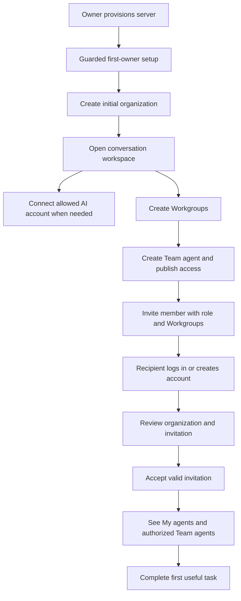
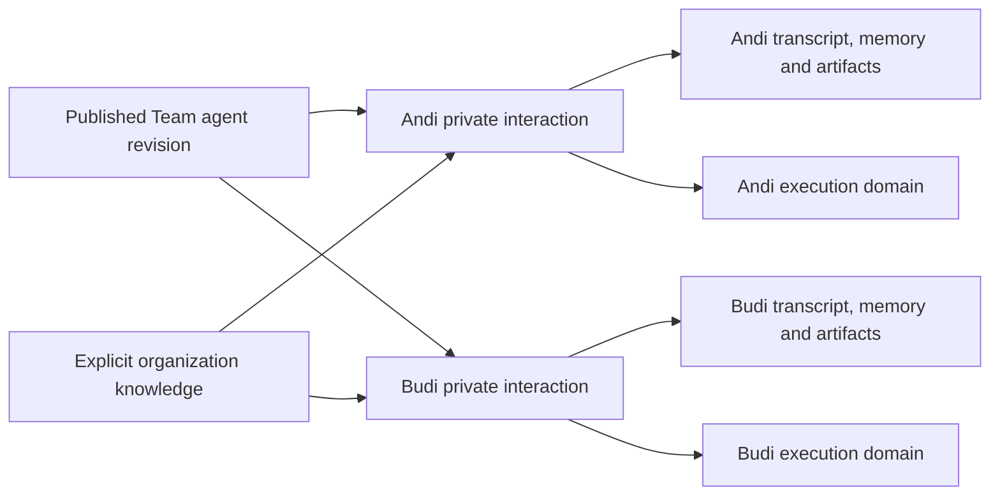
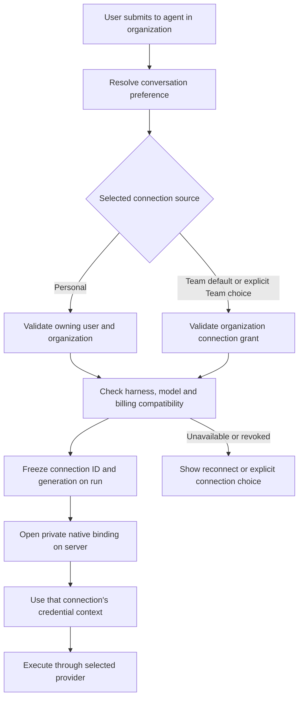
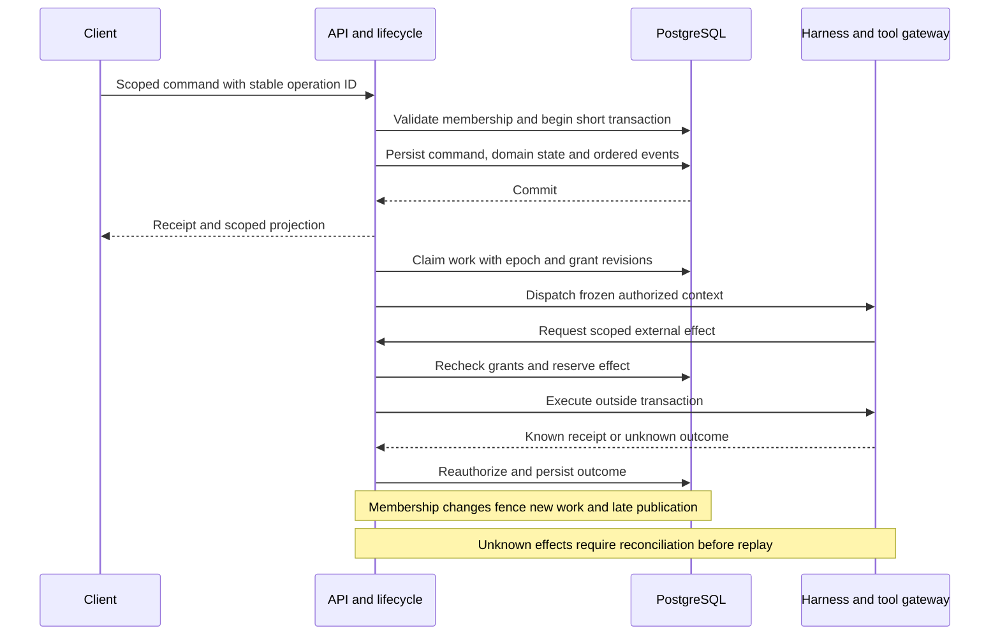

# Central server, PostgreSQL and organizations implementation plan

Date: 2026-11-12. Status: NMA-072 Done for its verified single-owner PostgreSQL/import scope; NMA-073 Done for its verified backend authentication/headless native scope; NMA-074–083 remain planned. This is the main design and delivery document for [NMA-072–083](../backlog/README.md#server-organizations-plan). The owner requested this plan after agreeing to PostgreSQL. It records the session's product direction and identifies implementation defaults separately from verified capabilities.

The implementation targets `apps/server`, `apps/web-client` and the Tauri host in `apps/desktop`. Further `apps/desktop-rs` and GPUI experiment work is paused. Their historical Done milestones and evidence remain intact. This document does not authorize deployment, credential changes, database resets, or deletion of existing data.

## 1. Outcome and scope decisions

One owner-operated server serves multiple organizations and many authenticated people. Each person uses the web client or a Tauri client, can own private agents, and can use organization-owned agents granted to their workgroups. The server runs the required harnesses and durable work independently of client visibility or shutdown.

| Decision | Direction and boundary |
| --- | --- |
| Server database | PostgreSQL is the target primary database for authentication and application metadata. NMA-072 implements the PostgreSQL store; its controlled import preserves the legacy owner until later binding. No SQLite capacity failure is claimed. |
| Clients | Web and Tauri; a remote Tauri profile connects to the server without starting a local backend, harness or Cua machine. |
| Organization | An application data, membership, administration and connection boundary. One account can join or create multiple organizations when permitted. |
| Administrative roles | Owner, Admin and Member, scoped to one organization. Organization creation is a separate installation policy. |
| Workgroup | A named collection of organization members, such as Mobile Dev or Marketing. A member may join several workgroups. |
| Personal agent | Owned by one user. Planning default: it belongs to the organization in which it was created and is private to its owner. A global personal space is outside this delivery. |
| Organization agent | Owned by the organization; Owner/Admin manage its published configuration and workgroup access. It survives the departure of its creator. UI calls it a Team agent. |
| Private interaction | Sharing an agent shares its authorized configuration and published knowledge. Each user's conversations, memory, native bindings and uploads remain separate. |
| Provider choice | Authorized organization connections and personal connections remain explicit options. Selection is private to the user/conversation and frozen for admitted work. |
| App connections | Each integration chooses an organization-owned or personal account. Skills and MCP configuration do not implicitly grant credentials. |
| Network | HTTPS API, authenticated SSE and scoped HTTPS/WSS viewer transport. VPN/Tailscale is optional deployment infrastructure. |
| Runtime | Codex App Server and Muse SDK/MSP run on the server. ACP remains an optional transport, not a prerequisite or a new runtime commitment. |

**Planning defaults to validate:** Better Auth is the recommended authentication implementation; its Organization plugin maps Organizations to Ngertiin organizations and Teams to Workgroups. Browser-based public-client OAuth with PKCE is the Tauri login baseline. NMA-072 pins PostgreSQL 18.1, `pg`/`@types/pg` 8.23.1 and Bun 1.3.10; its [persistence amendment](postgresql-persistence.md) records the image digest and verification boundary. Native runtime support, authentication dependencies and OS credential backends are pinned by their own implementation milestones after compatibility checks.

Not included: client-hosted harness workers, remote enrollment of arbitrary machines, distributed schedulers, native Rust client development, a billing/resale platform, automatic credential pools/fallback, public marketplace publishing, and multi-human group-chat collaboration. Existing group chats remain one human plus authorized agents; shared-human conversations require a separate scope decision.

## 2. Observed baseline and change map

Source baseline: `7c5e3bf7b7a65ef828c66ad49bec3881b55d9247`, inspected with the working tree on 2026-11-12. This section preserves the pre-implementation planning observations. The [NMA-072 persistence amendment](postgresql-persistence.md) describes the PostgreSQL implementation and current verification boundary.

| Current source | Observation | Required change |
| --- | --- | --- |
| [Store](../../apps/server/src/store.ts) | `bun:sqlite`, one owner, WAL/FULL, synchronous transaction callbacks, process-lifetime authority lock, JSON entity/event projections and command receipts | Async PostgreSQL persistence, explicit tenant/actor scope, indexed bounded reads, durable ordering and an equivalent application-authority fence |
| [HTTP boundary](../../apps/server/src/api/http.ts) and [consumer contract](api-consumer-contract.md) | Installation bearer authenticates normal APIs; event reads are owner-wide | User/device sessions, resource authorization, scoped events/replay and separation of operator versus user routes |
| [Credential contexts](../../apps/server/src/harness/context.ts) and [broker](../../apps/server/src/harness/broker.ts) | Private HOME/CODEX_HOME per connection; binding lanes currently follow agent/thread and their selected connection | Personal/organization ownership, per-interaction connection selection, actor-aware native bindings and credential access checks |
| [Codex account login](../../apps/server/src/harness/codex/accounts.ts) | Native browser login returns an auth URL; Codex file credential storage is selected by its adapter | Prove a remote/headless login flow; local callback assumptions cannot be reused untested |
| [Machine service](../../apps/server/src/machines/service.ts) and [trust plan](shared-machine-cua-plan-2026-11-04.md) | One cooperative, sudo-capable Cua desktop shared by an installation's agents | Resolve a retained execution domain per organization/user; enforce separate volumes, browser profiles and viewer authority across people |
| [Tauri profile](../../apps/desktop/src-tauri/src/profile.rs), [gateway](../../apps/desktop/src-tauri/src/gateway.rs) and [supervisor](../../apps/desktop/src-tauri/src/supervisor.rs) | Local configuration, installation-token gateway and backend supervision | Explicit remote mode, native user-token storage and renewal, HTTPS origin binding and no remote-server lifecycle ownership |
| [Interface](../product/interface.md) | Conversation-first UI with retained drafts, Settings and Marketplace | Add onboarding, organization switcher, administration, My agents/Team agents and private connection preferences while preserving that structure |

## 3. Deployment and trust boundaries

Expose the application ingress, not database ports, harness transports, spacesd or Driver control endpoints. Keep the existing product-tool bridge private and run-lease authenticated. HTTPS proxying must preserve bounded uploads, SSE flushing, viewer upgrades and trusted-origin information. Trust forwarded headers only from the configured proxy.

The owner can use public HTTPS or place the same application behind a VPN. Tailscale membership, ACLs, DNS and certificates are deployment configuration; the product has no required VPN SDK. Both modes retain application login and authorization. Server identity and issuer/origin validation bind sessions and local caches to the selected installation.

This is server-trusted processing: infrastructure operators can administer the machines holding provider credentials and plaintext application data. Product Admin permission does not expose private chats or secrets in the UI, but this is not end-to-end encryption against the server operator.

## 4. Domain model and authorization

Use distinct `user_id`, `organization_id`, owner identity, acting identity and visibility fields. Do not reinterpret the current `owner_id` as an organization ID throughout the code. The migration must state how each old identity maps to the new model.

The diagram is conceptual; group threads use an explicit agent-membership relation rather than a single agent column. Required application relations also include private preferences, scoped memory, immutable artifacts, pinned skill revisions, app-account grants, native bindings, execution domains, responsibilities, events, command receipts and administrative audit records.

| Action | Owner | Admin | Member |
| --- | --- | --- | --- |
| Create/use own personal agents and personal connections | Yes | Yes | Yes |
| Manage organization agents, workgroups and allowed resources | Yes | Yes | No |
| Invite/remove ordinary members | Yes | Yes, within configured permission limits | No |
| Grant/revoke Admin or transfer ownership | Yes; retain a last Owner | No by default | No |
| Use an organization agent | An explicit effective access grant | An explicit effective access grant | An explicit effective access grant |
| Read another user's private chat/memory/files | No automatic product permission | No automatic product permission | No |
| Create another organization | Separate installation permission | Separate installation permission | Separate installation permission |

Administrative management and invocation are distinct: managing an agent does not automatically select a sensitive provider/app connection. Organization-agent audience supports selected workgroups or an explicit All members grant. Workgroup membership grants a union of authorized agent access; explicit revocation and current resource policy still apply. The installation operator sets organization-creation permission and limits without acquiring organization chat access through that setting.

Every request resolves authenticated user/session, requested organization, active membership and current resource grants. An organization ID from a client selects a candidate context, not an authorization result. Check relations in SQL, use organization-qualified foreign keys/unique indexes, and constrain private reads by owner/participant as well as organization. An organization switch changes presentation, never the scope of already admitted work.

PostgreSQL Row-Level Security is an additional required tenant-boundary check for application tables suitable for it, not a substitute for product permissions. Use an application role that is neither superuser, table owner nor BYPASSRLS. Set tenant/actor context transaction-locally after validation; test pool reuse and background work. Keep migration/admin database roles separate. Authentication tables and cross-organization account lookup need documented privileged paths; do not expose those paths to ordinary queries.

The [NMA-074 implementation contract](organization-access.md) defines the adopted defaults and routes: explicit creation quotas, Owner-only elevation, email-bound invitations, multiple Workgroups, explicit audience policies, immutable attribution and membership generations. Organization deletion is disabled. Administrative export excludes private data and credentials. Removal suspends a durable private-work principal; NMA-075 consumes that principal throughout scoped data and scheduling. Its verified administration boundary does not enable general multi-user application access.

## 5. PostgreSQL persistence and cutover

Use one PostgreSQL instance, optionally on the same physical server, with separate auth and application namespaces and explicit permissions. NMA-072 implements a `pg` 8.23.1 pool with Bun 1.3.10 and PostgreSQL 18.1 verification. Its asynchronous services preserve the existing lifecycle model. The current single-owner clock is installation-wide; organization-qualified policies and clocks follow the verified mapping in NMA-075. Initial deployment retains one backend lifecycle authority even though PostgreSQL supports concurrent transactions.

1. Inventory queries, JSON indexes, sequence/cursor semantics, nested transactions, projections, command reservations and filesystem receipts. Replace full-kind materialization such as `Store.list(kind)` with bounded scope-aware queries where required.
2. Add schema migrations and transaction-bound persistence methods. Make organization/actor relationships queryable and constrained; JSONB may preserve payload flexibility but is not the sole tenant boundary.
3. Commit domain changes, events and command receipts together. Scope idempotency identities by installation/organization, actor and operation. Reauthorize before returning a receipt so a previously valid key cannot disclose revoked data.
4. Use an organization event-clock row locked until transaction commit, or another proven commit-ordered design. Plain PostgreSQL sequence allocation does not establish commit order: a late transaction with a smaller sequence must not disappear behind a consumer cursor. Consumers apply filtered, context-bound cursors and re-snapshot after relevant authorization changes.
5. Replace the SQLite process lock with a dedicated-session PostgreSQL advisory authority lock plus a durable epoch/fence. Lost authority stops new dispatch and invalidates stale publication. Pooled queries cannot own a process-lifetime lock accidentally. Database migration does not authorize multiple independent schedulers.
6. Keep model/tool/network and file transfer work outside short transactions. Reserve effects durably, reconcile unknown results and reauthorize before publication. Preserve nested-transaction rollback semantics, stable operation IDs and immutable bytes.
7. Stage the cutover: NMA-072 imports into a fresh PostgreSQL target while retaining the legacy owner identity and a documented mapping manifest. After NMA-073/074 establish the verified account and organization, NMA-075 backfills their scope under a guarded operator mapping before enabling multi-user access. NMA-082 rehearses the final switch from a verified backup with the old authority stopped. Compare IDs/counts/hashes/receipts/history and treat old payload versions explicitly. Handle native bindings rather than resuming against a different credential identity. Rollback restores a consistent database/blob/credential set; do not merge two divergent writers.

Use disposable fixtures first. A development-data reset is an alternative only when separately authorized for named data; this plan does not reset the current installation. Once multiple users are enrolled, normal upgrades preserve their data. Backup/restore covers PostgreSQL plus immutable artifact bytes, private provider stores, execution-domain volumes and configuration. Record a tested RPO/RTO, and configure WAL archiving/PITR when that recovery objective requires it; a database dump alone does not back up the entire product.

## 6. User login and device sessions

The [NMA-073 implementation contract](user-authentication.md) pins Better Auth/OAuth Provider 1.7.23 and Resend delivery, with controlled-email HTTP and headless PKCE evidence. It selects opaque audience-bound OAuth access tokens, independent native device sessions and server-checked revocation, including offline credentials. Only the explicitly bound account can enter the retained owner-wide domain before NMA-074/075. Product login screens, OS credential storage and general multi-user access are still later scope.

Web login uses secure HttpOnly cookies on the selected server origin, CSRF defenses and server-validated sessions. Tauri remote mode uses the same web-client UI and existing narrow native gateway, with an external system-browser public-client authorization-code/PKCE flow. Store long-lived renewal credentials in the OS credential store, short-lived access tokens in native memory, and keep provider tokens outside the renderer. The OAuth access token is not an ID token or an installation bearer.

Native callback listeners bind loopback only, validate state/issuer and close after the bounded flow; no client secret is embedded in the app. Keep access-token verification, audience, revocation and user/session mapping consistent across REST, SSE and viewer bootstrap. A Better Auth session bearer plugin is not itself the OAuth/PKCE flow. Device authorization is an optional alternative to prove only if needed; distinguish first-party session tokens from OAuth access tokens.

Users can list/revoke their device sessions. Logout retires that device's streams/viewer tickets and clears scoped presentation caches; it does not cancel every durable responsibility. Organization removal fences that membership's work independently of whether the account still belongs to another organization. Short token lifetime alone is not the revocation mechanism.

## 7. Owner setup and invited-member onboarding

The first Owner is established through a bounded operator-controlled bootstrap, not first public signup. Subsequent organization creation requires the installation policy. Invitation acceptance verifies intended identity, expiry, current role/workgroup grants and the target organization; retries do not create duplicate memberships, Tobi agents, conversations or openers. NMA-074 records the durable membership-provisioning intent; NMA-075 materializes the private Tobi/DM once per user/organization without an inference call.

Creating workgroups, inviting people and publishing agents can be completed later in Settings; agent naming/persona questionnaires remain optional. A member does not choose their own administrative role. A member without a workgroup can still use personal agents and any explicit All members agent grant. Missing AI setup preserves created entities and points the responsible person to setup. New devices sign in without repeating organization setup.

## 8. Agent sharing, memory and files

| Resource | Default scope | Shared path |
| --- | --- | --- |
| Personal agent profile and preferences | Organization + owning user | No automatic publication |
| Team agent identity/instructions | Organization + allowed audience; managed revision | Owner/Admin publish changes |
| Native session, transcript, draft, task result | Exact user/organization/conversation | No reuse across another human |
| Memory | User + agent + conversation or explicit private cross-conversation scope | Separate explicit published knowledge record |
| Upload, parsed text, chunks, thumbnails, saved artifact | Original private conversation and owner | Explicit scoped publication/copy, including derived data |
| Skills | Enabled, pinned revision on the selected agent | Published package assignments; no credential grant |
| Working filesystem and browser | Enforced execution domain | Explicit authorized external destination, never a common server home |

Team-agent personalization writes a user's preference overlay rather than the organization's global instructions. Publishing shared knowledge/skills requires the corresponding management permission; a member's chat does not silently update global configuration or another user's memory. Retrieval, generated previews, caches and native transcript hydration apply the same visibility policy as source records. Reopening history never triggers inference or recaptures private information globally.

Execution-domain default: one retained isolated Cua environment per `(organization_id, user_id)`, created lazily and bound durably. Agents belonging to that same human may cooperate inside that domain, preserving the existing shared-computer experience for one person. Conversation metadata and immutable artifacts remain separately scoped; a working copy staged into that person's cooperative machine is visible to their authorized agents. This is not adversarial filesystem isolation among that person's agents. Separate per-conversation domains are required before any future human-shared conversation would otherwise expose private working files.

Across people and organizations, separate writable volumes, browser profiles, process namespaces and control credentials. Directory prefixes within the same sudo-capable OS are insufficient. Keep backend state, provider homes and the Docker socket outside every agent environment. Viewer tickets bind domain, user/session, allowed files root, lease revision and authorization generation; revoke active media/input on removal or handback. Measure domain capacity, lazy provisioning, admission and safe cleanup on the target host. If isolated Cua domains cannot be enforced, the affected multi-user machine capability remains unavailable; the singleton machine is not a privacy fallback.

Actions in an organization-owned external account intentionally create shared external effects. Private chat does not make an issue, email or file written to that shared destination private; show the selected account and destination when relevant. Private data is not automatically promoted to shared knowledge.

## 9. AI connections, MCP and skills

Two different connection families remain separate: model/harness accounts and app/MCP accounts. Both have explicit personal or organization ownership, access grants, generations and revocation. A personal connection is user-owned and organization-scoped in this delivery; using the same external account in another organization requires a separate explicit connection rather than ambient credential reuse.

Selection order is an explicit conversation choice, then a compatible user preference, then the organization's configured default when allowed. A missing or invalid explicit selection produces an actionable failure rather than stepping through that order as an automatic fallback chain. Only unset preferences inherit defaults. Freeze selected connection/model/billing and relevant grants at admission, recheck current authorization before dispatch, and retain the actual source in usage/effect records. Changing preferences affects future work and may rotate a native binding; it does not mutate a Team agent globally or replace an in-flight run's credentials.

Native binding identity includes organization, acting user, agent, conversation, connection and generation. A changed account cannot resume another account's session. Product history persists independently; rehydrate only authorized product context into a fresh native session where required. Persisted private responsibilities select a valid explicit execution principal and connection; they never borrow the last active UI session or organization.

Separate credential authority from native session storage. Several people selecting the same organization connection must not share a native transcript/history/skill cache simply because today's CODEX_HOME is keyed by connection. The target isolates native session/control homes per actor/binding and supplies only the selected account's authentication through a supported mechanism. NMA-077 must prove a single coordinated refresh authority or equivalent provider-supported credential delivery, including restart and simultaneous consumers; copying an entire authenticated home or independently rotating stale refresh-token copies is not an accepted solution.

For Codex, current `cli_auth_credentials_store=file` writes sensitive native auth files under private per-connection CODEX_HOME. Directory permissions are not encryption. The implementation must prove remote login, native refresh persistence, redaction, private storage/backups and a disconnect procedure covering live processes and residual files. Choose an encrypted volume/secret-store arrangement compatible with native refresh; do not claim arbitrary secret-manager storage is already supported by the harness. Password entry remains at the provider. Credentials never enter chat, artifact storage, shared working files, SSE or other users' clients.

Organization AI connections may technically serve several authorized users; those calls use the selected account's allowance/billing. Subscription eligibility and provider terms remain separate from this routing capability. Keep the technical option configurable without claiming universal entitlement. Muse subscription is still unverified; supported Muse API-key behavior remains required, with unsupported states explicit.

| Configuration | Management and invocation |
| --- | --- |
| Organization app/MCP account | Owner/Admin connects a designated integration identity and grants tools/resources/audience; allowed members need no personal login for that account |
| Personal app/MCP account | User authorizes their own account when needed; other members cannot select it |
| Organization skill | Owner/Admin publishes a pinned application-owned revision and assigns it to the Team agent |
| Personal skill/preference | Private overlay/package; agent-assisted edits cannot overwrite the shared Team package |
| Harness-inherited skill | Read-only inventory from the selected authorized connection/binding; a shared server install does not expose every private account's skills |

Composio identity distinguishes organization integration ownership from member-owned accounts. Use the current supported session API, pin connected accounts/tools explicitly and recheck application grants at dispatch. Existing single-owner identity mapping must change. Do not silently enable experimental shared-account APIs or switch to a different account. Custom MCP endpoints require a verified server-side connection/session scope; support only a catalog that the gateway and both adapters can enforce, rather than promising arbitrary root-token MCP forwarding.

## 10. Durable execution and revocation

Removing a member or revoking a workgroup/agent/connection updates authorization generations, closes affected streams/viewers and prevents queued dispatch. Request native stop for active work while recording whether stop was confirmed. A late external effect can still have occurred; receipts preserve that fact without disclosing a private result to a now-unauthorized user. Receipt replay, retries and new operation IDs cannot bypass revocation or unknown-effect holds.

Private Goals/Routine pause when their execution principal loses membership. Organization-owned responsibilities require an explicit assigned principal and takeover policy; Admin membership alone does not transfer someone's private responsibility. The last Owner is protected; organization deletion is disabled by default during the first delivery, with offboarding/archive handled explicitly.

Agent handoff, review, delegation and group routing preserve the initiating user's organization, conversation and effective resource grants. A Team agent cannot use an organization service identity to fetch another human's private context or invoke an inaccessible agent. Revalidate all handoff participants before dispatch and preserve the same attribution through background continuation.

## 11. Web/Tauri interface contract

Keep the existing conversation-first interface, icon rail, Settings, Marketplace, contextual panels and Focus viewer. Add an organization switcher and My agents/Team agents sections without creating a mandatory global agent dashboard. Settings gains permission-aware organization/member/workgroup/agent-access management; Marketplace retains app installation and scoped connection grants. Members see their own connections and authorized organization choices without receiving secrets.

Organization switch, logout, account switch and server switch namespace or clear drafts, optimistic operations, IndexedDB/localStorage projections, downloads, query caches, file trees, viewer tickets and SSE cursors by installation/user/organization/conversation. An active-organization field in a session is not enough: two tabs can operate different organizations. Every command carries its intended context, validated server-side, and preserves that context through retries. Do not change the current conversation's organization underneath a pending send.

Tauri remote mode keeps tokens in native transport/OS storage, restricts gateway requests to the selected HTTPS origin and expected relative API routes, and preserves existing Host/Origin/path/redirect defenses. Quit/reload/logout closes only this client's sessions/tickets according to their semantics; it never stops a remote backend, machine or other user's work. Preserve local development supervision as an explicitly selected mode, not an automatic recovery fallback for a failed remote connection. New modes do not require changes to desktop-rs.

## 12. Delivery backlog and gates

NMA-072 is **Done** for its [verified PostgreSQL/import scope](../verification/nma-072/README.md); NMA-073 is **Done** for its [verified backend authentication/headless native scope](../verification/nma-073/README.md); NMA-074 is **Done** for its [verified organization-administration and membership-principal scope](../verification/nma-074/README.md); NMA-075–083 remain **Backlog**. Dependencies are recorded in their files and [status.json](../backlog/status.json); dates and assignees are unset. Backend behavior precedes the new API gate, followed by web/Tauri consumption, deployment rehearsal and integrated acceptance. Existing NMA-060/061/062 and NMA-066–071 Done statuses retain their old scope. [NMA-063](../backlog/NMA-063.md) gains this plan's acceptance dependency; [NMA-064](../backlog/NMA-064.md) remains the separate fresh-device distribution gate.

```mermaid
flowchart LR
    P72[NMA-072 PostgreSQL] --> P73[NMA-073 Authentication]
    P73 --> P74[NMA-074 Organizations and Workgroups]
    P74 --> P75[NMA-075 Scoped domain and events]
    P75 --> P76[NMA-076 Execution isolation]
    P76 --> P77[NMA-077 AI connections]
    P77 --> P78[NMA-078 MCP and skills]
    P78 --> P79[NMA-079 API gate]
    P79 --> P80[NMA-080 Web client]
    P80 --> P81[NMA-081 Tauri remote client]
    P81 --> P82[NMA-082 Deployment and recovery]
    P82 --> P83[NMA-083 Integrated acceptance]
    P83 --> G63[NMA-063 Full product gate]
    G63 --> G64[NMA-064 Fresh-device distribution]
```

| Milestone | Reviewable outcome |
| --- | --- |
| [NMA-072](../backlog/NMA-072.md) | PostgreSQL store, commit-ordered events, authority fencing and rehearsed SQLite cutover |
| [NMA-073](../backlog/NMA-073.md) | Better Auth compatibility, user/device sessions, guarded bootstrap and native-client auth contract |
| [NMA-074](../backlog/NMA-074.md) | Multiple organizations, role policy, Workgroups, invitations and offboarding |
| [NMA-075](../backlog/NMA-075.md) | Private/shared agent model, complete data/retrieval/event authorization and RLS |
| [NMA-076](../backlog/NMA-076.md) | Enforced execution-domain, working-file/browser and viewer isolation |
| [NMA-077](../backlog/NMA-077.md) | Explicit personal/organization AI connections and server-side credential lifecycle |
| [NMA-078](../backlog/NMA-078.md) | Organization/personal app connections, MCP permissions and versioned skills |
| [NMA-079](../backlog/NMA-079.md) | Versioned API export, exhaustive affected surface inventory and multi-actor backend proof |
| [NMA-080](../backlog/NMA-080.md) | Real-API web onboarding, administration, organization switching and agent/connection selection |
| [NMA-081](../backlog/NMA-081.md) | Tauri remote profile, browser login, secure user sessions and independent server lifecycle |
| [NMA-082](../backlog/NMA-082.md) | Reproducible single-server HTTPS deployment, backup/restore and optional VPN runbook |
| [NMA-083](../backlog/NMA-083.md) | Integrated privacy, recovery, native/provider and web/Tauri acceptance report |

## 13. Evidence and release criteria

Use at least two organizations, three people with different per-organization roles, two workgroups in one organization, one person in both organizations, personal and Team agents, and personal/organization connections. Include a Team agent used by two humans with distinct private facts/uploads, and an outsider with no membership. Report exact planned/executed denominators rather than extrapolating these fixtures to production scale.

Required negative cases cover each affected HTTP route, entity projection, command receipt, history/replay/SSE cursor, upload/download/preview, memory retrieval, native binding, job/responsibility, MCP account, skills inventory and Computer ticket. Verify cross-user access within one organization as well as cross-organization access. Revoke during queueing, streaming, asynchronous authorization, tool dispatch and viewer control. Test server/account/org switching with retained caches and pending commands.

PostgreSQL proof includes rollback, duplicate admission, commit-order races, connection-pool tenant leakage, RLS using the deployed application role, authority loss, crash recovery, migration comparison and real restore. Provider proof separately records login, catalog discovery, completed inference, useful scoped tool execution, account identity and effective billing. Keep Codex subscription and Muse API-key evidence separate; never relabel Muse subscription unknown as a pass.

Web acceptance uses real API browser desktop/mobile journeys. Tauri acceptance uses the actual development app, native callback/secure storage, reconnect/relaunch and remote-server survival after client Quit. A fixture proves authorization logic; it does not prove native Cua isolation or provider execution. Record versions, configuration, observed resource usage, p95 command/event latency, contention and failures on a declared concurrent workload before making capacity claims. No arbitrary user-count capacity promise is part of this plan.

## 14. Decisions and compatibility work still to close

| Item | Planning default | Resolution owner |
| --- | --- | --- |
| Auth library and native token mode | Better Auth/OAuth Provider 1.7.23, public-client S256 PKCE, opaque access tokens and independent revocable native sessions; [contract](user-authentication.md). Organization/Teams administration is implemented in NMA-074; [contract](organization-access.md). | NMA-073 / NMA-074 |
| PostgreSQL driver/version and SQL shape | PostgreSQL 18.1, `pg`/`@types/pg` 8.23.1, Bun 1.3.10; JSONB with explicit identity and future scope columns, indexed bounded reads | NMA-072; tenant policy/RLS remains NMA-075 |
| Personal scope | Per user within an organization; no global personal space in this delivery | NMA-074/075 |
| Org creation and admin elevation | Operator entitlement defaults to one created organization for the bootstrap account and zero for others; Owner-only elevation and last-Owner protection; [implemented policy](organization-access.md#creation-and-administrative-roles) | NMA-074 |
| Machine deployment/capacity | Retained per-user/organization isolated Cua environments on the same server | NMA-076/082 |
| Credential protection | Native-compatible isolated storage plus measured at-rest/backup controls; remote login must be proven | NMA-077 |
| Custom MCP compatibility | Gateway-enforced scoped server connections; no unrestricted native/global MCP inheritance | NMA-078 |
| External email delivery | Resend HTTPS adapter for verification/recovery; controlled delivery capture verified in NMA-073. NMA-074 verifies organization invitations with controlled capture; real provider delivery remains unverified. | NMA-073/074 |
| Backup targets, capacity and recovery SLO | Declared workload, restore drill and measured RPO/RTO on selected host | NMA-082/083 |

These are bounded implementation decisions, not permission to weaken privacy, silently switch billing or add a second runtime authority. Escalate a material incompatible requirement before changing the accepted boundary.

## 15. Primary references and adoption

Checked during the design discussion on 2026-11-12. These references establish available mechanisms, not local implementation acceptance. Follow [source adoption](../development/source-adoption.md): pin the selected dependency/source revision and record local adaptation, provenance and upgrade checks when code is adopted.

- [PostgreSQL MVCC](https://www.postgresql.org/docs/18/mvcc-intro.html), [RLS](https://www.postgresql.org/docs/18/ddl-rowsecurity.html), and [continuous archiving/PITR](https://www.postgresql.org/docs/18/continuous-archiving.html).
- [Better Auth Elysia](https://better-auth.com/docs/integrations/elysia), [PostgreSQL](https://better-auth.com/docs/adapters/postgresql), [Organization](https://better-auth.com/docs/plugins/organization), [OAuth Provider](https://better-auth.com/docs/plugins/oauth-provider), and [Device Authorization](https://better-auth.com/docs/plugins/device-authorization).
- [OAuth native applications, RFC 8252](https://www.rfc-editor.org/rfc/rfc8252), [OAuth security BCP, RFC 9700](https://www.rfc-editor.org/rfc/rfc9700), and [OWASP REST security](https://cheatsheetseries.owasp.org/cheatsheets/REST_Security_Cheat_Sheet.html).
- [Codex authentication and native credential storage](https://learn.chatgpt.com/docs/auth), [Composio B2B connection ownership](https://docs.composio.dev/docs/b2b-agents), and [MCP authorization](https://modelcontextprotocol.io/specification/latest/basic/authorization).
- [Tailscale private HTTPS deployment](https://tailscale.com/docs/solutions/host-private-server-docker), an optional operator-owned network configuration.
