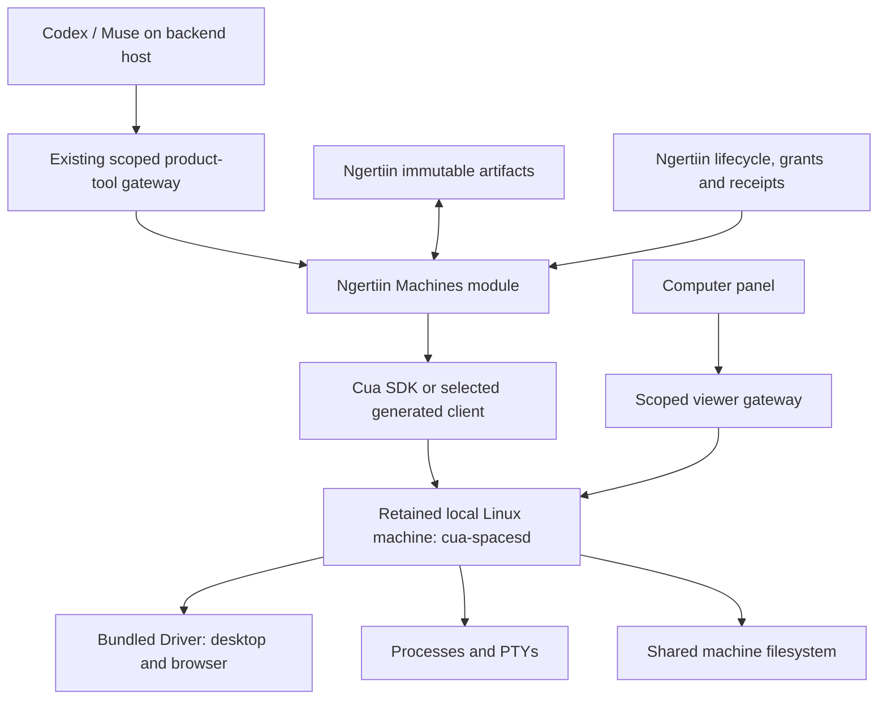

# Shared persistent machine with Cua

November 14 execution-domain amendment: NMA-076 implements [isolated organization/user execution domains](execution-domains.md) following the [server-organizations plan](server-organizations-plan-2026-11-12.md#8-agent-sharing-memory-and-files). Its [verification](../verification/nma-076/README.md) has a separate native boundary. The cooperative shared OS described below remains the retained single-owner baseline; folder prefixes alone do not isolate different users. Scoped native admission, remote clients and deployed transport retain their later gates.

Date: 2026-11-04. Status: approved plan implemented in the working tree. Backend/API delta and native Cua/Codex/Muse checks were completed before UI consumption. Current evidence, setup and limitations: [verification report](../verification/shared-machine/README.md).

Task cleanup amendment (2026-11-04): contract 1.30.0 adds tracked task-owned browser/GUI-terminal windows. Cleanup follows successful completion of the whole root task/handoff, uses graceful native close through the shared input gate, and preserves files, profiles, previews, existing windows and potentially human-edited resources. Details, native results and conservative unknown-outcome behavior: [cleanup verification](../verification/shared-machine/cleanup-2026-11-04.md).

Implementation amendment (2026-11-04): the pinned full ARM64 image actually bundles spacesd 0.8.0. Native Bun 1.3.10 + SDK 0.10.1 file/process/screenshot/registry checks pass. An immutable resource manifest does not support arbitrary new application windows and internet origins; standard mode also refuses retained-profile attachment without an embedding grant not exposed by this service. The initial dedicated shared OS therefore uses Cua's explicitly acknowledged unrestricted startup mode, with Ngertiin's scoped tool allowlist/input gateway and the cooperative trust model below. This replaces the planned static bounded-manifest configuration; there is no silent runtime escalation or alternate controller.

Repository baseline: `6067471bee124b446a593e0e2952e2aeaef304ef`; backend contract `1.28.0`; package manager `bun@1.3.10`. Concurrent unrelated work in the checkout is outside this plan. Upstream findings and exact source references are in [the refreshed research report](../research/agent-desktop-machine-options-2026-11-03.md#2026-11-04-cua-source-and-compatibility-addendum).

## Decision and scope

Use one retained local Linux desktop per Ngertiin installation/owner, shared by every machine-enabled agent. Use Cua SDK → `cua-spacesd` → its bundled Cua Driver. Reuse Cua's process, filesystem, browser, desktop and viewer protocols; keep Ngertiin's existing Codex/Muse harnesses and application lifecycle. Cua Spaces' management application and a Cua model/agent loop are unnecessary. This matches Cua's documented [own-harness integration](https://cua.ai/docs/cua-sdk/guides/own-harness).

The machine is provisioned once, attached on subsequent starts, and retained across runs, conversations and backend restarts. Ending a native harness session or agent run does not destroy it. Browser, shell, GUI applications, uploads/downloads and the working-file UI must operate on the same machine and filesystem.

Remote/VPS attachment, SSH enrollment, remote provisioning, multiple-machine selection, automatic suspend, cloning and snapshot products are future scope. Keep a stable endpoint/credential boundary so remote attachment can be added later without changing agent tools; do not build remote management or a universal provider framework now. Local setup for development is included; a distributed installer remains the later installation stage.

### Product semantics

- One machine belongs to the installation/owner, not to each existing `workspace` record. Current workspace records identify conversation context; creating a DM/group must not provision another computer.
- Working files on the machine are intentionally shared among machine-authorized agents. A directory or workspace ID is not an OS privacy boundary when agents have shell access as the same machine user.
- Agent identities, DM/group transcripts, private memory, native harness sessions, provider credentials and unpublished application metadata stay separate in Ngertiin. Published artifacts retain conversation-scoped metadata and immutable application-owned bytes.
- Putting an attachment or private document's working copy on the shared machine makes that copy accessible to other machine-authorized agents. The UI and instructions must state this plainly; private transcript storage must not imply private working files.
- Parallel terminal jobs are supported. Browser operations are parallel only where explicit target binding and focus independence are proven. Shared mouse/keyboard work and foreground-sensitive browser actions have one multi-step input owner, including human takeover.
- Existing group responder selection, turn ordering, responsibility ownership and lifecycle admission remain authoritative. Machine parallelism does not implicitly enable parallel group writers or bypass application queues.

The current local [scope](../../PRODUCT.md), [feature matrix](../product/feature-decisions.md) and [architecture](overview.md) adopt the approved shared-machine boundary. This supersedes earlier browser-only and private working-root planning. F06/F07 and F01/D05 retain their recorded user decision identities. Historical NMA-054/NMA-058 acceptance proves only its original implementation; the [shared-machine API/native report](../verification/shared-machine/README.md) proves the later delta. Reverify any new boundary change before UI consumption.

## Observed implementation and required changes

The table below records the pre-implementation audit at the baseline revision above. Its observed column is historical; current behavior and native results are in the verification report.

| Area | Observed implementation | Concrete consequence |
| --- | --- | --- |
| Browser host | [`browser/host.ts`](../../apps/server/src/browser/host.ts) starts profile-specific Docker containers, mounts `/profile`, and runs `browser_use.mcp.server`. [`infra/browser`](../../infra/browser/Dockerfile) contains Chromium/Xvfb/x11vnc. | Replace the browser-only host with the retained Cua machine. Do not add a desktop viewer while leaving execution in the old container. |
| Browser authority | [`browser/service.ts`](../../apps/server/src/browser/service.ts) persists grants, generation, observations and action receipts; a per-profile busy guard serializes actions. | Reuse its authorization/recovery patterns, but replace the per-profile machine model and focus assumptions with shared-machine, target and input ownership. |
| Working files | [`workspaces/service.ts`](../../apps/server/src/workspaces/service.ts) maps DM/group workspaces to backend-host paths. [`workspaces/files.ts`](../../apps/server/src/workspaces/files.ts) performs synchronous POSIX operations with device/inode checks. | Separate logical workspace scope from machine location. Use Cua filesystem operations for working bytes; local inode checks do not validate a machine-side path. |
| Uploads/artifacts | [`artifacts.ts`](../../apps/server/src/artifacts.ts) retains immutable bytes in backend `artifact-bytes`; materialization, verification and publication synchronously read/write the host workspace, including inside command transactions. | Retain immutable storage; move machine I/O outside SQLite transactions and make upload staging/publication explicitly asynchronous and recoverable. |
| Native work location | [`harness/broker.ts`](../../apps/server/src/harness/broker.ts) passes the host workspace root into both adapters. [retired `codex/rpc.ts`](../development/history.md#retired-codex-execution--2026-11-16) enables native shell/unified exec for work sessions; Codex's workspace policy grants host workspace writes. | Keep authentication/harness processes on the backend host, but route machine work through scoped tools. A Linux path cannot simply replace a macOS native `cwd`. |
| Product-tool bridge | [`harness/tools.ts`](../../apps/server/src/harness/tools.ts) already validates owner, connection, agent, thread, run, binding and grant revisions. Tool definitions are shared with [`product-tool-contracts.ts`](../../apps/server/src/harness/product-tool-contracts.ts); [`muse/tools.ts`](../../apps/server/src/harness/muse/tools.ts) checks a fixed catalog. | Extend this gateway and its shared catalog for Cua. Do not give agents the upstream root token or an unmediated machine MCP endpoint. |
| Runtime compatibility | Server uses Bun 1.3.10. SDK 0.10.1 loads a native Node runtime; no Bun pass was found. No Cua dependency is installed in this repo. | Prove native binding plus real RPC/stream compatibility first. Use upstream generated protobuf/gRPC-Web transport if needed, with one selected transport after the proof. |
| Computer UI | [`context-panel.tsx`](../../apps/web-client/src/features/conversation/components/context-panel.tsx) renders `BrowserSection` under Computer. `browser-section.tsx` selects a member browser. `browser-viewer.tsx` uses view-only noVNC/RFB. | Show one shared machine and its controller. Reuse Cua's viewer through its own protocol, replacing the per-member browser selector and RFB transport. |
| Library | [`files-panel.tsx`](../../apps/web-client/src/features/conversation/components/files-panel.tsx) lists conversation artifacts rather than a live machine filesystem. | Add a machine-backed Working files surface while retaining scoped attachment/output/download behavior. |

Graph-discovery tools were unavailable in the enabled tool inventory, so this audit used targeted `rg` and source reads. Decision records and upstream sources were checked during the original audit. No existing unit/native/UI check was rerun merely to label this planning audit as tested.

## Architecture

### Deployment and persistence

The initial deployment is one retained named local Docker machine using the official full Linux desktop image. Add `infra/machine/compose.yaml` for that single service, pinned image, persistent mounts and private control port. Local setup starts it once; the backend attaches to the configured spacesd endpoint with the Cua client and persists its binding. Backend restart must not replace a missing/unreachable machine automatically. Normal shutdown detaches clients only. Do not use `Sandbox.ephemeral` or its cleanup semantics.

Candidate SDK: `@trycua/cua@0.10.1`. Candidate spacesd release: `0.10.1`; standalone `@trycua/cua-driver` is unnecessary when the image already links Driver. The source catalog's full-image candidate is `ghcr.io/trycua/linux:24.04@sha256:9ac0d6f6f7dd95392554ec95163f83c5061de3db05b64977696c78d71cd4861c`. Its catalog declares AMD64/ARM64. These are trial pins, not evidence that the image contains the exact separately published service release. Read the pulled image manifest, build-info, bundled Driver contract and capabilities before freezing a supported tuple. Avoid the headless service artifact. Exact release/source differences are recorded in the research addendum.

Persist `/home/cua`, a designated spacesd data directory and shared `/home/cua/workspace`. Point normal terminal cwd, browser downloads and the file UI at that working root. Use collision-resistant `inputs/<artifact-id>/...`, `projects/...`, `downloads/...` and run-attributed temporary locations. Keep browser profile data under the persistent machine home.

Retain the container's writable layer across stop/start. Baseline system packages belong in the pinned image/custom image; an application installed into that layer survives container restart but not replacement. Home/data volumes alone do not preserve OS packages during image recreation. Updates must explicitly retain/backup user data, rebuild required system software and verify restore. Do not advertise process survival across machine reboot or automatic snapshot/restore. Measure machine resource usage on the intended host before choosing CPU/RAM defaults.

The control service is loopback/private to the local backend. Keep its credential out of tool results, logs and the shared working filesystem. Do not mount backend state, installation credentials, provider homes, the host home directory or Docker socket into the machine. Normal commands use the machine's `cua` account; broad machine lifecycle and privileged `run_as` are absent from the ordinary agent catalog.

The stock image grants `cua` passwordless sudo, so its shell is machine-admin capable. This initial shared device is a cooperative trust domain, including machine-local Driver policy and service credentials; the gateway is not an adversarial boundary against a shell user controlling that same OS. Private backend data remains outside the machine. Do not claim machine-local credential secrecy or enforced GUI ownership against arbitrary shell commands. If stronger isolation becomes a requirement, explicitly derive/harden the image and verify daemon/user privilege separation before advertising it. [Stock user setup](https://github.com/trycua/cua/blob/33db0d554751b5f8b816d9c7deb7449d84278346/libs/images/common/desktop/install-desktop-user.sh).

### Ngertiin-owned module and data

Add a cohesive `apps/server/src/machines/` module, with contracts/service, a Cua implementation, scoped tool registration and viewer integration. Keep its public interface at machine status, process/terminal operations, working files, Driver observations/actions and viewing. Hide transport details and avoid a provider factory with only one implementation.

Persist an owner-level machine record containing stable machine ID, retained container identity, machine generation, connection/health state, approved working root and observed capabilities/version tuple. Keep secrets in private configuration, not entity/event payloads. Separate durable operation/process records, target assignments and input-lease state; record agent/thread/run identity and the machine generation on each effect.

Current logical workspace IDs remain useful for run binding, artifact provenance and conversation authorization. Bind them to the same installation machine and shared working root. Replace host-only `project_path`/device/inode assumptions for this mode with explicit machine location. Do not silently bind an arbitrary host project directory into the desktop. If existing development files are carried forward, import them explicitly into named machine directories and verify hashes; do not delete unrelated host work or immutable artifact bytes.

Wire one Machines instance through startup, ProductTools, APIs, workspaces and artifacts. Backend shutdown detaches that instance and viewer streams; an explicit machine-wide administration action is required to stop/reset the retained machine.

### Tools and native harness placement

Continue using the existing per-run MCP/product-tool lease. Resolve machine and acting identity server-side, recheck current grants/cancellation/responsibility revisions immediately before effects, and persist receipts before dispatch. Keep raw RPC selection, machine credentials, `run_as`, deletion and machine-wide lifecycle operations outside the agent catalog.

Use Cua Process/Filesystem RPCs for shell, PTYs and working files. `cua-spacesd /mcp` exposes the linked Driver registry, not the separate daemon's full shell/file catalog. Reuse approved Driver schemas/results for GUI/browser operations through the gateway, with server-owned Driver session identity and machine/target scope. Maintain one filtered catalog source for MCP, Codex, Muse and contract export; remove Muse's assumption that only the old hardcoded names exist. Do not manually reproduce all Cua tools or expose every upstream tool automatically. Preserve bounded multimodal tool results without leaking raw output into user activity bubbles.

Keep Codex/Muse authentication, private session data and provider configuration on the backend host. Give native harness processes a separate local control/scratch cwd. Machine paths belong to machine tools and instructions, not to native host cwd or provider credential locations. Make attachment staging and machine-side project guidance available before dispatch.

For machine-enabled sessions, disable host native shell/unified exec and host work-file writes through verified harness capabilities/policies. Update Codex's policy and launch flags, including its file-edit path; preserve Muse's currently restricted native tool preset. A prompt alone is insufficient to establish the execution location. The compatibility proof must show both harnesses create/edit/read machine files through the product-tool path and cannot accidentally write the claimed output to a host workspace. If a harness capability cannot be enforced, mark that path unsupported until resolved rather than claiming a unified machine.

### Working files and artifact transactions

Convert relevant workspace/file methods and API/tool consumers to async machine access. Preserve size limits, traversal/symlink handling, stable-read/hash checks and exclusive-create semantics where the upstream protocol supports them. Prove machine-side path behavior; do not transplant host inode guarantees into a network API. Add a machine-side write/patch operation using upstream atomic writes and operation receipts so coding work is not limited to create-only files.

Uploads: persist and hash immutable input bytes on the backend → commit pending materialization → write/verify a working copy on the machine → reauthorize and commit ready. The harness must not dispatch an attachment-dependent task before selected inputs are ready. Reconnect resumes/reconciles the pending projection rather than duplicating it.

Publication: reserve a command/operation → read a stable bounded machine file outside the SQLite transaction → persist/fsync its immutable blob and hash → recheck current run/grants/workspace and goal generation → commit artifact metadata/events/receipt. Unknown dispatch and retries reuse the same operation ID. Retain attachment extraction/cache and published-byte downloads on the backend. A later machine edit/deletion cannot change an already published artifact.

For gateway-mediated edits, acquire a path claim and verify an expected content hash before a conflicting update. Use distinct output paths by default. This prevents coordinated-agent conflicts; it is not a transactional filesystem guarantee against arbitrary shell writers. Shared shell authority can alter files outside the file API. Keep that trust boundary explicit and use observable conflict/retry behavior rather than promising isolation the OS does not provide.

### Browser ownership and concurrency

Cua's native browser path is primary. Keep one installation-owned Chromium process/profile alive independently of per-run Driver sessions. Attach to its exact process/window with `existing_profile`, then require exact binding and retain target/tab assignments. Use the explicitly acknowledged Driver configuration in the implementation amendment above for existing-profile attachment. A per-run `isolated_named` launch retains profile files but ties browser process lifetime to that run, so it is unsuitable for the retained shared browser.

Keep per-run Cua identities, fresh observations and tab references; invalidate stale references on navigation/reconnect/generation change. Serialize mutations to the same target. Parallel reads and DOM actions on separate targets require real proof of focus independence and postconditions. Linux trusted input and dialogs can require foreground focus and must acquire the desktop lease; a background DOM event whose effect is unverifiable is not a successful action without a confirming observation.

Reuse the existing browser module's receipt, stale-observation, grant and unknown-outcome patterns. Do not keep browser-use as an automatic second controller. If the native Cua proof finds an essential missing browser capability, document a deliberate temporary alternative and its shared ownership rules before admitting that operation.

### Desktop lease, human control and cancellation

Persist one input owner per machine generation: none, a specific agent/run, or the human. Hold ownership across a multi-step interaction, not only one click. Include lease revision/heartbeat and validate it at the gateway. Independent processes and verified background targets can continue unless they conflict with the leased application's state.

Lease timeout is not sufficient proof that earlier native input stopped. Before handoff, quiesce/reconcile in-flight input and revoke prior interactive streams. If the effect or stop result is unknown, keep input fenced until observation/reconciliation; do not let an old client and a new owner both type. After backend restart, reconstruct durable ownership and close/reconcile stale media/input sessions before granting control.

Human takeover requests that same ownership, suspends conflicting agent input, issues an activation-enabled viewer ticket, and restores a view-only connection on handback. It does not cancel unrelated terminal work. A view-only ticket must be enforced upstream, not only with a React/noVNC flag.

Shell access makes this a shared cooperative trust domain: an agent could invoke display tools directly. Route display-affecting shell work through the same ownership protocol and document this limitation; do not claim a shell command-name filter creates adversarial GUI isolation. The normal agent catalog/instructions must use the coordinated Driver path for computer input.

For processes, persist upstream request ID, stable process tag and run ownership. Use native request deduplication and `GetExecRecord` for reconnect; keep application receipts because upstream retention/output tails are bounded. Reconnect by stable attribution rather than PID alone. A disconnected output stream is not proof that a process stopped. Cancellation signals and reconciles only that run's process/group and input session. Never use machine-wide `AdvanceEpoch`, token rotation, container stop or reset to cancel one agent. A spacesd restart can leave a command lost/unknown; never automatically replay an uncertain external action.

### Viewer and API

Reuse Cua's actual HTML5 viewer/media implementation. Serve it through an owner-authorized same-origin Ngertiin prefix with the required viewer assets, gRPC-Web routes, media WebSocket and bounded file transfers. An authenticated owner API issues the scoped viewer bootstrap; subsequent viewer requests use that scoped ticket/session rather than an ambient installation bearer. Do not inject the root credential into arbitrary browser-originated RPCs. Mint tickets with view-only default, a bounded files root and explicit clipboard/activation grants. Bind each interactive ticket/session to the current human takeover lease revision. Check that revision on every activation-capable RPC and media upgrade, not only when minting the ticket; reject reuse of an older activation bearer even before its upstream expiry.

The stock viewer sends `frame-ancestors 'none'`. Deliberately adapt that response to an appropriate same-origin embed policy, preserving other headers and recording the narrow upstream compatibility change. Verify prefix handling, WebSocket subprotocols, iframe focus and localhost/HTTPS codec behavior. Expiring an attach ticket does not revoke an existing interactive media session: close it via upstream `CloseMedia` and/or the tracked gateway connection before handing control back. These are initial compatibility gates, not UI polish left to the end.

Add a singleton machine API surface for status/capabilities, operation receipts, processes, scoped viewing and control acquisition/release. Keep workspace file/attachment/artifact routes but update their machine-backed location and async behavior. Register schemas/entities/events and export the actual new contract through `contracts.ts`, `api-contract.ts`, `api.ts` and service wiring. Bump the contract version based on the implemented delta and reverify the API gate; do not simply retain the old `ready` claim for an untested machine contract.

### UI

Preserve Details / Library / Computer navigation. Computer shows the same machine ID/status/display in every DM/group, the current controller, pending access and human takeover/handback. Remove per-member browser provisioning from this surface. The shared browser profile is visible as an application inside that desktop.

The initial delivery placed live Working files in Library. The [2026-11-07 interface amendment](../product/interface.md#working-files) moves this machine-root browser to a dedicated contextual file tree opened beside Close; shared-machine scope remains explicit. Retain conversation attachments, published outputs, immutable downloads and provenance as application-scoped records. Refresh lists on relevant operations and bounded polling/focus; do not require a new global file-watching system for this first delivery. Update prompts and copy so a machine file path and a published downloadable artifact have distinct meanings.

## Delivery sequence and acceptance

| Phase | Work and primary files | Exit evidence |
| --- | --- | --- |
| 0. Scope and native compatibility | Record the scope delta; pin candidate dependencies/image; add a disposable native verification script. Prove Bun transport, ARM/full desktop, browser profile attachment, viewer embed/revocation and both harnesses' scoped tool/cwd policies. | Exact runtime/image/service/Driver tuple, commands and actual pass/fail/unknown results. Select SDK native binding or upstream generated client. A failed gate is fixed before broad integration. |
| 1. Retained machine backend | Add `infra/machine/compose.yaml`, `machines/` and local machine configuration; update `config.ts`, `main.ts`, `api/services.ts`, schemas and startup/shutdown wiring. Create once, persist binding, reconnect and detach. | Two agents resolve the same machine ID; backend restart retains the machine/data; no per-thread/per-run provisioning or shutdown. |
| 2. Machine work and files | Update `workspaces/{contracts,service,tools}.ts`, file access, `artifacts.ts`, `api/workspaces.ts`, `harness/{broker,instructions,context}.ts`, Codex policies and the shared tool catalog/Muse bridge. Add processes/PTYs and async upload/publication reconciliation. | Both Codex and Muse use real scoped product tools to run a command, create/edit/read a machine file, consume an uploaded document and publish an immutable downloadable result. The terminal, GUI and file API see identical bytes. |
| 3. Browser, desktop and recovery | Add Cua target binding, durable ownership/receipts, foreground escalation, scoped viewer proxy and active-session revocation; wire cancellation/recovery. | Independent terminal jobs overlap; proven background targets coexist; GUI ownership and human handoff are coherent; stopping one run leaves the machine and another run's work alive; unknown actions are not blindly repeated. |
| 4. API gate | Update actual contract export, focused domain/HTTP tests and native verification; reverify cancellation, restart, grants, attachments and historical artifact reads. | New API delta accepted with traceable evidence and limitations before consuming it in the product UI. Historical NMA-060 evidence remains historical. |
| 5. Product UI | Update `context-panel.tsx`, replace `browser-section.tsx`/`browser-viewer.tsx`, extend `files-panel.tsx`, client types and API helpers. | One coherent machine across DM/group; actual Cua desktop display, correct takeover state, live shared working files and stable scoped artifact downloads. Verify browser behavior against the real service. |
| 6. Cutover and documentation | Retire old `DockerBrowserHost`, browser-use runtime/image, RFB proxy and noVNC dependency where unused; update architecture/setup/provenance docs and capability/version claims. | One active machine-control path; no hidden old-host file/shell or browser fallback. Preserve unrelated working data, immutable blobs and historical evidence; rollback uses a known Git version plus verified backup. |

Each phase is reviewable on its own, but the requested shared-machine experience is complete only after the backend, API, UI and cutover acceptance pass. Do not mark the whole effort Done after a desktop screenshot or SDK smoke test.

### Required verification scenarios

1. **Same machine:** two agents in separate DMs receive one machine ID. Agent A creates a file in shell; B reads it through a file tool; it appears in the GUI file manager, browser upload/download flow and Working files. Check hashes and paths, not only labels.
2. **Real harnesses:** perform a useful command/file/GUI round trip through Codex and Muse independently. Prove the claimed file is machine-side and the provider credential directories remain outside the machine. Verify actual native shell/edit policy, not only configured flags.
3. **Parallelism:** record overlapping process start/end intervals and separate browser targets. Exercise a trusted foreground/browser dialog action while another agent requests input; preserve existing group turn ordering. Report which browser operations were actually parallel.
4. **Ownership:** hold a multi-step agent GUI lease, contend from another agent, take over as human, then hand back. Verify closure/rejection of the old input socket and attempt to reopen media with its still-unexpired activation bearer; reject both. Test in-flight timeout and backend restart before granting a new owner.
5. **Files/artifacts:** upload and parse an attachment, recover interrupted materialization, detect a conflicting edit, publish output, edit/delete the working copy and verify the original artifact download is unchanged. Revoke run/grant during transfer and verify commit authorization.
6. **Recovery/cancellation:** disconnect a process stream, reconnect by attributed tag, cancel one run while another command continues, and interrupt dispatch before acknowledgement. Reconcile known/lost records without repeating an uncertain action or using a machine-wide epoch.
7. **Persistence:** retain machine ID, user files, app settings and browser profile/login through backend restart and machine stop/start. Test image recreation separately; distinguish a retained writable layer, persistent data and image-built software. Do not claim live processes survive reboot.
8. **Boundary failures:** test stale machine generation/tab refs, unavailable desktop capability, traversal/symlink handling, input grant revocation and viewer expiry versus active-session closure. Confirm normal tools cannot choose arbitrary upstream machines or receive root credentials.

Use existing `apps/server/tests/browser/domain.test.ts`, `workspaces.test.ts`, attachment/group tests and contract tests as regression anchors, adding meaningful machine/async/recovery tests. Native scripts belong beside existing `scripts/verification/nma054`, `nma058`, `nma060` and attachment verification, in a clearly named new machine verification directory. Record tested versions, setup, denominator, pass/fail/skip and unknown outcomes; fixtures do not prove native acceptance.

Relevant existing commands for implementation verification: `bun run --filter @ngertiin/server typecheck`, `bun run --filter @ngertiin/server lint`, focused `bun test` suites, then `bun run test:server`; after the API gate, `bun run typecheck:web-client`, `bun run lint:web-client`, `bun run build:web-client` and the relevant work/conversation Playwright configuration. This planning session did not execute those checks or create a machine.

## Remaining bounded decisions

The product direction is settled. Phase 0 resolves the transport compatible with Bun, the exact full desktop image/version tuple, retained-profile capability manifest, and viewer embed/revocation behavior. These are compatibility proofs inside the Cua direction, not an invitation to reopen the entire service comparison.

Cua SDK/Driver and spacesd/viewer have different licenses, documented in the research report. The accepted FSL technical direction does not establish commercial clearance; licensing remains a separate product/distribution matter and adds no new permission step to this local development plan.
