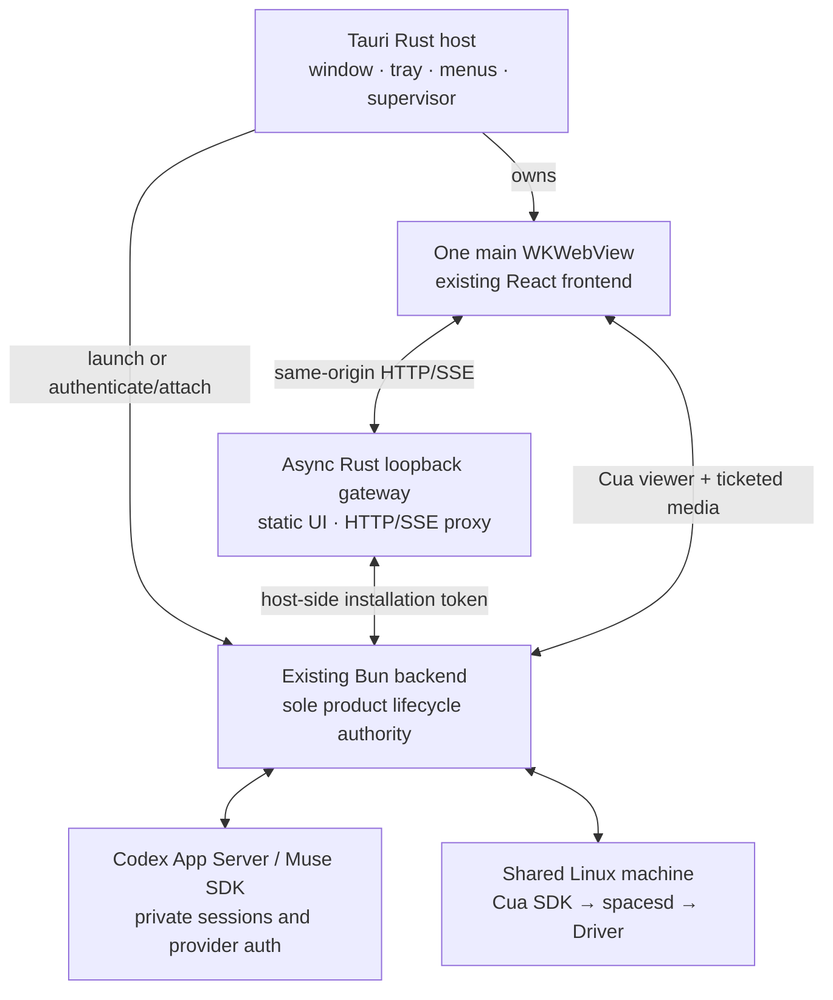

# Tauri desktop design and performance plan

Date: 2026-11-04. Status: proposed design, requested by the user after using the Electron development app. No Tauri runtime, installation, benchmark, or feature acceptance is claimed. This document proposes a macOS ARM64 development trial; it does not close distribution or other-platform work.

Implementation update (2026-11-05): the user subsequently authorized implementation. See [the implemented development host](tauri-development.md) and [current verification](../verification/tauri-development/README.md). The original proposal and its benchmark gates below remain a design record, not claims that every gate has passed.

## Recommendation

Use **Tauri v2 as a small native host, retain the existing React web client, and retain the existing Bun backend as the sole product lifecycle authority**. Port the Electron host's gateway and process supervision to asynchronous Rust. Optimize the measured frontend bottlenecks alongside the shell trial.

Tauri uses the OS WebView rather than bundling Electron's Chromium/Node runtime. On macOS that means WKWebView, so this is also a browser-engine compatibility change. It can reduce shell overhead; it cannot by itself remove React work, avatar painting, file buffering, harness processes, or the shared Linux machine's resource cost. Numerical savings require a matched native comparison. [Tauri process model](https://v2.tauri.app/concept/process-model/), [WebView engines](https://v2.tauri.app/reference/webview-versions/).

Keep the current visual identity, Hugeicons, conversation layout, Detail/Library/Computer semantics, URL-backed Settings, and avatar behavior. Smoothness should come from doing less work per interaction and from predictable animation scheduling.

## Decision sources and current evidence

Read live Notion product scope, architecture, feature matrix, roadmap, acceptance, NMA-060 and NMA-064 during this investigation. NMA-060 currently has **Done** status for its recorded engine/API scope; NMA-064 remains **Backlog**, depending on NMA-063. The November 4 shared-machine amendment supersedes older browser-use/VNC paragraphs. Older index text still lists native clients as deferred; the user's present request authorizes this scoped desktop design, without promoting mobile, remote hosting, or full distribution.

- [Product scope](https://app.notion.com/p/402abdd61873816e871ae24804345b56), [active architecture](https://app.notion.com/p/402abdd6187381beacd6c48fa521b99f), [feature decisions](https://app.notion.com/p/409abdd61873813284bbf75698073d8e).
- [Roadmap](https://app.notion.com/p/402abdd6187381ceaa4fe40ebf41001c), [acceptance](https://app.notion.com/p/402abdd61873812a97a9f41032dd854f), [NMA-060](https://app.notion.com/p/409abdd61873819b80c4dd2b3e593834), [NMA-064](https://app.notion.com/p/409abdd618738198a715db475e9e6f81).
- Electron baseline: `1226b91f697bbb063d993e4a1043e00fca597fde`; latest frontend optimization: `807bfa08b984cdbaa3feb9387b661f1e02b2e873`.
- Current package manifests pin Electron 45.2.2 and Bun 1.3.10. The native host serves the existing React/Vite UI through a saved loopback origin and launches or attaches the Bun backend. See [Electron design](electron-development.md).
- Existing [performance evidence](../verification/electron-development/ui-performance-2026-11-04.md) reports zero historical Markdown rerenders on repeated Detail/composer interactions after optimization, and a median p95 Detail-open frame interval of 17.5 ms across three opens. Some approximately 33 ms frames and a 94 ms first-open task in a content-heavy group remain. This small cohort is not a general smoothness guarantee.
- Computer now uses a Cua iframe and media protocol, with one retained Linux machine. The old noVNC UI was removed. See [machine evidence](../verification/shared-machine/README.md).

The project knowledge-graph tools were unavailable, so discovery used local source search. This was a source/evidence audit, not a fresh functional walkthrough.

### Memory attribution before setting expectations

The user observed approximately 1–2 GB. That observation has no standardized workload/process breakdown yet. A read-only, uncontrolled `ps -axo pid=,ppid=,rss=,pcpu=,comm=` sample during this investigation found:

| Process category | Single-sample RSS |
| --- | ---: |
| Installed Electron main process | 63.7 MiB |
| Two Electron helper processes | 87.0 MiB |
| Electron renderer | 142.9 MiB |
| Bundled Bun backend | 93.8 MiB |
| Arithmetic sum of these five processes | 387.4 MiB |

This is **not** Activity Monitor's memory footprint, a peak measurement, an idle benchmark, or the entire installation. RSS sums can count shared pages; Docker VM/container memory, active Codex/Muse processes and other applications are outside that sum. It does not invalidate the user's observation. The inspected host reports MacBookAir10,1, 8 GiB RAM, macOS 26.3.

Record three resource totals independently in the trial: (1) native host plus attributable WebView content/GPU/network processes, (2) those processes plus Bun, and (3) the complete workload including harnesses and Docker/shared machine. Never compare Electron's total against only Tauri's Rust process.

## Runtime design

One main WebView does not imply one OS process; WebKit can use separate content/network/GPU processes. Detail, Library and Settings remain in-place React surfaces. Opening a tab/panel must not create another WebView, backend, event consumer, or harness.

| Layer | Owns | Boundary |
| --- | --- | --- |
| Rust native host | Window/tray/menu state, single instance, executable paths, backend discovery/ownership, gateway, downloads/external opening, visibility and shutdown | No agent scheduler, domain DB writes, model loop or provider-login implementation |
| React frontend | Conversation rendering, composition, visible projections, focus/accessibility, lightweight animation | Reads authoritative HTTP/events; does not infer successful effects from animation or prose |
| Bun backend | Identity, admission, queue, persistence, goals/Routine, scoped tools, cancellation/recovery, artifacts, machine input leases | Preserve current contract and harness adapters |
| Codex/Muse | Their existing inner model/tool loops and supported authentication | Preserve private native session and billing boundaries |
| Cua machine | Shared working files, browser, terminal and GUI | Closing the Ngertiin window or viewer does not stop/delete the machine |

### Keep one stable HTTP origin for the first trial

Port [gateway.ts](../../apps/desktop/src/gateway.ts) behavior into the Rust host, using one asynchronous runtime and a streaming HTTP client. Serve built UI assets and proxy `/v1` and `/health` at `http://127.0.0.1:<saved-ui-port>`. Backend discovery still resolves its separate private port. Retain the profile's stable UI port and fail visibly if another unowned listener occupies it.

This deliberately retains Ngertiin's controlled local HTTP architecture. Tauri's localhost plugin warns that HTTP asset serving adds risk; do not add that plugin as a second listener. Bind loopback only, enforce exact Host/Origin and route checks, strip untrusted forwarded/authorization headers, and inject installation authentication host-side. Keep secrets out of Vite variables, JavaScript, URLs and generic IPC. Missing fetch-metadata headers in WKWebView must not lead to weakening the exact-origin rules. [Localhost tradeoff](https://v2.tauri.app/plugin/localhost/).

Proxy request/response bodies with backpressure, cancellation and bounded queues; preserve SSE heartbeats/chunk boundaries, status/headers, downloads and range behavior. Do not buffer an entire answer, upload, or download in Rust. Avoid per-token JSON encoding through `invoke` or Tauri events.

Keep Cua's current generated-protocol rewriting in Bun. Audit its HTTP/gRPC and distinct ticketed media WebSocket route explicitly; the Electron gateway's production upgrade handler is not the Cua media implementation. Preserve native media teardown, origin checks, ticket expiry and revision fencing from [machines/view.ts](../../apps/server/src/machines/view.ts). The diagram's media connection includes this existing backend media listener.

Use a gateway-served CSP covering actual UI assets, IPC if enabled, Computer frame and local media destinations. Release assets contain no Vite HMR listener or DevTools instrumentation. A custom Tauri asset origin remains an alternative only if a focused spike proves a material benefit and closes CORS, storage, streaming and viewer compatibility. See [primary-source feasibility](../research/tauri-v2-desktop-feasibility-2026-11-04.md).

### Small native bridge

Reuse the frontend's narrow desktop seam: visibility subscription and Computer-view revision reporting. Introduce a small platform module with a browser implementation and a Tauri implementation; React product components should not directly import shell/filesystem plugins.

Keep native external opening, downloads, logs, data-folder opening and menus in Rust callbacks. Register only required custom commands, return typed results, validate payload size/types and check backend ownership. Use Tauri events for small visibility/readiness notifications; keep domain data on existing HTTP/SSE. Channels are reserved for a demonstrated native streaming need. Async I/O stays off the native UI thread; CPU-heavy native work uses a bounded blocking pool. Shared state uses short locks, never held across network awaits. [IPC](https://v2.tauri.app/develop/calling-frontend/).

Do not copy the skill's general deny-all claim: registered application commands need explicit command ACL configuration as well as capabilities. Restrict HTTP-origin native access to the actual controlled loopback URL and main WebView. Generate/check DTO naming explicitly; nested Rust structs require Serde casing rules. [Capabilities](https://v2.tauri.app/security/capabilities/), [command arguments](https://v2.tauri.app/develop/calling-rust/).

The same-origin Cua iframe is not isolated merely by a main-window capability, nor does the public WebView URL prove that the top frame invoked a command. Limit revision reporting to presentation bookkeeping, validate it against an issued interactive ticket and the backend's current exact revision, and never allow it to acquire or extend a lease. It must not expose arbitrary native operations. Host-side handback remains authoritative when renderer JavaScript fails. Stronger native privileges would first require a separately isolated viewer/preview origin or WebView and native denial tests; it is not safe to infer isolation from labels. See [the source-level caller analysis](../research/tauri-v2-desktop-feasibility-2026-11-04.md#capability-and-ipc-corrections-to-skill-examples).

### Backend and background lifecycle

Port the behavioral contract of [Supervisor](../../apps/desktop/src/supervisor.ts), rather than only its spawn call. Retain private runtime discovery, compatible authenticated readiness, owner/instance/manager identity checks, the existing authority lock, bounded restarts, redacted rotating logs and managed-versus-external ownership. Rust supervises the process; Bun still decides recovery of domain operations. Never resubmit prompts to recover a process.

| Trigger | Required behavior |
| --- | --- |
| Open / second launch | Attach or start one compatible backend; focus the existing native app; do not create a second authority |
| Close/hide/minimize | Keep tray and backend alive; stop visual work and close/revoke this desktop's viewer; hand back only its exact active human-control revision |
| Show / wake | Reconnect, read authoritative snapshots and resume visible work; opening an existing chat submits no new prompt |
| WebView suspension/crash | Backend work continues; pending commands survive in supported storage; recreate/resnapshot without blind replay |
| Backend crash | Bounded restart of owned service; preserve receipt/unknown-outcome recovery; do not replace a live unresponsive authority |
| Explicit Quit | Async handback and controlled shutdown of owned backend resources; external backend stays alive; Goal/Routine definitions and retained machine persist |
| Force kill / sleep / OS shutdown | Mark uncertain work honestly; process interruption is not a native cancellation receipt; sleeping hardware cannot execute local work |

Preserve the current 3-restarts-per-minute ceiling and 20-second owned shutdown deadline initially, then measure startup/recovery behavior before tuning. Drain/control requests must not freeze the window. Power/sleep hooks need a verified macOS integration; a generic window-close handler alone is insufficient.

Keep the WebView cached initially; explicitly pause visual activity while hidden. Do not disable global WebKit throttling to keep agent work alive. WKWebView may suspend/unload hidden content, so correctness must not rely on a permanently live JS context. Deliberately destroying the window to save memory is a later measured option only after draft/pending-operation restoration passes. [Background behavior](https://docs.rs/tauri/2.12.5/tauri/webview/struct.WebviewWindowBuilder.html#method.background_throttling).

## Frontend work that makes motion smooth

The latest optimization already supplies shared avatar scheduling, async texture generation, modal-background pausing, Markdown memoization and instant history positioning. Preserve these. Profile first-open group work and visible idle GPU activity before choosing further changes.

| Source-observed area | Proposed change and purpose | Proof |
| --- | --- | --- |
| [Workspace layout](../../apps/web-client/src/app/workspace-layout.tsx) maps all loaded timeline entries; older pages accumulate | Separate composer, timeline, navigation and contextual-panel subscriptions. Keep stable row/reference inputs. Preserve pagination; try chunked mounting/content visibility before complex row virtualization | Composer typing and Detail toggles render zero unchanged historical Markdown; long-history cold opening avoids the recorded long task |
| [WorkspaceSync](../../apps/web-client/src/hooks/workspace-sync.ts) already batches projections at 40 ms; [useWorkspace](../../apps/web-client/src/hooks/use-workspace.ts) caches five snapshots | Retain one event consumer and authoritative reconciliation. Publish only changed slices; bound both cached bytes and entry counts. Batch visual updates without dropping ordered domain/control events | Event replay/dedup, stale scopes and restart behavior remain correct during bursty streaming |
| [Avatar clock](../../apps/web-client/src/features/avatar/engine/clock.ts) still schedules display frames whenever a drawable entry exists | Add explicit native visibility to scheduling. Explore sleeping between idle blink/gaze/reaction deadlines; keep smooth display-rate updates during actual motion and activity | Hidden avatars produce no frame/SVG writes; foreground loading, expression and eye motion stay responsive |
| [Textures](../../apps/web-client/src/features/avatar/engine/texture.ts) already serialize rasterization and retain at most 16 entries | Preserve shared recipe textures and bitmap cleanup; add a decoded-pixel/byte budget if measured memory warrants it. Keep static fur separate from animated eyes/face | No repeated same-recipe rasterization on panel toggles; no retained bitmap growth during a roster soak |
| [File viewer](../../apps/web-client/src/features/conversation/components/file-viewer.tsx) limits text parsing to 128 KB after `response.blob()` reads the full response | Read only a bounded text preview stream and cancel the remainder, or use an API-supported bounded/range response. Avoid huge image decode surfaces with a measured preview policy. Original downloads remain complete | Large files do not cause full-file preview memory spikes; preview limitation is visible; downloaded bytes still match |
| [Submission](../../apps/web-client/src/features/conversation/lib/message-submission.ts) persists files then uploads base64 JSON sequentially | Keep sequential bounded uploads for the first parity trial; measure serialization peaks. Consider binary streaming only as a separately versioned backend/API improvement | Upload/retry receipts and exact file bytes stay correct; no native IPC base64 copy is added |
| Settings/studio and language grammars already load lazily; ContextPanel/FileViewer are eager | Analyze the built graph and split only heavyweight cold surfaces. Prewarm a likely chunk during idle when useful; show a small immediate skeleton | Reduced startup parsing without a new first-click freeze or missing keyboard/focus behavior |

These source observations identify candidates, not measured root causes for every instance of lag. In particular, a full-file blob is a possible memory spike under a large-file workload, not proof that it caused the user's current reading.

Do not introduce a new global state framework, rewrite the avatar engine, or move every computation to a Worker by default. For a measured expensive parser/highlighter, use a cancellable Worker with generation checks and bounded caches. Keep small tasks local. React memoization needs stable inputs and correct semantics. [React guidance](https://react.dev/reference/react/memo).

If long-history DOM remains above budget, evaluate the existing TanStack virtualizer dependency. Dynamic message height, streaming tail, prepend anchoring, cross-message selection/copy, in-page find, keyboard navigation and accessibility are acceptance requirements. Do not ship virtualization that makes existing content interactions fail. Table virtualization already exists and should be reused for its current purpose.

### Motion contract

Retain existing motion tokens initially: 120 ms fast feedback, 240 ms entry, 180 ms exit, 200 ms popover, 260 ms sheet, and `cubic-bezier(0.22, 1, 0.36, 1)`. Shorten a transition only when native comparison shows it feels delayed. Duration and frame stability are separate properties.

- Animate transforms and opacity for panel/dialog/popover entry. The existing Detail entrance already follows this pattern. Commit the final panel geometry once, then animate the surface; avoid reflowing the entire transcript on every animation frame. Do not scale transcript text to simulate panel resizing.
- Keep the window/background opaque initially. Retain the current appearance; native vibrancy, large animated blurs, and full-window filters require measured justification. Existing modal blur may need a visually matched static scrim if WebKit paint cost exceeds budget.
- Keep pointer tracking/SVG writes outside React state, group geometry reads before writes, and use one display-synchronized clock. Stop invisible/offscreen/occluded work and release animation observers/listeners on unmount. Idle blinking may sleep between gestures; active motion should not be visibly stepped down.
- Preserve the current streaming hook's bounded interpolation and immediate final/history/reduced-motion flush. Measure the combined 40 ms projection batch plus up-to-100 ms text interpolation; target at most 100 ms total client-added display delay rather than stacking buffers. Do not animate each arriving character as a new component or accumulate a typewriter backlog.
- Open history at its end immediately. Auto-follow new content only while the user follows the bottom; reading older content must preserve position. Composer resize and history prepend keep their current anchors.
- Respect `prefers-reduced-motion`: immediate geometry/final text, no persistent decorative motion, and understandable non-motion loading states. Do not solve performance by disabling all animation for every user.
- Add `will-change` only for a demonstrated compositor issue and remove it afterward. Earlier blanket layer-promotion probes did not improve consistently. GPU layers trade memory for paint work. [Browser rendering guidance](https://web.dev/articles/animations-guide).

## Storage and transition safety

The Rust host reuses installation/state/config/harness paths through Tauri path resolution and the existing profile contract. It must not bundle `.env`, credentials or user databases. WKWebView receives its own native data directory; **the same URL does not transfer Chromium storage into WebKit**.

Current browser state has distinct durability:

| Existing storage | State | Design implication |
| --- | --- | --- |
| Backend SQLite/files and harness-private directories | Conversations, receipts, goals/Routine, artifacts, account/session bindings | Remain under the same backend ownership; no Rust domain migration |
| `localStorage` | Selected thread, theme/UI settings, durable command bodies and original keys | New WebView cannot silently regenerate an unresolved operation's key |
| `sessionStorage` | Plain composer drafts | Not a reliable cross-window/process lifetime store; persist drafts independently before deliberate WebView disposal |
| IndexedDB `ngertiin-message-submissions` | Pending message envelope plus actual `File` bytes and IDs | An unsent attachment chip cannot be restored without its bytes; preserve exact operation identity and reconcile before retry |

Use an isolated Tauri trial profile and disposable/known fixture installation first, keeping the current Electron build and user's installation available. Before switching the user's actual profile, inspect unresolved commands/submissions and handle them explicitly: reconcile committed receipts, retain original IDs for pending work, and either complete/recover in the old client or hand off a small versioned private envelope including required bytes and hashes. Validate owner/scope and import once; never automatically resubmit unknown work. A pending-state handoff is a narrow transition tool, not a general legacy-development migration system.

Persist plain drafts on change through a small client storage abstraction if window recreation is introduced. Native durable spooling is needed only for state whose lifetime cannot be proven with supported WebView storage; it must not become another domain store. Preserve unsupported-storage/error behavior visibly. Avoid a second raw copy of all credentials, transcripts, or browser profiles.

Electron and Tauri must not simultaneously manage the same profile/UI port. Preserve a cross-host profile lock plus the backend authority lock; different framework single-instance plugins alone cannot enforce that shared ownership. Switching back never deletes or restores an old backend database over newer user work.

## Feature preservation gate

Every row is a required test area for the proposed shell where the underlying feature already exists. This table is a plan, not completed Tauri acceptance. Optional/new features remain optional.

| Area | Required native proof |
| --- | --- |
| DM/group identity and history | Reopen existing chat with zero inference; author/avatar/reference fidelity; create agent/group produces one durable opener even after lost acknowledgement |
| Streaming, queue, steer, stop and human input | Correct live projections, exact-run cancellation semantics, pending input recovery and group routing; no duplicated command after reload |
| Goals, Routine, memory, skills and contextual panels | Real backend round trips; scope/revision checks; hidden-window continuation; native versus app-owned skills remain separate |
| Codex and Muse | Account/model/capability detection, supported system-browser/device/loopback login paths, completed inference and useful tool round trip; subscription/API-key billing remains explicit |
| Composio | Existing external authorization opens in system browser; callback/cancel/retry/relaunch work without a new embedded login flow |
| Attachments and artifacts | Picker, OS file drop, image/text paste, upload retry, restart with pending submission, inline references, preview, table interactions and complete download hash |
| Cua Computer | Actual iframe/media decode, read-only enforcement, pointer/keyboard/IME, resize/DPI, clipboard, takeover/handback, renewal/expiry, native hide/minimize, wake, media reconnect and backend restart |
| Working files and coding | Same retained machine and shared root; native terminal/browser and process cancellation; immutable published artifacts remain unchanged |
| Desktop integration | App/menu-bar icons, menu editing shortcuts, Dock/tray reopen, window restoration, single instance, fullscreen/zoom, external links, download destination and Finder launch without terminal PATH |
| Accessibility and motion | Focus/Escape return, keyboard navigation, selection/copy, readable contrast/text, reduced motion and VoiceOver spot checks on dynamic surfaces |
| Faults and lifecycle | WebView crash, backend crash, full host kill, live unresponsive backend, stale human revision, port conflict, lost acknowledgement and external-backend Quit behavior |

Keep provider OAuth in the supported external flow. Do not invent a Tauri deep-link redirect if the provider only supports its existing loopback/device flow. Clipboard and download gaps should get narrowly scoped adapters after native reproduction, rather than broad filesystem/shell permissions. See [feature/platform evidence](../research/tauri-v2-desktop-feasibility-2026-11-04.md#feature-preservation-and-release-boundaries).

## Provisional performance budgets and measurement

The following are **engineering targets to validate**, not measured results or Tauri guarantees. Use the inspected 8 GiB macOS host as the first reference machine, with release-mode assets, Inspector closed, a fixed viewport and known display refresh rate. Record battery/power/thermal conditions and other foreground load. Calibrate instrumentation before making an adoption decision; failure stays visible rather than silently weakening a target.

| Measure | Proposed acceptance target |
| --- | --- |
| Warm interaction frame pacing at 60 Hz | p95 interval ≤20 ms; p99 ≤34 ms; no app-attributed interaction stall >50 ms in the tested cohort |
| Higher-refresh display | Record refresh interval; target display-rate motion with p95 ≤1.25× and p99 ≤2× the measured interval; prove separately |
| Foreground UI main-thread work | Typically ≤8 ms per 60 Hz frame, leaving time for layout/compositing; investigate any ≥50 ms task |
| Local typing/selection feedback | Input-to-visible response p95 ≤50 ms, including while streaming or Computer is visible |
| Warm Detail/Settings/chat navigation | First visible response ≤100 ms; warm content usable p95 ≤200 ms; report cold-load/network time separately |
| Streaming presentation | ≤100 ms client-added delay after usable authoritative data; final/stop/history flush immediately |
| Cold local launch | First useful shell ≤1 s; usable conversation p95 ≤3 s for a ready local installation; backend/machine/provider readiness timed separately |
| Idle native host + WebView processes | Provisional ≤250 MiB attributable memory footprint, with no open Computer view or active inference |
| Same idle workload plus Bun | Provisional ≤400 MiB; also target ≥25% reduction versus matched Electron using the same accounting method |
| Idle CPU | Settled closed-window app plus Bun average ≤1% of one core; visible idle average ≤3% with normal avatar behavior, over 60 s; harness/VM separate |
| Repeated-use memory | After warm-up, no continuing retained growth across equivalent cycles; end-of-soak footprint ≤10% above the warmed baseline after 60 s quiescence |

Absolute memory budgets may prove too ambitious for a particular OS/WebKit build. Record that result and the actual tradeoff before deciding; do not advertise the targets as achieved. The complete installation including Docker and active harnesses has a separate measured total, not a promised sub-400-MiB cap. Existing HTTP/base64 uploads can produce transient peaks that must be reported separately.

Run the comparison in two steps to identify causes: **same frontend/backend assets, Electron versus Tauri**, then **Tauri with a specific frontend optimization versus that Tauri baseline**. Do not credit both changes to the shell.

Suggested cohort:

1. At least five cold launches and twenty warm reopen cycles, distinguishing backend-already-running from owned cold startup. Record medians, p95 and worst observed latency with sample counts; small-sample p95 is descriptive only.
2. Normal and stress fixtures: an existing content-heavy group, paginated 1,000-message history, a large roster, Markdown/tables/code, and two agents producing events. Record exact loaded/visible counts, fixture revision and text/file sizes.
3. At least twenty repetitions each of Detail open/close, Settings open/Escape, DM/group navigation and composer type/delete, both idle and during deterministic streaming.
4. Real Cua view open/close, takeover/handback and a controlled visible-screen workload. Record decode/render/input latency, CPU/GPU use and media closure. Separate remote screen cadence from React animation frame cadence.
5. Large-file preview/upload/download within existing configured limits; retain peak memory, cancellation and byte-hash evidence. Do not hide peak costs behind an idle number.
6. A 30-minute cycle/idle soak and separate hide/show/wake/crash/restart checks; then a limited real Codex/Muse feature cohort using their existing explicitly selected billing methods.

Measure app and child resource attribution using the same macOS footprint tooling for both frameworks; keep RSS as a separate diagnostic, not a conversion to footprint. Use Instruments/WebKit Inspector for stalls/paint/allocations and lightweight frame/input marks in a verification build. `requestAnimationFrame` interval sampling alone does not establish presented FPS, GPU latency or subjective smoothness. Check trackpad scrolling and transitions visually in the native app as well.

Retain existing frontend/domain tests for logic. For native automation evaluate the current Tauri-documented macOS embedded WebDriver route; standalone `tauri-driver` remains Windows/Linux. Keep test-only automation plugins out of the shipped app. Browser Playwright/WebKit results are supporting evidence, not packaged WKWebView proof. [Native testing](https://v2.tauri.app/develop/tests/webdriver/).

## Implementation sequence after this design

| Stage | Concrete result | Exit condition |
| --- | --- | --- |
| 1. Matched baseline | Resource attribution and repeatable native interaction/stream/Computer cohort on current Electron | Workload, versions, process denominator and remaining stalls recorded |
| 2. Compatibility spike | Isolated Tauri host, one WebView, stable Rust gateway, attach existing fixture backend, minimal visibility/revision bridge | Cua decode/input/clipboard/download, SSE restart and native input pass; basic release performance measured |
| 3. Lifecycle and packaging | Port supervisor/profile/logging, ownership/locks, tray/menu/power behavior; bundle Bun and backend resources | Managed/external/crash/hide/Quit behavior matches the current contract; Finder launch works |
| 4. Targeted frontend optimization | Fix measured long-task/idle-paint/large-preview issues individually | Before/after evidence passes motion, latency, memory and functional checks |
| 5. User-profile transition | Resolve pending commands/files, retain installation/provider state and verify storage lifetime | No lost/duplicate submission, draft loss, billing change or lifecycle ambiguity |
| 6. Default-shell decision | Complete native feature matrix plus matched performance/soak results | Choose Tauri only with reviewable advantages and no unresolved required-feature regressions |
| 7. Distribution, later | Agreed OS packages, signing/notarization/updater and fresh-device setup | Product/distribution gates explicitly satisfied; no inference from a local development build |

Suggested source ownership: `apps/desktop/src-tauri/src/main.rs` stays thin; `lib.rs` composes host modules for profile, supervision, gateway, window/menu/tray, Computer handback and redacted logs. Keep capability/permission files explicit and resources outside the executable where Bun/native dependencies require them. During the trial the existing Electron host remains a reproducible baseline; after a successful switch, remove its active dependencies/commands rather than maintaining two default desktop implementations. No parallel product engine is introduced.

Bundle target-specific Bun with Tauri's external-binary mechanism and retain server source/production dependencies, generated Cua resources, native Sharp libraries and PDF subprocess layout. A single compiled Bun executable is an optional separate experiment, not a requirement. Use Tauri path APIs for resource/data roots and explicit resolved harness/Docker paths; Finder PATH must not be assumed. Pin the tested Rust/npm/plugin set and both lockfiles. See [packaging research](../research/tauri-v2-desktop-feasibility-2026-11-04.md#native-lifecycle-and-packaged-backend).

The first trial targets macOS ARM64. Windows, Linux, Intel macOS and mobile need their own supported-WebView/native-dependency/packaging proof if later selected. Updater signatures and Apple code signing/notarization are separate release mechanisms; neither is required to conclude a local performance experiment, and neither can be claimed from it.

## Review outcome

The recommended experiment is a **Tauri shell with the current product engine and a measured frontend performance pass**. Highest-priority unknowns are Cua media/input behavior in WKWebView, main-frame/iframe privilege boundaries, pending browser-state transition, release-mode memory attribution, and the remaining first-open group stall. The experiment succeeds only when required features and smoothness pass together. This document and its companion research note are the completed design deliverables; application code remains unchanged.
