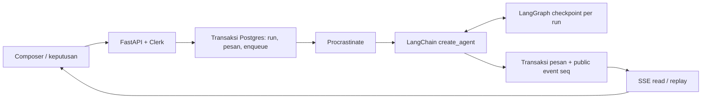

# Chat personal #04 — implementasi dan penerimaan

Implementasi lokal 16 Oktober 2026 untuk [backlog #04](../backlog/tasks/04-chat-personal-thread-dan-streaming-resumable.md). Rujukan: [riset framework, streaming, dan UI](../research/chat-04-streaming-research-2026-10-16.md) serta [desain Pen](../walkthrough-ux.pen). Catatan ini mencatat hasil implementasi; status mirror Notion tetap mengikuti snapshotnya.

## Perilaku yang tersedia

- Main chat dibuat satu kali per akun. Side chat baru mempunyai history kosong dan memakai profil/soul personal yang sama. Riwayat thread lain tidak digabung otomatis.
- Pengguna dapat membuka, mencari judul, dan melanjutkan percakapannya. History dimuat 60 pesan per halaman; konteks awal model dibatasi 24 pesan lengkap dan 36.000 karakter. Tool riwayat hanya membaca thread yang sama, maksimal 20 pesan/12.000 karakter.
- `create_agent` dapat menjawab langsung atau memilih beberapa tool. Tools saat ini: membaca profil, membaca riwayat thread, dan menyimpan tujuan Course setelah persetujuan.
- `/course` dan bahasa natural memakai tool serta HITL yang sama. Kartu memperlihatkan tujuan, pengetahuan awal, dan pilihan setuju/tolak. Keputusan menempel pada proposal, revision, serta tool call tersimpan; proposal berlaku tujuh hari.
- Persetujuan menulis satu `course_requests` dengan ID proposal sebagai kunci idempotensi. Penolakan tidak menulis tujuan. Ini belum menghasilkan Course, sumber, outline, atau materi; pekerjaan tersebut mengikuti #07–09.
- Stop mempertahankan bagian respons yang sudah tersimpan, membatalkan proposal pending, dan mencabut hak worker untuk menulis hasil berikutnya. Stop yang terlambat tidak mengganti hasil yang sudah selesai.
- Draft per akun/thread disimpan di sessionStorage. Request key pengiriman yang belum mendapat konfirmasi juga bertahan saat refresh. Teks baru yang diketik selama pengiriman tidak ikut dihapus ketika pesan sebelumnya diterima.

## Primitive dan tampilan

Primitive dipasang melalui CLI resmi terlebih dahulu:

```sh
bunx --bun shadcn@latest init --cwd apps/web --template start --base radix --preset nova --no-monorepo --no-reinstall --yes
bunx --bun shadcn@latest add card sheet drawer textarea input collapsible badge tooltip dropdown-menu avatar --cwd apps/web --yes
```

Hasil tersimpan di [components.json](../../apps/web/components.json) dan [components/ui](../../apps/web/src/components/ui). Button ikut dipasang saat init. Kustomisasi menggunakan token Soft Matcha, Nunito Sans, border serta surface Pen. History desktop memakai panel di antara rail dan konten chat; Drawer menjadi daftar chat mobile dan menyediakan akses akun. Button, Input, serta DropdownMenu tetap memakai primitive shadcn yang dipasang di atas.

Streamdown merender Markdown yang masih mengalir, KaTeX untuk matematika inline/display, dan plugin code untuk blok kode. Tool dan ringkasan penalaran mempunyai Collapsible tersendiri. Adapter hanya memproyeksikan ringkasan publik yang diberikan provider; encrypted reasoning, instruksi internal, raw checkpoint, dan raw tool result tidak dikirim ke UI. Bila provider tidak memberikan summary, bagian reasoning tidak ditampilkan.

`@shadcn/react/message-scroller` mengelola follow saat berada di bawah, mempertahankan posisi ketika pengguna membaca pesan lama, dan prepend history. Tombol ke pesan terbaru disembunyikan bila tidak diperlukan. Animasi teks menggunakan fade pendek dan mengikuti reduced motion. Log percakapan diberi `aria-busy` selama respons agar pembaruan token tidak diumumkan satu per satu.

## Kontrak runtime



Thread percakapan, run/eksekusi, job delivery, message, dan tool call memiliki identitas terpisah. Graph memakai `chat:{run_id}` agar approval yang dibatalkan tidak ikut terbawa ke turn berikutnya. Proposal menunggu keputusan dalam database setelah job worker selesai; keputusan mengantarkan resume sebagai job baru. Workflow generasi Course kelak memiliki execution ID sendiri; worker generasi Course belum dibuat di slice ini.

Setiap perubahan pesan dan seq event disimpan bersama di transaksi singkat dengan lock thread. Event publik versi 1 berupa `message.upsert`, `approval.upsert`, dan `run.status`. Implementasi mengirim snapshot bagian pesan yang berubah setiap sekitar 60 ms, bukan menyimpan satu event untuk setiap token. Snapshot awal dan `through_seq` dibaca dengan lock yang sama; urutan pesan memakai `position`, bukan timestamp yang bisa sama.

Subscriber SSE tidak menjalankan model atau tool. Ia membaca ledger setelah cursor, memakai `id: seq`, menerima `Last-Event-ID`, dan tidak menahan transaksi DB selama menunggu. FastAPI memberi heartbeat; koneksi dibatasi empat menit agar reconnect menjalankan autentikasi ulang. Client mengambil token segar saat connect/reconnect, mencoba refresh token sekali pada 401, lalu menampilkan tindakan pemulihan bila sesi tidak valid. Header cursor tetap dipertahankan. Reducer mengabaikan event duplikat, memeriksa versi/urutan, dan memperbarui message ID yang sama.

Hak eksekusi memakai lease token per attempt. Penulisan transcript, checkpoint, serta side effect memeriksa token dan cancellation. Recovery memeriksa heartbeat queue saat startup dan setiap menit, maksimum tiga attempts; delivery yang abort/selesai tanpa status terminal direkonsiliasi. Model/API error menjadi kegagalan yang dapat dicoba ulang pengguna. Retry memakai run dan bubble yang sama, dan hanya berlaku pada turn gagal terbaru.

Checkpoint adalah batas pemulihan langkah. Panggilan provider yang belum selesai/checkpoint dapat diulang setelah crash, sehingga ini bukan jaminan exactly-once billing. Side effect tujuan Course tetap idempotent. Subscription yang terputus saja tidak mengulang model atau tool.

## Endpoint dan batas

| Operasi | Endpoint |
| --- | --- |
| Profil ringkas + daftar thread / side chat baru | `GET /chat/threads`, `POST /chat/threads` |
| Snapshot / history sebelumnya | `GET /chat/threads/{id}`, `GET /chat/threads/{id}/messages?before=position` |
| Kirim pesan | `POST /chat/threads/{id}/runs` |
| Replay | `GET /chat/threads/{id}/events` |
| Keputusan | `POST /chat/approvals/{id}/decision` |
| Stop / retry | `POST /chat/runs/{id}/cancel`, `POST /chat/runs/{id}/retry` |

Owner ditentukan dari Clerk, bukan body. Akses akun lain mendapat 404. Pengiriman/keputusan memakai UUID request key; body menolak field tambahan. Satu thread hanya memiliki satu turn aktif; per akun maksimal tiga turn queued/running. Batas default: 12.000 karakter input, 3.000 output token per panggilan, enam model calls, sepuluh tool calls, timeout turn 180 detik. Kuota paket/periode dan pembukuan biaya adalah #05.

[Environment example](../../.env.example) mencantumkan konfigurasi server-only. Provider saat ini langsung melalui `langchain-openai` dan OpenAI Responses; LiteLLM gateway belum terlibat. Jalankan `make install`, `make infra-up`, `make migrate`, lalu `make dev`. Revision aplikasi: `0003_chat_order`.

Konteks Course/Lesson belum dapat dipilih karena domain/player tersebut belum tersedia. Integrasi berikutnya harus memvalidasi ownership dan meminta tindakan eksplisit pengguna sebelum menambah konteks asal ke side chat.

## Bukti penerimaan

[Bukti terstruktur](evidence/chat-04/manual-acceptance.json) memisahkan panggilan model asli dan fixture manual. Pemeriksaan perilaku dilakukan melalui browser dan probe operator lokal; tidak ditambahkan suite unit/integration/E2E.

| Pemeriksaan | Hasil |
| --- | --- |
| Jawaban langsung, tanpa tool | Model asli selesai dan history tetap berurutan setelah refresh |
| Beberapa tool + Course bahasa natural | Profil → riwayat → proposal tujuan; dua model calls sebelum pause |
| Approve / replay keputusan | Satu side effect tujuan tersimpan |
| Reject | Nol side effect tujuan |
| Approval tertunda sambil chat lain berjalan | Job approval sudah `succeeded`; chat lain selesai, proposal tetap menunggu |
| Revision salah / owner lain | 409 / 404; snapshot dan SSE lintas akun juga 404 |
| Request sama dua kali / pesan tumpang tindih | Run sama / 409 |
| Kapasitas akun penuh | Handler kirim, retry, dan keputusan sama-sama 429; fixture sementara dibersihkan |
| SSE replay | Seq 56 dilanjutkan 57; tidak ada bubble duplikat; cursor masa depan 409, tanpa login 401 |
| Worker dihentikan paksa | Run tetap sama, attempt 1 → 2 → complete; tepat dua message IDs |
| Stop respons yang sedang mengalir | Partial tersimpan dan status run/message cancelled |
| Stop proposal pending | Proposal/tool/message/run cancelled; tiga event terminal terkirim; nol side effect |
| Stop hasil selesai | Status tetap complete |
| History fixture 62 pesan | Snapshot 60, prepend 2; browser menampilkan 62 ID unik dan tombol history hilang |
| Draft dan mobile | Draft bertahan refresh; penerimaan awal memakai Sheet/Drawer. Revisi panel desktop dijelaskan di bawah. |
| Markdown | Kode dan rumus terlihat; tiga KaTeX nodes; tidak ada overflow halaman mobile |
| Public reasoning summary | Collapsible dibuka memakai fixture berlabel; provider live pada probe ini tidak mengirim summary |
| Static/build | `make check`, `make build`, wheel dan sdist backend lulus |

Screenshot: [desktop](evidence/chat-04/desktop.png), [persetujuan desktop](evidence/chat-04/desktop-approval.png), [mobile dark kode/rumus](evidence/chat-04/mobile-dark.png), dan [Drawer mobile](evidence/chat-04/mobile-drawer.png).

Belum menjadi bukti untuk deploy production, uji beban multi-replica, atau tagihan provider setelah crash. Event ledger masih menyimpan snapshot bagian pesan; delta/retensi dapat dievaluasi ketika volume nyata membutuhkannya.

## Audit duplikasi saat streaming — 16 Oktober 2026

Laporan pengguna direproduksi pada ledger: 25 snapshot `running` mengandung dua bagian teks identik di dalam satu message. Pemeriksaan awal terhadap jumlah bubble dan hasil final melewatkan duplikasi sementara ini.

OpenAI Responses mengirim ID response pada awal stream, kemudian chunk memakai ID LangChain. ID item teks baru hadir pada `output_text.done`. Adapter sebelumnya memakai ID sementara saat menampilkan delta, lalu menambahkan bagian baru ketika ID item muncul. Rekonsiliasi final membuang bagian lama sehingga gejalanya terutama terlihat menjelang akhir streaming.

[Projection](../../apps/backend/src/ngertiin/chat/projection.py) sekarang menyatukan alias invokasi graph, message LangChain, response provider, dan item provider. Bagian teks/summary memakai identitas response + jenis konten + urutan blok sejak awal. [Runtime](../../apps/backend/src/ngertiin/chat/runtime.py) memasok namespace invokasi graph untuk menghubungkan chunk yang ID pesannya berubah. Jawaban lengkap memperbarui slot yang sama; blok berbeda dengan teks atau item ID yang sama tetap dipertahankan.

[Bukti audit](evidence/chat-04/stream-duplication-audit.json): reproduksi minimal berubah dari jumlah bagian `[1, 1, 2, 2]` menjadi `[1, 1, 1, 1]`; replay 66 frame model asli menjaga satu ID bagian sepanjang stream. Probe juga memeriksa beberapa blok dengan item ID sama, iterasi model berbeda, summary publik, tool result, replay SSE, dan rekonsiliasi checkpoint. Dua run baru melalui browser—jawaban langsung dan jawaban setelah tool—menghasilkan 70 snapshot tanpa duplikasi. Semua pemeriksaan statis lulus; worker lokal sudah direstart.

Penerimaan streaming berikutnya harus memeriksa bagian teks di setiap snapshot, termasuk saat ID item muncul dan node model selesai, selain memeriksa jumlah bubble dan hasil akhirnya. Ledger historis dibiarkan utuh; tidak ada transcript saat audit yang memerlukan koreksi.

## History desktop sebagai panel

Mengikuti referensi pengguna, history desktop tampil sebagai panel yang menempati layout di sebelah kanan rail. Lebarnya 320 px, atau 264 px pada layar desktop kecil. Area chat menyesuaikan lebar tanpa dimount ulang; panel tidak mempunyai backdrop, dialog, atau focus trap. Membuka/menutupnya mempertahankan draft serta subscription chat.

Main chat dipisahkan dan tetap terlihat ketika pencarian memfilter Side chats. Tombol `+` membuat side chat kosong dan membersihkan pencarian. Memilih atau membuat percakapan mempertahankan panel terbuka pada desktop. Tombol rail, menu `…`, dan Escape dari dalam panel dapat menutupnya; penutupan melalui menu/Escape mengembalikan fokus ke tombol rail.

[ThreadList](../../apps/web/src/features/chat/thread-list.tsx) dipakai bersama oleh panel desktop dan Drawer mobile. State buka/tutup keduanya dipisahkan agar membuka panel desktop tidak otomatis membuka Drawer ketika viewport menjadi mobile. Judul panjang dipotong satu baris; judul lengkap tetap tersedia lewat label dan tooltip native. Penyesuaian ini direview langsung dalam satu konteks, dibantu scan layout, typecheck, lint, build, dan pemeriksaan browser.

## Cleanup React dan penutupan #04 — 16 Oktober 2026

`Thread` diperkecil dari 249 menjadi 93 baris dengan memisahkan transcript, lifecycle draft/pengiriman, dan aksi run. Query/pembuatan thread serta perilaku panel/Drawer dipindahkan dari `ChatPage` ke hooks masing-masing. Reducer replay dipisahkan dari kontrak DTO. Diagnostik menjadi fitur sendiri dengan route tipis, hook file/job, serta komponen status, akun, form upload, dan baris hasil.

[Pemeriksaan cleanup](react-cleanup-2026-10-16.md) melengkapi penerimaan runtime di atas. Probe browser baru memakai akun Clerk development dan backend nyata: kegagalan kirim yang disimulasikan mempertahankan draft/request key melewati reload; pengiriman ulang memakai key yang sama dan menghasilkan satu bubble jawaban. Panel desktop, pencarian, pemulihan fokus, Drawer mobile, perpindahan thread, serta upload/hapus file diagnostik diperiksa kembali. Ini tidak mengulang seluruh matriks crash/recovery/HITL; bukti untuk matriks tersebut tetap pada penerimaan #04 dan audit streaming sebelumnya.

Status #04 diselaraskan ke **Done** di Notion berdasarkan delapan acceptance criteria dalam cakupan chat. `/course` dan bahasa natural menyimpan proposal tujuan melalui HITL yang sama. Generation Course lengkap dan konteks Course/Lesson tetap mengikuti tiket domain berikutnya; penutupan ini bukan bukti penerimaan generation/player atau deploy production.
