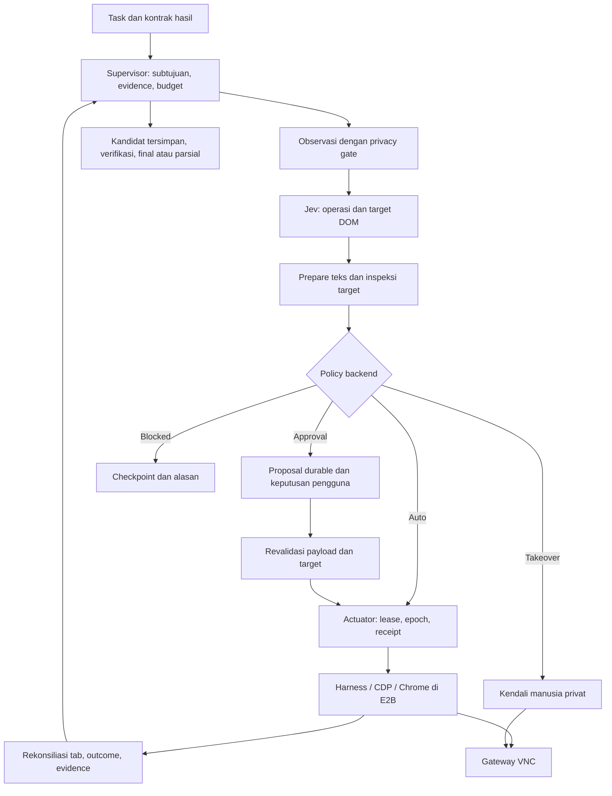

# Final implementation plan: Jev Ultrafast, E2B, VNC, dan approval

Tanggal: 23 Oktober 2026. Status: **rencana implementasi final; pekerjaan runtime belum dilaksanakan**.

## 1. Kedudukan dokumen dan hasil akhir

Dokumen ini menjadi urutan implementasi utama untuk menggabungkan [rencana Jev Ultrafast](jev-ultrafast-repair-plan-2026-10-23.md), [rencana VNC/permission](computer-use-vnc-plan-2026-10-23.md), dan [studi Rakazo/Hermes](../research/rakazo-hermes-computer-use-2026-10-23.md). Dokumen tersebut tetap menjadi penjelasan teknis pendukung. Urutan delivery mengikuti dokumen ini; kebijakan [routine-auto dan sensitive-approval](computer-permissions-2026-10-23.md) tetap berlaku.

Hasil yang dituju: Gwen menyelesaikan pekerjaan browser dengan Jev sebagai engine DOM utama, menyimpan hasil bacaan, pulih dari gangguan, dan menghasilkan output terverifikasi atau hasil parsial yang jujur. Pengguna dapat menonton serta mengambil alih komputer; aksi krusial meminta persetujuan yang konkret. Menutup viewer atau pengguna sedang offline tidak menjadi persetujuan.

Kasus regresi utama adalah [audit thread f9a8](browser-thread-f9a8-audit-2026-10-23.md): Jev tidak benar-benar digunakan pada retained v1, tab artikel dapat ditinggalkan, aksi berulang tanpa evidence tersimpan, dan budget berakhir tanpa kandidat. Perbaikan harus membuktikan kasus ini tertangani, bukan hanya menghasilkan demo satu halaman.

## 2. Keputusan arsitektur yang dikunci

| Lapisan | Tanggung jawab |
| --- | --- |
| Planner Ngertiin | Membentuk tujuan, cakupan, output contract, runtime date, dan revisi Task. |
| Supervisor durable | Mengelola subtujuan, bukti, kemajuan, budget, checkpoint, recovery, dan finalisasi. |
| Jev Ultrafast | Memilih operasi/target dari state DOM teramati untuk subtujuan aktif. |
| Text helper / model generatif | Menyiapkan teks bila diperlukan dan menyusun laporan dari evidence yang tersimpan. |
| Backend permission | Menentukan auto/approval/takeover/blocked berdasarkan scope dan bukti target. |
| Actuator | Menegakkan lease, epoch, freshness, dispatch identity, dan receipt. |
| Browser Harness/CDP | Mengamati serta mengoperasikan Chrome yang disiapkan Ngertiin pada E2B. |
| E2B Desktop | Menyediakan runtime, display, browser, dan profil owner persisten. |
| VNC gateway | Memberi akses lihat/input manusia sesuai authorization dan kendali saat ini. |

Satu supervisor dan satu pemilik input pada satu waktu. Tidak menambahkan `Browser Use Agent.run()` sebagai loop bebas kedua. Agent tidak memperoleh arbitrary shell/evaluate untuk menghindari actuator. Sandbox kode tetap terpisah dari profil browser. Model keys dan provider ingress credentials tetap server-only; CDP localhost.

Baseline sesuai riset handoff: Jev source `1231850a0bf1a0c0341fe408ef1668dbbfdfac46`, Harness `0.1.13` beserta wheel hash, E2B SDK `2.56.0`, model `jev-1.13.0`, serta versi template/Chrome/Python/runner yang dicatat. Ini pin baseline yang direncanakan, bukan klaim versi terbaru. Verifikasi lockfile/build aktual pada tahap 0. Upgrade model/dependency dikerjakan terpisah setelah baseline lulus.



## 3. Kontrak permission dan approval

| Kategori | Perilaku final |
| --- | --- |
| Navigasi HTTPS publik, baca, scroll, pagination, pencarian/filter teridentifikasi | Otomatis dalam tujuan Task, tetap melalui privacy/egress/freshness checks. Tidak memerlukan exact URL grant untuk setiap sumber baru. |
| Draft lokal Ngertiin | Otomatis; belum memberi izin mengirim isi ke layanan lain. |
| Edit data/editor autosave, kirim/publish, delete, transaksi, perubahan akun/keamanan | Exact approval untuk aksi dan payload yang dapat ditinjau. |
| Password, OTP, token, pembayaran privat, file picker/iframe sensitif yang tidak dapat diperiksa | Takeover privat. |
| Target/efek ambigu | Approval jika efek dapat dijelaskan; takeover jika belum dapat dipastikan. |
| Ekspor secret/cookie, endpoint jaringan terlarang, akses owner lain | Block; approval tidak mengesampingkan invariant isolasi. |

Login tersimpan hanya memungkinkan pemakaian sesi sesuai tujuan. Izin melihat VNC, hak input, dan izin efek tetap terpisah. Tidak ada global YOLO, session-wide click grant, ataupun autoapprove karena pengguna tidak online.

Policy menghasilkan record `auto | approval | takeover | blocked`, reason code dan policy version. Proposal mengikat owner, Task/revision, session/workspace, browser generation, control epoch, document/target fingerprint, immutable action/payload digest, expiry, dan expected postcondition. Untuk efek yang relevan tampilkan domain, akun yang dapat diamati dengan aman, penerima/objek, isi/diff, attachment hash, serta jumlah/mata uang. Nilai yang belum diketahui tidak diisi berdasarkan tebakan actor.

Urutan: prepare → inspect → persist proposal/checkpoint → wait → keputusan pengguna → revalidate → dispatch → reconcile. Perubahan material membuat proposal stale. Klik ganda dan replay tidak menambah dispatch. Penolakan dicatat per efek/revisi sehingga agent tidak mengajukan ulang efek identik hanya dengan parafrasa. Menolak efek tetap memungkinkan melanjutkan alternatif yang memang tidak membutuhkan efek tersebut.

Versi pertama tetap exact-action approval. Approval satu transaksi yang mencakup beberapa aksi UI ditunda sampai adapter dapat membuktikan payload, autosave, commit boundary, dan postcondition. Saat mengetik sendiri mengubah server, approval dibutuhkan sebelum pengetikan tersebut.

## 4. Model state dan data minimum

Reuse Task, queue, lease, steps, files/results, dan event stream existing. Tambahkan skema secara additive; tentukan nomor migrasi dari head aktual ketika implementasi, jangan menimpa migrasi `0019` yang sudah ada.

| Data | Penyimpanan dan invariant |
| --- | --- |
| Capability manifest | Workspace: actual template identity, runtime versions/hash, verified capabilities, browser generation, waktu probe. Ready hanya setelah probe sukses. |
| Workflow cursor | Runtime state ringkas: schema version, subgoal, phase, budget/finish reserve, evidence/candidate refs, loop state. Bukan seluruh artikel/transcript. |
| Source evidence | Store owner/Task/revision scoped: URL tersanitasi, title, waktu akses, publication date bila tersedia, excerpt/section, hash, relevance/status. Bounded size dan retensi. |
| Candidate/verdict | Reuse output storage untuk bytes; metadata revision/hash/evidence refs, unverified/passed/failed/inconclusive. Penyimpanan bytes tidak otomatis mempromosikan draft ke publishable. |
| Decision/proposal | Steps atau tabel terkait untuk immutable payload, policy reason, bindings, expiry dan keputusan pengguna. |
| Dispatch journal | Dispatch ID unik, attempt/epoch, accepted/confirmed/stale/unknown dan hasil rekonsiliasi; tidak menyimpan secrets. |

Petakan domain outcomes `final`, `partial`, `needs_input`, `blocked_budget`, dan `blocked_runtime` ke status/stage/outcome API existing secara eksplisit. Jangan menambah enum sepihak atau menandai partial sebagai sukses penuh. Model `DONE` bukan otorisasi publication.

Control tetap `agent → handoff → human → resuming → agent`. State koneksi viewer terpisah: connecting/live/reconnecting/expired/revoked/unavailable. Durasi attempt adalah potongan kerja; deadline dan budget Task tetap batas keseluruhan.

## 5. Paket implementasi berurutan

Setiap paket menghasilkan perubahan vertikal beserta fixture dan bukti acceptance. Gate keselamatan tidak ditunda sampai paket terakhir. Setiap paket boleh menjadi perubahan/commit kohesif ketika commit diminta; rencana ini sendiri tidak melakukan commit atau deployment.

### P0 — Baseline, kontrak, dan reproduksi

- Baca instruksi repo dan periksa dirty tree, lockfiles, source hashes, runtime state yang relevan; pertahankan perubahan pengguna. Prefer graph MCP untuk discovery; fallback source search bila tool tidak tersedia.
- Kunci reproduksi tab baru, retained v1, klik berulang tanpa kemajuan, rejected candidate, budget 23.376 vs reservasi 26.630, serta takeover race.
- Tetapkan kontrak state/data di bagian 3–4, dependency pins, feature flag browser-loop v2, dan skema telemetry tersanitasi.
- Buat fixture deterministic dan resource/DB disposable; jangan memakai browser profile pengguna untuk eksperimen destruktif.

**Area:** `scripts/inspect_browser_runtime.py`, `scripts/inspect_computer_permissions.py`, `scripts/probe_jev_browser.py`, kontrak computer/tasks dan rancangan migration.

**Gate:** kasus gagal dapat direproduksi, source baseline tercatat, dan setiap requirement punya skenario penerimaan. Telemetry tidak merekam token, raw input rahasia, atau aktivitas takeover.

### P1 — Privacy, permission, dan fencing bersama

- Satukan pre-observation privacy gate untuk DOM, screenshot actor, dan verifier. Pemeriksaan struktural tidak mengekspor nilai field rahasia; unsupported sensitive frame/window menuju takeover.
- Ubah permission boolean menjadi decision record tanpa mengubah routine-auto/sensitive-approval baseline. Semua engine melewati policy yang sama.
- Terapkan epoch/generation fencing pada observasi, input, hasil model terlambat, watcher, dan hasil capture sebelum dikirim/disimpan. Handoff harus drain actuator dan channel sebelum mengaktifkan input manusia.
- Pertahankan egress/owner constraints serta pemisahan sandbox kode. Hindari jalur shell/CDP yang tidak melewati authority yang sama.

**Area:** `computer/permissions.py`, `contracts.py`, `steps.py`, `control.py`, `actuator.py`, `jev_runner.py`, `jev_assets/snapshot.js`, screenshot/verifier paths.

**Gate:** routine read/search tetap otomatis; secret fixture tidak mencapai model/log/artifact; takeover-handback selama capture membatalkan hasil lama; mutasi tanpa izin dan input dari epoch lama ditolak.

### P2 — Capability Jev aktual dan lifecycle E2B

- Startup memverifikasi capability manifest, bukan hanya membaca `engine=jev`.
- Resource baru memakai template dependency terpin. Resource retained v1 mendapat maintenance satu kali pada sandbox yang sama: exclusive lease → preflight privilege/disk/egress → stage runtime versi baru → smoke test → atomic pointer switch → pause/cold-resume test. Profil Chrome dipertahankan, rollback pointer tersedia.
- Bila maintenance tidak memungkinkan, tahan admission dengan alasan jelas. Migrasi profil ke resource baru menjadi jalur sekunder yang diuji terpisah; tidak menjanjikan login portable.
- Set endpoint Harness sebelum import, bersihkan override, gunakan identitas per workspace/browser generation, dan validasi Chrome yang di-attach. Tidak boleh membuat browser lain secara diam-diam.
- Bedakan absent/paused/unreachable; error transport tidak menjadi alasan membuat resource pengganti. Viewer tidak memperpanjang deadline E2B.

**Area:** `computer/e2b.py`, `lifecycle.py`, `desktop.py`, `desktop_io.py`, `jev_runner.py`, `scripts/build_e2b_templates.py`; capability module kecil bila diperlukan.

**Gate:** create v2 dan retained v1 yang selesai maintenance benar-benar memanggil Jev; ledger mencatat engine/model aktual. Warm/cold restart mempertahankan capability dan login sintetis. Resource yang belum siap tidak diam-diam memakai screenshot sepanjang Task.

### P3 — Target manager dan readiness

- Satu registry target untuk DOM, screenshot, input, verifier dan viewer. Rekonsiliasi target sebelum observasi mengaktifkan tab.
- Korelasikan target baru dengan action ID, opener bila ada, URL final, generation dan epoch. Jangan memilih tab terakhir secara arbitrer; popup ambigu tidak diadopsi otomatis.
- Gunakan satu consumer/demultiplexer event Harness; buffer `drain_events()` tidak dikuras helper bersaing.
- Readiness berdasarkan hasil navigasi, frame/loader/route dan predicate konten, dengan deadline. Default awal 15 detik dipotong remaining Task/attempt, lalu dievaluasi pada corpus.
- Pergantian dokumen/target membatalkan proposal yang tidak lagi cocok. Handle CDP/node lama tidak dipakai setelah cold boot.

**Area:** `computer/cdp.py`, `actuator.py`, `jev_runner.py`, `e2b.py`, target module baru dengan tanggung jawab terbatas.

**Gate:** ordinary link, target=_blank, window.open, redirect, SPA, download, close tab, reconnect, ambiguous popup dan tab manusia saat takeover lulus. Artikel tidak kembali ditinggalkan karena fokus tab pencarian lama.

### P4 — Supervisor Jev dan evidence tanpa looping

- Supervisor mengelola `SEARCH → OPEN_SOURCE → WAIT_READY → READ_SOURCE → SAVE_EVIDENCE → CHECK_COVERAGE → SYNTHESIZE`. State ini milik aplikasi; Jev memilih aksi browser untuk subtujuan aktif.
- Ganti `Action | None` dengan hasil eksplisit `Act`, `SubgoalDone`, `Blocked`, `NeedsHuman`. DONE/BLOCKED tidak otomatis berarti screenshot fallback.
- Pertahankan satu request TypeSafe untuk pilihan operasi/target yang dapat dibatch; text helper hanya ketika diperlukan. Tidak ada model reasoning tambahan per klik.
- Reader menyimpan excerpt nyata dan metadata sebelum pindah sumber. Artikel panjang dibaca per bagian/cursor; viewport snapshot bukan bukti seluruh artikel dibaca.
- Guard berlaku pada kedua engine: dua pengulangan aksi semantik pada state sama memicu replan; tiga siklus sumber tanpa evidence/postcondition baru mengganti strategi sekali, lalu partial/blocked. Nilai awal dituning; replan tidak mereset budget/history global.
- Fallback screenshot terbatas pada bagian unsupported, punya alasan dan batas percobaan, serta kembali ke Jev ketika DOM tersedia. Animasi, klik diakui, dan navigasi bukan otomatis kemajuan tujuan.

**Area:** `computer/jev.py`, `workflow.py`, `continuation.py`, `contracts.py`, reader/evidence store, observer.

**Gate:** research tiga sumber benar-benar menyimpan bacaan; pola audit berhenti berulang; evidence tetap ada sesudah pergantian worker; Jev menjadi actor aktual pada task DOM supported.

### P5 — Kandidat, verifier, dan cadangan finalisasi

- Simpan candidate bytes/hash/evidence refs sebelum verifikasi dengan status unverified. Pisahkan staging bytes dari promotion ke `draft_ready`/publication.
- Verifier riset menerima laporan, claim-source map, excerpt asli, metadata tanggal, dan cakupan. Periksa ID/hash/quote/tanggal deterministik, lalu judgment semantik yang dibatasi; simpan verdict dan alasan. Verifier aksi situs memakai expected postcondition/receipt yang relevan.
- Sisihkan finish reserve berdasarkan bounded konteks/output dan tahap sintesis/verifikasi yang diperlukan. Jangan menyamakan byte dengan token atau memotong reservation agar lolos.
- Hentikan eksplorasi ketika tidak muat bersama finish reserve. Hasilkan final jika cukup, partial yang berlabel bila kurang, atau checkpoint/blocked yang akurat. Renderer deterministik dapat menyajikan evidence tervalidasi bila finalisasi model tidak tersedia.
- Publication memeriksa revision/hash/verdict bahkan pada retry; kandidat gagal tidak dipromosikan karena worker restart.

**Area:** `computer/verification.py`, `workflow.py`, `tasks/budget.py`, `sandbox/outputs.py`, files/results publication, Task API/types/UI.

**Gate:** kandidat ditolak tetap tersimpan, unsupported claims tidak terbit sebagai verified, replay budget audit tidak kehilangan semua hasil, dan pesan draft tersimpan hanya muncul jika memang ada draft.

### P6 — Approval konkret dan dispatch recovery

- Lengkapi immutable effect proposal dan preview sesuai bagian 3; tampilkan observed facts terpisah dari penjelasan actor.
- Simpan checkpoint sebelum waiting_user. Decision dapat diproses setelah worker restart; expiry/offline tidak pernah menjadi persetujuan.
- Revalidasi account/domain, recipient/body/attachment atau objek/diff yang relevan, document/fingerprint, epoch, policy dan expiry tepat sebelum dispatch. Tombol Send yang sama tidak cukup bila isi berubah.
- Tambahkan dispatch ID/journal pada actuator, atomic claim pada backend, dan rekonsiliasi acknowledgment yang hilang. Receipt `input_acknowledged` terpisah dari `postcondition_satisfied`.
- Unknown effect menahan replay. Periksa keadaan tanpa mutation; bila tak dapat dipastikan, minta pemeriksaan manusia. Tidak menjanjikan exactly-once pada situs eksternal.
- Kartu approval menyediakan Setujui aksi ini, Tolak, dan Ambil alih; koordinat teknis bukan pengganti preview efek. Generic ambiguous UI dapat berakhir takeover.

**Area:** `computer/steps.py`, `control.py`, `actuator.py`, `contracts.py`, Task recovery/jobs, migration additive, `computer-action.tsx`, computer/task types.

**Gate:** perubahan payload setelah approval ditahan; double click/replay/restart tidak menggandakan efek; rejected proposal tidak diulang tanpa perubahan material; unknown mutation tidak diretry otomatis.

Approval existing tetap aktif pada P0–P5. P6 memperkuat payload/UX/recovery, bukan baru mulai melindungi aksi mutation.

### P7 — VNC reconnect dan pengalaman takeover

- Reconnect/renewal token menggunakan endpoint owner-authenticated dengan epoch/generation terbaru; backoff terbatas dan satu channel aktif. Rotasi menunggu penutupan channel lama sebelum menggantinya.
- Pisahkan network interruption yang retryable dari revoked/expired/ended; fetch status terbaru sebelum memberi input. Disconnect manusia tidak mengembalikan kendali otomatis.
- UI membedakan menonton, human control, handoff, membaca perubahan, waiting approval, reconnecting dan stopping. Stop segera memblokir aksi baru dan mengonfirmasi cleanup melalui readback.
- Menutup viewer hanya menutup layar. Approval tersedia tanpa viewer terbuka. Watcher/capture/logging privat tetap berhenti selama human control.
- Waiting approval mempunyai checkpoint dan idle policy. Jika runtime dipause, resume harus revalidate; approval lama tidak dipaksakan berlaku pada browser generation baru.
- Pertahankan backend RFB enforcement, HttpOnly credential dan private ingress. Optimasi query/caching baru setelah profiling dan tetap memenuhi revocation bounds.

**Area:** `computer/viewer.py`, `rfb.py`, `control.py`, lifecycle/jobs, `use-computer.ts`, `computer-viewer.tsx`, `computer-panel.tsx`, banner/approval surfaces.

**Gate:** expiry grant 300 detik, network loss, reconnect, dua tab viewer, mobile input, takeover dan Stop lulus tanpa input ganda, auto-handback, perluasan deadline, atau approval tersirat.

### P8 — Evaluasi, canary, dan rollout

- Jalankan deterministic/fault corpus, lalu browser/E2B nyata menggunakan akun serta layanan uji. Pisahkan hasil fixture dari hasil layanan nyata.
- Pin workflow/capability version untuk Task baru; canary pada resource baru dulu, retained profiles sesudah maintenance gate. Task aktif pindah versi hanya di boundary aman.
- Rollback menghentikan admission baru, merekonsiliasi aksi aktif, dan memakai runtime kompatibel yang tersedia. Jika tidak ada versi aman, tetap paused/blocked; jangan mengaktifkan loop lama atau screenshot secara diam-diam.
- Pertahankan profile/evidence/candidate saat rollback. Uji migrasi dan pembacaan state lama; proposal lama tidak direinterpretasi otomatis.

**Gate:** seluruh acceptance keselamatan lulus, target pilot di bagian 6 tercapai, resource cleanup terkonfirmasi, dan bukti dapat ditelusuri. Produksi memerlukan langkah deployment tersendiri; dokumen ini belum melakukan deployment.

## 6. Acceptance dan bukti wajib

| Corpus | Bukti lulus |
| --- | --- |
| Routine navigation/search | Tidak ada approval yang tidak diperlukan pada fixture supported Indonesia/English; editor autosave dan label menyesatkan tidak lolos. |
| Multi-source research | Minimal tiga sumber termasuk target baru/SPA; evidence tersimpan sebelum berpindah; laporan atau partial jujur tersedia. |
| Actual Jev | Trace keputusan TypeSafe/Jev sepanjang jalur DOM supported pada new dan upgraded resource; actual engine dan fallback reason tersedia. |
| Privacy | Password/OTP/token fixture tidak masuk model, log, artifact, URL telemetry maupun verifier, termasuk sebelum takeover dan late capture. |
| Approval effects | Payload tepat dapat ditinjau; perubahan penerima/isi/account setelah approve ditolak; satu action dispatch untuk satu claim. |
| VNC authorization | Wrong owner/origin/token/epoch, fragmented RFB, clipboard/extended input dan unknown protocol tidak melewati kontrol. |
| Race/fault | Kill worker, timeout sebelum/sesudah dispatch, delayed model, takeover/handback, Stop dan disconnect tidak menghasilkan input ganda atau replay unknown mutation. |
| Persistence | Beberapa attempt melewati 180 detik, warm/cold resume, maintenance dan rollback mempertahankan profil sintetis/evidence; handle/proposal lama direvalidasi. |
| Budget/results | Kondisi audit dan finish-reserve exhaustion menghasilkan state/output akurat; candidate invalid tidak menjadi success pada retry. |
| Offline user | Approval durable tetap pending/expired sesuai policy; tidak autoapprove, dan pengguna kembali melihat status terbaru. |

Semua invariant keselamatan wajib lulus tanpa unauthorized/double mutation atau false success. Gate pilot: **30 tugas supported × 3 pengulangan, minimal 90% goal completion terverifikasi**. Unsupported escalation dilaporkan terpisah. Angka tersebut adalah target acceptance, bukan hasil atau SLA produksi saat ini.

Catat p50/p95 startup, observasi, Jev/text-helper, dispatch/readiness, sintesis/verifikasi, total latency; biaya per hasil, fallback/repeat rate, unnecessary approval, recovery success, evidence coverage, dan completion. Kecepatan Ultrafast dinilai pada workload, permission, budget, dan verifier setara. Tetapkan target latency/cost dari baseline P0; jangan mengarang klaim penghematan sebelum pengukuran.

Checks sesuai area perubahan:

```text
make computer-permissions-inspect
make computer-inspect
make browser-runtime-inspect
make task-inspect
make files-inspect        # bila staging/publication berubah
make quota-inspect       # bila reservation/settlement berubah
make check
make build
make docs-check
git diff --check
```

Backend inspectors menggunakan environment disposable yang disediakan tooling; backend Python memakai `uv run --project apps/backend python`. Live probe memerlukan resource uji dengan cleanup/readback. Static checks dan fixture Send counter tidak menggantikan E2E pada layanan uji, dan tidak ada transaksi produksi sebagai pengujian.

## 7. Batas scope dan definition of done

Iterasi ini tidak mencakup provider selain E2B, penggantian Jev, global permission framework seluruh produk, permanent domain grants, unrestricted desktop shell, model upgrade, atau janji portabilitas login lintas resource. Ini menjaga perubahan tetap fokus pada kegagalan yang sudah dibuktikan dan interaksi VNC yang diminta.

Selesai ketika kasus audit menghasilkan laporan bersumber atau partial yang jujur; Jev aktual bekerja; routine tasks otonom; aksi krusial memiliki exact approval; private takeover tidak mengirim capture ke model; reconnect/restart tidak menggandakan efek atau menghilangkan evidence; dan rollout/rollback melewati gate. Hasil analisis source Rakazo/Hermes tetap referensi desain, bukan bukti kelulusan runtime Ngertiin.

Dokumen ini merencanakan pekerjaan. Implementasi, perubahan resource, commit/push, deployment dan update status Notion belum dilakukan pada penyusunan plan ini.
