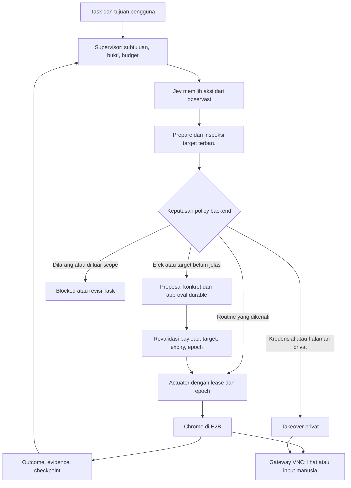

# Rencana computer use, VNC, dan approval Ngertiin

Tanggal: 23 Oktober 2026. Status: **rancangan, belum implementasi runtime**.

## 1. Tujuan dan hubungan dengan rencana sebelumnya

Agent dapat menelusuri situs, membaca, mencari, dan menyusun hasil secara otonom; pengguna bisa melihat atau mengambil alih komputer; pengiriman, perubahan data, transaksi, dan tindakan keamanan berhenti pada approval yang konkret. Gangguan viewer tidak menggagalkan pekerjaan, dan gangguan worker tidak mengulang efek eksternal yang belum pasti.

Dokumen ini memperluas [rencana perbaikan Jev](jev-ultrafast-repair-plan-2026-10-23.md) dengan desain permission, kontrol VNC, approval, dan UX. Rincian capability maintenance, target manager, reader, verifier, serta budget pada rencana tersebut tetap berlaku. [Kebijakan izin yang sudah diterima](computer-permissions-2026-10-23.md) tetap baseline; tidak mengembalikan approval untuk setiap navigasi atau klik pencarian.

Dasar pemeriksaan: handoff pengguna, source checkout aktual, [audit thread gagal](browser-thread-f9a8-audit-2026-10-23.md), dan [analisis Rakazo/Hermes](../research/rakazo-hermes-computer-use-2026-10-23.md). HEAD lokal `263b2c6b2e0c5cf49c06bf5e27933289d76c9887` memiliki banyak perubahan belum di-commit; HEAD saja tidak mewakili source aktual. Delapan hash source inti masih cocok dengan snapshot audit ketika diperiksa pada sesi ini.

## 2. Fondasi yang dipertahankan dan celah yang ditutup

| Area | Bukti source saat ini | Arah perbaikan |
| --- | --- | --- |
| Viewer | `viewer.py` memberi cookie HttpOnly, origin check, expiry, owner binding, dan control version; `rfb.py` memblokir input manusia saat agent memegang kendali. | Pertahankan enforcement backend; tambah reconnect terkontrol dan alasan disconnect yang tersanitasi. |
| Takeover | `control.py` mencabut viewer/proposal lama, mengubah epoch, menunggu barrier/channel selesai, lalu menyerahkan kendali. | Jadikan fase handoff terlihat dan retry idempoten; jangan menyatakan takeover selesai sebelum barrier diakui. |
| Approval | `permissions.py` mengizinkan routine read/search dan menahan mutation/unknown; `steps.py` mengikat aksi ke fingerprint dan mengecek ulang sebelum dispatch. | Tambahkan keputusan terstruktur, alasan, payload/efek yang dapat ditinjau, dan audit decision. |
| Jev/browser | Audit membuktikan retained v1 memakai screenshot; canonical tab dapat kembali ke tab pencarian. Delapan file inti belum berubah dari audit. | Capability aktual dan target reconciliation lebih dahulu daripada optimasi kecepatan. |
| Hasil | Evidence lintas sumber dan kandidat/verdict durable belum memadai; budget bisa habis tanpa draft. | Supervisor, source evidence, kandidat persisten, dan cadangan finalisasi sesuai rencana Jev. |
| Privacy | DOM snapshot punya private-field gate; actuator menolak capture selama human control. Jalur `screen` sendiri langsung memakai `scrot` saat agent/resuming. | Satukan gate observasi untuk DOM, screenshot actor, dan verifier; jangan menganggap private-target gate sesudah capture melindungi gambar yang sudah dikirim. |
| Koneksi | Grant viewer maksimum 300 detik; hook menutup pada expiry. UI disconnect meminta pengguna menutup dan menyambung ulang. | Renewal/reconnect bounded tanpa mengubah kendali, menambah budget, atau mengulang aksi. |

Temuan privacy terakhir adalah celah dari alur source, **bukan bukti kebocoran historis**. Halaman privat atau dialog desktop dapat muncul sebelum pengguna menekan takeover. Klaim perlindungan harus mencakup fase itu, bukan hanya saat status sudah `human`.

## 3. Pisahkan tiga jenis izin

1. **Akses layar:** siapa boleh melihat workspace ini, untuk berapa lama, dan pada generation/epoch mana. Capability tidak berisi provider token dan tidak memberi izin aksi agent.
2. **Kepemilikan input:** agent atau manusia. Hanya satu pihak aktif; takeover harus menghentikan input serta observasi agent sebelum input manusia dibuka.
3. **Otorisasi efek:** tindakan apa yang boleh dilakukan agent terhadap situs/akun/data. Membuka viewer, menonton, memberi akses VNC, atau mengembalikan kendali bukan approval transaksi.

E2B menyediakan komputer dan ingress; policy aplikasi menentukan tiga batas tersebut. VNC adalah jalur melihat/mengendalikan desktop manusia. Agent tetap memakai Jev/Harness/CDP dan fallback GUI melalui actuator yang sama, bukan wajib mengirim input melalui protokol VNC.

## 4. Matriks permission yang dituju

| Situasi | Default | Batas |
| --- | --- | --- |
| Buka HTTPS publik, tautan biasa, baca, scroll, pagination | Otomatis | Masih relevan dengan tujuan; egress dan privasi berlaku; URL bukan endpoint mutation/token. |
| Ketik kueri, filter, submit pencarian teridentifikasi | Otomatis | Bukti target/form aktual, bukan pengakuan model bahwa aksi aman. |
| Membaca situs yang sudah login | Otomatis dalam tujuan Task | Login tersimpan tidak mengizinkan seluruh akun atau semua jenis tindakan. |
| Menulis draft lokal Ngertiin | Otomatis | Tidak mengirim ke layanan eksternal; publication/result review tetap kontrak terpisah. |
| Mengetik ke editor situs, autosave, ubah data | Approval sesuai efek | Jangan menyamakan persiapan dengan harmless: mengetik dapat langsung menyimpan ke server. |
| Kirim pesan, email, publish, delete, transaksi | Exact approval | Isi, penerima, objek, jumlah/mata uang bila relevan, dan situs harus dapat ditinjau. |
| OAuth/izin akun, logout, perubahan keamanan | Approval; langkah rahasia melalui takeover | Sesi login dan control grant tidak menjadi grant keamanan. |
| Password, OTP, token, pembayaran privat, file picker/iframe tak dapat diperiksa | Takeover privat | Tidak meminta pengguna menempel rahasia di chat. |
| Dampak tidak diketahui | Approval atau takeover | Bila hasil yang akan terjadi tidak bisa dijelaskan, jangan tampilkan approval kosong yang seolah menjamin keselamatan. |
| Private-network/metadata endpoint, ekspor cookie/secret, scope lain yang dilarang | Block | Approval tidak mengesampingkan invariant isolasi. |
| Pengguna sedang offline | Lanjut aksi yang sudah diizinkan | Pada langkah krusial, checkpoint dan tunggu; timeout tidak sama dengan setuju. |

Tidak ada mode global “izinkan semua”. Scope riset tidak perlu daftar URL persis; agent boleh menemukan sumber baru yang relevan. Scope akun/transaksi lebih ketat: domain/account/context harus cocok dengan proposal. Evaluasi semantik oleh model dapat membantu menyusun penjelasan, tetapi tidak boleh memperluas izin atau menimpa larangan backend.

**Batasi kompleksitas versi pertama:** tetap gunakan exact action approval existing. Jangan sekaligus memperkenalkan izin permanen per domain, wildcard tool, atau grant lintas Task. Perbaikan false-positive navigasi dilakukan melalui bukti DOM dan fixture, bukan default allow untuk kontrol yang ambigu.

## 5. Kontrak approval yang konkret

Ubah hasil policy boolean menjadi record terstruktur dengan `decision`, `reason_code`, `policy_version`, observed target reference, dan sanitized explanation. Nilai keputusan yang diusulkan: `auto`, `approval`, `takeover`, `blocked`. Ini kontrak baru aplikasi, bukan API dari repo referensi.

Proposal menyimpan immutable action payload dan digest; owner, Task/revision, session/workspace, browser generation, control epoch, target/document/fingerprint, policy version, expiry, serta postcondition yang akan diperiksa. Payload efek menambahkan domain, akun bila dapat diamati dengan aman, penerima/objek, isi/diff, attachment hash, dan nilai transaksi sesuai jenis aksi. Gunakan field opsional yang tervalidasi per jenis efek, bukan tebakan model yang disajikan sebagai fakta.

Alur: **prepare → inspect → propose → durable wait → user decision → revalidate → dispatch sekali → reconcile outcome**. Revalidasi wajib menangkap perubahan penerima/isi walaupun tombol Send tetap sama. Perubahan material, redirect akun/domain, browser restart, takeover, kedaluwarsa, atau revisi Task membuat proposal stale. Sistem menyiapkan proposal baru; jangan merebase approval lama ke target baru.

Approval card menampilkan kalimat efek konkret, misalnya “Kirim email ini kepada A melalui akun B”, preview isi, attachment, alasan meminta izin, dan tombol **Setujui aksi ini / Tolak / Ambil alih**. Jika hanya koordinat diketahui, jelaskan keterbatasannya dan tawarkan takeover. Rincian epoch/hash masuk detail diagnosis. Data proposal sensitif mengikuti penyimpanan owner-scoped, retensi, dan redaksi yang berlaku; raw DOM, token dan kredensial tidak menjadi audit log.

State domain yang dibutuhkan: proposed, approved, rejected, expired, stale, dispatched, confirmed, unknown, cancelled; petakan secara eksplisit ke state existing sebelum migrasi. Klik ganda approval, replay request, dan restart worker tidak boleh menambah dispatch. Approval yang ditolak tidak boleh diminta ulang dengan parafrasa untuk efek sama; perubahan rencana yang material atau arahan baru pengguna dibutuhkan.

Jika transport putus setelah input, catat `unknown`; periksa postcondition tanpa mengirim ulang. Receipt input bukan bukti email/pembayaran berhasil. Tidak menjanjikan exactly-once pada sistem eksternal yang tidak memberikan idempotency key.

**Pengembangan opsional sesudah baseline lulus:** satu approval untuk transaksi semantik dengan payload beku dan rangkaian langkah terbatas. Hanya pada adapter yang bisa membuktikan field/account/recipient, efek autosave, final commit, dan hasil; target generik tetap exact action/takeover. Ini perlu desain dan acceptance terpisah sebelum mengganti perilaku yang telah disetujui.

## 6. Kontrol VNC, reconnect, dan privacy

Pertahankan state kendali existing: `agent → handoff → human → resuming → agent`. Pada handoff: increment epoch, cabut grant input/viewer lama dan proposal, hentikan watcher/capture/model feed, drain actuator/channel, baru aktifkan input manusia. Saat kembali: cabut input manusia, tunggu drain, periksa readiness serta privacy tanpa mengekspor isi, amati ulang, lalu lanjut dari checkpoint. Late response model tetap ditolak walaupun hasilnya tiba setelah resume.

Viewer memakai state koneksi tersendiri: connecting, live, reconnecting, expired, revoked, unavailable. Status koneksi tidak mengubah state Task/control. UI tetap bisa menampilkan hasil dan meminta approval ketika panel layar ditutup.

Reconnect memakai token baru dari endpoint owner-authenticated, backoff terbatas, satu koneksi aktif, dan epoch/generation terbaru. Bedakan gangguan jaringan yang boleh dicoba ulang dari revocation/takeover/expired session yang harus re-fetch state. Renewal dilakukan sebelum expiry dengan penggantian channel terurut; jangan melewati pemeriksaan viewer aktif atau menyalakan dua channel input. Deadline Task tidak diperpanjang oleh aktivitas viewer. Tidak ada auto-return dari human ke agent.

Tutup panel menutup viewer saja. Stop segera membatalkan admission aksi baru dan memulai fencing/cleanup; UI membedakan “menghentikan” dari “sudah berhenti”. Pause/awaiting approval perlu checkpoint durable dan idle policy agar komputer tidak terus memakai biaya tanpa kemajuan. Bila workspace dipause, resume mengamati ulang dan menandai proposal stale bila dokumen/generation berubah; janjikan kelanjutan tujuan, bukan identitas node lama.

Privacy gate berlaku sebelum screenshot/DOM dibaca atau dikirim ke actor maupun verifier. Gunakan pemeriksaan struktural terbatas yang tidak mengekspor nilai rahasia; unsupported frame/window/dialog sensitif menuju takeover. Saat human control, hentikan pula watcher URL/network/title karena URL callback dapat berisi token. Setelah kembali dari login, jangan otomatis membaca password manager, cookies, storage, atau halaman token. Gate heuristik tetap memiliki batas pada arbitrary desktop; bila kemampuan observasi aman tidak bisa dipastikan, jangan klaim seluruh desktop aman untuk capture.

Pertahankan gateway RFB backend, private E2B ingress, provider token server-only, dan CDP localhost. Uji fragmented frames, clipboard/QEMU input, extension tak dikenal, origin salah, owner salah, lease lama, dan channel yang masih hidup. Jangan mengganti enforcement dengan `viewOnly` pada React. Pengurangan query DB per frame/tick baru dilakukan setelah pengukuran; revocation tidak boleh tertunda demi cache yang tidak terukur.

## 7. Otonomi harus menghasilkan kemajuan yang tahan gangguan

Laksanakan capability manifest, canonical target manager, typed Jev outcomes, dan reader sesuai rencana Jev. Gunakan satu supervisor; jangan menambahkan loop agent kedua yang bebas memanggil CDP/shell. Arbitrary shell/browser-evaluate tidak boleh menjadi jalur menghindari approval. Sandbox kode tetap terpisah dari browser profile dan cookie.

State durabel minimal: subtujuan, source/evidence refs, target identity yang dapat direkonsiliasi, loop history, candidate ref/hash, verdict, decision/dispatch receipt, budget, deadline. Handle CDP/node bukan durable identity. Simpan bukti sebelum pindah sumber dan kandidat sebelum verifikasi; publication memeriksa candidate revision/hash dan verdict.

Penjaga tanpa kemajuan berlaku pada DOM dan fallback screenshot. Bedakan `SubgoalDone`, `Blocked`, `NeedsHuman`, dan aksi berikutnya; `DONE` bukan alasan otomatis beralih ke screenshot. Budget finalisasi dipisah dari eksplorasi; jika eksplorasi tidak muat, hasil parsial yang jujur tetap dapat diterbitkan sesuai kontrak hasil. Dashboard pengguna menampilkan “Membaca sumber 2 dari 3”, bukan hanya jumlah klik.

## 8. Urutan implementasi dan gate

| Tahap | Hasil konkret dan area perubahan | Gate sebelum lanjut |
| --- | --- | --- |
| 0 — Kontrak dan reproduksi | Kunci fixture audit, matriks izin, state transitions dan trace tersanitasi; `scripts/inspect_*`, `steps.py`, `contracts.py`. | Delapan hash baseline tercatat; kasus gagal dapat direproduksi; runtime pengguna tidak disentuh. |
| 1 — Privacy dan kontrol | Shared pre-observation privacy gate, keputusan policy terstruktur, invariant takeover/late response; `actuator.py`, DOM observer, `control.py`, `permissions.py`. | DOM/screenshot/verifier tidak mengirim rahasia fixture; satu pemilik input; unknown effect tidak diulang. |
| 2 — Capability dan tab | Manifest, create v2/maintenance retained v1, single target manager/readiness; `e2b.py`, `lifecycle.py`, `cdp.py`, `jev_runner.py`. | Jev aktual pada resource baru/lama, target=_blank/SPA/reconnect benar, login sintetis bertahan. |
| 3 — Supervisor dan hasil | Microgoal, evidence/loop, candidate/verdict, finish reserve; `workflow.py`, `continuation.py`, `verification.py`, budget/output primitives. | Riset tiga sumber menghasilkan laporan/partial yang didukung, termasuk restart worker dan budget audit. |
| 4 — Approval yang bisa ditinjau | Immutable effect proposal, exact revalidation, alasan/diff, refusal memory per Task; backend steps/control dan `computer-action.tsx`. | Perubahan penerima/isi setelah approval diblokir; duplicate approve/restart tidak menggandakan efek. |
| 5 — Viewer dan interaksi | Reconnect/renewal bounded, status layar terpisah, handoff progress, stop/readback; `viewer.py`, `use-computer.ts`, viewer/panel/banner. | Expiry 5 menit, offline, multi-tab viewer, takeover dan stop bekerja pada desktop/mobile tanpa perebutan input. |
| 6 — Canary dan evaluasi | Fault corpus, metrik, migration additive dan flag browser-loop; retained-profile rollout sesudah gate maintenance. | Seluruh invariant lulus; corpus supported mencapai target evaluasi; rollback tidak menghapus profil/evidence. |

Tahap 4 meningkatkan keterbacaan/payload approval; approval existing tetap aktif pada semua tahap sebelumnya. Tidak menunggu UX baru untuk mempertahankan pengamanan mutasi. Desain skema kandidat/budget dan proposal disepakati di tahap 0 sehingga perubahan vertikal berikutnya kompatibel.

Tidak perlu framework permission umum lintas seluruh produk pada iterasi ini. Tambahkan modul kecil hanya untuk responsibility yang jelas: target registry, evidence/candidate store, atau decision contract. Reuse database, queue, lease, event stream, files, dan results existing. Migrasi additive tidak mereinterpretasi proposal lama; Task aktif menyelesaikan boundary aman sebelum pindah versi.

## 9. Acceptance yang menentukan selesai

| Skenario | Bukti yang wajib |
| --- | --- |
| Riset publik tiga sumber termasuk tab baru | Navigasi routine tanpa approval, sumber benar-benar dibaca, tidak A–B–A tanpa kemajuan, hasil bersumber tersimpan. |
| Form pencarian vs editor autosave | Pencarian otomatis; perubahan eksternal yang tidak diberi izin ditahan. Termasuk Indonesia/English dan label menyesatkan. |
| Kirim email sintetis | Preview exact recipient/body/attachment; satu persetujuan menjalankan aksi terkait sekali; payload yang berubah meminta proposal baru. |
| Login/OTP | Human takeover privat; tidak ada screenshot/DOM/URL token di model feed, log, artifact, atau telemetry. |
| Agent masuk halaman sensitif sebelum takeover | Capture gate menahan actor dan verifier; tidak menunggu private-target check sesudah gambar terkirim. |
| Prompt injection pada halaman | Halaman tidak mengubah tujuan, grant, policy, atau memanggil bypass shell/CDP. |
| Race takeover/Stop/model terlambat | Worker/epoch lama tidak dapat input/capture; UI baru mengatakan human/stop setelah acknowledgment relevan. |
| VNC terputus/expired/reconnect | Task tetap sesuai state; koneksi baru owner/epoch benar; tidak menambah biaya/deadline atau mengembalikan kendali otomatis. |
| RFB/ownership | Input client modifikasi ditolak saat view-only; owner lain, token lama, origin salah, clipboard dan fragmented input tidak melewati gate. |
| Worker crash sebelum/sesudah dispatch | Receipt/evidence pulih; unknown mutation tidak diulang; pengguna tidak melihat false success. |
| Budget hampir habis | Reproduksi 23.376 tersisa vs reservasi 26.630 menghasilkan partial/checkpoint/block yang akurat, bukan pesan draft kosong tersimpan. |
| Retained profile/cold boot | Capability, login sintetis, profil, dan evidence bertahan; target/node/approval lama tidak dipercaya. |
| Pengguna offline pada approval | Checkpoint menunggu tanpa auto-approve; expiry dan idle policy jelas; reconnect pengguna mendapat proposal/status terbaru. |

Jalankan inspector permission/computer/browser-runtime/tasks yang relevan dan checks/build untuk perubahan runtime/UI. Bukti E2E wajib memakai browser/E2B nyata dengan akun/layanan uji untuk efek eksternal; fixture Send yang hanya menaikkan counter bukan bukti pengiriman layanan nyata. Jangan mengirim transaksi produksi sebagai uji.

Pertahankan target pilot dari rencana Jev: 30 tugas supported × 3 pengulangan, minimal 90% goal completion terverifikasi; semua invariant keselamatan harus lulus tanpa unauthorized/double mutation atau false success. Angka ini target yang diusulkan, bukan hasil saat ini. Ukur juga unnecessary approval rate pada corpus routine, takeover recovery, reconnect success, lost-progress, p50/p95 latency, biaya per hasil, dan false-positive/false-negative klasifikasi. Supported vs unsupported dilaporkan terpisah.

## 10. Batas penyelesaian dokumen

Investigasi ini membaca source dan bukti audit terdahulu. Tidak menjalankan aplikasi Rakazo/Hermes, tidak meresume sandbox pengguna, dan tidak menguji runtime baru. Rencana belum membuktikan portabilitas login, kemampuan maintenance resource tertentu, atau keamanan universal arbitrary website. Hasil studi kedua repo harus dibaca sebagai pola implementasi pada commit yang dipatok, bukan jaminan bahwa salah satunya menyelesaikan seluruh kebutuhan Ngertiin.

Deliverable sesi ini adalah dokumen rencana dan riset pendukung. Tidak ada perubahan runtime, deployment, commit/push, atau perubahan status Notion.
