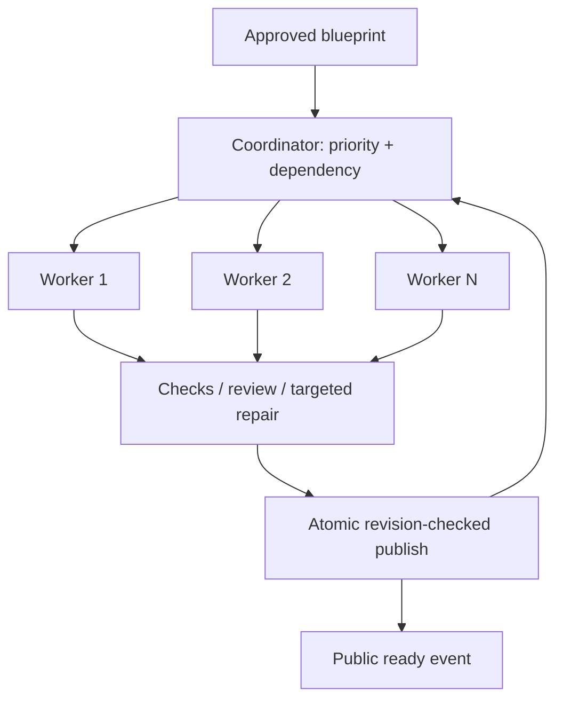

# Handoff generation Course: progressive, batch, multi-worker

Status: kontrak/desain #003 untuk implementasi planner #008, engine #009, player #011 dan Practice #012. Runtime Course multi-worker belum dibangun oleh #003. [Standar konten](course-content-standard.md) dan [riset primer](../research/course-generation-engine-2026-10-15.md) menjadi acuannya.

## Unit eksekusi dan tanggung jawab

Coordinator menerima outline yang disetujui dan sumber yang diotorisasi, membekukan blueprint/evidence revisions, lalu menerbitkan work items. Pool worker mengambil job yang siap. Peran tidak dipin permanen pada proses tertentu: setiap worker dapat menjalankan writer, review, Practice atau repair sesuai admission dan dependency.

WorkItem mencatat generation ID terpisah dari thread chat, blueprint hash, kind, target IDs, revisi dependency, prioritas dan idempotency key milik host. Key harus memasukkan scope pemilik serta identitas/revisi pekerjaan. Schema ini bukan otorisasi atau scheduler yang sudah berjalan.

## Jalur pertama dan batching

1. Persiapkan evidence/retrieval independen secara paralel; cache per source revision dan authorization scope.
2. Planner menyusun blueprint bersama: kemampuan, shared definitions, kontribusi, example assumptions, evidence, dependency dan intent asesmen. Persetujuan pengguna tetap mengikat revisi.
3. Admission memprioritaskan satu Lesson pertama yang berguna. Generate → validate → review → publish berada pada jalur ini, tanpa join seluruh Course.
4. Kelompok Lesson lain dibagi berdasarkan konteks, dependency dan token budget. Awal eksperimen: satu Lesson pertama, dua Lesson per kelompok berikutnya, jumlahnya configurable.
5. Kelompok independen dapat dikerjakan beberapa worker. Dependency pada hasil Lesson sebelumnya tetap menunggu artifact tersebut, bukan sekadar asumsi blueprint.
6. Lesson siap langsung diterbitkan sebagai snapshot. UI dapat membaca Lesson sambil menampilkan status bagian berikutnya.
7. Ketika semua Lesson wajib tersedia, satu call authoring menulis seluruh Practice melalui fixed typed slots. Checks dan review menilai paket terhadap versi Lesson tersebut.
8. Publish Practice secara idempotent setelah memeriksa ulang snapshot/revisi. Domain belajar menyelesaikan node setelah alur Practice pengguna selesai.

LangGraph StateGraph kecil memperlihatkan cabang pass/repair/hold; fungsi biasa melakukan aturan pasti. Publikasi boleh terjadi dalam worker/subgraph anak sebelum sibling selesai. Jangan menempatkan publish Lesson pertama setelah barrier seluruh writer pada parent. Independensi job memudahkan prioritas, cancellation dan recovery; tidak berarti setiap paragraf atau soal menjadi request terpisah.

## Resource admission dan pembagian keputusan

Urutan prioritas: first_lesson (termasuk review/publish), next_lesson, active_practice, background. Admission global membatasi jumlah call serta RPS/TPM/biaya provider lintas worker dan menjaga fairness antar pengguna. `max_concurrency` per graph saja tidak membatasi seluruh fleet. Benchmark jumlah worker dan batas call sebagai variabel terpisah.

Kode memiliki hitungan, IDs, dependency readiness, quota, cache lookup, batas repair dan publish routing. Jev hanya untuk keputusan semantik sempit atas evidence yang relevan: passage relevance, indikasi duplikasi kontribusi atau kandidat format. Batch pertanyaan independen atas state yang sama; input keputusan yang membutuhkan hasil sebelumnya menjadi request berikutnya. Keputusan sederhana tidak memerlukan LLM.

Mulai Jev sebagai signal yang dievaluasi; pin model/version dan ukur sensitivitas defect serta false hold pada bahasa Indonesia. Jangan menambah satu call Jev pada setiap tahap bila tidak menggantikan pekerjaan atau mengurangi latensi total. Model generatif menulis; model reasoning menangani perencanaan/review/repair yang membutuhkan penalaran sesuai evaluasi per peran.

## Recovery dan revisi

- Provider dipanggil di luar transaksi domain. Lock/claim dan publish memakai transaksi pendek.
- Checkpoint identity mencakup generation, slot, model/prompt/schema/rubric, evidence/blueprint dan dependency revisions.
- Restart boleh mengulang efek yang belum tercatat; write/event menggunakan idempotency key dan pemeriksaan hasil yang sudah ada.
- Artifact terbit immutable. Koreksi membuat revisi baru, menandai dependency/review terdampak, dan memberi penanganan pembaca yang telah membaca revisi lama.
- Batas dua repair dimiliki artifact/run dan berlaku lintas worker. Provider retries mempunyai overall attempt/deadline terpisah agar SDK retry tidak berlipat dengan graph retry.
- Browser ditutup tidak otomatis membatalkan generation. Pembatalan eksplisit dan perubahan outline dicek kembali sebelum publish.
- Stream hanya mengirim event/proyeksi allowlist; raw graph state dan token draf dapat mengandung key privat dan tidak dikirim ke pengguna.

## Verifikasi runtime pada #009

Bandingkan per-Lesson versus microbatch dengan kualitas, sumber dan tujuan yang setara. Ukur p50/p95 approval → Lesson pertama terbit, stall pada Lanjut, waktu Practice/semua konten siap, queue wait, defect/false hold, repair, token dan biaya termasuk retry. Pisahkan cache dingin/hangat, model per peran, worker tunggal/berbeban, serta ukuran konten. Jangan menyimpulkan speedup dari penurunan jumlah request saja.

Walkthrough manual meliputi dua worker mengambil pekerjaan sama, worker mati setelah provider/publish, sibling lambat atau gagal, provider 429, revisi sumber/outline saat berjalan, receipt/review kedaluwarsa, serta reconnect tanpa event/konten ganda. Model-generated quality dan hasil belajar pengguna perlu dievaluasi terpisah dari reliability runtime.
