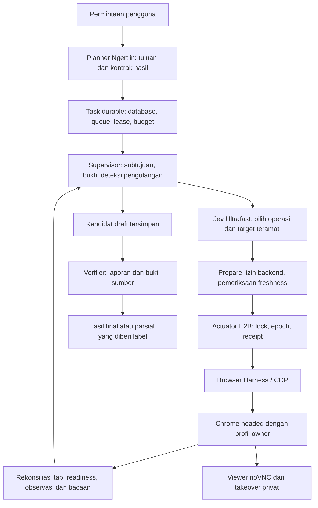

# Rencana perbaikan computer use berbasis Jev Ultrafast

Tanggal: 23 Oktober 2026. Status: rancangan implementasi, belum perubahan runtime.

Dasar: [audit thread f9a8](browser-thread-f9a8-audit-2026-10-23.md), [riset primer lanjutan](../research/jev-ultrafast-repair-2026-10-23.md), serta integrasi Jev/Harness/E2B dan izin komputer yang sudah tersedia. Hash delapan sumber inti masih cocok dengan snapshot audit ketika rencana disusun.

## 1. Hasil yang dituju dan keputusan arsitektur

Pengguna melihat agent membuka artikel, membaca informasi yang relevan, menyimpan temuan, kemudian berpindah sumber dengan alasan yang jelas. Worker yang berganti dapat melanjutkan temuan tersebut. Ketika suatu sumber terblokir atau budget tidak cukup, pengguna mendapatkan hasil parsial yang diberi label atau status hambatan yang jelas; aktivitas berulang tidak dianggap keberhasilan.

Jev Ultrafast tetap engine utama pemilihan operasi dan target DOM. Browser Use/Browser Harness tetap lapisan browser/CDP dalam E2B Desktop. Planner dan supervisor Ngertiin mengelola tujuan, durabilitas, izin, budget, dan hasil. Text helper tetap menyiapkan isian serta model generatif menyusun laporan; keduanya memakai bukti yang diberikan aplikasi.



Tidak ditambahkan loop Browser Use generatif kedua yang berebut kendali dengan Jev. Integrasi memakai pola Ultrafast yang sudah diadaptasi dan dipatok versinya: pilihan operasi/target dari state browser, prepare teks sebelum izin, kemudian actuator yang difence aplikasi. Menjalankan `Agent.run()` upstream tanpa integrasi lease/receipt bukan jalan untuk memperbaiki persistence. [Source Jev terpin](https://github.com/browser-use/jev-ultrafast/blob/1231850a0bf1a0c0341fe408ef1668dbbfdfac46/jev_ultrafast/agent.py), [CLI Browser Use](https://docs.browser-use.com/open-source/browser-use-cli).

Keputusan tetap: satu pemilik input pada satu waktu; CDP localhost; model/provider key di backend; navigasi dan pencarian rutin otomatis; mutation/keamanan memerlukan exact approval; password/OTP melalui takeover. Semua engine berbagi observer, target manager, evidence, izin, receipt, budget, dan verifier.

## 2. Fase 0 — Kunci reproduksi, kontrak, dan telemetry

Sebelum memperbaiki, simpan kasus gagal sebagai fixture deterministik: pencarian, artikel `target=_blank`, tiga kunjungan sumber tanpa informasi baru, retained v1, kandidat ditolak verifier, serta reservasi 26.630 dengan sisa 23.376.

Tambahkan metadata tersanitasi pada receipt dan observasi: `action_id`, subtujuan, engine dan model aktual beserta peran panggilan, browser generation, control version, target/frame/document, URL/title sebelum-sesudah, hasil navigasi, content hash, jumlah bukti baru, alasan fallback, dan durasi. Pisahkan `input_acknowledged` dari `postcondition_satisfied`. `complete` pada input tidak boleh tampil sebagai “sumber berhasil dibaca”.

Saat browser di bawah kendali manusia, hentikan pengamatan DOM/screenshot dan pengiriman konteks ke model; jangan menyimpan URL atau event yang berpotensi membawa token dari aktivitas login. Rekonsiliasi baru dilakukan setelah manusia mengembalikan kendali.

**Gate:** dua reproduksi audit tetap dapat dijalankan, trace menjelaskan sumber keputusan/akibat aksi, dan data privat tidak masuk telemetry. Perubahan berikutnya diuji terhadap fixture ini, bukan hanya demo form satu halaman.

## 3. Fase 1 — Pastikan kemampuan Jev tersedia pada resource aktual

Policy `engine=jev` tidak cukup. Startup harus menghasilkan capability manifest terverifikasi: runner/schema/build version, Python, Harness, interpreter yang dipakai, Chrome/CDP identity, endpoint, viewport, kemampuan DOM dan screenshot. Catat template identity asli secara terpisah; jangan menamai resource v1 sebagai template v2 setelah menambah dependency.

Pin baseline yang sudah terintegrasi: Jev source `1231850a0bf1a0c0341fe408ef1668dbbfdfac46`, wheel Harness `0.1.13` beserta hash, E2B SDK `2.56.0`, template build, versi Python/Chrome/runner, dan model `jev-1.13.0`. Evaluasi model lebih baru dilakukan terpisah sesudah baseline lifecycle lulus. Nama model alias dan confidence tidak menjadi bukti keberhasilan Task. [Dependency Jev](https://github.com/browser-use/jev-ultrafast/blob/1231850a0bf1a0c0341fe408ef1668dbbfdfac46/pyproject.toml), [model TypeSafe](https://docs.typesafe.ai/models).

Untuk retained v1, jalur utama adalah **maintenance capability satu kali pada sandbox yang sama**:

1. Ambil maintenance lease eksklusif hanya ketika tidak ada Task, aksi, atau takeover aktif. Admission resource/budget maintenance tetap berlaku.
2. Periksa kemampuan menjalankan perintah administratif, ruang disk, egress dependency terpin, serta persistensi filesystem. SDK menyediakan parameter user, tetapi akses aktual resource wajib diprobe.
3. Stage Python/uv/Harness/runner terpin pada direktori versi baru. Pertahankan Chrome dan profil owner; jangan membaca cookie ke model, mengganti profil, atau menjalankan dua Chrome pada profil yang sama.
4. Uji import, CDP attachment dan pembacaan halaman sintetis. Switch manifest/interpreter pointer secara atomik hanya sesudah sukses; simpan pointer lama untuk rollback. Instalasi yang terputus tidak menandai capability ready.
5. Flush writes; uji filesystem pause/resume dan cold restart. Bangun ulang koneksi/handle setelah boot. Baru setelah itu resource boleh menerima Task Jev.

Resource baru tetap memakai template v2 yang dependency-nya sudah dibakar; tidak ada instalasi dependency pada setiap Task. Bila maintenance tidak layak pada resource lama, tahan Task dengan alasan upgrade yang jelas. Ekspor/import profil ke resource baru merupakan jalur sekunder dengan uji portability dan kemungkinan reautentikasi, bukan jaminan login dapat dipindahkan. Snapshot/fork dapat membantu checkpoint bila didukung, tetapi tidak mengganti base template resource lama. [SDK terpin](https://github.com/e2b-dev/E2B/blob/62a17dfc3f11439d1d06bfb9bb515eadc5adfcd3/packages/python-sdk/e2b/sandbox_sync/main.py), [filesystem persistence](https://docs.e2b.dev/sandbox/filesystem-only-snapshots), [snapshot](https://docs.e2b.dev/sandbox/snapshots).

Sebelum import Harness, set `BU_CDP_URL=http://127.0.0.1:9222`, bersihkan override `BU_CDP_WS`, dan gunakan `BU_NAME` yang terikat workspace/browser generation. Validasi browser yang sudah disiapkan aplikasi; self-healing Harness tidak boleh diam-diam membuat Chrome lain atau memilih profil lain.

**Gate:** create v2 dan retained v1 setelah maintenance sama-sama benar-benar menjalankan keputusan browser melalui Jev, ledger mencatat peran `browser_decision`, dan resume tidak menghilangkan capability/profil. Missing capability tidak lagi berubah diam-diam menjadi screenshot untuk seluruh Task.

## 4. Fase 2 — Canonical target mengikuti transisi yang sah

Canonical target adalah tab milik subtujuan saat ini, bukan satu ID yang dibekukan sepanjang sesi. Target manager menjadi satu sumber kebenaran bagi DOM, screenshot, input, verifier, dan viewer.

Gunakan CDP `Target.setDiscoverTargets`, event target created/changed/destroyed, serta `Target.getTargets` untuk rekonsiliasi. Harness 0.1.13 menyediakan `cdp()` dan `drain_events()`, dengan buffer bersama; gunakan satu consumer/demultiplexer dan hindari helper network-idle lain yang menguras buffer secara bersaing. Ini adaptasi aplikasi, bukan API subscription baru dari Harness. [Harness helpers](https://github.com/browser-use/browser-harness/blob/c6a941287424f32e2d20c7b7b892c8493f46808d/src/browser_harness/helpers.py), [CDP Target](https://chromedevtools.github.io/devtools-protocol/tot/Target/).

Urutan untuk satu aksi:

1. Catat baseline target, dokumen, expected href bila tersedia, event cursor, action ID, browser generation, dan epoch.
2. Prepare dan authorize terhadap target/fingerprint terbaru; dispatch sekali di actuator lock.
3. Rekonsiliasi akibat sebelum observasi berikutnya memfokuskan tab mana pun: halaman yang sama, target baru, redirect, download, tab tertutup, atau tidak ada perubahan.
4. Untuk tab baru, periksa hubungan dengan aksi/target asal, `openerId` bila tersedia, tujuan, dan epoch. Tunggu URL final yang relevan; `about:blank` saat target lahir bukan bukti tujuan akhirnya. Jangan memilih tab terbaru hanya berdasarkan urutan `/json/list`.
5. Bila hubungan jelas dan policy mengizinkan navigasi rutin, adopsi target baru tanpa approval tambahan. Update registry/freshness secara atomik; proposal dari dokumen lama menjadi stale. Bila beberapa popup atau asalnya ambigu, hentikan perpindahan otomatis dan minta keputusan yang relevan.
6. Setelah target konsisten, barulah aktivasi untuk viewer/screenshot. Jangan mengaktifkan tab pencarian lama sebelum rekonsiliasi.

Readiness memakai hasil navigasi, frame/loader yang tepat, perubahan route SPA, dan predicate konten yang dibutuhkan. Network idle atau sleep 0,75 detik bukan satu-satunya penentu. Default awal yang diusulkan: batas navigasi 15 detik dengan observasi konten stabil yang singkat, selalu dipotong deadline sesi/attempt. Jika halaman tetap terblokir/loading, simpan alasan dan pindah sumber atau minta bantuan. Nilai ini dituning dengan corpus, bukan SLA yang sudah terbukti. [CDP Page](https://chromedevtools.github.io/devtools-protocol/tot/Page/).

**Gate:** tautan biasa, `target=_blank`, window.open, redirect, SPA, download, popup ambigu, tab ditutup, dan reconnect lulus. Artikel tetap menjadi target observasi sesudah terbuka. Worker/epoch lama tidak dapat mengadopsi tab dari takeover.

## 5. Fase 3 — Beri Jev subtujuan dan kontrak keputusan yang jelas

Planner menyusun kontrak hasil yang dibekukan per revisi Task. Untuk riset: cakupan topik, kebutuhan sumber, tanggal acuan runtime, bentuk laporan dan aturan pembedaan fakta/proyeksi. Untuk interaksi situs: postcondition yang diperlukan dan batas izin yang sudah berlaku. Konten halaman tidak dapat memperluas kontrak atau grant.

Supervisor mengelola siklus berikut; Jev memilih langkah browser untuk subtujuan yang sedang aktif:

```text
SEARCH -> OPEN_SOURCE -> WAIT_READY -> READ_SOURCE -> SAVE_EVIDENCE
       -> CHECK_COVERAGE -> source berikutnya / SYNTHESIZE
       -> SAVE_CANDIDATE -> VERIFY -> FINAL / PARTIAL / NEEDS_INPUT
```

Nama state merupakan rancangan aplikasi, bukan operasi upstream Jev. READ_SOURCE dijalankan observer/extractor yang terkendali, dengan scroll atau disclosure yang dipilih Jev bila diperlukan. Jangan meminta Jev membuktikan seluruh laporan riset “terlihat selesai” pada satu halaman.

Ubah hasil broker yang sekarang `Action | None` menjadi union eksplisit:

| Hasil | Arti dan tindakan supervisor |
| --- | --- |
| `Act(action)` | Aksi teramati; tetap melalui izin, freshness, dan receipt. |
| `SubgoalDone(evidence_refs)` | Verifikasi subtujuan, lalu lanjut cakupan atau sintesis. Tidak langsung menerbitkan hasil. |
| `Blocked(reason, category)` | Bedakan sumber terblokir, mekanisme DOM tidak didukung, bukti kurang, atau masalah runtime. |
| `NeedsHuman(reason)` | Handoff privat atau klarifikasi yang memang dibutuhkan. |

`DONE` dan `BLOCKED` tidak lagi sama-sama menjadi `None` yang otomatis memanggil actor screenshot. Pertahankan keunggulan Ultrafast: pilihan operasi dan target yang relevan dibatch pada satu request TypeSafe; jangan menambah reasoning model pada setiap klik. Text helper hanya dipanggil ketika teks memang diperlukan, dan isinya siap sebelum izin.

Fallback screenshot hanya untuk bagian yang tidak dapat diamati/dikendalikan DOM, dengan alasan dan batas percobaan. Ia memakai target, observer, evidence dan penjaga loop yang sama, lalu mengembalikan kendali ke Jev ketika DOM dapat digunakan. Password/OTP/halaman privat tetap ke takeover.

**Gate:** supervisor membedakan selesai/blocked/fallback secara deterministik; task DOM yang didukung benar-benar memakai Jev sepanjang pemilihan aksi, bukan hanya satu panggilan probe.

## 6. Fase 4 — Simpan hasil bacaan dan hentikan pengulangan tanpa kemajuan

Simpan metadata source dan excerpt terbatas setelah sumber siap dibaca: requested/final URL tersanitasi, title, waktu akses, tanggal publikasi bila tersedia, content hash, section/anchor, excerpt yang benar-benar diamati, temuan yang didukung, dan status sumber. Keterangan yang tidak tersedia tetap unknown. Jangan mengganti excerpt dengan parafrasa model lalu menyebutnya bukti asli.

Untuk artikel panjang, baca bagian yang relevan dengan cursor/section dan batas ukuran; snapshot viewport 6.000 karakter tidak dianggap seluruh artikel. Field privat dan konten takeover tidak masuk reader. Model hanya menerima bundle relevan yang dibatasi ukuran; evidence terikat owner, Task, revisi, dan lifecycle file/task yang berlaku.

Sebelum meninggalkan artikel, harus ada salah satu dari: bukti tersimpan, alasan sumber tidak relevan/terblokir, atau interupsi pengguna/keamanan. Tidak ada sleep buatan untuk memberi kesan membaca.

Pisahkan kemajuan operasional dari kemajuan tujuan. Navigasi committed atau klik diakui adalah kemajuan operasional; bukti relevan baru, field yang tervalidasi, atau subtujuan terpenuhi adalah kemajuan tujuan. Navigasi A–B–A tidak boleh terus mereset counter tujuan.

Default penjaga awal yang diusulkan untuk kedua engine:

- Aksi semantik sama pada target/dokumen yang tidak berubah dua kali: hentikan pengulangan tersebut dan replan.
- Siklus kunjungan/pencarian tiga kali tanpa bukti atau postcondition baru: ganti sumber/strategi sekali, lalu blocked/partial bila tetap tidak maju.
- WAIT hanya selama transisi dengan deadline; readiness ditangani kode tanpa menghabiskan panggilan Jev berulang untuk menunggu kondisi yang sama.
- URL normalization mempertahankan query/route yang bermakna; scroll dengan teks baru serta revisit untuk subtujuan berbeda tetap sah. Retry untuk outcome mutation yang belum pasti tidak diizinkan.

Angka tersebut adalah guard awal untuk diuji pada data target, bukan threshold universal model. Replan tidak boleh mereset budget global, deadline, atau histori pengulangan.

**Gate:** kasus audit berhenti mengklik sumber yang sama; sumber benar-benar menghasilkan catatan; dua engine melewati penjaga yang sama; temuan tetap tersedia setelah pergantian worker.

## 7. Fase 5 — Kandidat persisten, verifier sesuai jenis hasil, dan budget finalisasi

### Kandidat dan verifikasi

Simpan kandidat beserta hash, evidence refs, dan status `unverified` sebelum verifikasi. Jangan sekadar memanggil `sandbox.outputs.persist()` lebih awal: helper sekarang mengubah stage menjadi `draft_ready`, yang dapat melewati browsing/verifikasi pada retry. Pisahkan penyimpanan bytes dari promotion ke draft yang boleh difinalisasi. Publication harus memeriksa kandidat/hash/revisi dan validation status, termasuk ketika worker diulang.

Untuk laporan riset, verifier menerima isi laporan, peta klaim–sumber, excerpt asli, metadata tanggal, dan batas cakupan. Pertama periksa ID/URL/hash, quote benar-benar ada, dan aturan tanggal melalui kode. Setelah itu Jev dapat menilai apakah klaim didukung konteks; ketidakpastian atau konflik penting dapat dinaikkan ke model reasoning dengan budget terbatas. Confidence tidak memberi izin publikasi. [Pola citation checking resmi](https://docs.typesafe.ai/cookbooks/citation_check), [confidence](https://docs.typesafe.ai/confidence).

Hasil verifier: `passed`, `failed`, atau `inconclusive`, dengan alasan dan klaim yang perlu diperbaiki. Simpan verdict serta kandidat yang ditinjau. Untuk aksi situs, pakai postcondition/receipt efek yang relevan; screenshot tetap berguna sebagai bukti tambahan, bukan verifier universal untuk semua tujuan.

### Budget dan hasil parsial

Hitung kebutuhan finalisasi dari batas konteks, output, dan jenis verifier yang benar-benar akan dipakai; jangan memakai persentase tetap atau menganggap byte sama dengan token provider. Pisahkan anggaran eksplorasi dari cadangan sintesis/verifikasi/finalisasi:

```text
boleh_aksi_baru = remaining_work >= bound_aksi_baru + remaining_finish_reserve
```

Reservation/settlement tetap atomik dan tidak boleh melampaui cap/allowance. Estimator, batas output, model call role, unknown cost, dan actual usage dicatat terpisah. Jika provider tidak memberikan estimator yang andal, batasi konteks/output dan pertahankan batas konservatif yang eksplisit. Jangan memotong reservation diam-diam agar request lolos.

Ketika eksplorasi tidak muat, checkpoint dan gunakan cadangan finalisasi. Jika bukti cukup, hasil final; bila belum cukup, hasil parsial yang berlabel dan menyebut kekurangannya. Bila bahkan finalisasi model tidak dapat dilakukan, renderer deterministik dapat menyimpan daftar temuan/tautan yang sudah tervalidasi atau status hambatan tanpa klaim riset lengkap. Tidak ada pesan “draft tersimpan” ketika kandidat kosong, dan status `succeeded` tidak dipakai untuk pekerjaan parsial.

Tentukan outcome/stage parsial dan blocked-budget yang eksplisit serta kompatibel dengan API/UI/ledger; jangan menambah status enum sepihak. Profil budget khusus riset ditetapkan dari baseline workload dan melalui admission yang sama. Memperbesar cap atau timeout bukan syarat pengganti perbaikan loop.

**Gate:** replay sisa 23.376/reservasi 26.630 menghasilkan checkpoint/hasil parsial atau hambatan yang dapat dilanjutkan, bukan kegagalan generik dengan hilangnya seluruh kandidat. Kandidat yang ditolak tetap dapat diaudit dan tidak otomatis dipublikasikan pada retry.

## 8. Fase 6 — Durabilitas, takeover, dan perubahan data yang aman

Gunakan database/queue/lease existing untuk melanjutkan pada batas aksi yang terkonfirmasi. Attempt 180 detik tetap potongan kerja; bukan durasi maksimum tujuan. Simpan subtujuan, bukti, candidate ref, fase verifikasi, dan anggaran saat yield. Setelah cold boot, target/CDP/node handle dianggap ephemeral: bangun ulang dari URL/subtujuan dan evidence, jangan mereplay node lama.

Tambahkan dispatch ID yang unik ke actuator dan receipt lokal yang terbatas agar koneksi hilang dapat direkonsiliasi tanpa mengirim input lagi. Ini at-most-once dispatch pada batas aplikasi; bukan jaminan exactly-once efek email/pembayaran di server eksternal. Mutation yang hasilnya belum pasti tetap memerlukan pemeriksaan, tidak otomatis diulang.

Penyimpanan minimum yang diusulkan bersifat additive: metadata capability/browser generation pada workspace; outcome metadata pada step; observasi/evidence yang dibatasi; kandidat/verdict dengan referensi output existing. Gunakan tabel terpisah untuk data yang perlu dicari/diuji kepemilikannya; `runtime_state` hanya cursor/progress ringkas, bukan seluruh artikel atau transcript model. Reuse storage/file primitives yang ada, hindari framework orchestration kedua.

Versikan skema browser-loop dan capability. Jangan menaikkan workflow global sehingga Task teks/Python lama ikut diblokir. Task lama dilanjutkan melalui jalur kompatibilitas yang jelas atau dimigrasikan di batas aman; proposal lama tidak boleh direinterpretasi otomatis. Task audit yang tidak menyimpan evidence memang tidak dapat memulihkan bacaan yang tidak pernah dicatat.

Kontrol kembali dari manusia selalu fresh observe dengan epoch baru; semua model result lama ditolak. Event consumer dan metadata watcher ikut aturan privacy. Penerbitan hasil, penghapusan profil, dan otorisasi aksi tetap kontrak terpisah.

**Gate:** kill/restart worker, delayed model result, lost acknowledgement, takeover, Stop, viewer disconnect, serta expiry tidak menyebabkan dua pemilik input, duplicate mutation, kehilangan evidence terkonfirmasi, atau false success.

## 9. Urutan delivery, file, dan release

| Increment | Perubahan utama | Area file | Prasyarat/gate |
| --- | --- | --- | --- |
| 0. Reproduksi dan trace | Fixture audit, model call role, observation/action outcome | `scripts/inspect_browser_runtime.py`, `scripts/probe_jev_browser.py`, `computer/steps.py`, budget events | Kasus gagal terkunci; tanpa efek pada data pengguna. |
| 1. Capability | Manifest, maintenance v1, create v2, actual engine | `computer/e2b.py`, `lifecycle.py`, `jev_runner.py`, template builder; modul capability baru bila diperlukan | Warm/cold probe dan rollback pointer lulus. |
| 2. Target/readiness | Single event consumer, target adoption, SPA/redirect | `computer/cdp.py`, `actuator.py`, `jev_runner.py`; target manager | Reproduksi tab artikel tidak lagi ditinggalkan; takeover race lulus. |
| 3. Jev supervisor | Typed decision, microgoal, bounded fallback | `computer/jev.py`, `contracts.py`, `workflow.py` | DONE/BLOCKED tidak tercampur; Jev jadi actor DOM aktual. |
| 4. Evidence/loop | Reader, state sumber, novelty, guard lintas engine | `workflow.py`, `continuation.py`, snapshot/reader; evidence/observation module | Pengetahuan tersimpan dan pola audit berhenti. |
| 5. Candidate/finish | Stage bytes, purpose verifier, finish reserve, partial outcome | `verification.py`, `tasks/budget.py`, `sandbox/outputs.py`, result publication/API | Retry tidak melewati verifikasi; low budget tetap jujur. |
| 6. Hardening/UX | Recovery/journal, progress dari outcome, privacy/fault corpus | runtime/recovery/control, Task/computer UI, additive migration | Gate end-to-end, cleanup, owner isolation dan canary. |

State/contract budget dan kandidat dirancang pada increment 0 agar increment berikutnya tidak membuat jalur publication yang tak terlindungi. Setelah itu setiap increment berupa perubahan vertikal dengan fixture dan bukti kelulusan sendiri; tidak menunggu seluruh kode selesai untuk menguji browser nyata.

UI normal menampilkan kemajuan dari outcome: “Membaca sumber 1 dari 3”, “Sumber meminta login”, “Menyimpan temuan”, atau “Hasil sementara tersedia”. Versi Harness/model dan engine teknis masuk detail diagnosis; jangan memenuhi alur utama dengan konfigurasi internal. Closing viewer tidak menghentikan Task atau menyetujui aksi.

Release: migration additive dan feature flag browser-loop v2; Task baru canary dahulu, lalu retained profile setelah maintenance gate. Rollback menahan Task baru pada boundary aman dan mengembalikan manifest/versi kompatibel. Jangan memindahkan Task aktif ke loop lama di tengah aksi atau kembali ke screenshot tanpa alasan yang tercatat. Evidence, kandidat, profil, dan hasil tidak dihapus oleh rollback.

## 10. Acceptance dan batas klaim

| Kelompok uji | Bukti yang wajib |
| --- | --- |
| Stack aktual | Jev menerima state DOM dan memilih aksi pada create v2 maupun retained v1 setelah maintenance; tidak ada silent full-task screenshot fallback. |
| Lintas tab/situs | Minimal 3 sumber, termasuk target baru/SPA/redirect; DOM, screenshot, verifier dan viewer memakai sumber yang sama. |
| Membaca/loop | Bukti tersimpan sebelum pindah; source blocked dicatat; klik berulang dan A–B–A tanpa informasi baru berhenti secara bounded. |
| Verifikasi | Quote palsu, unsupported dan kontradiksi diuji; verdict/candidate tersimpan; penelitian faktual dan proyeksi dibedakan. |
| Budget | Kasus audit, insufficient synthesis reserve, unknown cost dan cap/allowance; hasil partial/blocked akurat dan tidak menghabiskan tanpa batas. |
| Persistence | Melewati beberapa attempt >180 detik, worker restart sebelum/sesudah dispatch, warm/cold resume dan viewer disconnect. |
| Izin/privacy | Read otomatis; send/edit/pay/security approval; password/OTP takeover; late callback dan popup tidak memperluas izin. |
| Profil | Data/login sintetis tetap tersedia setelah maintenance, pause/resume dan rollback; portability login lintas resource diuji terpisah. |

Semua fixture keselamatan harus lulus, tanpa unauthorized/double mutation atau false success. Untuk corpus awal, usulkan 30 tugas supported yang representatif, tiga pengulangan masing-masing, mencakup Indonesia/English, cold/warm dan multi-sumber. Gate pilot awal: minimal 90% tujuan terselesaikan dengan output terverifikasi pada corpus supported; eskalasi benar pada corpus unsupported dicatat terpisah dan tidak dihitung sebagai keberhasilan tujuan. Ini target evaluasi, bukan hasil yang sudah dicapai atau SLA produksi.

Ukur p50/p95 startup, snapshot, Jev/text-helper, dispatch/readiness, pembacaan, sintesis/verifikasi, total latency, biaya per provider, fallback ratio, repeat/no-progress rate, coverage sumber, recovery, dan completion. Bandingkan Jev dengan screenshot pada task, izin, budget dan verifier yang setara. Long-run 30–60 menit hanya diuji pada policy pilot yang lebih dahulu diadmit; tidak mengubah default 20 menit menjadi unlimited.

Selesai berarti kasus audit benar-benar menghasilkan laporan bersumber atau hasil parsial yang jujur tanpa looping, Jev benar-benar berjalan, dan failure recovery tidak melanggar kontrol. Keberhasilan fixture satu halaman atau nama engine dalam konfigurasi tidak memenuhi gate tersebut.
