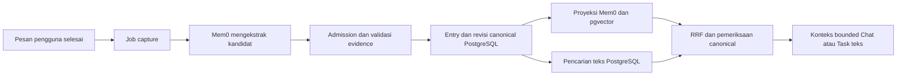

# Memory personal Ngertiin

Memory menyimpan fakta, preferensi dan observasi pengguna dengan sumber yang dapat diperiksa. Implementasi NG-017/018 memakai `mem0ai==2.2.1` sebagai library Python di proses backend/worker, PostgreSQL/pgvector yang sudah ada, dan Procrastinate. Tidak memerlukan akun, API key atau layanan Mem0 Cloud. Panggilan model dan embedding tetap memakai provider yang dikonfigurasi dan menimbulkan biaya.

## Alur data

1. Setelah respons chat berhasil, `memory.discover` memilih pernyataan personal atau permintaan eksplisit untuk mengingat. Pertanyaan biasa dilewati. Capture tidak dijalankan sebelum giliran selesai agar keputusan persona, termasuk rejection, sudah tersedia.
2. Backend memverifikasi owner dari autentikasi, capture setting, revisi/hash sumber, exclusion persona, secret dan perintah forget. API capture juga menerima file/result revision exact milik owner; file/result tidak otomatis ditangkap dan tidak memiliki tombol capture pada UI V1 ini. Assistant output dan web bukan sumber personal memory.
3. Mem0 mengekstrak paling banyak lima kandidat dari input maksimal 6.000 UTF-8 bytes. Kandidat terisolasi per owner/job dalam collection `ngertiin_memory_candidates_v1`. Hasil extraction belum tersedia untuk recall. Satu batch admission memeriksa kutipan sumber exact, jenis, confidence, key atribut dan apakah fakta baru, koreksi atau perubahan dunia. LLM mengusulkan makna; code menentukan legalitas write.
4. Transaksi pendek memeriksa ulang lease, generation, sumber dan suppression. `memory_entries`, `memory_revisions` dan `memory_evidence` menjadi sumber kebenaran. Entry memuat owner, jenis, confidence, status dan waktu; evidence memuat ID/revisi/hash sumber dan kutipan exact. Confidence di bawah 0,85 atau konflik yang belum jelas tetap candidate dan tidak masuk prompt.
5. Outbox memproyeksikan revisi aktif melalui Mem0 `add(infer=False)` ke `ngertiin_memory_active_v1`, tanpa ekstraksi ulang. Metadata menyimpan ID entry/revisi aplikasi. Record SDK dapat dibangun ulang dan bukan otoritas domain. Kandidat staging dibersihkan sesudah job; recovery juga membersihkan kandidat orphan setelah tiga menit.

## Recall dan penggunaan oleh agent

Sebelum Chat dan Task teks, aplikasi menggabungkan kandidat semantic Mem0, kandidat full-text PostgreSQL yang dicari secara independen, dan profil inti kecil. Full-text memakai konfigurasi `simple` dan `ts_rank_cd`; penggabungan memakai Reciprocal Rank Fusion. Bahasa Indonesia/English diteruskan ke embedding yang sama; tidak memerlukan model NLP bahasa Inggris tambahan.

Setiap hasil dihidrasi kembali dari canonical: owner harus sesuai, revision masih current/active, waktu berlaku sah, tidak suppressed dan sedikitnya satu evidence masih tersedia dengan hash yang sama. Stale/orphan vector tidak boleh masuk prompt. Kegagalan semantic search menggunakan full-text/profil inti yang masih sah. Akun tanpa entry aktif tidak melakukan embedding recall.

Envelope konteks dibatasi 4.000 UTF-8 bytes, termasuk label dan metadata, sebagai batas token konservatif. Chat menyediakan `read_user_memories`; `remember_current_message` hanya mengakui pending dan menunggu turn selesai. Memory adalah data, tidak mengubah Soul, izin tool, saldo atau status Task.

Run/Task menyimpan referensi revision dan generation yang dipakai. Referensi diperiksa sebelum model/tool, progress dan publication. Koreksi/forget menghentikan pekerjaan aktif yang memakai revision lama, menghapus draft, approval tertunda dan snapshot draft revisi tersebut serta checkpoint yang terlacak, dan mencegah saver ber-lease lama menulis kembali. Riwayat untuk model menyaring source turn yang dikecualikan dan jawaban dengan lineage memory yang dicabut. Snapshot instruksi/izin Task tetap utuh; hasil yang sudah dikirim tidak ditarik kembali. Retry Task memakai revision baru dan menyusun ulang draft dengan konteks yang masih sah.

## Kendali pengguna dan lifecycle

Avatar/nama asisten → **Identitas → Ingatan tentangmu** menyediakan daftar berpaginasi, jenis/status, kutipan dan label sumber, edit, riwayat, forget serta capture toggle. Revision stale mendapat 409 dan meminta data terbaru. Request key mengembalikan receipt yang sama pada retry exact; key dengan isi berbeda ditolak. Browser menyimpan fingerprint/key retry, bukan salinan teks ingatan di sessionStorage.

| Tindakan | Hasil |
| --- | --- |
| Koreksi informasi salah | Revisi lama `corrected`; revisi baru aktif dengan evidence editor. Informasi salah tidak dianggap kebenaran historis. |
| Fakta benar kemudian berubah | Revisi lama `historical` dan `valid_to`; versi baru berlaku kini. Riwayat tersedia untuk inspeksi; recall otomatis hanya mengambil fakta yang berlaku kini. |
| Sumber hilang/berubah | Dukungan sumber itu tidak sah. Fakta tetap dapat dipakai hanya jika evidence independen lain masih sah. UI menandai sumber tidak tersedia. |
| Lupakan | Segera cabut penggunaan dan tambah suppression; hapus plaintext entry/revision, kutipan evidence, payload capture serta checkpoint konteks yang terlacak. Outbox menghapus proyeksi pencarian. Pending cleanup terlihat dan tidak menunda revocation. |
| Capture off | Blok job baru serta commit hasil job in-flight melalui generation fence. Ingatan lama dan seluruh kontrol tetap tersedia. Tidak menghapus ingatan lama. |

Source revision yang telah dilupakan dikecualikan dari capture ulang. Kemunculan biasa dalam sumber baru juga tidak membatalkan suppression atribut. Permintaan baru dari pesan pengguna yang secara eksplisit mengatakan **“ingat lagi” / “remember again”**, dengan evidence baru yang lolos admission, dapat membuka suppression atribut tersebut. Edit langsung juga merupakan keputusan eksplisit owner.

Forget tidak menghapus chat/file/result asli, jawaban yang sudah terkirim, backup atau semua turunan arbitrer yang tidak terlacak. Penghapusan sumber menggunakan operasi sumber tersendiri. Backup mengikuti retention operasional; restore tidak boleh menghilangkan suppression/tombstone sebelum traffic memory dilayani.

## Operasi, biaya dan pemulihan

Jalankan `make install`, `make migrate`, lalu restart worker. Migration incremental `0008_personal_memory` tidak mereset data. Konfigurasi/default ada di `.env.example`: extraction `gpt-5-mini`, embedding `text-embedding-3-small`, dimensi 1.536. Adapter extraction menggunakan JSON terbatasi, output maksimal 2.000 token dan transport yang sama dengan meter biaya. Embedding model/dimensi diikat fingerprint registry; perubahan konfigurasi indeks ditolak dan memerlukan rebuild terencana, bukan mencampur embedding lama dan baru.

`memory_cost_events` mereservasi setiap HTTP attempt sebelum request, termasuk admission dan embedding. Batas konservatif: 160.000 unit/job, 250.000 unit/akun/hari dan 2.500.000 unit/global/hari UTC. Usage provider yang terkonfirmasi mengganti reservasi; unknown outcome tetap menahan estimasi, tidak diasumsikan gratis. Ledger tidak menyimpan prompt/teks memory. Angka ini merupakan internal token units, bukan harga USD atau SKU pelanggan. Inspect/edit/forget/capture-off tidak menggunakan allowance chat atau inference.

Capture: lease tiga menit, timeout attempt 150 detik, maksimal tiga attempts; extraction/admission yang sudah tersimpan diteruskan saat retry. Index: lease 90 detik, maksimal lima attempts; delete diprioritaskan. Maintenance memulihkan lease expired dan outbox. Sesudah batas attempts, operator perlu meninjau penyebab dan mengantrekan ulang operation yang tepat; UI tidak menyebut cleanup selesai selama masih pending.

Mem0 telemetry dimatikan sebelum import. History SQLite SDK memakai `:memory:` per operation dan ditutup eksplisit, termasuk saat delete, sehingga tidak meninggalkan history SDK plaintext pada disk. Secret gate bersifat best effort; bukan janji deteksi semua rahasia. LLM admission juga memerlukan evaluasi kualitas berkelanjutan dan tidak menjamin setiap inferensi benar.

Verifikasi: `make memory-inspect`; trial provider nyata: `uv run --project apps/backend python scripts/inspect_memory.py --live`. Inspector memakai database disposable; lihat [penerimaan NG-017/018](memory-17-acceptance.md) untuk bukti dan batas environment.
