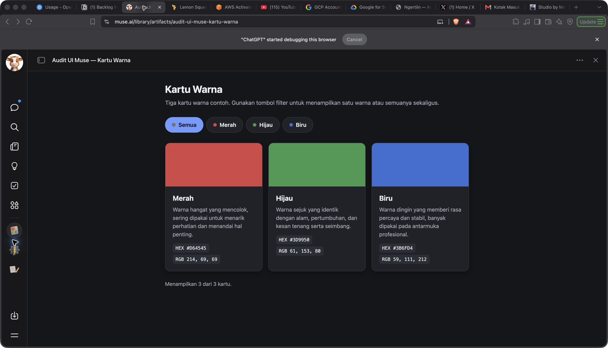
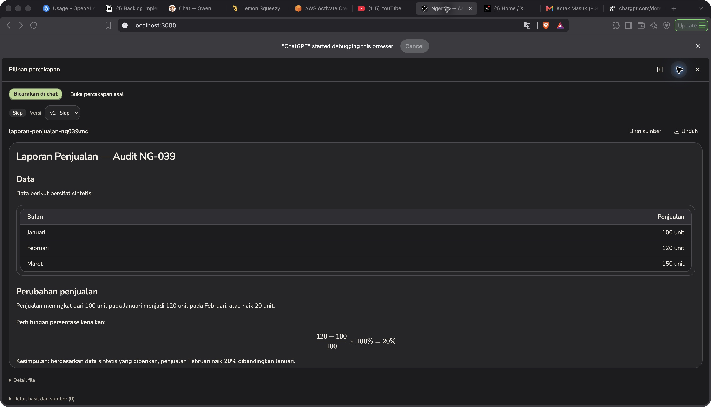
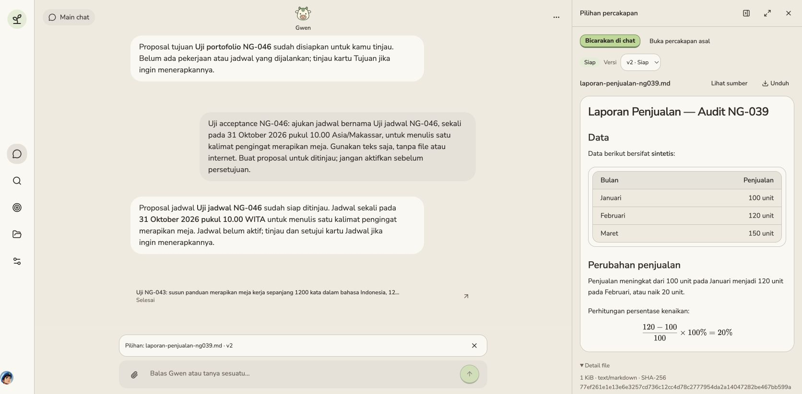
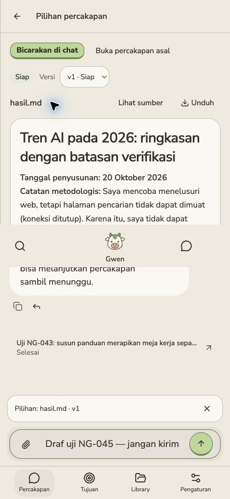
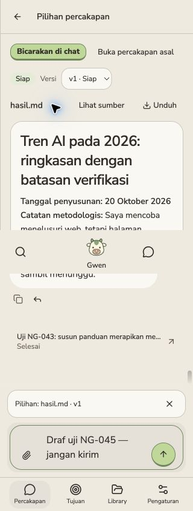

# NG-045–046 · Artifact, tujuan, jadwal dan acceptance terpadu

Implementasi lokal 20 Oktober 2026. [NG-045](https://app.notion.com/p/3feabdd6187381b1b2eefcbae0e4cbc9) dan [NG-046](https://app.notion.com/p/3feabdd618738189878dea88adaf97fc) **Review**. Belum memenuhi seluruh Definition of Done. Perubahan melanjutkan workspace NG-042–044 yang belum di-commit; tidak ada commit/push dalam pekerjaan ini.

## Implementasi

- Hasil chat menjadi kartu ringkas. Satu klik dari chat/Library membuka file ter-render di panel bersama chat. Detail checksum, ringkasan dan provenance ada dalam disclosure. Versi tetap dapat dipilih; gagal/terhenti mengarah ke pekerjaan dan pemulihan yang sudah ada.
- Markdown memakai renderer produk, termasuk heading/list/table/code, dollar math dan display LaTeX `\[...\]` di luar code fence. Sumber terpisah. Gambar eksternal dalam Markdown tidak dimuat; script/iframe tidak dirender. HTML tetap memakai sanitizer, CSP, sandbox kosong dan tanpa jaringan. PDF/format tanpa preview menjelaskan jalur unduh. Tidak ada share publik baru.
- Library memiliki kategori Semua/Hasil/File, tujuh hari terakhir/semua waktu, pencarian, sorting serta grid/daftar. Preview kartu adalah cuplikan teks dan ikon, bukan screenshot thumbnail HTML atau kategori yang belum didukung.
- Bicarakan memilih objek/versi secara eksplisit dalam composer dan mempertahankan viewer. Perubahan versi viewer tidak diam-diam mengganti pilihan chat: pill menunjukkan versi konteks sampai Bicarakan ditekan kembali. Desktop memakai split/resize/maximize/collapse. Mobile diskusi memakai split vertikal 45% viewer, sisa chat. Referensi viewer disimpan per pengguna/thread; posisi baca per pengguna/revisi file/mode. Penyimpanan gagal tetap memakai state memori.
- Rencanakan lewat chat menambahkan instruksi ke draft tanpa mengirim otomatis. Proposal goals/jadwal menggunakan jalur agent dan keputusan backend yang sudah ada. Form manual tetap tersedia; konfigurasi runtime, input/output dan cap berada dalam disclosure. Menyimpan goal bukan izin menjalankan pekerjaan.
- Goals menampilkan target dan progress dari evidence server. Proposal jadwal memakai estimator kredit backend; tidak menganggap unit token sama dengan kredit. Pause/delete tidak ditampilkan sebagai eksekusi berbayar. Riwayat waktu mengikuti zona jadwal, atau zona perangkat bila jadwal tidak tersedia, dengan label zona eksplisit.
- Bicarakan goal/jadwal memilih konteks objek/versi. Feed/proaktivitas memakai permukaan existing; tidak menambah feed atau kemampuan baru.

## Referensi langsung dan perbedaan sengaja

Isi artifact Muse **kini teramati** melalui AX native Brave: halaman Kartu Warna memiliki heading, penjelasan, filter empat tombol, tiga kartu, HEX/RGB dan jumlah kartu. Tool screenshot/DOM extension gagal mengakses iframe blob; akses native memperlihatkan isi tanpa melemahkan sandbox/izin browser. Klik Open side-by-side chat mempertahankan artifact dan membuka chat, dengan separator serta Maximize. Ini bukti ready artifact HTML tersebut, bukan semua state Muse.

Pasangan native berikut memakai jendela 3360×1926 piksel fisik yang sama. Viewport Ngertiin diukur 1672×822 CSS; viewport Muse tidak berhasil diukur melalui extension, sehingga pasangan ini hanya bukti komposisi pada jendela setara, **bukan parity pixel yang terverifikasi**. Keduanya memperlihatkan viewer penuh, tetapi isi artifact berbeda.

| Aspek | Bukti / keputusan |
| --- | --- |
| Header viewer | Muse menampilkan judul, side-chat, menu dan close. Ngertiin mempertahankan header panel bersama dan nama file/aksi di bawah; ini penyimpangan layout yang belum menjadi parity. |
| Density | Ngertiin: header 56px minimum, padding 16px, gap 12px; split awal 480px, keyboard resize 32px, rentang 320–900px dengan batas 52vw. Ukuran Muse belum diukur secara DOM; perkiraan visual tidak dijadikan spesifikasi final. |
| Konten | Ngertiin memakai Soft Matcha/Nunito dan semantic tokens. Markdown ter-render; gambar jarak jauh diblokir. HTML tanpa script tetap kontrak produk meskipun artifact Muse memiliki filter interaktif. |
| Mobile | Split vertikal 45dvh adalah keputusan Ngertiin agar dokumen dan composer terlihat. Pola mobile Muse tetap unknown. |
| Library | Preview teks/ikon untuk tipe yang benar-benar tersedia; bukan janji thumbnail raster. |
| Unknown Muse | Goals/upcoming terkini, empty/loading/error/interrupted/retry, share/permission, mobile, reduced-motion dan recovery. Tidak ada klaim identik untuk state ini. |

## Walkthrough browser aktual

Backend `/health/ready` ready, browser pengguna terautentikasi. Data uji proposal bernama NG-046; proposal ditolak dan tidak diaktifkan. Dua pesan uji tetap merupakan riwayat chat lokal. Draft sementara dan pilihan resource sudah dibersihkan. Viewport override dipulihkan.

| Skenario | Hasil yang diamati |
| --- | --- |
| Chat → hasil | Satu klik `hasil.md` membuka heading dan isi Markdown, tanpa Preview kedua. |
| Library → hasil | Kategori Hasil dan grid/daftar berfungsi; fixture `laporan-penjualan-ng039.md` v2 membuka tabel. |
| Diskusi → versi → kembali | v2→v1→v2, draft `Draf lintas versi NG-045` tetap ada. Pilihan chat v1 terlihat saat viewer v2; Bicarakan memilih versi terbaru yang dilihat. |
| Posisi baca / sumber | File scroll mempertahankan posisi ketika kembali ke revisi; sumber memiliki `pre` tanpa heading ter-render, kembali konten mengembalikan renderer. Dua formula dan satu tabel terdeteksi pada DOM v2. |
| Reload | Pada 320×844, viewer, heading, draft dan konteks masih ada setelah reload. Ini bukti reload, bukan simulasi putus koneksi saat eksekusi. |
| Desktop 1672×822 | Tidak ada root overflow. Maximize membuat main inert; kembali split membuka chat. ArrowLeft pada separator mengubah 480→512. |
| Mobile 390×844 dan 320×844 | `innerWidth/innerHeight` diverifikasi dari DOM, tidak ada root overflow pada artifact/discussion; 320px juga dicek pada Library. |
| Keyboard/fokus | Menutup Settings mengembalikan fokus Pengaturan. Menutup viewer dari Library mengembalikan fokus judul hasil setelah perbaikan. Tab/resize dasar diuji; seluruh urutan keyboard belum lengkap. |
| Goal dari bahasa alami | Proposal target satu halaman portofolio, dua kriteria dan horizon tampil tanpa meminta angka runtime/cap. Ditolak melalui Tolak usulan; tidak ada goal uji diterapkan. |
| Jadwal dari bahasa alami | Proposal sekali 31 Okt 2026 10.00 WITA, izin teks tanpa web/aksi eksternal, batas per eksekusi 30 kredit; belum aktif sebelum keputusan. Ditolak setelah ditinjau. |
| Settings di atas artifact | Viewer tetap mounted; draft tetap ada ketika modal ditutup. |
| Tema | Toggle light/dark diuji. Screenshot native membuktikan viewer dark; capture extension kadang merender light atau ukuran berbeda, sehingga matriks tema penuh belum diterima. |
| Download | Kontrak API lulus, handler asli dipertahankan. Percobaan wait download browser timeout; download E2E belum diklaim lulus. |

Capture mobile artifact berukuran 390×844/320×844. Capture proposal/Library berikutnya justru 320×157, tidak sesuai viewport yang diminta; disisihkan ke `.dev/redesign-45-46-captures/`, bukan dipakai sebagai bukti visual acceptance. Screenshot awal adalah bukti state, bukan golden snapshot seluruh perubahan akhir.

## Matriks audit lintas tiket

| Gap | Implementasi / bukti | Pengecualian eksplisit |
| --- | --- | --- |
| P1-01 modul mendominasi navigasi | Shell NG-042, entry perencanaan lewat chat NG-046. | Tidak mengulang semua acceptance shell; lihat [NG-042](shell-42-acceptance.md). |
| P1-02 Settings | Modal NG-044; buka/tutup saat artifact terlihat diuji. | Save/conflict/error penuh mengikuti sisa [NG-044](settings-44-acceptance.md). |
| P1-03 konfigurasi teknis awal | Disclosure, proposal bahasa alami, estimator kredit; proposal nyata diuji. | Form edit/cancel/network-retry UI lengkap belum diulang; idempotency backend lulus. |
| P1-04 artifact metadata/Markdown | Konten satu klik, renderer/source, detail tersimpan, versi dan math diuji. | File unsupported/PDF/HTML/error recovery penuh belum diuji visual pada run ini. |
| P1-05 kontinuitas | Viewer diskusi, draft, versi, reload, split mobile; Settings di atas viewer. | Rangkaian satu sesi live background→approval→artifact belum lengkap. |
| P2-01 task berulang | Kartu hasil kompak ditambah di atas implementasi NG-043. | Bukti [NG-043](activity-43-acceptance.md) tidak diklaim sebagai uji baru. |
| P2-02 composer/header | Shell NG-042 dipertahankan; draft/attachment menu tetap. | Upload/browser chooser masih mengikuti sisa NG-042. |
| P2-03 copy/waktu | Versi, waktu berzona, batas kredit proposal; UTC riwayat dihapus dari jalur utama. | Unit token tetap tersedia di advanced karena cap berbeda dari kredit; audit seluruh copy lama belum lengkap. |
| P2-04 aktivitas pasif | Aktivitas/approval NG-043 tetap dipakai, tanpa Feed baru. | Takeover/recovery live dan seluruh state avatar belum diuji ulang. |

## Gate dan sisa sebelum Done

- `make check`, `make build`, `git diff --check`: lulus. Build mempertahankan warning dependency `use client`/ukuran chunk.
- `make files-inspect`: 47 kontrak; `make library-inspect`: 65; `make goal-inspect`: 74; `make schedule-inspect`: 82. Fixture/database disposable dibersihkan oleh inspector.
- `bun run apps/web/src/features/files/text-preview.test.tsx`: 17 assertions renderer nyata, termasuk tabel/math/code, source, CSV, batas ukuran, blok remote image/script/iframe/javascript URL, dan code fence tidak diubah oleh normalisasi math.
- Ownership, permission, quota/caps, idempotency dan persistence backend tidak diubah. Tidak ada tes model/layanan eksternal baru selain dua permintaan proposal lokal melalui chat.
- Empat view Notion dibaca kembali: Semua 46, Kanban 30, Ready 0, Riwayat/di luar V1 16. NG-045/046 Review; status dependency NG-042–044 tetap Review.

Sebelum Done: lengkapi state loading/error/recovery untuk setiap tipe file, download UI, edit/retry proposal dan grant, walkthrough live background/approval dalam satu rangkaian desktop/mobile, reduced-motion runtime, serta pasangan Muse dengan viewport/state terukur. Tidak mengganti pekerjaan tersebut dengan kelulusan build atau screenshot yang ukurannya keliru.
