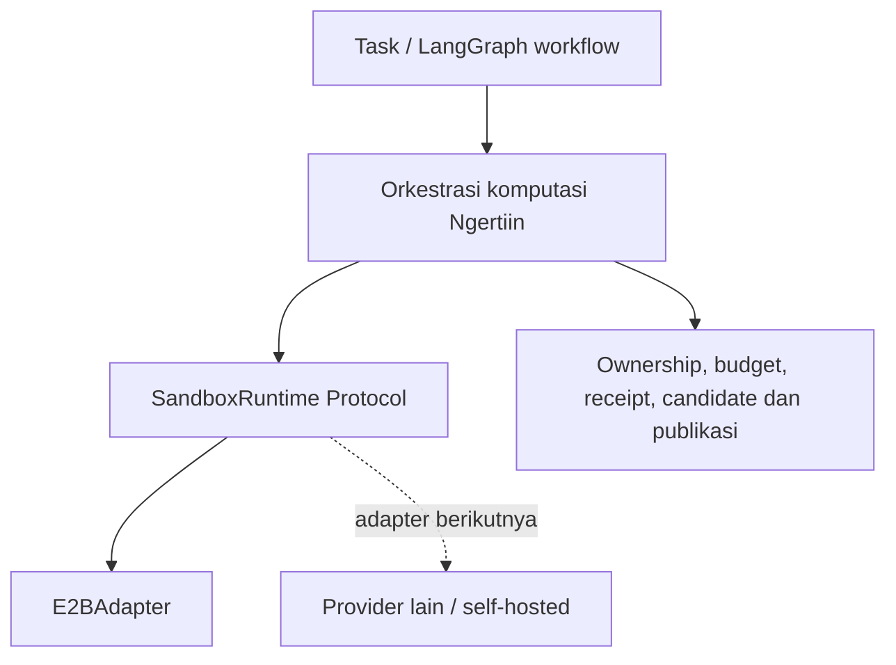

# Runtime komputasi yang dapat diganti

NG-035 memakai interface Python `SandboxRuntime` di `apps/backend/src/ngertiin/sandbox/contracts.py`. **E2B adalah satu-satunya provider aktif**. Adapter dan data provider lama telah dipensiunkan; lihat [pembersihan provider](e2b-only-cleanup.md). Kontrak Task, review, ownership, File/Result dan ledger tetap milik Ngertiin.

## Interface dan tanggung jawab

| Operasi | Kontrak |
| --- | --- |
| `preflight` | Membaca konfigurasi/versi dan memastikan alokasi didukung; tidak membuat resource. |
| `create` | Membuat resource dengan nama deterministik, TTL terbatas dan isolasi yang diwajibkan. Outcome jaringan yang ambigu tidak menjadi izin create ulang. |
| `inspect` | Memeriksa status tanpa menyalakan atau memperpanjang sesi. |
| `stage` | Mengirim bytes input yang sudah diotorisasi ke direktori input aplikasi. |
| `execute` | Menjalankan Python dengan deadline, environment bersih, batas resource dan descendant cleanup; mengembalikan receipt bertipe. |
| `collect` | Mengambil keluaran biasa dengan batas jumlah/ukuran; menolak symlink, FIFO, device dan hasil tidak lengkap. |
| `delete` | Mengonfirmasi resource sudah tidak ada; menerima request delete saja belum memenuhi kontrak. |

Seluruh dataclass, status dan exception pada interface adalah tipe aplikasi. Tidak ada objek SDK provider yang dikembalikan ke Task atau agent. Adapter Python berada di `sandbox/e2b.py`; operasi SDK E2B bersama adapter browser berada di `ngertiin/e2b.py`.

`policy.get_runtime(provider)` merupakan satu tempat pemilihan adapter. Orkestrasi menerima dependency `SandboxRuntime`, sehingga kontrak diuji dengan `ControlledRuntime` tanpa membuat resource remote atau mengeksekusi kode pada host. Konfigurasi dan pemilihan runtime hanya menerima E2B; identitas provider lain ditolak.

## Domain yang tetap berada di aplikasi

- Owner berasal dari Clerk/server, bukan argumen model. Task menyimpan `runtime_kind`, snapshot instruksi, input revision/rentang, model, policy dan harga.
- `sandbox_sessions` mengikat owner, Task, revision dan execution. Reservasi biaya serta concurrency atomik dilakukan sebelum panggilan model/provider.
- `sandbox_steps` menyimpan hash program, dispatch identity dan receipt. Dispatch tak terkonfirmasi tidak diulang; resource direkonsiliasi dan dibersihkan lebih dahulu.
- `sandbox_outputs` menyimpan candidate immutable di object storage. JSON draft hanya berisi referensi dan cuplikan; output besar tidak ditulis ulang lewat respons model.
- Review mengikat revision exact. Ringkasan dapat diedit; bytes candidate tetap. Publikasi memakai manifest File/Result dan delivery atomik NG-034. Retry publikasi tidak mengulangi perhitungan.
- Stop mencabut lease, menjadwalkan cleanup dan mencegah publikasi worker lama. Sweep maintenance berjalan setiap menit untuk resource yang ditinggalkan, outcome ambigu dan candidate yang perlu dipurge.

Transaksi database singkat tidak memegang koneksi selama panggilan SDK/model/storage. Setelah create timeout, 404 awal belum membuktikan request create tidak akan muncul; reservasi ditahan sampai ada konfirmasi resource atau TTL absolut plus margin cleanup.

## Isolasi adapter

E2B memakai template aplikasi `ngertiin-code-v1`, dibangun dari `base` pada **2 vCPU/4 GiB**. Generated code tetap memakai UID 65534, environment allowlist, hard limits dan seccomp launcher yang sama. Provider diminta memblokir outbound dan public ingress. Template E2B memiliki backing filesystem sekitar 22 GiB; batas program/file/output tetap ditegakkan launcher. Profil browser berada pada sandbox E2B desktop terpisah.

Supervisor tepercaya memakai root, tetapi **program pengguna dijalankan sebagai UID 65534**, dengan `no-new-privs`, environment allowlist dan hard limits yang tidak dapat dinaikkan.

Launcher memasang filter seccomp kernel sebelum memuat program: socket/network, io_uring, ptrace dan operasi namespace berbahaya ditolak; filter diwariskan ke child process. Runtime gagal sebelum menjalankan program bila filter tidak dapat dipasang. Ini bukan filter sintaks Python.

Input hanya berisi revision/rentang yang dipilih. PDF/gambar memakai ekstraksi halaman yang diizinkan; CSV/JSON/teks memakai bytes/rentang exact. Model menerima metadata dan sampel terbatas, sedangkan program mengolah seluruh data yang dipentaskan. File input tidak dijalankan sebagai script dan tidak memberikan grant baru.

Path aplikasi adalah `/tmp/ngertiin-work/inputs` dan `/tmp/ngertiin-work/outputs`. Input root-owned dan read-only; generated code tidak memiliki akses direktori kontrol supervisor. Setelah command, proses UID eksekusi dihentikan sebelum output diinspeksi dan diambil. App/API/storage credentials tidak dikirim ke sandbox.

## Policy awal

| Batas | Nilai |
| --- | --- |
| Satu command / satu Task | 60 detik / 300 detik |
| Umur resource | Maksimal 10 menit; waktu model mengurangi TTL yang masih tersedia |
| Margin cleanup dalam reservasi | 120 detik |
| Perbaikan kode / resource per Task | Maksimal 3 dispatch / 3 sesi, termasuk retry |
| Alokasi provider | 2 vCPU / 4 GiB; E2B backing filesystem sekitar 22 GiB, batas output terpisah |
| Hard limit proses | 2 GiB address space, 64 proses, 64 descriptor, 10 MiB per file |
| Log / file hasil | 16.000 byte / 10 file dan 25 MiB total |
| Resource aktif | 1 per akun, 2 global |
| Reservasi resource / cap Task | 36.000 / 108.000 micro USD |
| Cap harian akun / global | 1.000.000 / 5.000.000 micro USD, tanggal UTC |

Token model dan chat allowance tetap ledger terpisah. Rate default E2B adalah **konfigurasi estimasi** 165.600 micro USD/jam untuk alokasi tersebut, versi `e2b-linux-2026-10-20`; ini bukan harga pelanggan atau invoice vendor. Rate lama Daytona 166.464 micro USD/jam tetap pada snapshot sesi historis. Batas rate konfigurasi menjaga reservasi cukup untuk TTL plus margin. Policy dan rate disnapshot; perubahan konfigurasi tidak menghitung ulang sesi lama. Unknown resource tetap menahan seluruh reservasi. Konfirmasi penghapusan menyelesaikan estimasi konservatif dari seluruh wall time teramati, termasuk waktu persiapan.

Candidate tetap dapat diunduh saat review melalui proxy berautentikasi. Menghapus Result langsung mencabut akses candidate, lalu sweep mempurge bytes. Candidate gagal/dibatalkan dipurge setelah tujuh hari; orphan objects dipurge setelah resource dibersihkan. Candidate yang masih diperlukan untuk hasil/review tetap diperhitungkan dalam storage cap akun.

## Menambahkan provider

1. Implementasikan `SandboxRuntime` dengan tipe aplikasi, tanpa mengubah modul Task/chat/files. Provider harus memenuhi kontrak isolasi, limit, receipt, inspect dan konfirmasi cleanup; kemampuan yang belum didukung harus gagal sebelum dispatch.
2. Tambahkan pemilihan adapter di `get_runtime`, konfigurasi kredensial privat dan snapshot rate/policy yang sesuai. Session lama tetap memakai identitas provider tersimpan untuk reconciliation.
3. Jalankan kontrak terkontrol serta probe/live acceptance yang sama. Penggantian adapter tidak menjanjikan migrasi RAM, proses berjalan atau session web antar-provider.

Browser/VNC/takeover mengikuti NG-036. Interface GUI belum dimasukkan ke kontrak kode ini. Bukti implementasi: [penerimaan NG-035](sandbox-35-acceptance.md).
