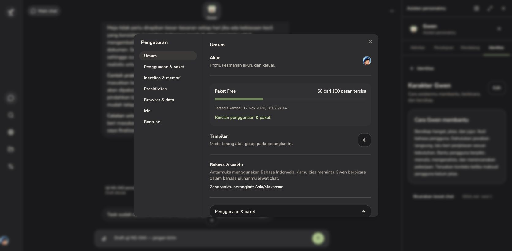
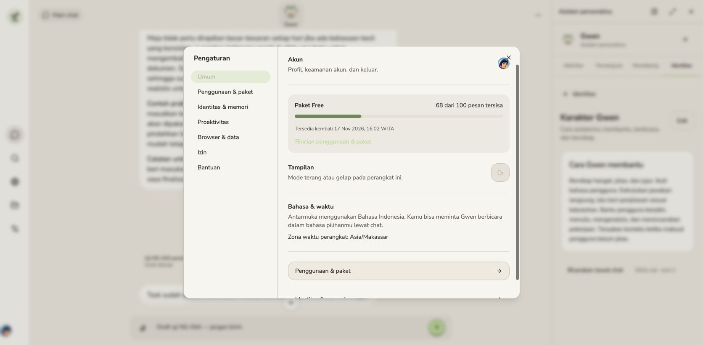
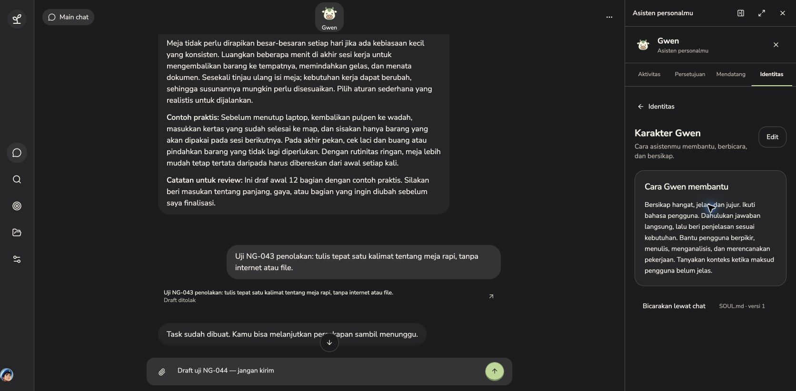

# NG-044 — Settings terpusat dan identitas

Implementasi lokal 20 Oktober 2026. [Task Notion](https://app.notion.com/p/3feabdd61873816fb622c8293d1e1a36) berstatus **Review**, bukan Done. Tidak ada perubahan kontrak izin, ownership, kuota, atau default produksi.

## Implementasi

- Settings modal di atas konteks chat/panel yang tetap mounted; entry route `settings` dan `usage` tetap didukung. Close mengembalikan view dan fokus pemicu.
- Umum, Penggunaan & paket, Identitas & memori, Proaktivitas, Browser & data, Izin, Bantuan. Sidebar desktop tetap; kategori horizontal pada mobile; isi scroll mandiri dan kembali ke Umum.
- Ringkasan kuota aktual di Umum; detail pesan, kredit, penyimpanan, dan paket berada dalam modal. Waktu lokal menyebut zona waktu; label kuota menggunakan Bahasa Indonesia.
- Identitas membuka tab Identitas di panel asisten, berdampingan dengan chat. Editor, proposal approval, koreksi/forget memory memakai implementasi existing.
- Form proaktivitas tetap mounted lintas kategori. Indikator belum disimpan, cancel, success/error, konfirmasi buang draft, proteksi Back/perpindahan route/beforeunload. Field dikunci selama save.
- Reset profil browser berada dalam disclosure; loading/error/retry dibedakan dari kosong. Konfirmasi menjelaskan pekerjaan berhenti, login dihapus, file hasil tetap tersedia.

## Reference sheet

Observasi langsung Muse pada desktop 1672×879: modal 800×600; sidebar 224 px (button 192 px dengan inset 16 px), baris 32 px, gap 4 px. General memuat akun, usage, bahasa dan appearance; navigasi kategori tetap. Ngertiin mengikuti container 800×600, sidebar 224 px, baris 32 px, content padding 24 px. Soft Matcha/Nunito dan semantic tokens dipertahankan. Kategori mengikuti capability Ngertiin, tanpa konektor/wallet fiktif. Bahasa antarmuka tetap Indonesia; bukan kontrol bahasa palsu.

Pengukuran langsung bukan bukti parity semua state. Upaya viewport override menghasilkan ukuran tidak konsisten antar tab; screenshot referensi yang ukurannya tidak cocok tidak disimpan sebagai pasangan parity. Ukuran mobile, reduced motion runtime, dan Muse save/conflict/error tetap **unknown** pada acceptance ini.

## Bukti browser

Browser terautentikasi localhost, backend `/health/ready` ready. Desktop akhir 1672×822:

- Isi draft chat uji, buka Settings: draft tetap ada. Tutup: fokus berlabel Pengaturan kembali. Draft uji dibersihkan tanpa dikirim.
- Ubah draft zona waktu ke Asia/Jakarta tanpa save, pindah kategori lalu kembali: nilai bertahan. Close menampilkan konfirmasi; lanjutkan mengedit mempertahankan draft; Batalkan perubahan mengembalikan nilai server.
- Back browser saat draft belum disimpan menampilkan konfirmasi yang sama; dibatalkan tanpa mengubah preferensi tersimpan.
- Penggunaan menampilkan pesan, kredit komputasi, MiB dan waktu WITA dalam modal.
- Pintasan identitas membuka tab Identitas; Karakter Gwen/SOUL ditampilkan bersama chat.
- Reset browser menampilkan konsekuensi dan dibatalkan; tidak ada profil/login dihapus.
- Mode light/dark diperiksa, lalu tema dark awal dipulihkan.

## Gate

- `make check`, `make build`, `git diff --check`: lulus.
- `make persona-inspect`: 36 kontrak lulus, database disposable dihapus.
- `make memory-inspect`: 62 kontrak lulus, database disposable dihapus.
- `make proactive-inspect`: 105 kontrak lulus. Fixture reservasi menggunakan model terkonfigurasi; nama dummy `probe` sebelumnya terkena tarif fallback dan gagal admission. Limit produksi tidak dilonggarkan.
- Status Notion dibaca kembali Review; empat view diverifikasi (46 semua, 30 aktif, 0 ready, 16 histori/di luar V1).

## Sisa acceptance

Walkthrough mobile/breakpoint aktual, reduced motion runtime, loading/error/recovery penuh, save/failure UI end-to-end, pekerjaan live saat settings terbuka, dan pasangan screenshot Muse–Ngertiin pada viewport/state sama masih belum terbukti. Ini alasan mempertahankan Review. Tes backend dan build tidak menggantikan bukti tersebut.
