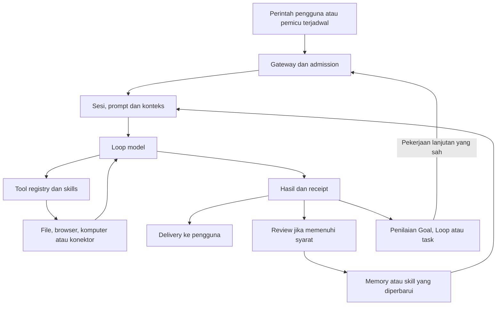

# Bedah Hermes Agent

Riset source dan runtime terkontrol untuk memahami bagaimana Hermes menjalankan pekerjaan, apa yang tersedia bagi agent, dan perilaku mana yang bisa diwujudkan di Ngertiin melalui harness yang aktif. Rilis yang dipatok adalah **Hermes Agent v0.23.2**, commit `ae2a81ccc00e9b7c06301523e5bb09608397149c`, dipublikasikan 16 November 2026. Pembanding Ngertiin memakai checkout `70b4f772582db09f08a6911c10704fc1222ba5e8` pada 18 November 2026. [Rilis stabil Nous Research](https://github.com/NousResearch/hermes-agent/releases/tag/v0.23.2), [source commit](https://github.com/NousResearch/hermes-agent/commit/ae2a81ccc00e9b7c06301523e5bb09608397149c).

## Cara kerjanya dalam satu rangkaian

Hermes menggabungkan empat mekanisme yang bisa terlihat seperti satu agent proaktif. **Goal** menjaga tujuan dalam sesi lintas turn. **Heartbeat dan Cron** memberi alasan untuk bangun di waktu lain. **Todo dan Kanban** mewakili pekerjaan dengan daya tahan dan ownership yang berbeda. **Review dan Curator** bisa mengubah materi yang dipakai saat pekerjaan berikutnya. Tool yang tersedia, scope execution, dan bentuk delivery bergantung pada profil, surface serta konfigurasi. [Lifecycle](lifecycle.md), [Goals](goals.md), [Proaktivitas](proactivity.md), [Kanban](kanban.md), [Learning](learning.md).

Pada rilis yang diperiksa, proses ACP Hermes adalah viewer Gateway. Runtime loopback juga memperlihatkan bahwa satu tool yang tidak ikut dikirim sebagai schema langsung, `todo_list`, tetap tersedia lewat bridge `tool_call`. Hasilnya kembali ke model fixture dan menjadi Plan ACP. Dua hal ini berpengaruh langsung pada cara membaca katalog dan pada keputusan integrasi Ngertiin. [ACP](acp.md), [Tools](tools.md), [bukti runtime](verification.md).

## Bukti dari Hermes Desktop macOS

Build terpasang cocok dengan pin riset. Analisis REA menelusuri renderer, preload, Electron main, dan Gateway. Probe computer use pada salinan yang identik membuktikan review otomatis membuat skill, sesi baru memuatnya, serta beberapa jalur Goal, Loop, Cron, memory, browser, dan artifact. Model loopback menentukan tool calls dan jawaban fixture. [Artefak dan Evidence IDs](desktop-artifact.md) · [Temuan runtime dan cakupan per fitur](desktop-runtime.md).

## Peta dokumen

| Bagian | Dokumen | Yang bisa ditelusuri |
| --- | --- | --- |
| Proses eksekusi | [Lifecycle](lifecycle.md) | Admission, FIFO, generation, model/tool loop, stop, commit, restart dan unknown |
| Sesi dan konteks | [Sessions](sessions.md) | Identitas, transcript, prompt assembly, cache, reset dan compaction |
| ACP | [ACP](acp.md) | Stdio, Gateway, capability, view, tool/plan events, receipt dan reconnect |
| Identitas agent | [Profiles](profiles.md) | Home, konfigurasi, Gateway ownership, clone, export dan backup |
| Provider | [Providers](providers.md) | Model, route, credential pool, retry, fallback, billing dan auxiliary model |
| Goal | [Goals](goals.md) | State, judge, completion, budget, wait dan goal continuation |
| Pekerjaan dalam sesi | [Tasks](tasks.md) | `todo_list`, revisi, status, recovery dan ACP Plan |
| Pekerjaan lintas worker | [Kanban](kanban.md) | Board, dependency, dispatch, heartbeat, retry, review dan artifacts |
| Delegasi | [Delegation](delegation.md) | Child, snapshot, concurrency, budget, hasil dan pembatalan |
| Proaktivitas | [Heartbeat](proactivity.md) | Wake, session lineage, coalescing, suppression dan quiet outcome |
| Pekerjaan berulang | [Loops](loops.md) | Loop interval, kondisi selesai, waktu hidup dan cancel |
| Penjadwalan | [Cron](scheduling.md) | Format jadwal, occurrence, claim, precheck, run, catch-up dan delivery |
| Tools | [Tools](tools.md) | Daftar built-in menurut module/toolset, gating, discovery, deferred calls dan dispatch |
| Skills | [Skills](skills.md) | Seluruh paket seed dan optional pada pin, load, dependency, mutation dan revision |
| Computer use | [Computer Use](computer-use.md) | Browser, terminal, file dan desktop visual, scope serta hak kendali |
| Konektor | [MCP](mcp.md) | Discovery, namespace, lazy setup, filter, trust, spend dan dispatch |
| Ekstensi | [Plugins](plugins.md) | Bundled dan installed capability, activation, observer, transform dan policy |
| Memory | [Memory](memory.md) | Memory profil, recalls, session search, provider memory dan write boundary |
| Learning | [Learning](learning.md) | Post-turn review, threshold, isolation, perubahan dan Curator |
| Human-in-the-loop | [Interaksi pengguna](human-in-the-loop.md) | Klarifikasi, izin, stale responses dan intervensi |
| Media | [Multimodal](multimodal.md) | Vision, audio, image/video generation dan batas backend |
| File | [Artifacts](artifacts.md) | Snapshot input, grounding, deliverable dan delivery attachment |
| Channel dan API | [Gateway Surfaces](gateway-surfaces.md) | Viewer, messaging, HTTP, webhook, delivery ledger dan profile owner |
| Kualitas kerja | [Verification](verification.md) | Verify-on-stop, batas evidence dan hasil probe riset |
| Penerapan | [Pemetaan ke Ngertiin](ngertiin.md) | Jalur implementasi, pembanding end-to-end dan urutan evaluasi |
| Artefak Desktop | [Desktop Artifact](desktop-artifact.md) | Identitas build lokal, REA Evidence IDs, pemetaan IPC dan Gateway |
| Observasi aplikasi | [Desktop Runtime](desktop-runtime.md) | Skenario yang dieksekusi di macOS, hasil aktual dan cakupan per fitur |
| Antrean kerja | [Checklist implementasi](implementation-checklist.md) | Perilaku yang harus dibuktikan di Ngertiin lewat computer use |

## Metode dan cakupan

Riset memakai `reverse-engineer-anything` untuk memilih source checkout sebagai jalur utama karena kode upstream tersedia lengkap. Riset membaca implementasi, dokumentasi dan tes resmi yang sesuai commit, kemudian menjalankan fixture terpilih dan probe proses upstream. Tidak diperlukan dekompilasi atau REA binary session. Setiap halaman membedakan perilaku source dari skenario yang sudah dijalankan atau masih perlu diukur. Inventaris menyatakan apa yang terdapat pada source, apa yang disalin ke profil kosong, dan apa yang muncul pada konfigurasi probe jika relevan. Perilaku paket canary, pilihan vendor live, serta kualitas keputusan model nyata berada di luar cakupan bukti yang dikumpulkan. [Metode dan bukti](verification.md).

Masing-masing halaman menghubungkan mekanisme ke source Ngertiin yang aktif. Usulan di sini merupakan hasil riset. Tidak ada perubahan aplikasi, install Hermes pada profil aktif, keputusan adopsi runtime, atau perubahan acceptance milestone.
