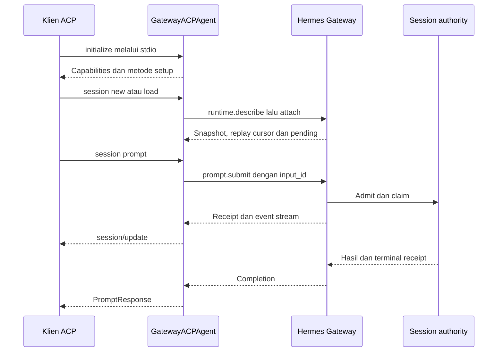

# ACP dan batas hosting

Pada sumber rilis v0.23.2, `hermes acp` dan `hermes-acp` menyalakan adapter stdio di sisi editor. Pembuatan `HermesACPAgent()` tanpa `SessionManager` eksplisit mengembalikan `GatewayACPAgent`. Gateway profil adalah owner session dan pelaksana tool/model. Kelas standalone masih ada di source untuk pemanggil yang memasukkan session manager secara eksplisit. Perbedaan ini menentukan cara membaca uji adapter dan menjelaskan mengapa menjalankan entrypoint ACP saja belum membuktikan model bisa menjawab. [Entrypoint](https://github.com/NousResearch/hermes-agent/blob/ae2a81ccc00e9b7c06301523e5bb09608397149c/acp_adapter/entry.py#L163-L226), [konstruktor](https://github.com/NousResearch/hermes-agent/blob/ae2a81ccc00e9b7c06301523e5bb09608397149c/acp_adapter/server.py#L273-L293).

## Wire dan capability

- `initialize` mengiklankan load session, input image, dan kemampuan list, fork serta resume. Harness mengekspos metode konfigurasi model/mode dan prompt, cancel serta list/load melalui adapter. Auth yang teramati dari proses sumber adalah terminal setup `hermes-setup`, sehingga handshake tanpa kredensial bisa lulus. [Handshake](https://github.com/NousResearch/hermes-agent/blob/ae2a81ccc00e9b7c06301523e5bb09608397149c/acp_adapter/gateway_server.py#L126-L153), [mode dan konfigurasi](https://github.com/NousResearch/hermes-agent/blob/ae2a81ccc00e9b7c06301523e5bb09608397149c/acp_adapter/gateway_server.py#L573-L653).
- `_client` membuka transport Gateway dari profil efektif, meminta `runtime.describe` dan menolak profil yang tidak cocok. Reattach memulihkan snapshot dan MCP editor yang dipinjamkan untuk session itu. Penutupan proses ACP melepaskan viewer. Owner yang menutup sesi ACP saat viewer terakhir lepas dan FIFO idle, atau saat Gateway berhenti. [Koneksi dan reattach](https://github.com/NousResearch/hermes-agent/blob/ae2a81ccc00e9b7c06301523e5bb09608397149c/acp_adapter/gateway_server.py#L155-L216), [shutdown adapter](https://github.com/NousResearch/hermes-agent/blob/ae2a81ccc00e9b7c06301523e5bb09608397149c/acp_adapter/entry.py#L209-L226).
- `new_session` membuka session Gateway serta memasang bagian konteks editor. Load dan resume mempertahankan alias ID logical/tip untuk kompresi. Kemampuan form elicitation ditangkap dari raw initialize karena model typed SDK pada pin melewatkan field tersebut. Elicitation atau approval dihubungkan ke prompt aktif saat pengguna memberi keputusan. [New session](https://github.com/NousResearch/hermes-agent/blob/ae2a81ccc00e9b7c06301523e5bb09608397149c/acp_adapter/gateway_server.py#L271-L322), [resume](https://github.com/NousResearch/hermes-agent/blob/ae2a81ccc00e9b7c06301523e5bb09608397149c/acp_adapter/gateway_server.py#L348-L420), [interaksi](https://github.com/NousResearch/hermes-agent/blob/ae2a81ccc00e9b7c06301523e5bb09608397149c/acp_adapter/gateway_server.py#L1160-L1223).

## Lost ACK, replay gap dan kontrol

`prompt` menyiapkan text/media, mengenali command session, dan mengirim `prompt.submit` dengan `input_id`. Jika transport hilang sebelum ACK, cache `_unacked` menyimpan identitas dan payload staging di proses viewer untuk exact retry, dibatasi 64 session. Setelah ACK, waiter menunggu admission yang cocok. Outcome unknown atau transport putus dilaporkan sebagai ambiguitas. Reconnect membaca kondisi yang disimpan owner tanpa mengirim ulang turn yang telah diterima. [Prompt dan ACK](https://github.com/NousResearch/hermes-agent/blob/ae2a81ccc00e9b7c06301523e5bb09608397149c/acp_adapter/gateway_server.py#L656-L735).

Pada replay gap, `_recover` mengecek pending status. Queued dapat tetap berjalan. Running menunggu completion yang masih mungkin datang. Jika row sudah selesai di dalam gap, adapter mencoba `prompt.receipt` dengan hasil yang tersimpan. Claim lokal antara receipt path dan event stream mencegah pengiriman jawaban ganda. Cancel menargetkan admission dan menangani race antara queued cancel dan interrupt. [Cancel](https://github.com/NousResearch/hermes-agent/blob/ae2a81ccc00e9b7c06301523e5bb09608397149c/acp_adapter/gateway_server.py#L422-L456), [pemulihan gap](https://github.com/NousResearch/hermes-agent/blob/ae2a81ccc00e9b7c06301523e5bb09608397149c/acp_adapter/gateway_server.py#L820-L889), [proyeksi event](https://github.com/NousResearch/hermes-agent/blob/ae2a81ccc00e9b7c06301523e5bb09608397149c/acp_adapter/gateway_server.py#L942-L1052).

## Implikasi untuk Ngertiin

Rute Hermes menunjukkan bahwa ACP bisa menjadi permukaan dari runtime yang sudah memiliki antrean. Protokol umumnya tidak mendefinisikan Goal, heartbeat, Cron atau Kanban. Menambahkan proses Hermes ke `AcpAdapter` sebagai peer akan menghubungkan Ngertiin ke Gateway Hermes beserta penyimpanannya. Itu menciptakan dua tempat yang dapat mengaku memiliki admission dan recovery jika boundary tersebut dibiarkan implisit. Penelitian ini menggunakan Hermes sebagai referensi perilaku dan tidak menetapkan penambahan runtime. [Kontrak Hermes Gateway](https://github.com/NousResearch/hermes-agent/blob/ae2a81ccc00e9b7c06301523e5bb09608397149c/gateway/session_contract.py#L87-L100), [transport Ngertiin](../../apps/server/src/harness/acp/adapter.ts), [invarian migrasi](../architecture/acp-harnesses.md).

Untuk harness yang aktif di Ngertiin, samakan perilaku melalui capability yang benar-benar dinegosiasikan. Proyeksikan fase, tool, plan, usage, jawaban dan interaksi ke receipt/event Ngertiin. Utamakan observasi run yang terikat ke percakapan. Bila peer tidak membuktikan identitas provider turn, pertahankan native ID nullable dan gunakan dispatch token aplikasi sebagai fence. Jangan menyimpulkan efek dari history replay. Periksa ulang per profil untuk cold start, resume, perubahan config, static MCP discovery, tool dengan side effect benign, izin, partial stream, cancel dan reconnect. [Session ACP](../../apps/server/src/harness/acp/session.ts), [projector](../../apps/server/src/harness/acp/projection.ts), [run endpoint](../../apps/server/src/harness/session-tools.ts).

## Bukti yang dijalankan

Proses upstream sesungguhnya dengan environment dan home terisolasi mengembalikan `protocolVersion=1`, `loadSession=true`, image prompt, fork/list/resume serta terminal auth `hermes-setup`. Versi wire dari checkout sumber adalah `0.0.0`. Identitas yang dipakai untuk riset adalah tag dan Git SHA. Fixture terpisah menguji receipt, unknown, replay gap, cancel dan retry. Handshake terpisah tidak melakukan inference. Probe Gateway dan provider fixture loopback menyelesaikan turn dengan `todo_list` melalui `tool_call`, mengirim Plan ACP dan menyimpan satu receipt terminal. [Rincian verifikasi](verification.md).

## Bukti Hermes Desktop macOS

Hermes Desktop Electron pada build lokal berbicara dengan Gateway lewat bridge preload/main dan canonical session verbs. Companion renderer dan IPC dikonfirmasi lewat REA, sementara pengujian sesi Desktop berhasil memuat ulang jawaban. Probe stdio ACP di atas tetap jalur terpisah untuk klien editor. [Artefak Desktop](desktop-artifact.md) · [DT-08](desktop-runtime.md#restart-loop-browser-dan-artifact).
