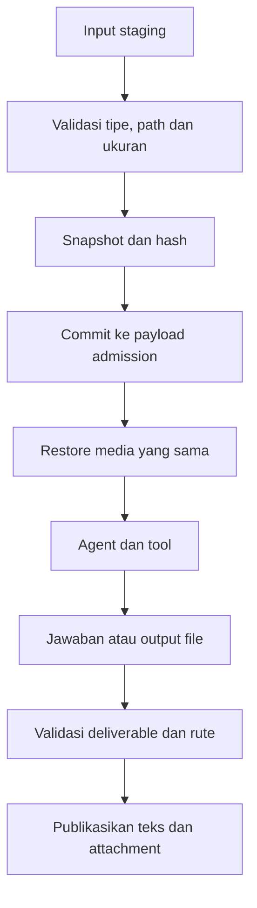

# Attachment, grounding dan deliverable

Hermes punya dua alur file. Intake mengambil snapshot dari input agar byte yang diproses tetap terkait dengan admission. Output mengenali deliverable dan menyerahkannya lewat transport tujuan. Ada jalur attachment khusus ACP dan channel, sehingga hasil di satu surface tidak bisa dipakai sebagai bukti untuk semuanya. [Intake](https://github.com/NousResearch/hermes-agent/blob/ae2a81ccc00e9b7c06301523e5bb09608397149c/gateway/session_ingress_media.py#L140-L182), [deliverable mode](https://github.com/NousResearch/hermes-agent/blob/ae2a81ccc00e9b7c06301523e5bb09608397149c/website/docs/user-guide/features/deliverable-mode.md#L20-L54).

## Intake dan output

1. Pada prompt ACP/Gateway, media di-stage sebelum submit. `admit_attachments` hanya menerima bentuk dan MIME yang diizinkan, memeriksa root staging, menghitung hash, dan membandingkan dengan byte yang sudah terkait receipt ketika input diulang. Jika ACK hilang dan staging sudah hilang, exact retry tertentu dapat memakai reference hasil commit. Live admission tetap memverifikasi bahwa byte yang dibutuhkannya masih bisa direstore. [ACP media staging](https://github.com/NousResearch/hermes-agent/blob/ae2a81ccc00e9b7c06301523e5bb09608397149c/acp_adapter/gateway_media.py), [admit_attachments](https://github.com/NousResearch/hermes-agent/blob/ae2a81ccc00e9b7c06301523e5bb09608397149c/gateway/session_ingress_media.py#L140-L182).
2. `capture_native_media` membuka regular file dan menghitung total ukuran satu admission, bukan batas per file saja. Media private diretain di bawah kontrol scope, dengan lease saat capture dan holder ketika row sudah tersimpan. `restore_attachments` membangun kembali input eksekusi dari reference commit. [Capture dan restore](https://github.com/NousResearch/hermes-agent/blob/ae2a81ccc00e9b7c06301523e5bb09608397149c/gateway/session_ingress_media.py#L296-L355), [lease](https://github.com/NousResearch/hermes-agent/blob/ae2a81ccc00e9b7c06301523e5bb09608397149c/gateway/session_ingress_media.py#L32-L94).
3. Output yang sengaja ditandai untuk delivery diproses oleh gateway dan platform. Tool output dengan teks yang hanya menyerupai marker file tidak otomatis dikirim. Path melalui kebijakan root dan scope; container path dapat melalui mapping yang dikenali. Proyeksi teks dan attachment memiliki langkah delivery masing-masing. [Media dari tool](https://github.com/NousResearch/hermes-agent/blob/ae2a81ccc00e9b7c06301523e5bb09608397149c/gateway/run.py#L1383-L1488), [validasi file tujuan](https://github.com/NousResearch/hermes-agent/blob/ae2a81ccc00e9b7c06301523e5bb09608397149c/gateway/platforms/base.py#L1030-L1129), [delivery output](https://github.com/NousResearch/hermes-agent/blob/ae2a81ccc00e9b7c06301523e5bb09608397149c/gateway/session_ingress.py#L508-L523).
4. Kanban dapat membawa reference artifact terstruktur bersama hasil task. Platform yang berlangganan dapat menyampaikan file bersama completion. Delivery sukses, file ada, dan pengguna berhak mengunduh adalah fakta yang harus diperiksa pada tahap berbeda. [Kanban deliverables](https://github.com/NousResearch/hermes-agent/blob/ae2a81ccc00e9b7c06301523e5bb09608397149c/website/docs/user-guide/features/deliverable-mode.md#L78-L96).

## Implikasi untuk Ngertiin

`AttachmentSubmissions` mengikat upload ke pesan dan `Artifacts` menangani materialize, verifikasi input, publikasi dan download. Jalur file keluar memerlukan authority workspace dan grant serta keberadaan byte. Pemetaan perilaku Hermes yang relevan adalah membuat materi, asal dan output tetap bisa dipahami setelah reload. Gunakan attachment/artifact ID dan scope native Ngertiin ketika menerjemahkan hasil harness ke conversation. [Attachment submission](../../apps/server/src/attachments/submissions.ts), [artifact store](../../apps/server/src/artifacts.ts), [kontrak workspace](../architecture/workspace-artifact-api.md).

Dalam skenario uji PDF atau CSV lokal, verifikasi upload commit, pesan terkait, artifact tersedia pada harness, tool membuka file, hasil membaca data yang benar dan jawaban mengacu pada sumber yang benar. Ulangi saat ACK hilang dan saat path staging berubah. Untuk deliverable, periksa byte yang diunduh dan akun yang boleh mengaksesnya. Diff atau nama file yang terlihat saja belum membuktikan pengguna menerima deliverable.

## Bukti Hermes Desktop macOS

Dari composer Desktop, `write_file` menyimpan CSV fixture dengan `verified: true`. Pustaka Artifacts kemudian menemukan nama dan path workspace. Isi CSV dibaca kembali dari storage uji. Ini bukti terpisah untuk penulisan dan indexing. Pengiriman ke akun/channel lain masih terbuka. [DT-11](desktop-runtime.md#restart-loop-browser-dan-artifact).
