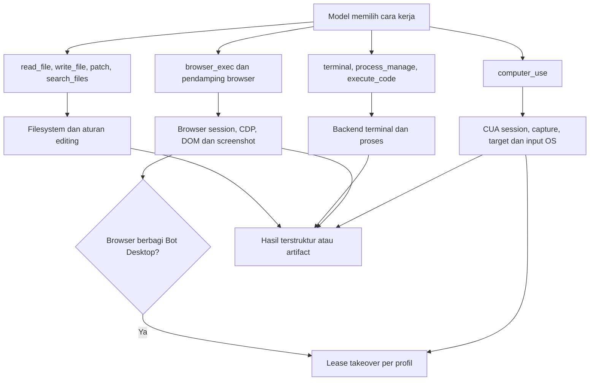
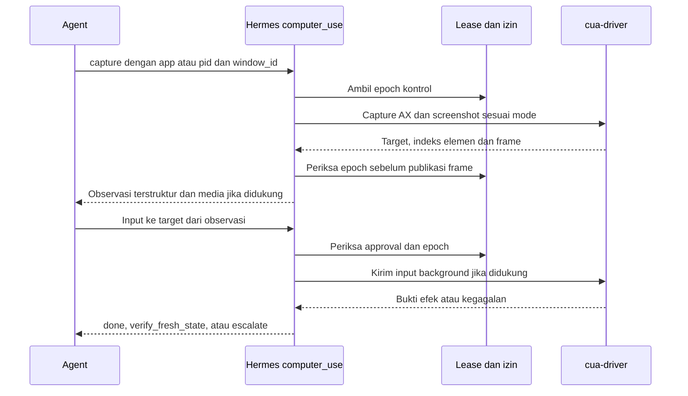

# Computer use, browser, dan lingkungan kerja

Hermes memberi model beberapa cara berinteraksi dengan komputer. Untuk dokumen ia bisa membaca atau mengubah file secara terstruktur. Untuk komputasi ia bisa menjalankan proses atau Python. Untuk aplikasi web ia bisa membaca DOM, mengisi form, dan mengambil screenshot lewat browser. Untuk UI native ia memilih target jendela, mengamati state lalu mengirim input melalui driver OS. Pilihan rute memengaruhi bukti yang diterima model, konteks yang bertahan, izin yang diperlukan dan cara mengecek efek. [Toolsets](https://github.com/NousResearch/hermes-agent/blob/ae2a81ccc00e9b7c06301523e5bb09608397149c/toolsets.py#L92-L123), [browser contract](https://github.com/NousResearch/hermes-agent/blob/ae2a81ccc00e9b7c06301523e5bb09608397149c/tools/browser_use_cli.py#L909-L969), [computer_use contract](https://github.com/NousResearch/hermes-agent/blob/ae2a81ccc00e9b7c06301523e5bb09608397149c/tools/computer_use/schema.py#L188-L204).

## Browser

`browser_exec(code, session?, timeout_s?, local?)` menjalankan Python dengan helper `browser-harness`. `page_info` dan pembacaan DOM memberi observasi teks. Helper navigasi, pengisian input dan screenshot menangani interaksi. Browser serta workspace bertahan antar-call. Python di-inisialisasi ulang pada setiap call, sementara helper yang ditaruh pada workspace bisa dipakai kembali. Schema mendorong model membagi ekstraksi panjang menjadi batch menengah, menulis hasil parsial ke workspace, lalu menghitung dan memvalidasi cakupannya. Default `timeout_s` pada `browser_exec` 300 detik dengan maksimum 1.800 detik. Field `local` bergantung pada opsi consent real profile. [Kontrak eksekusi](https://github.com/NousResearch/hermes-agent/blob/ae2a81ccc00e9b7c06301523e5bb09608397149c/tools/browser_use_cli.py#L909-L969), [timeout dan schema dinamis](https://github.com/NousResearch/hermes-agent/blob/ae2a81ccc00e9b7c06301523e5bb09608397149c/tools/browser_use_cli.py#L982-L1055).

1. `browser_exec` memeriksa kebijakan URL dari literal yang terlihat, membentuk identitas dari task atau nama sesi, dan memilih backend/CDP. Nama sesi dipadukan dengan scope profil ketika berlaku. Pada CDP override yang berbagi satu browser, named daemon diarahkan ke tab sendiri. Browser yang dedicated untuk sesi tidak memerlukan tab preamble. Rute sidecar lokal untuk URL private mengikuti konfigurasi dan tidak membawa profil login asli. Pemeriksaan literal ini hanya satu bagian jalur keputusan. [Policy URL](https://github.com/NousResearch/hermes-agent/blob/ae2a81ccc00e9b7c06301523e5bb09608397149c/tools/browser_url_policy.py#L86-L158), [pembentukan key](https://github.com/NousResearch/hermes-agent/blob/ae2a81ccc00e9b7c06301523e5bb09608397149c/tools/browser_use_cli.py#L327-L341), [route eksekusi](https://github.com/NousResearch/hermes-agent/blob/ae2a81ccc00e9b7c06301523e5bb09608397149c/tools/browser_use_cli.py#L783-L837), [fresh sidecar](https://github.com/NousResearch/hermes-agent/blob/ae2a81ccc00e9b7c06301523e5bb09608397149c/tools/browser_session.py#L231-L253).
2. Jalur fresh session memilih CDP override jika berlaku, lalu provider cloud atau Chromium lokal. Provider eksplisit di-resolve dari registry. Pada auto-detection kode mencoba Browser Use sebelum Browserbase. Gagal membuat sesi cloud dapat menghasilkan fallback Chromium dengan provenance error. Fallback implementasi browser ini terpisah dari pemilihan provider atau billing model. Pada mode lokal, `browser.engine: auto` memilih Chromium. Lightpanda merupakan opsi text-first tanpa screenshot. Default konfigurasi memakai browser headless, timeout idle 120 detik, profil sementara dan consent real-profile off. [Provider](https://github.com/NousResearch/hermes-agent/blob/ae2a81ccc00e9b7c06301523e5bb09608397149c/tools/browser_session_cloud.py#L180-L253), [pemilihan lokal/cloud](https://github.com/NousResearch/hermes-agent/blob/ae2a81ccc00e9b7c06301523e5bb09608397149c/tools/browser_session.py#L196-L292), [konfigurasi](https://github.com/NousResearch/hermes-agent/blob/ae2a81ccc00e9b7c06301523e5bb09608397149c/hermes_cli/config_defaults.py#L411-L465), [Lightpanda guidance](https://github.com/NousResearch/hermes-agent/blob/ae2a81ccc00e9b7c06301523e5bb09608397149c/tools/browser_use_cli.py#L946-L953).
3. Bila dipilih, real-profile berjalan sebagai snapshot lokal yang dikelola Hermes setelah consent. Browser juga bisa diberi direktori profil persistent atau memakai browser Bot Desktop bersama. Tool browser menghentikan/merawat daemon sesuai kepemilikan. Lifecycle mengeluarkan sesi ketika backend mati atau idle, dengan perlindungan khusus ketika manusia sedang mengendalikan browser yang sama. [Real-profile](https://github.com/NousResearch/hermes-agent/blob/ae2a81ccc00e9b7c06301523e5bb09608397149c/hermes_cli/config_defaults.py#L437-L457), [pemilihan profil](https://github.com/NousResearch/hermes-agent/blob/ae2a81ccc00e9b7c06301523e5bb09608397149c/tools/browser_session.py#L170-L253), [session reaper](https://github.com/NousResearch/hermes-agent/blob/ae2a81ccc00e9b7c06301523e5bb09608397149c/tools/browser_session_lifecycle.py#L277-L356).
4. Proses CLI mengeksekusi call dengan deadline, verifikasi lease bila memakai layar bersama, dan output yang disunting. Hasil membawa `exit_code`, `success`, `output`, opsi `workspace`/`session`, serta informasi screenshot bila ada. Model dengan rute media native dapat menerima screenshot sebagai bagian hasil tool. Jalur tanpa media mengutamakan DOM/teks dan bisa menunjuk `vision_analyze` jika tersedia. Hermes menjalankan proses CLI pembawa kode Python dari proses agent. Lokasi Chrome/CDP ditentukan terpisah melalui rute browser. Menempatkan Chrome di dalam sandbox belum membuktikan proses Python lokal memiliki batas filesystem yang sama. Timeout CLI masih bisa meninggalkan daemon bekerja. Workspace parsial dan observasi ulang penting sebelum mengulang tindakan. [Proses, timeout dan hasil](https://github.com/NousResearch/hermes-agent/blob/ae2a81ccc00e9b7c06301523e5bb09608397149c/tools/browser_use_cli.py#L844-L906), [rewrite vision](https://github.com/NousResearch/hermes-agent/blob/ae2a81ccc00e9b7c06301523e5bb09608397149c/model_tools.py#L387-L413).
5. `browser_cdp` menyediakan operasi CDP. `browser_dialog` mengelola dialog yang ditemukan supervisor; default `must_respond` dengan auto-dismiss timeout 300 detik. `browser_vault` menyimpan referensi atau mengisi login pada origin yang diikat dengan pemeriksaan target. Secret diolah oleh backend, dan hasil ke model menggunakan redaksi. Desktop preview adalah surface tersendiri yang dapat dipilih sesuai konteks. [CDP](https://github.com/NousResearch/hermes-agent/blob/ae2a81ccc00e9b7c06301523e5bb09608397149c/tools/browser_cdp_tool.py#L450-L513), [supervisor](https://github.com/NousResearch/hermes-agent/blob/ae2a81ccc00e9b7c06301523e5bb09608397149c/tools/browser_supervisor.py#L80-L151), [dialog](https://github.com/NousResearch/hermes-agent/blob/ae2a81ccc00e9b7c06301523e5bb09608397149c/tools/browser_supervisor_dialogs.py#L197-L273), [vault origin dan fill](https://github.com/NousResearch/hermes-agent/blob/ae2a81ccc00e9b7c06301523e5bb09608397149c/tools/browser_vault_tool.py#L470-L574), [vault preview](https://github.com/NousResearch/hermes-agent/blob/ae2a81ccc00e9b7c06301523e5bb09608397149c/tools/browser_vault_tool.py#L690-L735).

## Desktop OS

`computer_use` merupakan nama schema publik. Adapter default memakai cua-driver dengan backend yang dapat dipilih melalui registry plugin. Actions yang diekspos ialah `capture`, `click`, `double_click`, `right_click`, `middle_click`, `drag`, `scroll`, `type`, `key`, `set_value`, `wait`, `list_apps`, `list_windows`, dan `focus_app`. Driver aktif membuka transport sesi, mengetahui kapabilitas melalui `tools/list`, lalu menerjemahkan aksi menjadi call yang cocok. Nilai `check_fn` melihat kesiapan backend. Driver perlu terpasang dan OS perlu menyediakan izin atau display yang relevan. [Schema publik](https://github.com/NousResearch/hermes-agent/blob/ae2a81ccc00e9b7c06301523e5bb09608397149c/tools/computer_use/schema.py#L17-L91), [registry backend](https://github.com/NousResearch/hermes-agent/blob/ae2a81ccc00e9b7c06301523e5bb09608397149c/plugins/computer_use/__init__.py), [transport dan discovery](https://github.com/NousResearch/hermes-agent/blob/ae2a81ccc00e9b7c06301523e5bb09608397149c/tools/computer_use/cua_backend_session.py#L188-L256), [readiness](https://github.com/NousResearch/hermes-agent/blob/ae2a81ccc00e9b7c06301523e5bb09608397149c/tools/computer_use/tool.py#L927-L934).

- `capture` dapat mengambil SoM dengan overlay bernomor, gambar tanpa AX, atau AX tanpa gambar. Target default jendela aktif. Target eksplisit memakai `app`, atau kombinasi `pid` dan `window_id`. Mode screen memberi gambar komposit tanpa indeks aksi. Input menempel pada target capture atau `focus_app` terakhir. Argumen `app` yang tidak sesuai saat input menghasilkan refusal. Pada backend default, path input memerlukan identitas jendela dan live schema perlu mendukung perubahan mode yang diminta. Mekanisme ini mengurangi kasus model mengklik window yang berpindah. [Mode capture](https://github.com/NousResearch/hermes-agent/blob/ae2a81ccc00e9b7c06301523e5bb09608397149c/tools/computer_use/schema.py#L43-L91), [capture backend](https://github.com/NousResearch/hermes-agent/blob/ae2a81ccc00e9b7c06301523e5bb09608397149c/tools/computer_use/cua_backend_capture.py#L213-L369), [guard target](https://github.com/NousResearch/hermes-agent/blob/ae2a81ccc00e9b7c06301523e5bb09608397149c/tools/computer_use/tool.py#L445-L477), [input backend](https://github.com/NousResearch/hermes-agent/blob/ae2a81ccc00e9b7c06301523e5bb09608397149c/tools/computer_use/cua_backend_input.py#L27-L111).
- Handler cek takeover manusia, hard blocks, approval jika tindakan efek, backend dan lock sesi, lalu cek epoch di sekitar dispatch. Scope approval membedakan `cua:<action>:background` dan foreground. Focus persisten menambah scope sendiri. Capture dan list termasuk aksi non-mutation. Background adalah mode input pertama. Foreground hanya jika live schema mendukung dan user mengizinkan. `_classify_action_result` memilih `done` jika efek terkonfirmasi, `verify_fresh_state` jika efek belum terbukti, dan `escalate` dengan saran spesifik ketika bukti menunjukkan no-op/kegagalan. Timeout dengan outcome ambigu tidak dijadikan pengulangan input otomatis. [Handler dan izin](https://github.com/NousResearch/hermes-agent/blob/ae2a81ccc00e9b7c06301523e5bb09608397149c/tools/computer_use/tool.py#L277-L363), [action table](https://github.com/NousResearch/hermes-agent/blob/ae2a81ccc00e9b7c06301523e5bb09608397149c/tools/computer_use/tool.py#L421-L444), [verdict](https://github.com/NousResearch/hermes-agent/blob/ae2a81ccc00e9b7c06301523e5bb09608397149c/tools/computer_use/tool.py#L480-L522), [transport retry policy](https://github.com/NousResearch/hermes-agent/blob/ae2a81ccc00e9b7c06301523e5bb09608397149c/tools/computer_use/cua_backend_session.py#L459-L512).
- `capture_after` memverifikasi window yang sama ketika identitas tepat diketahui. Hasil memadukan verdict aksi dengan observasi baru. Frame yang identik dalam sesi dapat dikirim sebagai metadata teks. Media dipasang langsung pada model yang menerima gambar atau diringkas melalui auxiliary vision. Ketika rute vision gagal, AX masih tersedia saat driver mengembalikannya. Konfigurasi default memakai `permission_mode: standard`, screenshot 1.456 px sisi terpanjang, `capture_after_mode: som`, dan batas walk AX 200 elemen. Payload yang disajikan memiliki batas tersendiri. [Response](https://github.com/NousResearch/hermes-agent/blob/ae2a81ccc00e9b7c06301523e5bb09608397149c/tools/computer_use/tool.py#L595-L720), [config](https://github.com/NousResearch/hermes-agent/blob/ae2a81ccc00e9b7c06301523e5bb09608397149c/hermes_cli/config_defaults.py#L2489-L2535).

## Bot Desktop dan isolasi

Bot Desktop adalah layar Xfce/Xvnc per profil pada jalur Linux. Surface viewer membolehkan manusia mengamati, mengambil alih input, lalu menyerahkannya kembali. Default ukuran 1440×900, ambang memori bebas 1.536 MB, idle stop 30 menit, dan `auto_start: false`. Lease disimpan dengan transisi yang menaikkan epoch. Browser yang berbagi layar, serta capture dan input desktop, memeriksa lease. Frame yang selesai setelah takeover ditolak sebelum dibuat artifact, disimpan sebagai cache, atau dikirim ke vision. [Bot Desktop defaults](https://github.com/NousResearch/hermes-agent/blob/ae2a81ccc00e9b7c06301523e5bb09608397149c/hermes_cli/config_defaults.py#L2460-L2488), [lease](https://github.com/NousResearch/hermes-agent/blob/ae2a81ccc00e9b7c06301523e5bb09608397149c/tools/bot_desktop/lease.py#L176-L251), [browser fencing](https://github.com/NousResearch/hermes-agent/blob/ae2a81ccc00e9b7c06301523e5bb09608397149c/tools/browser_session.py#L84-L123), [capture fencing](https://github.com/NousResearch/hermes-agent/blob/ae2a81ccc00e9b7c06301523e5bb09608397149c/tools/computer_use/tool.py#L313-L333).

`resolve()` menempatkan layar gateway jika terminal local, atau mengikuti Docker/SSH/plugin yang mendukung stream pada placement `auto`. Backend tanpa stream seperti Modal, Daytona dan Vercel menghasilkan refusal untuk jalur layar. Menjalankan desktop di luar sandbox terminal memerlukan pilihan eksplisit `gateway`. Untuk Chromium lokal, jalur launch membaca keputusan placement sebelum memulai browser. Default terminal local berarti proses berjalan dengan akses OS host sesuai konfigurasi. Isolasi lintas tenant membutuhkan keputusan deployment yang lebih kuat daripada sesi browser, window selection, atau pemisahan nama profil. [Placement](https://github.com/NousResearch/hermes-agent/blob/ae2a81ccc00e9b7c06301523e5bb09608397149c/tools/bot_desktop/placement.py#L64-L102), [Chromium sandbox](https://github.com/NousResearch/hermes-agent/blob/ae2a81ccc00e9b7c06301523e5bb09608397149c/tools/browser_session.py#L196-L216), [terminal defaults](https://github.com/NousResearch/hermes-agent/blob/ae2a81ccc00e9b7c06301523e5bb09608397149c/hermes_cli/config_defaults.py#L285-L339).

## Terminal, file, dan Python

| Jalur | Perilaku yang perlu dipertahankan |
| --- | --- |
| `terminal` | `terminal_tool` merencanakan environment, resolusi workspace dan timeout, menjalankan pre-execution guard dan approval, lalu foreground exec atau background spawn. Default local dengan 180 detik. Registry environment memiliki Docker, Modal, Daytona, Vercel Sandbox, SSH, dan provider plugin. Hosted scope menuntut provider sandbox yang menyatakan kemampuan hosted. `process_manage` menerima ID proses untuk pengamatan dan pengendalian. Background dapat meminta notifikasi completion, heartbeat, atau aturan persistensi yang sesuai. [Plan dan dispatch](https://github.com/NousResearch/hermes-agent/blob/ae2a81ccc00e9b7c06301523e5bb09608397149c/tools/terminal_tool.py#L1566-L1701), [backend registry](https://github.com/NousResearch/hermes-agent/blob/ae2a81ccc00e9b7c06301523e5bb09608397149c/tools/terminal_tool_backends.py#L275-L319), [process scope dan actions](https://github.com/NousResearch/hermes-agent/blob/ae2a81ccc00e9b7c06301523e5bb09608397149c/tools/process_registry.py#L2670-L2713) |
| File tools | `_get_file_ops` memilih operator file sesuai environment task. `read_file` memberi hasil paginated dengan guard file dan batas output, termasuk jalur ekstraksi tipe dokumen tertentu. `write_file` dan `patch` menjalankan precheck target dan update tracking; `patch` mendukung replacement maupun format multi-file sesuai schema. `search_files` mencari nama atau isi. [Backend file](https://github.com/NousResearch/hermes-agent/blob/ae2a81ccc00e9b7c06301523e5bb09608397149c/tools/file_tools.py#L261-L370), [read](https://github.com/NousResearch/hermes-agent/blob/ae2a81ccc00e9b7c06301523e5bb09608397149c/tools/file_tools.py#L613-L761), [write](https://github.com/NousResearch/hermes-agent/blob/ae2a81ccc00e9b7c06301523e5bb09608397149c/tools/file_tools.py#L867-L932), [patch](https://github.com/NousResearch/hermes-agent/blob/ae2a81ccc00e9b7c06301523e5bb09608397149c/tools/file_tools.py#L963-L1056) |
| `execute_code` | Eksekusi Python memakai environment terminal. Ia bisa mengelompokkan perhitungan atau beberapa call melalui stub `hermes_tools`. Rute RPC mengambil irisan allowlist sandbox dengan tool yang aktif, mengautentikasi request, membatasi jumlah call, lalu dispatch handler asli. Config default `project` memakai konteks proyek, dengan opsi mode `strict` untuk cwd terpisah dan `reset` untuk state kernel. Scope eksekusi dan allowlist RPC menyelesaikan masalah yang berbeda. [Stub](https://github.com/NousResearch/hermes-agent/blob/ae2a81ccc00e9b7c06301523e5bb09608397149c/tools/code_execution_tool.py#L123-L148), [irisan](https://github.com/NousResearch/hermes-agent/blob/ae2a81ccc00e9b7c06301523e5bb09608397149c/tools/code_execution_tool.py#L591-L602), [mode dan schema](https://github.com/NousResearch/hermes-agent/blob/ae2a81ccc00e9b7c06301523e5bb09608397149c/tools/code_execution_tool.py#L825-L920), [RPC](https://github.com/NousResearch/hermes-agent/blob/ae2a81ccc00e9b7c06301523e5bb09608397149c/tools/code_execution_rpc.py#L85-L123) |

## Penerapan di Ngertiin

- **Pertahankan lease dan bukti efek.** `ngertiin.computer_tools` sudah menampilkan katalog ringkas atau schema detail. `Machines.computer` menolak input tanpa observasi sukses pada run dan revisi kontrol yang relevan, menetapkan session driver dari run ID, memperoleh lease sebelum input, lalu menyimpan receipt. Padankan verdict untuk `done`, tindakan tanpa bukti, dan tindakan diketahui gagal. Agent harus melihat ulang sebelum mengulang hasil unknown. Model lintas harness perlu menerima instruksi pendek tentang katalog, target, bukti dan penerusan kontrol ke pengguna. [Katalog mesin](../../apps/server/src/machines/tools.ts#L8), [observasi dan input](../../apps/server/src/machines/service.ts#L439), [receipt](../../apps/server/src/machines/operations.ts), [instruksi](../../apps/server/src/machines/instructions.ts).
- **Gunakan browser terstruktur dan pertahankan identitas.** `ngertiin.browser_sessions`, `browser_open`, dan `browser_action` sudah membentuk rute profile/session. `Browsers.action` memeriksa input, otorisasi, generation dan receipt, kemudian mendapatkan state sebelum dispatch. Menambahkan jalur batch untuk ekstraksi dapat diuji menggunakan artefak parsial serta state browser yang sama. Pengguna sendiri dapat menyelesaikan login di viewer, dengan context agent dibangun ulang dari state yang sudah boleh terlihat. Ukur jumlah item yang ditemukan dan verifikasi hasil akhir. [Tools browser](../../apps/server/src/browser/tools.ts#L5), [scope, idempotensi dan state](../../apps/server/src/browser/service.ts#L260), [viewer](../../apps/server/src/machines/view.ts#L115).
- **Pilih environment sebelum memberi kemampuan.** Ngertiin sudah menjalankan terminal melalui `MachineProcesses`, workspace/files melalui service yang terikat pada scope, dan deklarasi kebijakan domain melalui `DomainRuntime`. Jalur baru yang memadukan browser, tool execution, dan file harus membuktikan domain yang sama, serta dukungan nyata untuk media imbal balik per harness. Satu shared machine dalam domain single-owner memiliki batas lease dan privasi yang berbeda dari domain lintas pengguna/organisasi. [Machine process](../../apps/server/src/machines/processes.ts#L110), [workspace files](../../apps/server/src/workspaces/files.ts), [domain policy](../../apps/server/src/machines/domain-runtime.ts#L12), [media MCP](../../apps/server/src/harness/mcp.ts#L71), [rencana organisasi](../architecture/server-organizations-plan-2026-11-12.md).

Skenario parity yang diusulkan memakai dashboard lokal dengan tabel berpaginasi dan dua jendela fixture. Agent membaca semua entri, menyimpan CSV parsial, dan membandingkan hasil akhir dengan angka fixture. Setelah itu pengguna mengambil alih sambil satu capture berlangsung. Resume harus membutuhkan observasi baru. Uji pula browser profile yang terlepas, deadline saat efek input belum diketahui, dukungan vision yang berbeda, dan fallback yang disetujui. Bukti menyertakan state yang dilihat, scope, hasil yang dapat dibuka pengguna, serta jumlah efek aktual.

Pada desktop retained, jalur `computer_call` menjalankan persiapan profil Chromium, membaca state terstruktur, dan memakai aksi browser. Proxy Web lokal meneruskan WebSocket media viewer dengan Origin browser agar otorisasi viewer tetap diperiksa di server. [Navigasi dan simpan form](evidence/cua-01/verification.json).

Jika state terstruktur tidak memuat kontrol, agent dapat meminta screenshot target, memakai koordinat dalam frame tersebut, lalu mengambil observasi baru untuk memeriksa efek. Katalog Pi untuk konfigurasi impor menggabungkan modalitas model yang dikonfigurasi dengan dukungan ACP. Provider fixture menerima screenshot lewat jalur Pi ACP dan membaca posisi tombol serta kode dari piksel. [Fallback visual pada kontrol canvas](evidence/cua-02/verification.json).

Frame input viewer diteruskan sesuai urutan kirim, dengan otorisasi lease diperiksa saat setiap frame diteruskan. Saat kontrol kembali ke agent, revisi lease memaksa observasi baru sebelum input agent dapat dikirim. [Entri pengguna dan observasi setelah handback](evidence/cua-03/verification.json).

Peluncuran Chromium pada profil retained menunggu kemunculan satu jendela baru yang cocok sebelum menyimpan referensinya. Sesi portal tetap tersedia setelah jendela awal ditutup dan jendela baru dibuka. Setelah portal menolak sesi lama, pengguna login di viewer dan agent membaca ulang akun dan data dari jendela yang sama. [Pembukaan ulang dan login Orchid](evidence/cua-04/verification.json).

Viewer mempertahankan urutan frame input dan video dengan antrean terbatas. Panel ringkas menutup preview ketika viewer penuh aktif. Pada uji dua akun dalam satu organisasi, tiap akun dapat menyambung kembali ke desktop miliknya. URL viewer dan permintaan pembukaan kanal media akun lain ditolak sebelum dan sesudah reconnect. [Isolasi viewer dan kontrol](evidence/cua-05/verification.json).

## Verifikasi

Suite `test_browser_use_cli.py`, `test_computer_use_capture_fence.py`, `test_computer_use_delivery_ladder.py`, dan `test_computer_use_backend_lifecycle.py` menghasilkan **114 passed** pada release checkout dengan fixture dan home sementara. Cakupan mencakup routing browser, output screenshot, mode pengiriman, pemisahan approval, lifecycle transport, dan pergantian lease ketika capture berlangsung. Ini membuktikan alur fixture melalui kode aktual. Instalasi driver OS, klik native, login akun, dan pengamatan Browser/Cua pada desktop fisik belum dijalankan dalam probe ini. [Tes browser](https://github.com/NousResearch/hermes-agent/blob/ae2a81ccc00e9b7c06301523e5bb09608397149c/tests/tools/test_browser_use_cli.py), [tes lease](https://github.com/NousResearch/hermes-agent/blob/ae2a81ccc00e9b7c06301523e5bb09608397149c/tests/tools/test_computer_use_capture_fence.py), [tes ladder](https://github.com/NousResearch/hermes-agent/blob/ae2a81ccc00e9b7c06301523e5bb09608397149c/tests/tools/test_computer_use_delivery_ladder.py), [tes lifecycle](https://github.com/NousResearch/hermes-agent/blob/ae2a81ccc00e9b7c06301523e5bb09608397149c/tests/tools/test_computer_use_backend_lifecycle.py).

Probe proses terisolasi terpisah menjalankan `browser_exec` dengan Brave headless sebagai executable profil. Tool membuka tab `about:blank`, menjalankan perubahan DOM lokal, lalu membaca kembali judul `Hermes local fixture` dan isi `inspection started`. Handler mengembalikan `success: true` dan exit code 0. Ini membuktikan jalur browser lokal/CDP sampai observasi pascaaksi. [Rincian probe](verification.md).

## Bukti Hermes Desktop macOS

Probe Desktop menjalankan `browser_exec` dari chat dengan Brave headless, mengubah DOM lokal, lalu membaca nilai baru. Untuk kontrol jendela OS, menu **Capabilities → Tools → Computer Use** menunjukkan toggle aktif sekaligus preflight **Setup required** untuk driver dan izin macOS pada home uji. Status katalog dan kesiapan runtime bisa berbeda. [DT-10](desktop-runtime.md#restart-loop-browser-dan-artifact).
