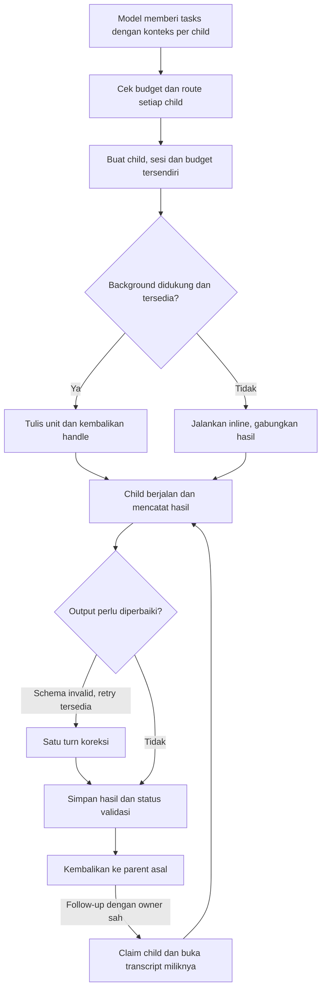

# Delegasi ke subagent

`delegate_task` memecah pekerjaan menjadi satu atau beberapa child dengan konteks percakapan sendiri. Parent menentukan objective tiap child dan menyintesis hasilnya. Runtime memilih jalur inline atau background berdasarkan tipe sesi, kontrak tool pada sesi itu, dan ketersediaan return path. Identitas child dapat digunakan kembali untuk follow-up. [Entrypoint](https://github.com/NousResearch/hermes-agent/blob/ae2a81ccc00e9b7c06301523e5bb09608397149c/tools/delegate_tool.py#L594-L715) · [Pemilihan jalur](https://github.com/NousResearch/hermes-agent/blob/ae2a81ccc00e9b7c06301523e5bb09608397149c/tools/delegate_tool_dispatch.py#L478-L553).

## Apa yang diserahkan

- Schema model menampilkan `tasks[]` berisi goal, context child, optional output schema, gambar, dan group delivery. Bentuk single goal lama masih bisa dibaca handler untuk kompatibilitas. Actions mencakup `spawn`, `list`, `steer`, `stop`, dan `continue`. Group menggabungkan output selesai dalam satu unit jika independent completion diaktifkan. Urutan kerja dependensi tetap menjadi tanggung jawab parent. [Schema](https://github.com/NousResearch/hermes-agent/blob/ae2a81ccc00e9b7c06301523e5bb09608397149c/tools/delegate_tool.py#L830-L911) · [Group units](https://github.com/NousResearch/hermes-agent/blob/ae2a81ccc00e9b7c06301523e5bb09608397149c/tools/delegate_tool_dispatch.py#L429-L444).
- Entrypoint memeriksa host policy, spawn pause, depth, task count, format schema/image, dan kejelasan route. Kegagalan routing dapat menolak satu child sambil membiarkan child valid tetap berjalan. Config menetapkan budget iterasi, default 250 per child. Default concurrency 10 dan depth 1. Orchestrator di depth yang masih diizinkan dapat meneruskan delegasi. [Default iterasi](https://github.com/NousResearch/hermes-agent/blob/ae2a81ccc00e9b7c06301523e5bb09608397149c/tools/delegate_tool.py#L105-L111) · [Validasi tool](https://github.com/NousResearch/hermes-agent/blob/ae2a81ccc00e9b7c06301523e5bb09608397149c/tools/delegate_tool.py#L611-L677) · [Concurrency](https://github.com/NousResearch/hermes-agent/blob/ae2a81ccc00e9b7c06301523e5bb09608397149c/tools/delegate_tool_config.py#L15-L30) · [Depth](https://github.com/NousResearch/hermes-agent/blob/ae2a81ccc00e9b7c06301523e5bb09608397149c/tools/delegate_tool_config.py#L197-L223).
- Child memperoleh session ID, parent pointer, budget iterasi segar, instruksi child, route model/provider, dan filter toolsets. Context files dilewati pada constructor ini. Memori di-skip normalnya, dengan pengecualian konfigurasi checkpoint yang memerlukan provider memori terikat ke fork. Toolsets mengikuti surface parent yang efektif serta deny-list untuk memory, send message, scheduling, user clarification, dan Kanban, dengan pengecualian delegasi lanjutan untuk orchestrator. Isolasi worktree opsional untuk local Git, default off. Boundary konteks, worktree Git, dan isolasi OS memiliki bukti yang berbeda. [Konstruksi child](https://github.com/NousResearch/hermes-agent/blob/ae2a81ccc00e9b7c06301523e5bb09608397149c/tools/delegate_tool.py#L229-L330) · [Toolset filtering](https://github.com/NousResearch/hermes-agent/blob/ae2a81ccc00e9b7c06301523e5bb09608397149c/tools/delegate_tool_toolsets.py#L15-L123) · [Worktree flag](https://github.com/NousResearch/hermes-agent/blob/ae2a81ccc00e9b7c06301523e5bb09608397149c/tools/delegate_tool_config.py#L162-L166).

## Join, hasil, dan continuation

Model top-level biasanya mendapat background dispatch, sedangkan orchestrator child perlu join hasil dalam turn. Mode gateway inline dipatok oleh schema yang diterima sesi. Run tanpa return path atau pool background penuh dapat fallback inline; detached-only auto-resume menolak jika tidak dapat berjalan detached. Background mengembalikan delegation ID, daftar child, dan kemungkinan unit hasil. Batch default join seluruh child sebelum satu result, dan `independent_completions` membuka return per group. [Schema mode](https://github.com/NousResearch/hermes-agent/blob/ae2a81ccc00e9b7c06301523e5bb09608397149c/tools/delegate_tool.py#L936-L977) · [Background routing](https://github.com/NousResearch/hermes-agent/blob/ae2a81ccc00e9b7c06301523e5bb09608397149c/tools/delegate_tool_dispatch.py#L404-L553).

Result parent mencakup status, exit reason, summary, partial/interrupted, penggunaan, informasi route, dan tool trace. `status=completed` dengan `exit_reason=max_iterations` masih dapat membawa ringkasan parsial dan `truncated=true`. Jika output schema gagal, satu turn koreksi diperbolehkan. Hasil tetap membawa validitas dan error terstruktur bila koreksi belum menghasilkan schema yang sah. Parent perlu memeriksa indikator tersebut sebelum memakai hasil sebagai bukti completion. [Validasi output](https://github.com/NousResearch/hermes-agent/blob/ae2a81ccc00e9b7c06301523e5bb09608397149c/tools/delegate_tool_child_run.py#L555-L609) · [Result entry](https://github.com/NousResearch/hermes-agent/blob/ae2a81ccc00e9b7c06301523e5bb09608397149c/tools/delegate_tool_child_run.py#L643-L749) · [Agregasi](https://github.com/NousResearch/hermes-agent/blob/ae2a81ccc00e9b7c06301523e5bb09608397149c/tools/delegate_tool_dispatch.py#L222-L272).

Etape background memakai ledger `async_delegations`, dengan route asal, parent/owner execution, state unit, child result, dan delivery state. Worker yang terdaftar harus cocok dengan execution dan identitas prosesnya agar operasi bisa diterima. Attempt dan delivery claim diproses terpisah. Recovery menginspeksi owner yang ditinggalkan dan bisa memulihkan undelivered completion. Scope dan route diperiksa kembali saat melanjutkan. [Tabel](https://github.com/NousResearch/hermes-agent/blob/ae2a81ccc00e9b7c06301523e5bb09608397149c/hermes_state_common.py#L726-L785) · [Ledger di gateway](https://github.com/NousResearch/hermes-agent/blob/ae2a81ccc00e9b7c06301523e5bb09608397149c/gateway/session_worker_delegation.py#L38-L165) · [Abandoned dan restore](https://github.com/NousResearch/hermes-agent/blob/ae2a81ccc00e9b7c06301523e5bb09608397149c/tools/async_delegation.py#L315-L440).

`continue` mencari child yang dimiliki parent pada registry dan persistent `resumable_subagents`. CAS memindahkan state child ke claimed. Runtime mencari transcript segment tip, membuka ulang child di endpoint yang sama dan memberi instruksi follow-up. Jika start gagal sebelum dispatch, claim dilepas. Default record resumable 48 jam dan maksimum 32. Auto-resume adalah opt-in. Ia membedakan gagal sementara, park sampai restart, perbaikan/konfigurasi, dan handoff; retry tunduk pada deadline, kapasitas dan keputusan parent yang datang kemudian. [Scope child](https://github.com/NousResearch/hermes-agent/blob/ae2a81ccc00e9b7c06301523e5bb09608397149c/tools/delegate_tool_registry.py#L242-L350) · [Classifier dan TTL](https://github.com/NousResearch/hermes-agent/blob/ae2a81ccc00e9b7c06301523e5bb09608397149c/tools/delegate_tool_resumable.py#L26-L75) · [Durable claim](https://github.com/NousResearch/hermes-agent/blob/ae2a81ccc00e9b7c06301523e5bb09608397149c/tools/delegate_tool_resumable.py#L581-L603) · [Resume transcript](https://github.com/NousResearch/hermes-agent/blob/ae2a81ccc00e9b7c06301523e5bb09608397149c/tools/delegate_tool_continue.py#L151-L243) · [Jadwal auto-resume](https://github.com/NousResearch/hermes-agent/blob/ae2a81ccc00e9b7c06301523e5bb09608397149c/tools/delegate_tool_auto_resume.py#L484-L518).

## Bukti eksekusi fixture

Hermes v0.23.2 pada Python 3.14.9 dan macOS ARM64, menggunakan home sementara. 125 lulus. Cakupan mencakup filter toolsets, claim eksklusif, record resumable, auto-resume, owner worker, replay completion yatim, dan binding sesi. Klaim cakupan di sini terbatas pada fixture yang dijalankan. [test_delegate_toolset_scope.py](https://github.com/NousResearch/hermes-agent/blob/ae2a81ccc00e9b7c06301523e5bb09608397149c/tests/tools/test_delegate_toolset_scope.py) · [test_delegate_resumable_claims.py](https://github.com/NousResearch/hermes-agent/blob/ae2a81ccc00e9b7c06301523e5bb09608397149c/tests/tools/test_delegate_resumable_claims.py) · [test_delegate_resumable.py](https://github.com/NousResearch/hermes-agent/blob/ae2a81ccc00e9b7c06301523e5bb09608397149c/tests/tools/test_delegate_resumable.py) · [test_delegate_auto_resume.py](https://github.com/NousResearch/hermes-agent/blob/ae2a81ccc00e9b7c06301523e5bb09608397149c/tests/tools/test_delegate_auto_resume.py) · [test_async_delegation_worker.py](https://github.com/NousResearch/hermes-agent/blob/ae2a81ccc00e9b7c06301523e5bb09608397149c/tests/tools/test_async_delegation_worker.py) · [test_async_delegation_orphan_sweep.py](https://github.com/NousResearch/hermes-agent/blob/ae2a81ccc00e9b7c06301523e5bb09608397149c/tests/tools/test_async_delegation_orphan_sweep.py) · [test_async_delegation_session_binding.py](https://github.com/NousResearch/hermes-agent/blob/ae2a81ccc00e9b7c06301523e5bb09608397149c/tests/gateway/test_async_delegation_session_binding.py).

## Pemetaan ke Ngertiin

Handoff Ngertiin sudah mengikat serah-terima, review, dan human input sebagai pekerjaan durable dalam grup. Member yang dipilih menjalankan turn yang terpisah dan output dikembalikan melalui task/continuation sesuai mode yang diminta. Ini sudah memberi sebagian pengalaman parent-worker pada identitas yang tetap. Hermes menambah temporary children dengan sesi sendiri, fan-out, per-child output contract, dan join yang tidak memerlukan child menjadi anggota workspace atau grup permanen. [Handoff and settle](../../apps/server/src/groups/service.ts#L623-L666) · [Kontrak task](../../apps/server/src/groups/contracts.ts#L106-L142) · [Instruksi parent](../../apps/server/src/goals/instructions.ts#L7).

Pola yang dapat ditransfer adalah result packet dengan provenance, schema opsional, status parsial, retry yang dibatasi, dan validasi artefak. Jika temporary delegation diadopsi, buat child run yang menginduk pada parent run/task dan masuk scheduler yang sama. Efektifkan tool grant melalui irisan parent, worker policy dan scope saat dispatch. Berikan hanya bahan yang diserahkan. Child memakai run dan storage scope sendiri. Settlement menjalankan join dan wake parent sekali per unit yang sah. Perubahan member/grant, penghentian, dan outcome tidak diketahui perlu diputuskan sebelum memulai child baru. Event progress dapat terlihat secara ringkas sementara prompt dan trace mentah berada di internal.

Uji satu agent merangkum tiga dokumen berbeda melalui child yang hanya melihat dokumennya masing-masing. Satu child menghasilkan schema salah lalu membaik setelah koreksi, satu dihentikan dan mengembalikan hasil parsial, dan satu selesai normal. Putuskan proses saat join lalu verifikasi session linkage, pembatasan bahan, continuation tepat sekali, kemunculan summary parsial dan bukti, serta isolasi antara child dengan pekerjaan grup lain.

## Bukti Hermes Desktop macOS

Toolset **Task Delegation** teramati aktif pada profil fixture. REA dan source yang cocok memetakan event aktivitas tool/child ke renderer. Jalur child run, join dan cancel tetap memerlukan pengujian Desktop khusus. [Pemetaan artefak](desktop-artifact.md#temuan-statis-per-fitur) · [Cakupan runtime](desktop-runtime.md#cakupan-setiap-fitur).
