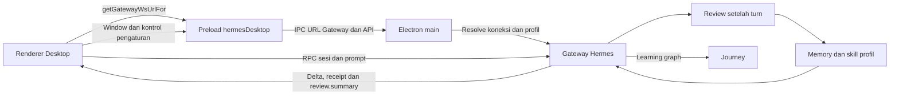

# Artefak Hermes Desktop macOS

Artefak yang diperiksa ialah bundle Electron ARM64 yang tampil sebagai proses Hermes pada Mac, di `~/.hermes/hermes-agent/apps/desktop/release/mac-arm64/Hermes.app`. Bundle `/Applications/Hermes.app` memiliki identifier `com.nousresearch.hermes.setup` dan executable `Hermes-Setup`. Temuan Desktop di bawah merujuk pada bundle yang menjalankan aplikasi.

## Identitas

| Bagian | Nilai dari artefak |
| --- | --- |
| Bundle aktif | `com.nousresearch.hermes`, executable `Hermes`, versi plist `0.0.0`, Mach-O ARM64 |
| Electron Framework | `44.10.2` dari plist framework |
| Stamp | `install-stamp.json` menandai `source: local`, `dirty: false`, `payload: bootstrap`, `distribution: desktop-app`, dan build `2026-11-18T12:18:08.231Z` |
| Revisi dalam stamp | `ae2a81ccc00e9b7c06301523e5bb09608397149c`, sama dengan pin riset dan HEAD checkout Hermes lokal pada saat diperiksa. Ini mengaitkan build dengan source. |
| SHA-256 `app.asar` | `f80eb501b49c0905a0a7f533c80d606023bcf96fa717230a1777cd08f57b0ad0` |
| SHA-256 executable `Hermes` | `5ff5c3d8113bae1fb20ebf11329852a4c4090ab00ec6f740b3e043fd3e84a9a5` |
| SHA-256 `install-stamp.json` | `2ab0b694efc427c8561397e4194d9bcff2fe6878d88bb2da8f2627db16e1d57c` |
| Pemeriksaan bundle | `codesign --verify --deep --strict` melaporkan valid di disk. Signature `adhoc` menjelaskan jenis build lokal. |

Nama versi pada panel dan versi runtime Gateway perlu didokumentasikan dari pengamatan aplikasi. Stamp dan hash di atas memberi identitas paket yang lebih tepat daripada nama aplikasi. [Source yang dirujuk stamp](https://github.com/NousResearch/hermes-agent/commit/ae2a81ccc00e9b7c06301523e5bb09608397149c).

## Jalur aplikasi dalam bundle

REA menemukan satu API `contextBridge` di `dist/electron-preload.js` dan melacak dua literal `invoke`. Artefak menunjukkan `hermes:gateway:ws-url-for` pada baris 72 dan `hermes:api` pada baris 340. Teks main process yang tersimpan sebagai companion unpacked menunjukkan handler dengan nama persis sama, masing-masing pada `dist/electron-main.mjs:89274` dan `:89582`. Handler URL menyiapkan dial lokal atau registry berdasarkan koneksi dan profil. Handler API meneruskan request ke implementasi native yang relevan. Ini pengaitan statis dari dua sisi literal dan kode terpilih.

Desktop menggunakan RPC Gateway seperti `prompt.submit`, `session.resume`, dan `approval.respond` untuk chat dan kontrol. Di jalur yang terbaca, ACP adalah surface integrasi terpisah dari transport Desktop. Desktop juga menggunakan management API untuk skills, settings dan cron. Kesamaan domain Gateway menjelaskan bagaimana UI Desktop dan ACP bisa memunculkan proyeksi yang berbeda untuk perilaku backend yang sama. [ACP](acp.md) · [Gateway](gateway-surfaces.md).

## Self-learning, Journey, dan Curator

1. **Sinyal review.** Chunk `dist/assets/main-cT3v4W7C.js` pada offset byte 2872096 menangani event `review.summary`. Bila teks dan session ID tersedia, ia mem-flush delta dan menambah row system bertanda `review:` di state percakapan. Ini adalah proyeksi untuk hasil yang sudah disimpan agent. Bukti kode renderer menetapkan jenis row yang dibentuk. Ketahanannya setelah reload harus diperiksa pada runtime. [Handler Desktop pada pin](https://github.com/NousResearch/hermes-agent/blob/ae2a81ccc00e9b7c06301523e5bb09608397149c/apps/desktop/src/app/session/hooks/use-message-stream/gateway-event/status.ts#L208-L242).
2. **Review otomatis dan eksplisit.** Source Gateway menerbitkan event yang sama untuk callback background review pada viewer lokal dan untuk `/refine`. Jalur `/refine` mengambil transcript sesi, memakai policy sesi, dan memulai side agent, termasuk saat agen cached sudah hilang. Dua pemicu memiliki hasil yang dapat tampak sama di Desktop. Uji otomatis perlu memastikan mulainya berasal dari turn yang memenuhi syarat. [Callback otomatis](https://github.com/NousResearch/hermes-agent/blob/ae2a81ccc00e9b7c06301523e5bb09608397149c/gateway/run_turn_runner.py#L448-L471) · [Review eksplisit](https://github.com/NousResearch/hermes-agent/blob/ae2a81ccc00e9b7c06301523e5bb09608397149c/gateway/session_refine.py#L25-L101).
3. **Mengajarkan skill.** Deskripsi `/learn` dikirim di chunk aksi. Gateway menerima sumber yang dirujuk pengguna, seperti direktori, URL, catatan atau percakapan. Ia menulis ulang input menjadi prompt authoring dan meneruskannya ke agent. Input command kosong mengambil workflow dari percakapan. Jalur ini mencatat tindakan mengajar yang eksplisit. [Command](https://github.com/NousResearch/hermes-agent/blob/ae2a81ccc00e9b7c06301523e5bb09608397149c/gateway/run_inbound.py#L991-L997) · [Pembentuk prompt](https://github.com/NousResearch/hermes-agent/blob/ae2a81ccc00e9b7c06301523e5bb09608397149c/agent/learn_prompt.py#L136-L160).
4. **Journey.** `actions-DhQYrHd_.js` berisi `/journey`, panggilan `GET /api/learning/graph`, serta baca, ubah dan hapus node. `starmap-BJjDgzPd.js` membedakan node memory dan skill serta memproyeksikan state, pemakaian, asal, dan pin. Source command Desktop mengarahkan `/journey`, `/learning` dan `/memory-graph` ke overlay yang sama. [Command](https://github.com/NousResearch/hermes-agent/blob/ae2a81ccc00e9b7c06301523e5bb09608397149c/apps/desktop/src/lib/desktop-slash-commands.ts#L250-L255) · [Handler](https://github.com/NousResearch/hermes-agent/blob/ae2a81ccc00e9b7c06301523e5bb09608397149c/apps/desktop/src/app/session/hooks/use-prompt-actions/slash.ts#L1273-L1279).
5. **Arti node dan relasi.** Backend membangun graph dari skill di pustaka profil dengan sinyal `created_by=agent`, `created_by=learn`, atau sudah dipakai, serta potongan memory. Hubungan skill mengikuti `related_skills`. Hubungan memory ke skill memakai kecocokan nama dan kata hingga empat hasil per kartu. Sebuah edge menunjukkan keterkaitan berdasarkan aturan itu. Atribusi belajar otomatis, kecocokan prosedur, dan kualitas hasil baru memerlukan bukti review serta percobaan pemakaian ulang. Edit dan penghapusan diproses per profil. Aksi hapus skill melalui graph diimplementasikan sebagai arsip. [Pembentuk graph](https://github.com/NousResearch/hermes-agent/blob/ae2a81ccc00e9b7c06301523e5bb09608397149c/agent/learning_graph.py#L192-L256) · [Management API](https://github.com/NousResearch/hermes-agent/blob/ae2a81ccc00e9b7c06301523e5bb09608397149c/hermes_cli/web_routers/status.py#L780-L830).
6. **Curator.** `command-center-B2Pau47H.js` memproyeksikan status, pause dan pemicu manual. Fungsi aksi di bundle memanggil `/api/curator`, `/api/curator/paused`, dan `/api/curator/run`. Route manual meminta pekerjaan `curator run` di background pada profil terpilih. Tujuannya merawat pustaka skill yang sudah ada. [Curator API](https://github.com/NousResearch/hermes-agent/blob/ae2a81ccc00e9b7c06301523e5bb09608397149c/hermes_cli/web_routers/status.py#L732-L777) · [Learning](learning.md).

## Temuan statis per fitur

Di tabel ini, nama chunk renderer merujuk pada `dist/assets/` dalam ASAR. Sebagian besar hubungan ditemukan dari teks chunk yang dipastikan ada dalam inventaris paket. Tombol, string command, atau wrapper API menetapkan permukaan yang dikirim dalam bundle. Hasil eksekusi setiap fitur dibuktikan lewat uji Desktop yang sesuai.

| Fitur | Yang dikirim oleh Desktop | Pertanyaan runtime |
| --- | --- | --- |
| [Lifecycle](lifecycle.md) · [Sessions](sessions.md) | `actions-DhQYrHd_.js` menyiapkan identitas submit, menangani receipt, serta melacak revisi, generation dan pending prompts. Chunk utama menangani `session.replay_gap`, `message.complete`, `prompt.resolve_unknown`, cancel, steer dan penggantian antrean. Compaction memanggil `session.resume` untuk menyelaraskan snapshot. | Jalankan antrean nyata, putuskan viewer, lalu periksa satu hasil dan pemulihan state. |
| [Human-in-the-loop](human-in-the-loop.md) | Jalur `approval.respond` dan `clarify.respond` menyusun session, generation dan prompt ID. Persiapan respons menolak prompt yang sudah stale atau tidak tersedia. | Bedakan kartu yang tampil, keputusan yang terpasang pada run, dan efek di target. |
| [Goals](goals.md) · [Proaktivitas](proactivity.md) · [Loops](loops.md) | Deskripsi `/goal`, `/heartbeat`, `/loop`, dan `/refine` tersedia di `actions-DhQYrHd_.js`. Chunk utama meneruskan command ke `slash.exec` dan memiliki proyeksi khusus output `goal`. | Set, status, pause, dan hasil setelah trigger perlu dicoba satu per satu. |
| [Cron](scheduling.md) | `cron-B2K5YEzn.js` memproyeksikan waktu berikutnya dan delivery. `actions-DhQYrHd_.js` berisi request list, create, edit, pause, resume, serta daftar run dan target. `open-cron-run-CEqTce8N.js` menangani navigasi dari run Cron. | Bedakan schedule state, benar-benar run, sesi hasil, dan efek pengiriman. |
| [Tools](tools.md) · [Computer](computer-use.md) | `capabilities-8I6_jw2f.js` mengelompokkan kategori kerja, kreasi dan recall. Wrapper Desktop memuat/simpan toolset, menampilkan status izin Computer, dan memilih backend terminal. Chunk utama mengamati aktivitas nama `computer_use` dan `browser_`. | Capability yang terlihat bisa berbeda dari tool yang dapat dipanggil, izin OS, dan keberhasilan input. |
| [Skills](skills.md) · [Memory](memory.md) | Wrapper `actions-DhQYrHd_.js` menyediakan list/read/toggle/lock skills, serta Hub install dan update. `memory-layers-DCy0qhPt.js` memisahkan lapisan built-in dan provider memory. Chunk utama memproyeksikan `skill_view` dan memperbarui data skill sesudah `skill_manage`. | Bedakan aktif, dibaca, dipakai, ditulis, dan ditemukan kembali pada sesi berbeda. |
| [Tasks](tasks.md) · [Delegation](delegation.md) · [Kanban](kanban.md) | Chunk utama memetakan payload `todos` ke `todo_list`, menyediakan kartu `delegate_task`, dan merender event child hingga `subagent.complete`. Chunk `subagents-CZSt6qfh.js` menormalisasi status child dan membentuk pohon parent–child. Nama board hadir di navigasi, kategori tools, dan rute kait plugin. | Join, budget dan terminal settlement harus dipastikan pada backend atau UI. Tampilan board bergantung pada aktivasi plugin. |
| [Artifacts](artifacts.md) · [Multimodal](multimodal.md) | `artifacts-CKIycZak.js` mencari referensi file dari pesan/hasil tool serta membawanya dengan session dan profil. `chat-messages-CPf0o00Z.js` mendukung bagian tool dan kartu gambar. | Buka atau unduh byte aktual, cocokkan isinya dan scope, lalu observasi input/output media pada backend yang dipilih. |
| [Profiles](profiles.md) · [Providers](providers.md) · [MCP](mcp.md) · [Plugins](plugins.md) | `connections-DtSejob0.js`, `profile-ops-BrweI9Id.js` dan `settings-CvkEQ3GV.js` berisi control plane. Rute scoped melalui connection ID dan profil. Wrapper menyertakan MCP, toolsets, memory provider, katalog plugin, pengaturan profile dan auxiliary task. | Tampilan konfigurasi dapat dibuktikan tanpa model. Inference, koneksi aktif, tingkah laku plugin dan billing perlu uji terpisah. |
| [Gateway Surfaces](gateway-surfaces.md) | `webhooks-D8051D6J.js` dan wrapper aksi menyediakan konfigurasi webhook sebagai bagian Desktop. Chunk utama memproyeksikan daftar sesi menurut koneksi. | Skenario uji perlu membedakan edit konfigurasi, penerimaan event sah, admission, dan publikasi. |

## Ledger REA dan batas cakupan

| Bukti | Temuan |
| --- | --- |
| `ev_dcf8390d5c322df30805c2dfa42ba27bf54ec4f2d7fe9609389ed8784750b92f` | Parent `analyze_javascript_application` untuk 12 path. Inventaris relevan 1.019 file, 11 JavaScript diparse dan 1 file metadata. `detail=summary` memberi `ev_7d7038f7ad1d837e99e1c7d8d0491921ffbd8b04dd5738cf83855394fb0a1074`. |
| `ev_9705d07df39aaa266ba9d7091490f1c4857a7d78f4cb8f8d9a92de526b2bb5cc` · `ev_b3ec042b02832e234447c30d35abc29a5824e7e57e76593d767fe42930c79147` | Trace exact literal di preload untuk `hermes:gateway:ws-url-for` dan `hermes:api`. Masing-masing menemukan satu observation. Main handler ditetapkan lewat pembacaan teks companion, di luar coverage trace ini. |
| `ev_b489c913bd41929b16cd5d76afbc7b82e59c4787b10cece4236d7f60b45460da` | Analisis terpilih untuk command center, request router sesi, open-cron-run, connections, settings manifest, dan webhooks. Ringkasan `ev_267a7133b4986e2df3f9ce257682a744f452a291d5b20166d47e8742918456e3` mencatat enam JS diparse. |
| `ev_1ad4ef1200704b939d4fdda4c78759c685b6cf32a716c44b367553654d45dcc1` | Analisis tiga chunk Journey, dialog arsip, dan memory layers. Ringkasan `ev_1087f3be6b320be65055c3f2b39e21b587876ff12e36512affedd4d01ad71579`. |
| `ev_d709cd0819b1570344e92fbd51c269c253c32e5b8d658e0713a8841429e5f31d` | Analisis besar mencapai batas 120 detik pada `dist/electron-main.mjs`. Cakupan parsial tetap tersimpan. Pemeriksaan handler selanjutnya memakai teks dan posisi yang dibaca langsung dari file companion build. |

REA awalnya menolak karena metadata integritas ASAR dan dua file unpacked `node-pty` memiliki digest berbeda. Path yang teramati berakhir di `pty.node` dan `spawn-helper`. Analisis melanjutkan dengan `integrity_policy=record-and-continue`, mempertahankan kontradiksi dan status untrusted kedua file ini. Validasi tanda tangan bundle ad-hoc berhasil sebagai pemeriksaan terpisah. Penyebab perbedaan digest belum terbukti.

Coverage JavaScript dan semantic graph parsial karena pemilihan sumber dan batas node. Posisi yang disebut adalah offset byte atau baris file yang dikirim. Pembacaan dilakukan secara statis. Pengujian runtime memiliki bukti tersendiri.
