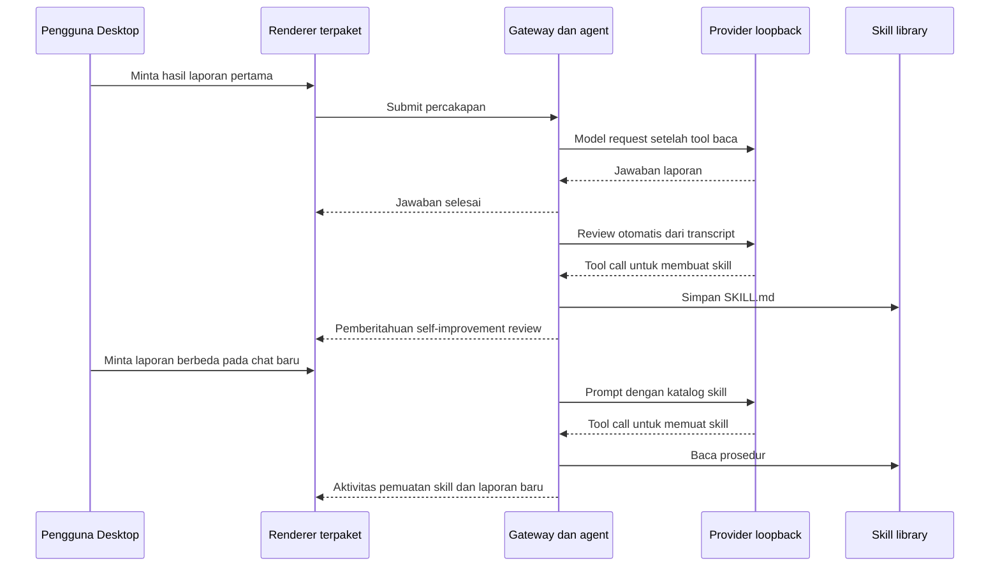

# Hermes Desktop macOS dari POV pengguna

Pengamatan 18 November 2026 pada macOS ARM64. Targetnya Hermes Desktop Electron yang aktif, dengan versi engine `v0.23.2` di UI. Installer `Hermes-Setup` di Applications adalah bundle berbeda. Stamp build Desktop dan checkout engine menunjuk ke `ae2a81ccc00e9b7c06301523e5bb09608397149c`. Hash SHA-256 ASAR adalah `f80eb501b49c0905a0a7f533c80d606023bcf96fa717230a1777cd08f57b0ad0`. [Identitas build, analisis REA, dan Evidence IDs](desktop-artifact.md).

Pengujian berjalan lewat computer use pada salinan Desktop dengan ASAR identik, user-data Electron dan `HERMES_HOME` baru, engine dari checkout dengan SHA yang sama, serta provider OpenAI-compatible fixture pada loopback. Semua prompt dan file pengujian sintetis. Backend, penyimpanan, tool executor dan UI menjalankan implementasi Hermes. Fixture menentukan respons model dan tool calls, sehingga bukti ini bisa dipakai untuk mekanisme runtime dan observasi pengguna. Kualitas pilihan model, manfaat belajar pada input bebas, dan billing akun provider memerlukan bukti terpisah.

## Self-learning dari dua sesi

**DT-01.** Sebelum turn, skill `hx-paginated-report` belum ada. Chat pertama hanya meminta total terverifikasi dari sumber uji. Engine menjalankan `read_file` dan UI menjawab **317**. Ambang memory dan skill pada profil uji diatur menjadi 1 untuk memicu review sesudah turn. Nilai default source tetap 10 pada masing-masing penghitung. Prompt pengguna tidak memuat instruksi untuk belajar atau membuat skill. [Default dan trigger](learning.md#review-dari-turn-yang-baru-selesai).

Setelah jawaban tampil, fixture menerima request review dengan konteks turn selesai. Fixture hanya mengembalikan `skill_manage` apabila transcript berisi hasil `read_file` pertama. Engine kemudian menulis `skills/hx-paginated-report/SKILL.md` dan Desktop menampilkan `Self-improvement review` dengan keterangan skill dibuat. `agent.log` pada profil uji menandai satu review selesai dengan `result=skill` dan dua panggilan provider. File skill berisi prosedur memeriksa semua halaman dan memvalidasi total.

**DT-02.** Di chat baru, prompt hanya meminta total laporan kedua. Fixture memeriksa nama skill dalam prompt yang diterima sebelum mengembalikan `skill_view`. Dalam run ini, tool tersebut langsung tersedia dan dipanggil tanpa `skills_list`. Engine mengembalikan isi skill, `read_file` membuka file kedua, dan UI menampilkan aktivitas `Loaded skill: hx-paginated-report, explored pagination-new.txt` serta total **584**. SQLite test menyimpan hasil berhasil dari `skill_view`. Kontrol positif ini membuktikan penemuan capability dari prompt, pemuatan paket yang ditulis reviewer, dan penggunaan tool pada sesi lain dengan profil yang sama. Perbandingan kualitas dengan model live dan baseline tanpa skill masih terbuka. [Kontrak skill](skills.md) · [Checklist LEARN](implementation-checklist.md#2-self-learning-dan-memory).

## Goal dan tugas dalam sesi

**DT-03.** Menjalankan `/goal status` di sesi fixture baru menghasilkan status Goal kosong. Perintah `/goal <objective>` membuat status aktif dan kickoff, dengan budget 20 turn. Model fixture mengembalikan jawaban teks biasa pada request evaluator. Log backend mencatat tiga kegagalan parse JSON, dan Desktop menampilkan `Goal paused · Turn 3/20`. Jawaban yang mengklaim laporan ditinjau tidak menyelesaikan Goal. Dua instruksi continuation tampil di timeline sesi. Ini membuktikan jalur kegagalan evaluator dari app sampai state final; semantik done model bebas belum terukur. [Goals](goals.md).

**DT-04.** Model fixture menerima tiga bridge Tool Search pada katalog efektif dan meminta `todo_list` lewat `tool_call`. Hasil tool menyimpan satu item completed dan satu in progress dengan revision 1. Setelah turn selesai, Desktop menampilkan tombol `Previous tasks 1/2` di atas composer. Membukanya menunjukkan kedua langkah. Task plan merupakan state sesi dan dapat diperiksa terpisah dari klaim jawaban. [Tasks](tasks.md) · [Tools](tools.md).

## Jadwal, history, dan konfigurasi capability

**DT-05.** Dari **Scheduled jobs**, buat Cron harian 09.00 dengan tujuan **This desktop**. Form menawarkan nama, prompt, frekuensi, model, dan kebijakan missed runs. Klik **Trigger now**. Gateway menjalankan satu permintaan fixture, menyimpan satu output Cron, dan panel menampilkan satu riwayat run. Klik riwayat tersebut membuka sesi Cron dengan jawaban. Sesi hasil juga menampilkan awalan instruksi scheduler pada pesan input. Jenis tampilan itu perlu diputuskan sendiri di Ngertiin sesuai aturan privasi instruksi. Percobaan membuktikan eksekusi trigger manual dan tujuan lokal. Catch-up dan pengiriman eksternal masih membutuhkan skenario sendiri. [Scheduling](scheduling.md).

**DT-06.** Sidebar **Capabilities** menampilkan tab Skills, Plugins, Connectors, dan Tools. Pada profil uji, tab Tools menampilkan 23 kelompok yang dapat dikonfigurasi. Computer Use, Browser Automation, Memory, Skills, Task Delegation, Task Planning, dan Cron Jobs tampil aktif dalam daftar tersebut. Kanban serta Video Analysis/Generation tampil nonaktif. Panel Computer Use menyediakan pemeriksaan driver dan izin OS. Jumlah kelompok berbeda dari jumlah schema yang dikirim ke model. Run laporan dan Todo masing-masing menerima 19 schema pada fixture, dan run Cron menerima 18. Angka ini milik konfigurasi yang diuji. [Tools](tools.md) · [Computer Use](computer-use.md).

## Memory dan status tool yang dilihat pengguna

**DT-07.** Pengujian negatif mengirim target memory di dalam operasi batch. Tool menolak bentuk tersebut. Target adalah field top-level dan operasi hanya menerima field mutasi yang sesuai. File `USER.md` tidak dibuat. Jejak UI yang dipulihkan menampilkan label `Memory write noted` dan jawaban fixture mengaku mengirim preferensi, sementara tool receipt menyatakan gagal. Untuk Ngertiin, keberhasilan belajar atau mengingat sebaiknya dilaporkan dari hasil tool yang terkonfirmasi. [Memory](memory.md).

Sesudah restart Desktop dan gateway fixture dengan profil uji yang sama, batch yang benar untuk target `user` berhasil. UI menampilkan jawaban fixture bahwa preferensi tersimpan, tool receipt memiliki `success: true`, dan file `memories/USER.md` berisi preferensi **Cedar**. Chat baru mengirim prompt uji tanpa kata Cedar; fixture hanya mengembalikan Cedar setelah menemukan preferensi di konteks yang diterima. **Memory & Context → Persistent memory** memperlihatkan built-in memory aktif serta pilihan provider terpisah. Ini membuktikan write, pemuatan lintas sesi, dan perbedaan antara isyarat UI dan receipt pada kondisi gagal. Mutasi unattended atas entri lama tetap mengikuti bukti dari source. [Kontrak mutasi](memory.md#kontrak-dan-algoritme-perubahan).

## Restart, loop, browser, dan artifact

**DT-08.** Setelah restart dua proses fixture, buka lagi percakapan kedua dari sidebar. Total 584 dan ringkasan `Loaded skill` tetap dapat dibuka. Di pengaturan **Memory & Context → Context & compression**, terlihat strategi context engine, Auto-Compression, threshold, target, serta timeout model kompresi. Percakapan uji cukup pendek sehingga pengujian ini mencakup keterlihatan pengaturan dan replay hasil. Peristiwa compaction aktual belum ditimbulkan. [Sessions](sessions.md) · [Lifecycle](lifecycle.md).

**DT-09.** Pada sesi dengan jawaban sebelumnya, `/heartbeat 1m HX-HEARTBEAT` mengaktifkan status Heartbeat dengan countdown 1 menit. Pengguna tidak perlu menulis prompt tambahan ke sesi tersebut. Provider loopback dipanggil oleh wake, dan snapshot SQLite menangkap `active` dengan `fire_count=3`, tiga input wake, dan tiga output terjadwal pada sesi asal. Pada sesi terpisah, `/loop 30s HX-CRON loop check --times 1` mula-mula menampilkan Run 0/1, lalu satu jawaban fixture dan `Loop finished · Run 1/1`. Pending response pada state Loop kembali false. Keduanya terlihat sebagai kontrol sesi yang berbeda dari Scheduled jobs. Backoff self-paced, quiet delivery, dan klaim yang gagal sebelum admission masih tercakup di riset source dan fixture, di luar probe Desktop ini. [Heartbeat](proactivity.md) · [Loop](loops.md).

**DT-10.** Dari composer Desktop, fixture memilih `browser_exec`. Hermes menjalankan Brave headless memakai konfigurasi profil uji, membuka `about:blank`, mengubah DOM, lalu membaca ulang nilai sintetis `cedar-584`. UI menampilkan aktivitas browser sebelum jawaban yang memuat nilai tersebut. Tool result yang dipersist juga memuat nilainya. Jalur desktop OS diperiksa terpisah lewat **Capabilities → Tools → Computer Use**. Toggle tercatat aktif, tetapi detail preflight di home uji menampilkan **Setup required** untuk `cua-driver` dan meminta Accessibility dan Screen Recording. Bukti eksekusi berlaku untuk browser dan CDP. Aksi pada jendela macOS dan takeover manusia masih terbuka. [Computer Use](computer-use.md).

**DT-11.** `write_file` menghasilkan `summary.csv` dengan `verified: true`. Desktop menampilkan aktivitas untuk file tersebut, dan **Artifacts** menemukannya beserta path workspace. Pemeriksaan file uji membaca header `label,total` dan row `cedar,584`. Probe mencakup file output lokal serta indexing di UI. Uji ingest attachment, akses lintas pengguna, dan delivery channel memerlukan fixture tersendiri. [Artifacts](artifacts.md).

**DT-12.** Perintah `/journey` membuka panel grafik di route `#/starmap` dengan timeline dan satu node yang terlihat sebagai hitungan 1/1 saat katalog uji hanya punya satu hasil belajar. Panel ini menampilkan hasil yang sudah tersimpan. Setelah satu turn lain selesai, `/refine pagination` menampilkan pemberitahuan review eksplisit sesuai fokus. Fixture mengembalikan no-change, tanpa menulis skill tambahan. Review otomatis DT-01 telah terjadi sebelum kedua perintah ini digunakan. [Learning](learning.md) · [Jalur renderer](desktop-artifact.md).

**DT-13.** Uji kedua Goal mengirim putusan evaluator `done` dalam JSON valid. Desktop menampilkan `Goal done · 1 turn` dan SQLite menyimpan status `done`. Bersama DT-03, uji ini memperlihatkan cabang done serta cabang pause setelah kegagalan parse berulang. Gate deliverable dan kualitas judge pada provider live masih perlu diuji. [Goals](goals.md).

## Bukti REA untuk state uji

Snapshot SQLite dibuat dengan backup API dari profil sintetis, lalu REA memeriksa file yang stabil. Evidence `ev_3757263d9178d077f4cfeaa326a91a9af00a495087ad11cd905355f5e4a6caa4` merujuk SHA-256 `09ec39fde401911ee5bd0da9003b93d74be6a03fc02f3859cda6c03929f791f9` tanpa WAL pendamping. Inspeksi memilih hanya `status`, `outcome`, dan `generation` pada `session_admissions`. Pada snapshot itu, hasil memuat 17 baris `terminal/completed`, generation 1–5, tanpa pemotongan dan dengan urutan yang tidak ditentukan. Ini sampel lifecycle pada satu waktu. Query read-only terpisah terhadap data uji memeriksa state Goal, Heartbeat/Loop, dan hasil tool yang dipakai pada DT-01 sampai DT-13.

Probe Desktop ke gateway mengikuti pola isolasi dari [harness Desktop upstream](https://github.com/NousResearch/hermes-agent/blob/ae2a81ccc00e9b7c06301523e5bb09608397149c/apps/desktop/e2e/core/harness.ts#L42-L166). Untuk mengulang pembelajaran, arahkan provider custom ke loopback, set `skills.creation_nudge_interval` dan `memory.nudge_interval` menjadi 1 hanya pada profil uji, lalu kirim dua tugas di chat terpisah. Respons fixture pertama memakai `read_file`, fork review memakai `skill_manage`, dan sesi kedua memakai `skill_view` hanya setelah mendapat nama skill di konteks. Pakai model live yang terotorisasi pada run terpisah jika yang diuji adalah kualitas pilihan dan hasilnya.

## Cakupan setiap fitur

| Fitur | Bukti Desktop yang tersedia | Pertanyaan yang masih terbuka |
| --- | --- | --- |
| [Learning](learning.md) | DT-01/02/12 membuktikan review otomatis, pemakaian ulang, Journey, dan review eksplisit pada build yang sama. | Pemilihan pelajaran, revisi dari koreksi, Curator dan rollback dengan model bebas. |
| [Skills](skills.md) | Pembuatan dan pemuatan paket uji, ringkasan aktivitas, katalog Capabilities. | Paket opsional, dependency, dan perubahan hak akses saat eksekusi. |
| [Memory](memory.md) | DT-07 menguji argumen gagal, write valid, recall di chat baru dan konfigurasi built-in. | Provider eksternal, penghapusan atau koreksi saat review berbarengan. |
| [Lifecycle](lifecycle.md) | Hasil terminal di Desktop dan REA SQLite, pemulihan history setelah restart. | Lost ACK, antrean unknown, stop/steer dan rekonsiliasi efek saat eksekusi aktif. |
| [Sessions](sessions.md) | DT-02/08 membuka sesi berbeda dan replay jawaban beserta aktivitas, UI kompresi teramati. | Fork, reset, compaction aktual dan lineage dengan pekerjaan aktif. |
| [ACP](acp.md) | Artefak memetakan Desktop ke Gateway. Bukti ACP stdio terpisah ada di [probe sebelumnya](verification.md). | Perbandingan desktop, viewer ACP, dan klien editor saat reconnect pada sesi yang sama. |
| [Goals](goals.md) | DT-03/13 menguji Goal aktif, continuation, pause setelah evaluator invalid, dan done. | Gate dengan bukti nyata, wait/wake, pause dan resume oleh pengguna, subgoal lintas agent. |
| [Tasks](tasks.md) | DT-04 menguji Todo via bridge, state dua item dan UI Previous tasks. | Perubahan plan paralel dan konsistensi selepas kompresi. |
| [Delegation](delegation.md) | Toolset aktif pada DT-06, renderer event delegasi dapat ditelusuri pada artefak. | Child scope, eksekusi, join dan pembatalan melalui Desktop. |
| [Kanban](kanban.md) | Toolset opt-in tampil nonaktif pada profil uji, jalur plugin dan board terpetakan dari artefak. | Aktivasi board, dependency, claim, review dan recovery worker. |
| [Proaktivitas](proactivity.md) | DT-09 membuktikan wake Heartbeat dari countdown tanpa chat baru ke sesi asal. | Coalescing saat sibuk, quiet response, dan wake dari hasil proses atau child. |
| [Loops](loops.md) | DT-09 membuktikan tick awal dan berhenti pada cap 1. | Self-paced, perubahan hasil, evaluator kondisi dan resume. |
| [Scheduling](scheduling.md) | DT-05 membuat jadwal, trigger manual, output lokal, dan run history yang bisa dibuka. | Fire kalender pada waktu due, missed runs, pre-check, delivery eksternal. |
| [Tools](tools.md) | DT-04/06/10/11 menguji katalog, Tool Search, browser dan file; jumlah schema efektif teramati. | Cakupan backend dan paralelisme tiap kelompok tool. |
| [Computer Use](computer-use.md) | DT-10 menguji perubahan dan observasi DOM, serta preflight driver macOS. | Izin dan aksi desktop OS, handback, launcher managed dan sesi provider lain. |
| [Artifacts](artifacts.md) | DT-11 menguji hasil byte lokal dan indexing Artifacts. | Attachment input, download scoped dan deliverable lintas platform. |
| [Human-in-the-loop](human-in-the-loop.md) | Katalog menunjukkan Clarifying Questions, artefak menyediakan approval dan prompt resolution. | Pengguna menjawab satu klarifikasi, deny, expiry dan efek yang benar-benar dicegah. |
| [Profiles](profiles.md) | Sidebar menampilkan profil default, tindakan create/import dan pengelolaan gateway. Fixture memakai home dan data Electron terpisah. | Migrasi profil nyata, ekspor/cadangan dan pilihan jaringan multi-gateway. |
| [Providers](providers.md) | Model fixture terlihat pada composer. Inference, tool calls dan auxiliary judge memakai loopback yang sama. | Auth akun nyata, biaya, entitlement, fallback dan perbandingan model. |
| [MCP](mcp.md) | Connectors tersedia sebagai bagian Capabilities; jalur konfigurasi terpetakan pada artefak. | Menjalankan allowed connector, revoke, budget dan scope tool. |
| [Plugins](plugins.md) | Tab Plugins dan integrasi Kanban teridentifikasi. | Load dependency, transform stream, kebijakan hook dan kegagalan plugin. |
| [Gateway Surfaces](gateway-surfaces.md) | Desktop attach ke Gateway lokal, replay, dan Cron menuju This desktop teramati. | Messaging sungguhan, webhook, HTTP replay dan delivery eksternal. |
| [Multimodal](multimodal.md) | Toggle vision/audio dan opt-in video terlihat di Capabilities. | Analisis gambar, STT/TTS, dan produksi media dari backend yang dipilih. |
| [Verification](verification.md) | DT-03/13 menunjukkan klaim teks, outcome evaluator dan state final perlu diperiksa masing-masing. DT-07 menunjukkan tool error dapat berdampingan dengan label aktivitas. | Verify-on-stop dan gate berkas dengan pemeriksaan yang sungguh gagal lalu diperbaiki. |

Untuk Ngertiin, uji utama self-learning harus menunjukkan temuan dari run pertama menjadi skill yang ditemukan kembali pada run kedua. Simpan identitas versi dan bukti pemakaian serta hasil yang bisa dicek. Pada Goal, tampilkan alasan pause yang tepat. Pada Routine, pertahankan jejak hasil per occurrence di permukaan pengguna. Gunakan hasil yang telah terkonfirmasi untuk status memory dan artifact. [Pemetaan ke Ngertiin](ngertiin.md) · [Checklist implementasi](implementation-checklist.md).
