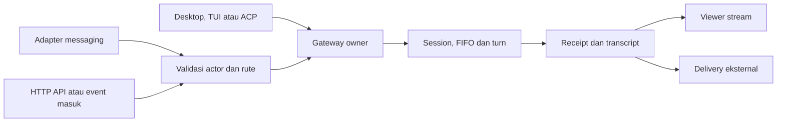

# Gateway, channel, API dan delivery

Hermes menyatukan beberapa permukaan dengan runtime Gateway yang sama, dengan identitas dan policy berbeda pada masing-masing ingress. TUI/desktop dan ACP dapat menjadi viewer dari owner lokal. Messaging, API dan webhook membawa principal serta payload dari transport masing-masing. Jawaban yang selesai dieksekusi memerlukan tahap delivery tambahan ketika tujuannya ada di luar store Gateway. [Gateway internals](https://github.com/NousResearch/hermes-agent/blob/ae2a81ccc00e9b7c06301523e5bb09608397149c/website/docs/developer-guide/gateway-internals.md), [authority contract](https://github.com/NousResearch/hermes-agent/blob/ae2a81ccc00e9b7c06301523e5bb09608397149c/gateway/session_contract.py#L8-L100), [delivery settled](https://github.com/NousResearch/hermes-agent/blob/ae2a81ccc00e9b7c06301523e5bb09608397149c/gateway/session_ingress.py#L468-L523).

## Runtime dan ingress

| Surface | Sambungan ke lifecycle |
| --- | --- |
| Owner lokal dan viewer | `connect_gateway` menemukan owner, dapat memulai unmanaged daemon jika belum ada, mengambil session ticket lewat control socket, lalu membuka transport Gateway. Ticket terikat ke instance dan profil dengan expiry 30 detik pada jalur yang disitir. Owner lock dan epoch menjaga urutan penulis. [Client](https://github.com/NousResearch/hermes-agent/blob/ae2a81ccc00e9b7c06301523e5bb09608397149c/hermes_cli/gateway_client.py#L330-L389), [ticket](https://github.com/NousResearch/hermes-agent/blob/ae2a81ccc00e9b7c06301523e5bb09608397149c/gateway/control_socket.py#L381-L408), [ownership](https://github.com/NousResearch/hermes-agent/blob/ae2a81ccc00e9b7c06301523e5bb09608397149c/gateway/runtime_ownership.py#L164-L246). |
| Messaging | Adapter mengubah input channel menjadi event yang membawa origin/principal. Policy receiver dan allowlist diperiksa pada jalur scoped profile. `admit_message` meminta admit native, menyimpan waiter delivery lokal setelah row durable dan menggunakan receipt/row untuk mendeteksi race dengan drain. Platform plugin yang ada di source mencakup Telegram, Slack, Discord, Signal, Teams, WhatsApp dan lainnya. [Authz](https://github.com/NousResearch/hermes-agent/blob/ae2a81ccc00e9b7c06301523e5bb09608397149c/gateway/authz_mixin.py#L855-L940), [native ingress](https://github.com/NousResearch/hermes-agent/blob/ae2a81ccc00e9b7c06301523e5bb09608397149c/gateway/session_ingress.py#L43-L120), [direktori platform](https://github.com/NousResearch/hermes-agent/tree/ae2a81ccc00e9b7c06301523e5bb09608397149c/plugins/platforms). |
| API | API server menyediakan permukaan chat completions, responses, model list dan operasi native. Request bisa memakai conversation/response identity sesuai route. Status seperti incomplete perlu dibaca dari kontrak route dan hasil tersimpan. Heartbeat/cron dan satu permintaan HTTP punya ownership yang berbeda. [Endpoint dan hasil](https://github.com/NousResearch/hermes-agent/blob/ae2a81ccc00e9b7c06301523e5bb09608397149c/website/docs/user-guide/features/api-server.md#L56-L157), [proyeksi response](https://github.com/NousResearch/hermes-agent/blob/ae2a81ccc00e9b7c06301523e5bb09608397149c/gateway/platforms/api_server_openai_routes.py#L63-L169), [idempotency store](https://github.com/NousResearch/hermes-agent/blob/ae2a81ccc00e9b7c06301523e5bb09608397149c/gateway/platforms/api_server_run_idempotency.py#L42-L124). |
| Webhook | Route/producer dikaitkan dengan profil dan target session. Ingress dapat coalesce event per konfigurasi, memeriksa scope dan menulis melalui jalur canonical admission. Deduplikasi event diterapkan pada batas producer. Jalur producer memiliki identitas yang berbeda dari jadwal berulang dan stream viewer. [Producer admission](https://github.com/NousResearch/hermes-agent/blob/ae2a81ccc00e9b7c06301523e5bb09608397149c/gateway/platforms/webhook_ingress.py#L122-L218), [webhook finalize/recovery](https://github.com/NousResearch/hermes-agent/blob/ae2a81ccc00e9b7c06301523e5bb09608397149c/gateway/platforms/webhook_ingress.py#L257-L335), [coalescer](https://github.com/NousResearch/hermes-agent/blob/ae2a81ccc00e9b7c06301523e5bb09608397149c/gateway/platforms/webhook_coalesce.py#L27-L109). |
| Delivery | `deliver_settled` menangani reply yang sudah commit dan tidak memiliki waiter aktif. Adapter memisahkan teks, file dan hasil kirim. Delivery ledger melacak kewajiban, attempt, outcome dan jadwal retry. Send yang gagal tidak mengubah hasil inference yang sudah terminal. [Settled delivery](https://github.com/NousResearch/hermes-agent/blob/ae2a81ccc00e9b7c06301523e5bb09608397149c/gateway/session_ingress.py#L468-L523), [ledger states](https://github.com/NousResearch/hermes-agent/blob/ae2a81ccc00e9b7c06301523e5bb09608397149c/gateway/delivery_ledger.py#L264-L351), [recovery](https://github.com/NousResearch/hermes-agent/blob/ae2a81ccc00e9b7c06301523e5bb09608397149c/gateway/delivery_ledger.py#L368-L447). |

Gateway juga dapat melayani secondary profile dengan batas owner per profil. Sebuah profile/home adalah boundary runtime Hermes yang berguna untuk konfigurasi, session dan kepemilikan proses. Ngertiin memerlukan pembuktian isolasi eksekusi organisasi secara terpisah, terutama ketika terminal atau desktop punya akses OS yang luas. [Topologi Gateway](https://github.com/NousResearch/hermes-agent/blob/ae2a81ccc00e9b7c06301523e5bb09608397149c/website/docs/developer-guide/multiplexing-gateway.md), [execution domains Ngertiin](../architecture/execution-domains.md).

## Implikasi untuk Ngertiin

Web/Tauri tetap menjadi account client untuk jadwal, interaksi dan riwayat Ngertiin. Pola yang relevan ialah satu commit bisa diikuti oleh pembacaan history/replay, termasuk ketika klien belum melihat delta. Jika delivery eksternal kemudian dipilih sebagai scope produk, modelkan receipt tujuan dan deduplikasi terpisah dari run. Itu memungkinkan retry kirim tanpa menjalankan pekerjaan lagi. [Event stream](../../apps/server/src/event-stream.ts), [akses API](../../apps/server/src/api-access.ts), [Tauri remote client](../architecture/tauri-remote-client.md).

Uji event duplikat, caller tidak berwenang, ACK hilang setelah commit, reconnect dengan replay gap serta delivery gagal setelah hasil tersimpan. Channel live, API server publik dan layanan provider eksternal tidak dijalankan untuk halaman ini. ACP stdio dan Gateway lokal dibahas di [ACP](acp.md).

## Bridge channel terkelola di Ngertiin

`NGERTIIN_CHANNELS` mengikat satu channel ke akun terverifikasi, organisasi, DM, pengirim eksternal, thread eksternal, dan endpoint delivery. Adapter tepercaya mengirim `event_id` dan teks ke `POST /v1/channels/:channel/events` dengan bearer khusus channel dan `X-Ngertiin-Channel-Sender`. Server mengambil identitas eksekusi serta target dari konfigurasi dan memakai pilihan harness, akun, serta billing DM. Admission dan receipt memakai satu transaksi. Delivery mencatat attempt terpisah dan mengirim teks serta metadata artifact dari run yang sudah selesai. Adapter membuka bytes lewat route exchange dengan autentikasi yang sama. Receipt 503 yang mengonfirmasi retry memungkinkan pengiriman ulang dengan ID delivery yang sama. Respons ambigu tersimpan sebagai `unknown`. [Messaging](evidence/channel-02/verification.json) · [Webhook](evidence/channel-03/verification.json) · [Retry](evidence/channel-04/verification.json).

## Bukti Hermes Desktop macOS

App terpaket menampilkan backend lokal ready, lalu membuka sesi hasil Cron melalui row riwayat pada tujuan **This desktop**. Renderer menggunakan kontrak canonical Gateway untuk sesi. Bukti ini mencakup egress lokal; producer webhook dan messaging punya jalur eksekusi tersendiri. [Artefak Desktop](desktop-artifact.md) · [DT-05](desktop-runtime.md#jadwal-history-dan-konfigurasi-capability).
