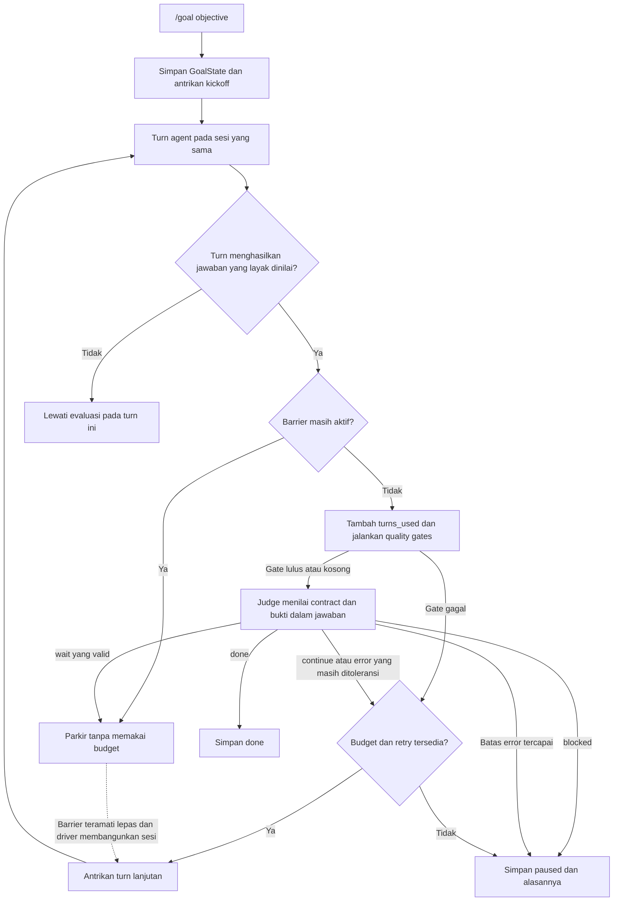

# Goal

Hermes menyimpan satu objective per sesi dan mengevaluasi kemajuannya setelah turn yang memenuhi syarat. Jika masih ada pekerjaan, runtime mengantrikan turn lanjutan. Contract, subgoal, gate verifikasi, dan wait barrier memengaruhi keputusan yang sama. [Model state](https://github.com/NousResearch/hermes-agent/blob/ae2a81ccc00e9b7c06301523e5bb09608397149c/hermes_cli/goals.py#L420-L501) · [Loop evaluasi](https://github.com/NousResearch/hermes-agent/blob/ae2a81ccc00e9b7c06301523e5bb09608397149c/hermes_cli/goals.py#L1484-L1568).

## Perintah, penyimpanan, dan scope

- `dispatch_goal_command` menangani set, status/show, pause/resume, clear, wait/unwait, gate, dan draft. Teks biasa menetapkan objective dan menggantikan goal sesi sebelumnya. Inline contract diurai menjadi `outcome`, `verification`, `constraints`, `boundaries`, dan `stop_when`. Draft menggunakan model auxiliary, lalu mengembalikan goal bebas jika draft gagal. Subgoal dari `/subgoal` ditambahkan ke kriteria judge dan prompt kelanjutan. Set mengembalikan kickoff yang disesuaikan jika objective panjang baru saja dikirim. [Parser perintah](https://github.com/NousResearch/hermes-agent/blob/ae2a81ccc00e9b7c06301523e5bb09608397149c/hermes_cli/goal_command.py#L137-L218) · [Contract](https://github.com/NousResearch/hermes-agent/blob/ae2a81ccc00e9b7c06301523e5bb09608397149c/hermes_cli/goals.py#L265-L339) · [Dedup kickoff](https://github.com/NousResearch/hermes-agent/blob/ae2a81ccc00e9b7c06301523e5bb09608397149c/hermes_cli/goals.py#L979-L997) · [Subgoal](https://github.com/NousResearch/hermes-agent/blob/ae2a81ccc00e9b7c06301523e5bb09608397149c/gateway/slash_commands_goals.py#L271-L309).
- `GoalState` diserialisasi sebagai JSON pada `state_meta` SQLite dengan key `goal:<session_id>`. Field-nya mencakup objective, status `active | paused | done | cleared`, turn count, reason/verdict terakhir, counter kegagalan judge, gates, dan kriteria/wait. Clear menyimpan status arsip. Resume menghapus wait dan secara default mereset turn count. Compaction mencoba memindahkan row ke sesi anak dan menandai row lama cleared, dengan perlindungan jika anak sudah memiliki goal. Jalur tulis/migrasi bersifat best-effort. Kode memakai operasi tulis dan clear terpisah, sehingga atomisitas migrasi antar-row perlu dibuktikan terpisah. [State](https://github.com/NousResearch/hermes-agent/blob/ae2a81ccc00e9b7c06301523e5bb09608397149c/hermes_cli/goals.py#L420-L503) · [Load, save, migrasi](https://github.com/NousResearch/hermes-agent/blob/ae2a81ccc00e9b7c06301523e5bb09608397149c/hermes_cli/goals.py#L636-L706) · [Command state](https://github.com/NousResearch/hermes-agent/blob/ae2a81ccc00e9b7c06301523e5bb09608397149c/hermes_cli/goals.py#L1172-L1221).
- Di gateway, perintah melakukan operasi sinkron di executor dengan ContextVars profil. Kickoff messaging membawa referensi media, message ID, auto-skill, dan channel prompt dari event asal. Resume memasukkan synthetic prompt dengan konteks lanjutan. Kontrol pause/clear membersihkan continuation yang masih menunggu. Untuk local slash, hasilnya berisi direktif prompt untuk dikirim client. [Gateway command](https://github.com/NousResearch/hermes-agent/blob/ae2a81ccc00e9b7c06301523e5bb09608397149c/gateway/slash_commands_goals.py#L33-L112) · [Pause/resume/clear](https://github.com/NousResearch/hermes-agent/blob/ae2a81ccc00e9b7c06301523e5bb09608397149c/hermes_cli/goal_command.py#L38-L65).

## Judge, bukti, dan budget

- Gateway melewati Goal hook bila turn gagal atau respons akhir kosong. Hook mengumpulkan background process dan delegasi yang relevan untuk sesi, lalu menjalankan evaluator di luar event loop. Status notice dilepas melalui slot post-delivery. Continuation masuk FIFO messaging sehingga pesan pengguna yang sudah menunggu mendapat giliran, atau menggunakan `admit_route_wake` untuk local authority. Viewer klasik yang menjadi driver memiliki hook sendiri. [Gateway hook dan driver](https://github.com/NousResearch/hermes-agent/blob/ae2a81ccc00e9b7c06301523e5bb09608397149c/gateway/run_goals.py#L312-L404) · [CLI evaluator](https://github.com/NousResearch/hermes-agent/blob/ae2a81ccc00e9b7c06301523e5bb09608397149c/hermes_cli/cli_loops_mixin.py#L861-L894) · [TUI evaluator](https://github.com/NousResearch/hermes-agent/blob/ae2a81ccc00e9b7c06301523e5bb09608397149c/tui_gateway/prompt_turn.py#L355-L403).
- Sebelum judge, `_check_gates` menjalankan gate yang terdaftar berdasarkan urutan. Gate yang merah menghentikan rangkaian gate saat itu dan memberi continuation berisi exit code serta tail output. Retry memeriksa input aktual kembali. Timeout, gagal start, atau workspace deklaratif yang tidak tersedia punya jalur gagal yang terpisah. Default 300 detik per gate dan tiga retry setelah kegagalan awal, dibatasi juga oleh budget Goal. Pesan admin diperlukan untuk mendaftarkan gate melalui messaging dan local route menggunakan otorisasi owner. [Default](https://github.com/NousResearch/hermes-agent/blob/ae2a81ccc00e9b7c06301523e5bb09608397149c/hermes_cli/goals.py#L32-L57) · [Eksekusi dan workspace](https://github.com/NousResearch/hermes-agent/blob/ae2a81ccc00e9b7c06301523e5bb09608397149c/hermes_cli/goals.py#L374-L414) · [Retry gate](https://github.com/NousResearch/hermes-agent/blob/ae2a81ccc00e9b7c06301523e5bb09608397149c/hermes_cli/goals.py#L1306-L1358) · [Otorisasi gateway](https://github.com/NousResearch/hermes-agent/blob/ae2a81ccc00e9b7c06301523e5bb09608397149c/gateway/slash_commands_goals.py#L41-L50).
- Model auxiliary `goal_judge` menerima cuplikan objective maksimal 2.000 karakter, jawaban akhir 4.000 karakter, contract/subgoal bila ada, dan status proses/delegasi yang relevan. Default runtime memakai timeout 30 detik dan output budget 4.096 token. Parser menerima `done`, `blocked`, `continue`, `wait` dan bentuk legacy `done: boolean`. Kegagalan parse dan transport memberi `continue` sementara, lalu pause masing-masing setelah 3 atau 5 kejadian berturut-turut. Respons `done` langsung memajukan Goal ke done setelah gate lulus. Tanpa gate, validitas klaim dalam jawaban bergantung pada input dan keputusan judge. [Default dan directive](https://github.com/NousResearch/hermes-agent/blob/ae2a81ccc00e9b7c06301523e5bb09608397149c/hermes_cli/goals.py#L30-L57) · [Parser](https://github.com/NousResearch/hermes-agent/blob/ae2a81ccc00e9b7c06301523e5bb09608397149c/hermes_cli/goals.py#L798-L845) · [Input judge](https://github.com/NousResearch/hermes-agent/blob/ae2a81ccc00e9b7c06301523e5bb09608397149c/hermes_cli/goals.py#L894-L959) · [Keputusan dan batas](https://github.com/NousResearch/hermes-agent/blob/ae2a81ccc00e9b7c06301523e5bb09608397149c/hermes_cli/goals.py#L1484-L1568).
- Default budget 20 turn. Evaluasi menghitung turn pengguna dan synthetic turn ketika barrier sedang bebas. `wait` dapat menunjuk proses registry `session_id`, PID hidup di host, atau timer. Registry bisa lepas saat proses selesai atau trigger-nya terpenuhi. PID/session barrier punya batas 30 menit, timer yang berhubungan dengan delegasi dapat lepas lebih awal setelah satu delegasi selesai. Barrier yang masih aktif menahan evaluasi tanpa menambah turn. Driver CLI memiliki idle hook untuk park yang sudah lepas. Bukti hook CLI ini belum menetapkan perilaku wake otomatis untuk semua adapter gateway. [Wait](https://github.com/NousResearch/hermes-agent/blob/ae2a81ccc00e9b7c06301523e5bb09608397149c/hermes_cli/goals.py#L1363-L1475) · [CLI idle hook](https://github.com/NousResearch/hermes-agent/blob/ae2a81ccc00e9b7c06301523e5bb09608397149c/hermes_cli/cli_loops_mixin.py#L702-L729).
- Untuk kartu Kanban, worker goal mode memakai evaluator serupa pada loop sendiri. Setelah judge menyatakan done, worker didorong sekali untuk memanggil `kanban_complete`. Kartu baru selesai lewat settlement board. Judge yang menyatakan blocked, budget turn habis, atau worker menolak finalize memblokir kartu sesuai cabang kode. [Loop Kanban](https://github.com/NousResearch/hermes-agent/blob/ae2a81ccc00e9b7c06301523e5bb09608397149c/hermes_cli/goals.py#L1630-L1753) · [Kanban](kanban.md).

## Bukti eksekusi fixture

Hermes v0.23.2 pada Python 3.14.9 dan macOS ARM64, menggunakan home sementara. 140 lulus dan satu dilewati karena gate fixture tersebut khusus Linux. Cakupan mencakup state Goal, dispatch command, gate, restart/resume setelah budget habis, serta idle hook CLI saat barrier waktu terlepas. Klaim cakupan di sini terbatas pada fixture yang dijalankan. [test_goals.py](https://github.com/NousResearch/hermes-agent/blob/ae2a81ccc00e9b7c06301523e5bb09608397149c/tests/hermes_cli/test_goals.py) · [test_goal_gates.py](https://github.com/NousResearch/hermes-agent/blob/ae2a81ccc00e9b7c06301523e5bb09608397149c/tests/hermes_cli/test_goal_gates.py) · [test_goal_dispatch.py](https://github.com/NousResearch/hermes-agent/blob/ae2a81ccc00e9b7c06301523e5bb09608397149c/tests/hermes_cli/test_goal_dispatch.py) · [test_goal_resume_restart.py](https://github.com/NousResearch/hermes-agent/blob/ae2a81ccc00e9b7c06301523e5bb09608397149c/tests/gateway/test_goal_resume_restart.py) · [test_cli_goal_parked_resume.py](https://github.com/NousResearch/hermes-agent/blob/ae2a81ccc00e9b7c06301523e5bb09608397149c/tests/hermes_cli/test_cli_goal_parked_resume.py).

## Pemetaan ke Ngertiin

Ngertiin sudah menangkap tanggung jawab yang perlu bertahan lintas run secara semantik, dengan identitas Goal sendiri, thread/agent scope, revisi, dan pada grup seorang coordinator. Run aktif melaporkan `continue | scheduled | wait | blocked | completed` melalui `report_goal`. Dua fase menjaga penyelesaian. Laporan completed mencatat `completion_pending`, lalu Background menunggu settlement native sukses dan memeriksa artefak dari lineage, scope, dan generation yang tepat. Linked Routine menguasai wake yang sudah dijadwalkan. [Instruksi tanggung jawab](../../apps/server/src/goals/instructions.ts#L10-L19) · [Report](../../apps/server/src/goals/service.ts#L150-L228) · [Finalisasi](../../apps/server/src/goals/service.ts#L559-L601) · [Bukti artefak](../../apps/server/src/goals/evidence.ts#L6-L45).

Untuk mendekati Hermes, gunakan Goal Ngertiin yang sama sebagai pemilik continuation. Simpan completion contract dan checkpoint verifikasi saat Goal membutuhkan beberapa tahap. Sebelum mengadmit kelanjutan, tentukan dari receipt dan verifikasi apa yang masih bisa dilakukan sekarang. Langkah pemeriksaan yang perlu model dapat menjadi run terbatas melalui harness terpilih, mengikuti pilihan koneksi dan billing yang sudah berlaku. Gate deterministik bisa menghasilkan receipt verifikasi di workspace terotorisasi. Jika bukti valid baru muncul setelah pekerja grup atau proses selesai, event settlement dapat melanjutkan Goal yang masih aktif dengan cek generation dan satu admission key. UI dapat memperlihatkan progress, bukti, dan alasan menunggu yang relevan.

Skenario pembanding yang disarankan adalah pengerjaan satu laporan dengan tiga kriteria. Turn pertama membuat draft dan menyebutnya selesai, tetapi satu kriteria gagal. Verifikasi merah harus memicu koreksi, lalu wait harus diam sampai hasil pekerja atau proses tersedia. Jika pengguna menjeda di sela-sela, receipt lama tidak boleh membangunkan Goal. Setelah resume, artefak yang benar harus melewati verifikasi dan settlement sebelum Goal selesai. Ukur jumlah continuation yang menghasilkan bukti baru, biaya evaluasi, false completion, dan admission ganda pada setiap harness.

## Bukti Hermes Desktop macOS

Desktop memberi status aktif dan kickoff saat pengguna menetapkan Goal. Fixture dengan tiga jawaban judge yang formatnya invalid berakhir `Goal paused · Turn 3/20`. Fixture dengan putusan JSON valid memperlihatkan `Goal done · 1 turn` dan DB menyimpan `done`. Timeline sesi juga memperlihatkan dua input continuation pada cabang gagal. [DT-03](desktop-runtime.md#goal-dan-tugas-dalam-sesi) · [DT-13](desktop-runtime.md#restart-loop-browser-dan-artifact).
