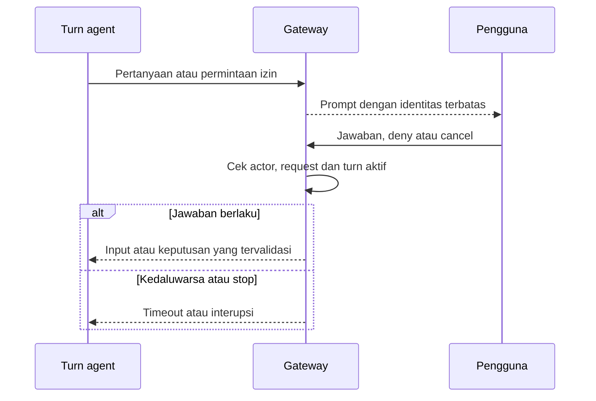

# Klarifikasi, izin dan intervensi pengguna

Hermes bisa meminta jawaban yang menjadi input untuk melanjutkan pekerjaan, meminta izin atas efek tertentu, dan menerima steer/stop dari pengguna. Ketiganya memakai identitas dan waktu hidup berbeda. Transport dapat menampilkan tombol atau form, tetapi handler harus memverifikasi pengguna, prompt dan turn yang sedang aktif. [Clarify tool](https://github.com/NousResearch/hermes-agent/blob/ae2a81ccc00e9b7c06301523e5bb09608397149c/tools/clarify_tool.py#L95-L154), [approval actor](https://github.com/NousResearch/hermes-agent/blob/ae2a81ccc00e9b7c06301523e5bb09608397149c/gateway/approval_actor.py#L40-L89), [kontrak Gateway](https://github.com/NousResearch/hermes-agent/blob/ae2a81ccc00e9b7c06301523e5bb09608397149c/gateway/session_contract.py#L93-L100).

## Jalur implementasi

- `clarify_tool` menormalkan batch pertanyaan, pilihan, default dan pilihan jamak, memanggil callback surface lalu membentuk hasil per pertanyaan. Gateway menyimpan wait entry per clarify ID dengan session scope dan expiry. Resolusi hanya mengubah entry yang masih pending. Kalimat pengguna juga bisa dicocokkan terhadap label atau pilihan menurut mode entry. [Normalisasi dan handler](https://github.com/NousResearch/hermes-agent/blob/ae2a81ccc00e9b7c06301523e5bb09608397149c/tools/clarify_tool.py#L36-L154), [pendaftaran dan resolusi](https://github.com/NousResearch/hermes-agent/blob/ae2a81ccc00e9b7c06301523e5bb09608397149c/tools/clarify_gateway.py#L20-L127), [coercion](https://github.com/NousResearch/hermes-agent/blob/ae2a81ccc00e9b7c06301523e5bb09608397149c/tools/clarify_gateway.py#L140-L246).
- Untuk izin, `_await_gateway_decision` dipakai beberapa gate tool. Concurrent request yang identik dan punya owner/pihak yang boleh menjawab sama dapat digabung ketika menunggu. Allow Once milik satu call. Session/Always memiliki scope izin yang berbeda. Browser atau messaging UI adalah perantara dan tidak dapat mengganti aturan call. [Coalescing](https://github.com/NousResearch/hermes-agent/blob/ae2a81ccc00e9b7c06301523e5bb09608397149c/tools/approval_gateway_wait.py#L164-L224), [scope keputusan](https://github.com/NousResearch/hermes-agent/blob/ae2a81ccc00e9b7c06301523e5bb09608397149c/tools/approval.py#L442-L521).
- Native card menunjuk request tertentu. `resolve_gateway_approval_card` memeriksa request ID, eligibility kartu, actor dan policy dalam critical section yang sama dengan settlement. Kartu lama yang telah selesai tidak bisa menyetujui request berikutnya. Timeout, hard stop atau session replacement dapat melepaskan waiter tanpa mengotorisasi efek. [Card settlement](https://github.com/NousResearch/hermes-agent/blob/ae2a81ccc00e9b7c06301523e5bb09608397149c/tools/approval.py#L208-L236), [wait interruption](https://github.com/NousResearch/hermes-agent/blob/ae2a81ccc00e9b7c06301523e5bb09608397149c/tools/approval_gateway_wait.py#L72-L125), [turn runner](https://github.com/NousResearch/hermes-agent/blob/ae2a81ccc00e9b7c06301523e5bb09608397149c/gateway/run_turn_runner.py#L795-L862).
- ACP memproyeksikan izin maupun klarifikasi dari owner. Inline form bergantung pada kemampuan client. Job tanpa channel izin yang cocok perlu outcome yang dapat dipahami ketika tool mensyaratkan manusia. [ACP answers](https://github.com/NousResearch/hermes-agent/blob/ae2a81ccc00e9b7c06301523e5bb09608397149c/acp_adapter/gateway_server.py#L1160-L1223), [MCP gate tanpa approver](https://github.com/NousResearch/hermes-agent/blob/ae2a81ccc00e9b7c06301523e5bb09608397149c/tools/mcp_tool_handlers.py#L190-L246).

## Implikasi untuk Ngertiin

Ngertiin memiliki `Interactions.ask/reply/resolve`, journal run dan ACP permission/elicitation. Pertahankan identitas yang berbeda untuk jawaban terstruktur, pemberian izin dan kontrol run. Gunakan target run atau action fingerprint dan cek authority saat jawaban diterima. Jika check rutin perlu informasi pengguna, publish permintaan yang bisa ditindaklanjuti dan simpan alasan pekerjaan belum selesai. [Interaksi produk](../../apps/server/src/interactions/service.ts), [ACP permission/form](../../apps/server/src/harness/acp/session.ts#L506-L645), [kontrak kontrol](../architecture/conversation-control-api.md).

Uji jawaban valid, free text, deny, kartu lama sesudah cancel, tautan keputusan dari user lain dan race dengan expiry. Ukur apakah tool benar-benar jalan setelah Allow Once, serta apakah tidak ada efek setelah denial. Source mendeskripsikan kontrak. Tes ACP lifecycle mencakup cancel, sementara halaman ini tidak mengklaim uji semua platform interaksi.

## Bukti Hermes Desktop macOS

Katalog Desktop menawarkan **Clarifying Questions**. Handler shipped menyiapkan jalur untuk identitas prompt, approval, dan response yang diproyeksikan. Uji native kali ini mencakup observasi permukaan dan artefak; loop pengguna menjawab atau menolak belum dieksekusi. [Artefak Desktop](desktop-artifact.md) · [Cakupan runtime](desktop-runtime.md#cakupan-setiap-fitur).
