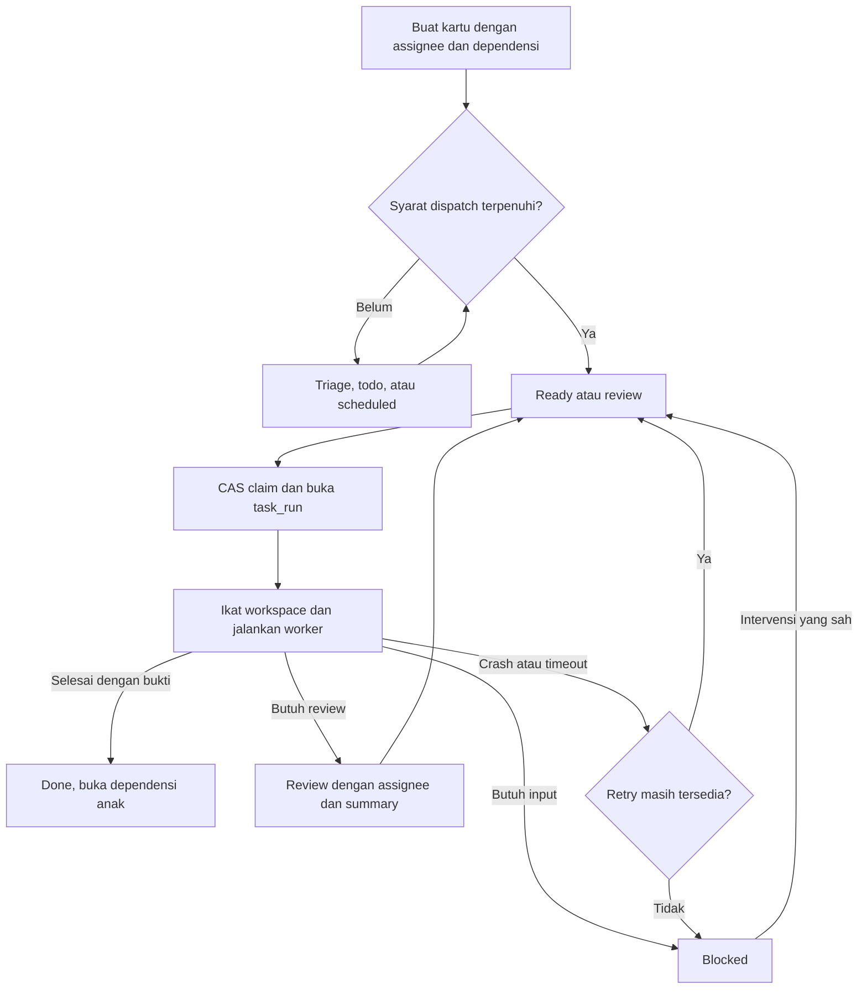

# Kanban dan pekerjaan lintas profil

Kanban menyimpan kartu dan menjalankan pekerja ketika dependensi, penerima, dan kapasitasnya siap. Satu kartu dapat melalui beberapa upaya, tahap review, dan serah-terima hasil. Board SQLite menghubungkan kartu ke run, workspace, dependensi, komentar, lampiran, dan event. [Schema kartu](https://github.com/NousResearch/hermes-agent/blob/ae2a81ccc00e9b7c06301523e5bb09608397149c/hermes_cli/kanban_db.py#L776-L868) · [Schema riwayat](https://github.com/NousResearch/hermes-agent/blob/ae2a81ccc00e9b7c06301523e5bb09608397149c/hermes_cli/kanban_db.py#L880-L967).

## Kartu, graph, dan kontrak worker

- `create_task` menerima title, body, assignee, priority, parents, workspace, project, model/provider pin, skill list, retry/runtime limit, goal mode dan completion contract. Create menggunakan `triage`, `todo` atau `ready` menurut precondition, dengan jalur khusus untuk status awal. Kartu dengan key idempotensi yang sama dapat mengembalikan kartu non-archived. Pada pin ini lookup tersebut terjadi sebelum write transaction. Ada jendela race untuk create konkuren yang perlu diuji sebelum mengandalkan key itu sebagai jaminan exactly-once. [Create](https://github.com/NousResearch/hermes-agent/blob/ae2a81ccc00e9b7c06301523e5bb09608397149c/hermes_cli/kanban_db.py#L1157-L1250).
- Board menyajikan `triage`, `todo`, `scheduled`, `ready`, `running`, `blocked`, `review`, dan `done`. Archived tersedia sebagai state tersendiri. Workflow manual memiliki allow-list transisi. Tidak semua kolom menjadi target drag bebas karena beberapa transisi meminta data tambahan atau hanya dijalankan kernel. Graph dependensi dicek ulang pada claim dan penyelesaian. Worker baru menerima ringkasan berbatas ukuran dari body, lampiran, upaya terakhir, handoff orang tua, komentar, dan pekerjaan assignee yang relevan. [Workflow](https://github.com/NousResearch/hermes-agent/blob/ae2a81ccc00e9b7c06301523e5bb09608397149c/hermes_cli/kanban_workflow.py#L43-L138) · [Readiness](https://github.com/NousResearch/hermes-agent/blob/ae2a81ccc00e9b7c06301523e5bb09608397149c/hermes_cli/kanban_db.py#L2036-L2107) · [Worker context](https://github.com/NousResearch/hermes-agent/blob/ae2a81ccc00e9b7c06301523e5bb09608397149c/hermes_cli/kanban_db.py#L3896-L3917).
- Toolset `kanban` membedakan dispatcher-owned worker dan sesi orchestrator. Worker dibatasi ke claim miliknya untuk operasi mutasi yang relevan. Tool komit status seperti `kanban_complete`, `kanban_block`, `kanban_schedule`, `kanban_request_review`, `kanban_request_changes`, serta heartbeat dan komentar memakai guard yang sesuai. Pada jalur worker, teks akhir saja belum mengubah status. Kartu selesai melalui operasi yang memeriksa expected run, parent yang masih satisfied, dan bukti sesuai kontrak. [Visibility dan guard](https://github.com/NousResearch/hermes-agent/blob/ae2a81ccc00e9b7c06301523e5bb09608397149c/tools/kanban_tools.py#L38-L103) · [Ownership](https://github.com/NousResearch/hermes-agent/blob/ae2a81ccc00e9b7c06301523e5bb09608397149c/tools/kanban_tools.py#L251-L327) · [Tool registry](https://github.com/NousResearch/hermes-agent/blob/ae2a81ccc00e9b7c06301523e5bb09608397149c/tools/kanban_tools.py#L1294-L1337) · [Completion transaction](https://github.com/NousResearch/hermes-agent/blob/ae2a81ccc00e9b7c06301523e5bb09608397149c/hermes_cli/kanban_db.py#L2640-L2744).

## Claim, eksekusi, dan recovery

Pada pin ini, `kanban_schedule` menyimpan state `scheduled`, alasan, dan penutupan attempt. Handler worker tidak menerima timestamp wake. Kartu menunggu `unblock_task` atau re-gating yang sah sebelum dispatcher dapat mengklaimnya lagi. Worker goal mode tidak dapat memarkir kartu lewat tool ini. Perbedaan tersebut penting ketika memetakan kolom Scheduled ke Routine yang benar-benar memiliki waktu jatuh tempo. [Handler schedule](https://github.com/NousResearch/hermes-agent/blob/ae2a81ccc00e9b7c06301523e5bb09608397149c/tools/kanban_tools.py#L871-L888) · [Transisi scheduled](https://github.com/NousResearch/hermes-agent/blob/ae2a81ccc00e9b7c06301523e5bb09608397149c/hermes_cli/kanban_db.py#L3865-L3891) · [Unblock](https://github.com/NousResearch/hermes-agent/blob/ae2a81ccc00e9b7c06301523e5bb09608397149c/hermes_cli/kanban_db.py#L3557-L3598).

1. Dispatcher menjalankan reclaim phase, lalu memeriksa budget global dan per profil, ready/review, default assignee, dan respawn guard. Satu slot dipertahankan untuk review yang bisa dijalankan ketika ada batas kapasitas. Claim `ready -> running` atau `review -> running` memakai compare-and-set status, assignee, dan lock. Di transaksi yang sama, run baru dibuat dan dicatat sebagai `current_run_id`. Review memperoleh attempt tersendiri. [Dispatcher](https://github.com/NousResearch/hermes-agent/blob/ae2a81ccc00e9b7c06301523e5bb09608397149c/hermes_cli/kanban_db_dispatch.py#L2324-L2418) · [Claim dan attempt](https://github.com/NousResearch/hermes-agent/blob/ae2a81ccc00e9b7c06301523e5bb09608397149c/hermes_cli/kanban_db.py#L2124-L2233).
2. Setelah claim, dispatcher mempersiapkan scratch, direktori absolut, atau linked Git worktree. Review lane menambahkan skill `sdlc-review`. Setelah worker berhasil dimulai, dispatcher mencatat PID pada attempt yang sama. Worktree memisahkan perubahan proyek pada tingkat Git. Privasi organisasi membutuhkan boundary execution domain yang dapat diuji. [Workspace](https://github.com/NousResearch/hermes-agent/blob/ae2a81ccc00e9b7c06301523e5bb09608397149c/hermes_cli/kanban_db_workspace.py#L787-L825) · [Spawn dan skill review](https://github.com/NousResearch/hermes-agent/blob/ae2a81ccc00e9b7c06301523e5bb09608397149c/hermes_cli/kanban_db_dispatch.py#L2125-L2168).
3. Pada jalur gateway-owned worker, identity request diturunkan dari board, task ID dan task run ID. Gateway memulihkan receipt yang tersimpan atau membuat sesi lokal dengan policy yang telah diikat. Transaksi board mencocokkan claim lock dan current run sebelum mencatat marker `owner_admitted`. Worker masuk `authority.submit` dengan mode finite dan antrean sesi. Runtime memuat skills serta context dan menjalankan recovery in-place terbatas jika claim masih hidup. Goal mode menambah putaran evaluator setelah worker berhasil menyelesaikan turn. [Admission](https://github.com/NousResearch/hermes-agent/blob/ae2a81ccc00e9b7c06301523e5bb09608397149c/gateway/session_kanban.py#L73-L152) · [Run, recovery, goal](https://github.com/NousResearch/hermes-agent/blob/ae2a81ccc00e9b7c06301523e5bb09608397149c/gateway/session_kanban.py#L388-L429).
4. Heartbeat memperbarui claim/progress. Default claim TTL 15 menit dan stale-heartbeat guard default satu jam. Resource monitor, validasi kepemilikan proses, timeout, dan death sweep menjaga recovery. Default circuit breaker menerima dua kegagalan berturut-turut, dengan override per dispatcher atau task. Refusal infrastruktur tertentu dicatat tanpa membebani budget kartu. Run baru tidak mereset counter. Penyelesaian berhasil meresetnya. [TTL](https://github.com/NousResearch/hermes-agent/blob/ae2a81ccc00e9b7c06301523e5bb09608397149c/hermes_cli/kanban_db.py#L280-L302) · [Reclaim](https://github.com/NousResearch/hermes-agent/blob/ae2a81ccc00e9b7c06301523e5bb09608397149c/hermes_cli/kanban_db.py#L2317-L2429) · [Heartbeat](https://github.com/NousResearch/hermes-agent/blob/ae2a81ccc00e9b7c06301523e5bb09608397149c/hermes_cli/kanban_db_dispatch.py#L606-L643) · [Default](https://github.com/NousResearch/hermes-agent/blob/ae2a81ccc00e9b7c06301523e5bb09608397149c/hermes_cli/kanban_db_dispatch.py#L35-L49) · [Failure accounting](https://github.com/NousResearch/hermes-agent/blob/ae2a81ccc00e9b7c06301523e5bb09608397149c/hermes_cli/kanban_db_dispatch.py#L1372-L1486).
5. Saat complete, kernel memeriksa expected run ID untuk worker yang sedang memegang claim. Status done, result, summary/metadata run, artefak, dan event completion disimpan. Referensi kartu terstruktur yang tak dapat ditemukan menolak completion, sementara referensi prose dapat menghasilkan advisory. Kartu anak dihitung ulang setelah transaksi. Review approval manusia memiliki pengecualian bukti non-kosong. Watcher membaca subscription/event cursor untuk mengirim pemberitahuan pada route pemilik jika diatur. [Completion](https://github.com/NousResearch/hermes-agent/blob/ae2a81ccc00e9b7c06301523e5bb09608397149c/hermes_cli/kanban_db.py#L2640-L2744) · [Watch subscription](https://github.com/NousResearch/hermes-agent/blob/ae2a81ccc00e9b7c06301523e5bb09608397149c/gateway/kanban_watchers_notifier.py#L271-L373) · [Delivery watcher](https://github.com/NousResearch/hermes-agent/blob/ae2a81ccc00e9b7c06301523e5bb09608397149c/gateway/kanban_watchers_notifier.py#L650-L799).

## Bukti eksekusi fixture

Hermes v0.23.2 pada Python 3.14.9 dan macOS ARM64, menggunakan home sementara. 43 lulus. Cakupan mencakup workflow, dispatcher lock, perlindungan live claim, pemulihan owner receipt, dan goal mode. Klaim cakupan di sini terbatas pada fixture yang dijalankan. [test_kanban_workflow.py](https://github.com/NousResearch/hermes-agent/blob/ae2a81ccc00e9b7c06301523e5bb09608397149c/tests/hermes_cli/test_kanban_workflow.py) · [test_kanban_dispatch_lock.py](https://github.com/NousResearch/hermes-agent/blob/ae2a81ccc00e9b7c06301523e5bb09608397149c/tests/hermes_cli/test_kanban_dispatch_lock.py) · [test_kanban_complete_live_claim_guard.py](https://github.com/NousResearch/hermes-agent/blob/ae2a81ccc00e9b7c06301523e5bb09608397149c/tests/hermes_cli/test_kanban_complete_live_claim_guard.py) · [test_kanban_owner_receipt_reclaim.py](https://github.com/NousResearch/hermes-agent/blob/ae2a81ccc00e9b7c06301523e5bb09608397149c/tests/hermes_cli/test_kanban_owner_receipt_reclaim.py) · [test_kanban_goal_mode.py](https://github.com/NousResearch/hermes-agent/blob/ae2a81ccc00e9b7c06301523e5bb09608397149c/tests/hermes_cli/test_kanban_goal_mode.py).

## Pemetaan ke Ngertiin

Board Ngertiin menyimpan kartu milik akun dalam organisasi aktif. Setiap kartu menunjuk assignee dan percakapan kerja tersendiri. Start memasukkan pekerjaan ke antrean Lifecycle untuk harness yang dipilih. Kartu dengan prerequisite menunggu settlement setiap pendahulu, kemudian worker menerima snapshot artefak yang diserahkan pada hasil pendahulu. [Kontrak kartu](../../apps/server/src/boards/contracts.ts) · [Lifecycle Board](../../apps/server/src/boards/service.ts).

Worker menyerahkan hasil dan artefak melalui tool yang terikat ke run kartu. Reviewer opsional menerima versi yang diserahkan dan dapat meminta koreksi pada kartu yang sama. Done memerlukan settlement run yang membawa hasil sah dan, jika ada reviewer, settlement run persetujuan. Heartbeat mencatat claim executor yang dimiliki aplikasi. Stop mengikuti konfirmasi native. Resume memakai kartu yang sama dan menunggu rekonsiliasi ketika run sebelumnya masih unknown. [Tool Board](../../apps/server/src/boards/tools.ts) · [API Board](../../apps/server/src/api/boards.ts) · [Bukti browser per kriteria](implementation-checklist.md#board-dependency-dan-review).

## Bukti Hermes Desktop macOS

Pada profil fixture, **Kanban** tampil sebagai toolset opt-in dan nonaktif. REA menunjukkan jalur plugin dan board tersedia di bundle, sehingga status katalog berbeda dari keputusan dispatch worker. Siklus create, claim, review dan retry board belum dipicu. [Artefak Desktop](desktop-artifact.md) · [DT-06](desktop-runtime.md#jadwal-history-dan-konfigurasi-capability).
