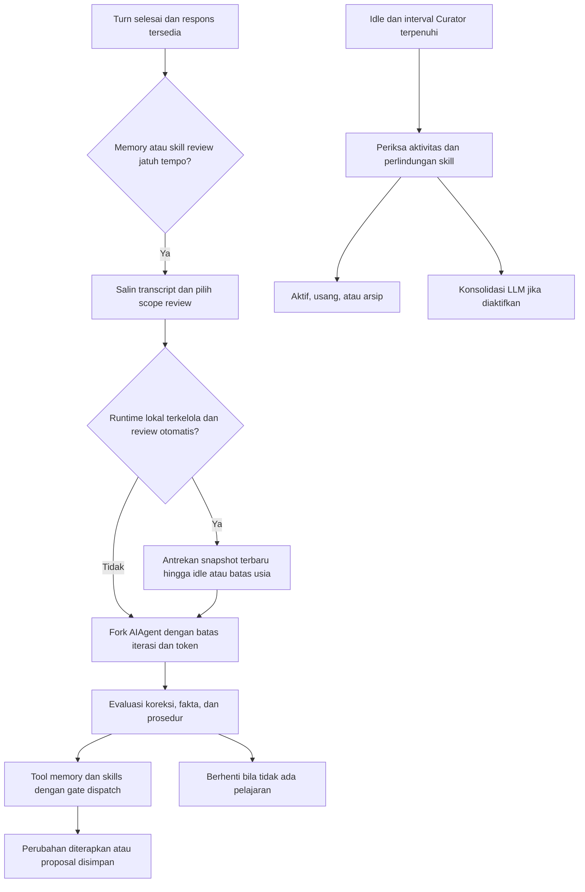

# Self-improvement dan pemeliharaan skills

Hermes membuat pembelajaran lintas sesi melalui perubahan pada fakta, preferensi, dan prosedur yang digunakan model. Turn biasa dapat menulis langsung dengan tool berizin. Review setelah turn mencari pelajaran dari pengalaman yang baru selesai, sedangkan Curator mengelola kesehatan pustaka berdasarkan aktivitas. Kualitas perubahan perlu diukur saat metode itu dipakai kembali. [Prompt review dan kriteria pelajaran](https://github.com/NousResearch/hermes-agent/blob/ae2a81ccc00e9b7c06301523e5bb09608397149c/agent/background_review.py#L441-L603), [siklus Curator](https://github.com/NousResearch/hermes-agent/blob/ae2a81ccc00e9b7c06301523e5bb09608397149c/agent/curator.py#L920-L1007).

## Review dari turn yang baru selesai

| Keputusan | Rincian implementasi |
| --- | --- |
| Pemicu memori | `_tick_memory_nudge` menambah jumlah turn pengguna jika store dan tool memory tersedia. Default interval 10. Pada cold restore, penghitung dapat dihidrasi dari jumlah baris role user modulo interval. |
| Pemicu skill | `_iters_since_skill` dihitung pada persiapan iterasi loop ketika `skill_manage` tersedia, dengan jalur terpisah untuk runtime Codex. Default interval 10. Penghitungan loop dapat mencakup iterasi tanpa tool call. Eksekutor mereset penghitung terkait ketika memproses `memory` atau `skill_manage` yang sudah lolos guardrail, sebelum handler mengembalikan hasil. |
| Waktu dan syarat | Finalizer menghitung signal skill sekali, membagikan signal read-only ke hook `post_llm_call`, mereset penghitung yang jatuh tempo, lalu mencoba review jika ada jawaban akhir dan turn tidak terinterupsi, diveto, atau dikonfigurasi melewati review. Cron memakai `skip_background_review=True`. |
| Jalur eksplisit | `/refine [focus]` menjalankan review dengan scope memory dan skills, memakai fokus opsional dan menandai fork sebagai attended. Guard skills tetap berlaku dan gate mutasi memory khusus unattended dilewati. Gate automatic-only seperti `auxiliary.background_review.enabled`, delegasi, dan penundaan idle dilewati. Gate host masih berlaku. |

[Penghitung memory](https://github.com/NousResearch/hermes-agent/blob/ae2a81ccc00e9b7c06301523e5bb09608397149c/agent/turn_context.py#L812-L829), [skill defaults](https://github.com/NousResearch/hermes-agent/blob/ae2a81ccc00e9b7c06301523e5bb09608397149c/agent/agent_init.py#L1232-L1251), [iterasi](https://github.com/NousResearch/hermes-agent/blob/ae2a81ccc00e9b7c06301523e5bb09608397149c/agent/turn_iteration_prep.py#L158-L168), [reset oleh tool](https://github.com/NousResearch/hermes-agent/blob/ae2a81ccc00e9b7c06301523e5bb09608397149c/agent/tool_executor.py#L737-L749), [signal hook](https://github.com/NousResearch/hermes-agent/blob/ae2a81ccc00e9b7c06301523e5bb09608397149c/agent/review_signals.py#L33-L64), [finalizer](https://github.com/NousResearch/hermes-agent/blob/ae2a81ccc00e9b7c06301523e5bb09608397149c/agent/turn_finalizer.py#L618-L642), [cron](https://github.com/NousResearch/hermes-agent/blob/ae2a81ccc00e9b7c06301523e5bb09608397149c/cron/scheduler.py#L2498-L2510), [spawn dan gate](https://github.com/NousResearch/hermes-agent/blob/ae2a81ccc00e9b7c06301523e5bb09608397149c/run_agent.py#L763-L797), [command refine](https://github.com/NousResearch/hermes-agent/blob/ae2a81ccc00e9b7c06301523e5bb09608397149c/hermes_cli/cli_commands_mixin.py#L1655-L1683), [flag attended pada fork](https://github.com/NousResearch/hermes-agent/blob/ae2a81ccc00e9b7c06301523e5bb09608397149c/agent/background_review.py#L1265-L1280).

### Bagaimana fork bekerja

- Spawn menyalin struktur transcript agar sanitasi review tidak menyentuh turn asli. Default `auto` memakai model dan runtime yang sama, dengan prompt, schema, reasoning dan cache scope yang diwarisi. Jika provider atau model berbeda, fork menyusun digest lama plus sekitar 24 pesan terbaru utuh. Pemotongan digest bergeser jika tail akan dimulai dari hasil tool. [Clone dan routing](https://github.com/NousResearch/hermes-agent/blob/ae2a81ccc00e9b7c06301523e5bb09608397149c/run_agent.py#L785-L797), [digest](https://github.com/NousResearch/hermes-agent/blob/ae2a81ccc00e9b7c06301523e5bb09608397149c/agent/background_review.py#L408-L438), [identitas dan cache fork](https://github.com/NousResearch/hermes-agent/blob/ae2a81ccc00e9b7c06301523e5bb09608397149c/agent/background_review.py#L1055-L1130).
- Fork memakai `session_id` induk untuk cache, memakai store memory yang sama, dan mematikan persistensi transcript serta provider memori eksternal pada fork. Turn review tidak muncul sebagai pesan percakapan. Penggunaan token dicatat ke sesi induk. Notifikasi kecil dihitung dari receipt tool review yang sukses, dengan hasil lama di riwayat dikeluarkan dari ringkasan. [Isolasi persistensi](https://github.com/NousResearch/hermes-agent/blob/ae2a81ccc00e9b7c06301523e5bb09608397149c/agent/background_review.py#L1055-L1101), [atribusi usage](https://github.com/NousResearch/hermes-agent/blob/ae2a81ccc00e9b7c06301523e5bb09608397149c/agent/background_review.py#L854-L887), [ringkasan receipt dan teardown](https://github.com/NousResearch/hermes-agent/blob/ae2a81ccc00e9b7c06301523e5bb09608397149c/agent/background_review.py#L1374-L1419).
- Batas fork 16 iterasi. Anggaran total input default 75% dari context window, maksimum 600.000 token, dengan fallback 120.000 jika ukuran window tidak diketahui. Runtime lokal Hermes yang otomatis tertunda di antrean dalam proses, satu snapshot terbaru per sesi dengan waktu enqueue semula untuk batas usia. Turn baru atau teardown dapat membatalkan review, dengan batas tunggu pengakuan request 2 detik. Komit tool yang sudah terjadi memiliki lifecycle sendiri. [Anggaran](https://github.com/NousResearch/hermes-agent/blob/ae2a81ccc00e9b7c06301523e5bb09608397149c/agent/background_review.py#L246-L301), [gate iterasi](https://github.com/NousResearch/hermes-agent/blob/ae2a81ccc00e9b7c06301523e5bb09608397149c/agent/turn_iteration_prep.py#L360-L396), [antrean idle](https://github.com/NousResearch/hermes-agent/blob/ae2a81ccc00e9b7c06301523e5bb09608397149c/agent/review_idle_queue.py#L74-L159), [pembatalan](https://github.com/NousResearch/hermes-agent/blob/ae2a81ccc00e9b7c06301523e5bb09608397149c/agent/background_review.py#L195-L243).

### Cara memilih dan menerapkan pelajaran

Prompt memory mencari fakta tahan lama dan memilih store yang sesuai. Prompt skill mencari koreksi gaya atau urutan kerja, metode yang berhasil, dan petunjuk yang sudah usang. Prioritasnya memperbaiki skill yang dipakai saat itu, kemudian skill umum yang sudah ada, kemudian file pendukung, lalu membuat skill baru untuk kelas tugas. Evidence yang dipakai sebaiknya menyertakan metode yang benar-benar bekerja. Prompt mengizinkan hasil kosong, tetapi mendorong update pada kebanyakan sesi, sehingga frekuensi tulis saja kurang cocok sebagai metrik keberhasilan. [Routing memory dan bentuk pelajaran](https://github.com/NousResearch/hermes-agent/blob/ae2a81ccc00e9b7c06301523e5bb09608397149c/agent/background_review.py#L441-L529), [prioritas dan pengecualian](https://github.com/NousResearch/hermes-agent/blob/ae2a81ccc00e9b7c06301523e5bb09608397149c/agent/background_review.py#L532-L603).

Gate runtime menjaga tindakan lebih ketat dari daftar schema model. Whitelist dispatch mengizinkan tool skills dan file read/search, plus memory bila review memory memang jatuh tempo serta target memory aktif. `extra_tools` hanya dapat mengizinkan tool yang sudah diwariskan induk. Penulisan skill lama memerlukan pembacaan target yang persis di turn review, dan skill terkunci menolak mutasi. Memory `patch` atau `remove` unattended menjadi proposal dengan target yang dipatok pada isi saat itu, sedangkan `add` dapat berjalan sesuai konfigurasi approval. [Whitelist](https://github.com/NousResearch/hermes-agent/blob/ae2a81ccc00e9b7c06301523e5bb09608397149c/agent/background_review.py#L1192-L1232), [read-before-write dan lock](https://github.com/NousResearch/hermes-agent/blob/ae2a81ccc00e9b7c06301523e5bb09608397149c/tools/skill_manager_guards.py#L213-L265), [proposal memory](https://github.com/NousResearch/hermes-agent/blob/ae2a81ccc00e9b7c06301523e5bb09608397149c/tools/memory_tool.py#L179-L219).

## Curator

Curator punya state per home di `skills/.curator_state`, meliputi last run, jumlah run, pause, dan path report. Poll idle menilai fitur aktif, pause, interval, dan durasi idle. Default interval 168 jam dengan idle minimal dua jam. Poll pertama mengisi waktu dasar dan menunda pekerjaan satu interval. Claim lintas proses mencegah dua host memulai pass otomatis bersamaan. [State](https://github.com/NousResearch/hermes-agent/blob/ae2a81ccc00e9b7c06301523e5bb09608397149c/agent/curator.py#L30-L63), [gates](https://github.com/NousResearch/hermes-agent/blob/ae2a81ccc00e9b7c06301523e5bb09608397149c/agent/curator.py#L145-L169), [claim dan dispatch](https://github.com/NousResearch/hermes-agent/blob/ae2a81ccc00e9b7c06301523e5bb09608397149c/agent/curator.py#L1176-L1208), [idle host](https://github.com/NousResearch/hermes-agent/blob/ae2a81ccc00e9b7c06301523e5bb09608397149c/hermes_cli/plugins_idle_tasks.py#L339-L350).

1. Pass deterministik memakai aktivitas terbaru atau waktu pembuatan. Default 14 hari menjadi stale, 30 hari dipindah ke arsip yang dapat dipulihkan. Pemakaian kembali dapat mengaktifkan skill stale. Pin, lock, dan referensi cron melindungi skill. Built-in dikecualikan dari prune default. Hub-installed, skill eksternal, dan built-in yang dilindungi dikecualikan oleh eligibility. Skill lokal tanpa flag managed bisa diadopsi melalui Curator. [Transisi](https://github.com/NousResearch/hermes-agent/blob/ae2a81ccc00e9b7c06301523e5bb09608397149c/agent/curator.py#L198-L252), [eligibility](https://github.com/NousResearch/hermes-agent/blob/ae2a81ccc00e9b7c06301523e5bb09608397149c/tools/skill_usage.py#L260-L303), [default](https://github.com/NousResearch/hermes-agent/blob/ae2a81ccc00e9b7c06301523e5bb09608397149c/hermes_cli/config_defaults.py#L1448-L1471).
2. Konsolidasi lewat model mati secara default. Jika diaktifkan, pass memilih skill agen yang memenuhi syarat untuk diserap ke prosedur umum. Snapshot keterampilan sebelum rewrite bersifat best-effort. Consolidation membandingkan state sebelum/sesudah dengan receipt tool, lalu menghasilkan laporan dan dapat memperbarui referensi cron yang direkonsiliasi. Mode preview menulis laporan tanpa memajukan jadwal reguler. [Backup dan transisi](https://github.com/NousResearch/hermes-agent/blob/ae2a81ccc00e9b7c06301523e5bb09608397149c/agent/curator.py#L920-L963), [laporan dan rekonsiliasi](https://github.com/NousResearch/hermes-agent/blob/ae2a81ccc00e9b7c06301523e5bb09608397149c/agent/curator.py#L965-L1007), [referensi cron](https://github.com/NousResearch/hermes-agent/blob/ae2a81ccc00e9b7c06301523e5bb09608397149c/agent/curator.py#L666-L678).

## Penerapan ke Ngertiin

`Background` sudah menjadi otoritas idle/scheduling/dispatch tanpa loop model. `Memories` dan `ApplicationSkills` menangani sumber, hak akses, revisi, serta assignment yang menunjuk versi skill. Inspeksi entry point scheduler, instruksi, dan learning tools belum menemukan review otomatis setara Hermes. Sambungkan event settlement yang memenuhi syarat ke pekerjaan review yang rendah prioritas dengan identitas dan cursor persisten. Pakai harness terpilih dan toolset terbatas yang divalidasi server setiap dispatch. Kontrak billing mengikuti koneksi terpilih yang sudah berlaku. [Scheduler](../../apps/server/src/background.ts#L36), [tick pekerjaan](../../apps/server/src/background.ts#L130), [tool learning](../../apps/server/src/learning/tools.ts#L8), [versi dan assignment skill](../../apps/server/src/learning/application-skills.ts#L78).

Keluaran review yang berguna adalah revisi aplikasi milik agen dengan sumber run yang dapat diperiksa. Gunakan revision check untuk melindungi koreksi manusia dan writer lain. Prioritaskan perubahan pada skill yang sudah dipakai dan cocok dengan kelas pekerjaan, simpan usulan sebelum mengubah assignment, lalu bandingkan hasil pada tugas ulangan. Terapkan saran perubahan skill warisan sebagai revisi skill aplikasi sesuai aturan kepemilikan Ngertiin. Ukur nilai Curator dari skill yang tetap dapat ditemukan dan dijalankan. Sebuah assignment aktif atau Routine yang menunjuk versi merupakan bukti ketergantungan saat menilai arsip.

| Uji kesetaraan | Hasil teramati yang dicari |
| --- | --- |
| Pengguna mengoreksi format laporan dan output berikutnya lolos | Reviewer memperbaiki skill relevan dengan sumber yang tepat. Run terpisah memakai revisi aktif dan memenuhi format pada data baru. |
| Metode gagal, prompt dibatalkan, atau tidak ada pelajaran | Reviewer tidak mempromosikan aturan yang belum terbukti. Hasil review kosong dicatat tanpa pesan tambahan kepada pengguna. |
| Review sedang berjalan saat pesan baru atau grant dicabut | Turn langsung mendapat prioritas. Kandidat terlambat tidak bisa melampaui fence dan merevisi state sesudah scope tercabut. |
| Skill jarang dipakai tetapi dipin atau dirujuk Routine | Skill tetap dapat dipakai. Skill usang yang bebas dependensi dapat dipulihkan ke versi yang sama setelah arsip. |
| Replay settle atau crash setelah commit dan sebelum publikasi | Satu hasil review untuk evidence yang sama, serta receipt yang dapat direkonsiliasi sebelum mengulang mutasi. |

Pengujian terfokus pada pin menjalankan fixture upstream untuk [scope memory saat review](https://github.com/NousResearch/hermes-agent/blob/ae2a81ccc00e9b7c06301523e5bb09608397149c/tests/agent/test_background_review_memory_scope.py), [pembatasan tool](https://github.com/NousResearch/hermes-agent/blob/ae2a81ccc00e9b7c06301523e5bb09608397149c/tests/agent/test_background_review_toolset_restriction.py), dan [aktivitas Curator](https://github.com/NousResearch/hermes-agent/blob/ae2a81ccc00e9b7c06301523e5bb09608397149c/tests/agent/test_curator_activity.py). Ketiganya lulus dalam batch 222 tes terisolasi. Bukti tersebut mencakup logika fixture. Jalur otomatis yang benar-benar meningkatkan hasil pada model nyata memerlukan perbandingan tugas sebelum dan sesudah.

Batch tambahan berisi 67 tes lulus, termasuk [isolasi transcript review](https://github.com/NousResearch/hermes-agent/blob/ae2a81ccc00e9b7c06301523e5bb09608397149c/tests/hermes_state/test_background_review_session_isolation.py), [parity cache](https://github.com/NousResearch/hermes-agent/blob/ae2a81ccc00e9b7c06301523e5bb09608397149c/tests/agent/test_background_review_cache_parity.py), dan [backup Curator](https://github.com/NousResearch/hermes-agent/blob/ae2a81ccc00e9b7c06301523e5bb09608397149c/tests/agent/test_curator_backup.py).

## Bukti Hermes Desktop macOS

Di Hermes Desktop terpaket, satu turn laporan menghasilkan pemberitahuan **Self-improvement review** dan satu berkas skill dari tool reviewer. Pada chat baru, katalog di prompt memuat nama skill, `skill_view` membaca paket, dan aktivitas chat memperlihatkan skill dimuat sebelum file data baru. `/journey` membuka grafik yang sudah berisi hasil belajar; `/refine` menyalakan review eksplisit dengan fokus. Model loopback menentukan pilihan tool. Perbaikan kualitas dengan model bebas masih perlu dibandingkan. [DT-01/02](desktop-runtime.md#self-learning-dari-dua-sesi) · [DT-12](desktop-runtime.md#restart-loop-browser-dan-artifact).
