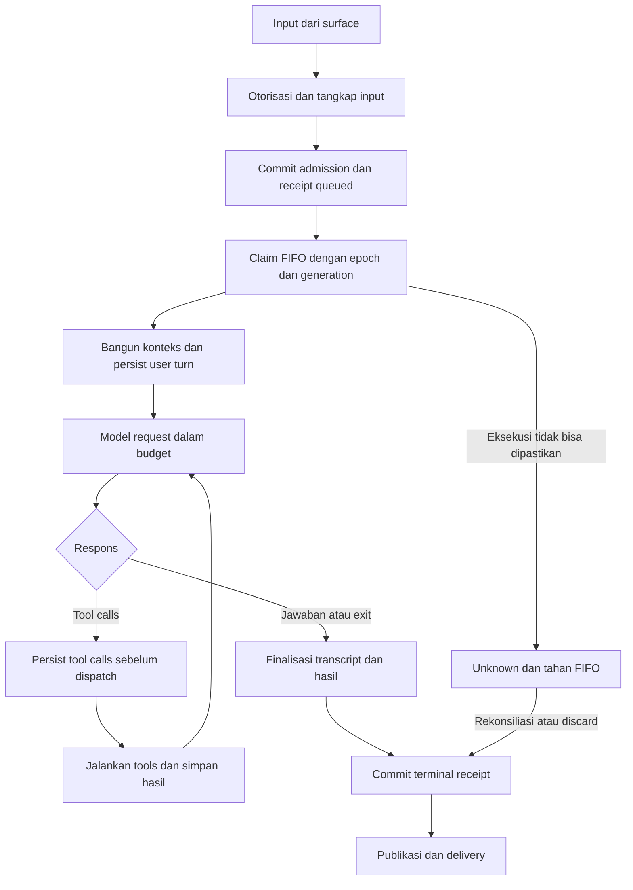

# Lifecycle eksekusi

Hermes v0.23.2 punya dua batas yang penting bagi Ngertiin. Gateway memutuskan kapan sebuah input menjadi pekerjaan yang sah dan kapan hasilnya boleh dipublikasikan. Agent menjalankan turn tersebut, termasuk iterasi model, tool, pemulihan dalam turn, dan finalisasi transcript. Input yang tampak sama bagi pengguna bisa berada di tahap yang berbeda dari hasil yang telah tersimpan. [Kontrak authority](https://github.com/NousResearch/hermes-agent/blob/ae2a81ccc00e9b7c06301523e5bb09608397149c/gateway/session_contract.py#L12-L99), [entry loop](https://github.com/NousResearch/hermes-agent/blob/ae2a81ccc00e9b7c06301523e5bb09608397149c/agent/conversation_loop.py#L1648-L1725).

## Admission dan state

| Tahap | Implementasi dan data |
| --- | --- |
| Identitas | `SessionActor` membawa subject, profile, capability set dan transport. `SessionRef` memuat profile dan session. `SessionHandle` menambahkan instance, epoch, revision dan generation. Snapshot menyertakan cursor replay, history, pending admission dan prompt interaksi. [Tipe RPC](https://github.com/NousResearch/hermes-agent/blob/ae2a81ccc00e9b7c06301523e5bb09608397149c/gateway/session_contract.py#L12-L84). |
| Terima | `SessionAuthority.submit` memeriksa kewenangan, menyiapkan payload dan menangkap media. `admit_session_input` mencari receipt berdasarkan principal, session tujuan dan request ID. Digest mengikat input kanonik dan intent. Payload berbeda pada request ID yang sama ditolak. Exact retry mengembalikan receipt yang sama, termasuk jalur receipt terminal terpisah. Maksimum 32 input berstatus queued per session. [Gateway submit](https://github.com/NousResearch/hermes-agent/blob/ae2a81ccc00e9b7c06301523e5bb09608397149c/gateway/session_authority.py#L705-L771), [transaksi admission](https://github.com/NousResearch/hermes-agent/blob/ae2a81ccc00e9b7c06301523e5bb09608397149c/hermes_state_runtime.py#L176-L227). |
| Claim | `claim_session_input` membaca head berdasarkan `seq`, cocokkan dengan head yang sudah diperiksa caller, lalu naikkan `sessions.runtime_generation` dan ubah row queued menjadi started dalam satu transaksi. Started dan worker aktif menghalangi head berikutnya. Unknown dari admission atau worker mengunci kelanjutan. High-water mark pesan membantu mengenali row yang benar-benar milik turn itu. [Transaksi claim](https://github.com/NousResearch/hermes-agent/blob/ae2a81ccc00e9b7c06301523e5bb09608397149c/hermes_state_runtime.py#L274-L310). |
| Execute | `_drain` mengulang claim per session. `_execute_claimed` membatalkan review yang masih berbagi session lalu meneruskan ke eksekusi finite admission. Kehilangan managed worker menghentikan antrean interaktif. Automation yang masuk aturan unattended dapat menyelesaikan statusnya dan melepas antrean. [Drain dan eksekusi](https://github.com/NousResearch/hermes-agent/blob/ae2a81ccc00e9b7c06301523e5bb09608397149c/gateway/session_authority.py#L1293-L1358), [penanganan unattended](https://github.com/NousResearch/hermes-agent/blob/ae2a81ccc00e9b7c06301523e5bb09608397149c/gateway/session_unattended_unknown.py#L37-L85). |
| Settle | `settle_session_input` memeriksa epoch, pemilik, status dan generation sekaligus. Penutupan worker, perubahan transcript yang dibutuhkan, dan receipt hasil dapat ditulis dalam transaksi yang sama. State terminal mencatat `completed`, `interrupted`, `rejected` atau `failed`. Cancel queued punya jalur terminal `cancelled` tersendiri. [Storage settlement](https://github.com/NousResearch/hermes-agent/blob/ae2a81ccc00e9b7c06301523e5bb09608397149c/hermes_state_runtime.py#L313-L374), [cancel publication](https://github.com/NousResearch/hermes-agent/blob/ae2a81ccc00e9b7c06301523e5bb09608397149c/gateway/session_authority.py#L834-L879). |
| Publish | `commit_and_publish` memagari pembacaan receipt melalui `live.settling` sampai frame completion tersedia. Bila publish gagal setelah commit, hasil yang sudah commit tetap otoritatif. Retry penyimpanan yang sementara melakukan percobaan ulang setelah 0,5 dan 2 detik dengan hasil yang sama. Kegagalan fence segera keluar. [Commit dan retry](https://github.com/NousResearch/hermes-agent/blob/ae2a81ccc00e9b7c06301523e5bb09608397149c/gateway/session_settlement_recovery.py#L171-L225). |

## Model dan tool loop

1. `build_turn_context` membangun prompt/history untuk turn dan mempertahankan versi display user row yang dapat berbeda dari input model, misalnya ketika ada awalan instruksi sintetis. Agent yang dipakai ulang mereset state per turn, termasuk kegagalan persistence, deduplikasi komentar, dan usage. Jalur Codex app-server yang dipilih dapat mengeksekusi satu turn melalui subprocess, di luar loop generik Hermes. [Konstruktor turn](https://github.com/NousResearch/hermes-agent/blob/ae2a81ccc00e9b7c06301523e5bb09608397149c/agent/conversation_loop.py#L1619-L1645), [preparasi](https://github.com/NousResearch/hermes-agent/blob/ae2a81ccc00e9b7c06301523e5bb09608397149c/agent/conversation_loop.py#L1665-L1748).
2. `begin_iteration` dan `prepare_iteration` menangani batas iterasi dan input steer, lalu request dibangun dan melewati preflight. `_run_api_retry_loop` memiliki state retry sendiri untuk guard, request, respons, interrupt dan error phase. Loop luar memeriksa batas turn dan sisa budget bersama. Retry transport, iterasi model, dan tick Goal adalah unit yang berbeda. [Iteration preparation](https://github.com/NousResearch/hermes-agent/blob/ae2a81ccc00e9b7c06301523e5bb09608397149c/agent/turn_iteration_prep.py#L144-L261), [retry loop](https://github.com/NousResearch/hermes-agent/blob/ae2a81ccc00e9b7c06301523e5bb09608397149c/agent/conversation_loop.py#L1579-L1608), [loop generik](https://github.com/NousResearch/hermes-agent/blob/ae2a81ccc00e9b7c06301523e5bb09608397149c/agent/conversation_loop.py#L1749-L1807).
3. `run_tool_round` menaruh hasil error untuk nama tool yang ditolak dari batch, menulis blok tool-call ke session DB, baru mengirim komentar dan memanggil tool. Gagal persist sebelum eksekusi menghentikan turn sebelum efek. Gagal menyimpan hasil menghalangi hasil yang hanya ada di memori untuk dikirim kembali ke model. Persist tool intent di transcript tidak dengan sendirinya mengonfirmasi efek di sistem eksternal. [Tool round](https://github.com/NousResearch/hermes-agent/blob/ae2a81ccc00e9b7c06301523e5bb09608397149c/agent/turn_tool_round.py#L110-L182).
4. `finalize_turn` menjalankan cleanup terpisah, mengambil teks yang telanjur terlihat jika relevan, menutup transcript, dan menyimpan history. Hook observasi menerima usage atau null sesuai turn. Envelope menghitung kembali batas user row setelah perubahan history, mencatat intervensi pengguna dan menutup row gagal. [Finalisasi](https://github.com/NousResearch/hermes-agent/blob/ae2a81ccc00e9b7c06301523e5bb09608397149c/agent/turn_finalizer.py#L721-L804), [envelope dan batas turn](https://github.com/NousResearch/hermes-agent/blob/ae2a81ccc00e9b7c06301523e5bb09608397149c/agent/conversation_loop.py#L1810-L1873).

## Stop, restart dan unknown

Cancel queued memiliki receipt dan tidak mengambil generation milik pekerjaan lain yang masih jalan. Bila row terlanjur diklaim, caller dapat membaca started row yang menang dan mengirim interrupt ke generation yang tepat. Steer masuk di batas iterasi dan berbeda dari redirect atau hard interrupt. Stop intent diterima lebih awal daripada bukti eksekusi berhenti. [Race cancel/claim](https://github.com/NousResearch/hermes-agent/blob/ae2a81ccc00e9b7c06301523e5bb09608397149c/gateway/session_authority.py#L807-L850), [interrupt dan input aktif](https://github.com/NousResearch/hermes-agent/blob/ae2a81ccc00e9b7c06301523e5bb09608397149c/agent/interrupt_control.py#L163-L188), [steer dan redirect](https://github.com/NousResearch/hermes-agent/blob/ae2a81ccc00e9b7c06301523e5bb09608397149c/agent/interrupt_control.py#L310-L384).

Owner mengambil epoch baru dengan profile lock. Saat boot, started dari epoch sebelumnya menjadi unknown. FIFO berhenti di depan pekerjaan yang tidak memiliki outcome pasti. Resolusi unknown interaktif memerlukan capability control, receipt dan generation. Jika owner yang sama masih memegang hasil yang telah selesai, ia mencoba menyelesaikan hasil itu. Jika hasil hilang, jalur discard menutup batas transcript dan membiarkan penerus berjalan. Input lama tidak dieksekusi ulang melalui discard. [Epoch](https://github.com/NousResearch/hermes-agent/blob/ae2a81ccc00e9b7c06301523e5bb09608397149c/hermes_state_runtime.py#L129-L173), [startup](https://github.com/NousResearch/hermes-agent/blob/ae2a81ccc00e9b7c06301523e5bb09608397149c/gateway/session_authority.py#L1469-L1488), [recovery storage](https://github.com/NousResearch/hermes-agent/blob/ae2a81ccc00e9b7c06301523e5bb09608397149c/hermes_state_runtime.py#L521-L531), [owner resolution](https://github.com/NousResearch/hermes-agent/blob/ae2a81ccc00e9b7c06301523e5bb09608397149c/gateway/session_authority.py#L881-L915).

## Implikasi untuk Ngertiin

`Lifecycle.admit`, `enqueue`, `claimNext`, `authorizeDispatch`, `settle` dan `reconcile` sudah memegang batas aplikasi. `Background` menggerakkan antrean dan timer, `HarnessBroker.execute` menjalankan harness terpilih, dan `RunRecovery` menangani observasi ulang. Reproduksi yang relevan adalah menjaga batas yang sama di interaksi sehari-hari: retry input awal menyatu dengan penerimaan pertama, status berjalan mempunyai bukti, stop melaporkan tahapnya, dan jawaban yang sudah commit bisa diambil meski stream putus. Loop model dan tool lokal tetap di harness. [Lifecycle](../../apps/server/src/lifecycle.ts), [background](../../apps/server/src/background.ts), [broker](../../apps/server/src/harness/broker.ts), [recovery](../../apps/server/src/harness/recovery.ts).

Untuk verifikasi kemiripan, gunakan tiga fault point pada alur yang sama: setelah commit admission sebelum ACK, sesudah tool mulai sebelum receipt hasil, dan setelah commit terminal sebelum publikasi. Ukur jumlah admit, jumlah efek dan jumlah hasil yang dilihat pengguna secara terpisah. Jalankan juga cancel saat head berpindah dari queued ke started serta stop saat model masih mengalir. Untuk kasus efek eksternal gabungkan bukti di sisi target dengan receipt aplikasi. Hasil yang berhasil di satu harness hanya membuktikan profil tersebut.

## Bukti yang dijalankan

69 tes upstream lulus pada checkout ini. Cakupannya adalah fixture ACP untuk receipt, replay gap, prompt retry, cancel dan antrean unknown, fixture recovery saat settlement gagal, dan tes loop untuk persistensi tool calls, race budget serta interrupt permintaan API. Ini menjalankan code path terpilih dengan dependency yang dipatok serta menghentikan akses eksternal melalui test fence. [Rincian verifikasi](verification.md).

## Bukti Hermes Desktop macOS

Pengujian Desktop menuntaskan turn foreground, background review, dan Cron melalui Gateway. Setelah Desktop dan gateway fixture dimulai kembali, jawaban terpilih serta ringkasan skill masih terlihat pada riwayat. REA menginspeksi snapshot SQLite dengan 17 admission `terminal/completed`, generation 1–5 pada waktu pengambilan. Bukti ini tidak memperluas hasil ke cancel aktif atau lost ACK. [DT-08](desktop-runtime.md#restart-loop-browser-dan-artifact) · [State uji dan Evidence ID](desktop-runtime.md#bukti-rea-untuk-state-uji).
