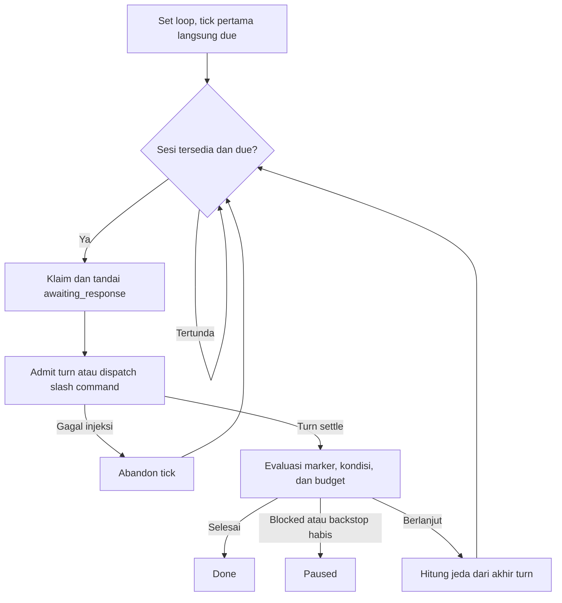

# Loop sesi

`/loop` menjalankan pekerjaan berulang dalam sesi yang sama. Loop dapat berjalan segera dengan interval tetap atau memperlambat sendiri ketika hasilnya tetap sama. Pengguna dapat memberi batas run atau kondisi berhenti. State memiliki satu owner sesi dan dihentikan atau dilanjutkan dari driver sesi yang sesuai. [Parser](https://github.com/NousResearch/hermes-agent/blob/ae2a81ccc00e9b7c06301523e5bb09608397149c/hermes_cli/loops.py#L71-L125) · [State](https://github.com/NousResearch/hermes-agent/blob/ae2a81ccc00e9b7c06301523e5bb09608397149c/hermes_cli/loops.py#L175-L221) · [Set](https://github.com/NousResearch/hermes-agent/blob/ae2a81ccc00e9b7c06301523e5bb09608397149c/hermes_cli/loops.py#L440-L470).

## State dan pacing

- Parser menerima cadence seperti 30s, 5m, dan 1h30m. Argumen valid dapat memasukkan `--times N` dan `--until condition`. Jika interval kosong, mode menjadi `self_paced`. Default fixed floor 30 detik dengan floor konfigurasi minimal 5 detik, budget backstop 100 tick, self-paced floor 60 detik dan ceiling 15 menit. Set mengganti loop lama dan membuat `next_due_at` langsung due. [Default dan parser](https://github.com/NousResearch/hermes-agent/blob/ae2a81ccc00e9b7c06301523e5bb09608397149c/hermes_cli/loops.py#L22-L125) · [Config floors](https://github.com/NousResearch/hermes-agent/blob/ae2a81ccc00e9b7c06301523e5bb09608397149c/hermes_cli/loops.py#L140-L172) · [Set](https://github.com/NousResearch/hermes-agent/blob/ae2a81ccc00e9b7c06301523e5bb09608397149c/hermes_cli/loops.py#L440-L470).
- `LoopState` menyimpan prompt, status, route, mode, cadence, tick count, `awaiting_response`, timestamp, digest respons, serta alasan pause/stop. `loop:<session_id>` dipetakan ke JSON pada SessionDB. Migrasi membawa loop ke sesi hasil kompresi bila anak belum memiliki loop. [State](https://github.com/NousResearch/hermes-agent/blob/ae2a81ccc00e9b7c06301523e5bb09608397149c/hermes_cli/loops.py#L175-L240) · [Persistensi dan migrasi](https://github.com/NousResearch/hermes-agent/blob/ae2a81ccc00e9b7c06301523e5bb09608397149c/hermes_cli/loops.py#L277-L359).
- `fire_tick()` memeriksa active/due/awaiting, mencatat count, menandai awaiting, dan menyimpan provisional next due. Prompt meminta pemeriksaan kondisi aktual dan bukti, dengan jalur khusus untuk prompt slash command. `abandon_tick()` membatalkan count dan flag jika injeksi gagal. Gateway memeriksa profil, route, adapter, sesi sibuk, Goal aktif yang tidak diparkir, serta emergency stop. Jika authority tersedia, wake masuk admission queue. Slash command masuk command handler dan tick diselesaikan segera. [Claim dan abandon](https://github.com/NousResearch/hermes-agent/blob/ae2a81ccc00e9b7c06301523e5bb09608397149c/hermes_cli/loops.py#L497-L536) · [Driver gateway](https://github.com/NousResearch/hermes-agent/blob/ae2a81ccc00e9b7c06301523e5bb09608397149c/gateway/run_goals.py#L461-L549).

## Keputusan sesudah turn

`complete_tick()` melepaskan flag dan memproses aturan berurutan. Marker `LOOP_COMPLETE` pada baris sendiri menutup loop terlebih dahulu. Jika ada `--until` dan jawaban berisi teks, judge Goal menilai kondisi itu. Done menutup, blocked menjeda, dan error yang ditoleransi meneruskan pemeriksaan. Cap `--times` menutup sebagai done, sedangkan backstop konfigurasi menjeda sebagai kondisi yang dapat dilanjutkan. Jika tetap aktif, mode interval menjadwalkan dari akhir turn. Mode self-paced menggandakan jeda saat digest keluaran identik, sampai ceiling, dan kembali ke floor bila digest berubah. Kemiripan semantik antardua jawaban yang berbeda secara tekstual membutuhkan mekanisme lain. [Marker](https://github.com/NousResearch/hermes-agent/blob/ae2a81ccc00e9b7c06301523e5bb09608397149c/hermes_cli/loops.py#L32-L37) · [Settlement dan backoff](https://github.com/NousResearch/hermes-agent/blob/ae2a81ccc00e9b7c06301523e5bb09608397149c/hermes_cli/loops.py#L549-L625).

Gateway melepas tick saat turn gagal, tetapi mengirim respons kosong ke evaluator loop sehingga judge `--until` melewatkannya. Reserve durasi dan flag di DB adalah bukti state. Recovery dari process death pada setiap posisi antara claim, admission dan settlement perlu diuji per driver. [Post-turn hooks](https://github.com/NousResearch/hermes-agent/blob/ae2a81ccc00e9b7c06301523e5bb09608397149c/gateway/run_goals.py#L370-L404) · [Completion hook](https://github.com/NousResearch/hermes-agent/blob/ae2a81ccc00e9b7c06301523e5bb09608397149c/gateway/run_goals.py#L438-L460).

## Bukti eksekusi fixture

Hermes v0.23.2 pada Python 3.14.9 dan macOS ARM64, menggunakan home sementara. 72 lulus pada state manager dan command TUI. Cakupan mencakup parser, cap, marker, pacing, dan state kontrol. Klaim cakupan di sini terbatas pada fixture yang dijalankan. [test_loops.py](https://github.com/NousResearch/hermes-agent/blob/ae2a81ccc00e9b7c06301523e5bb09608397149c/tests/hermes_cli/test_loops.py) · [test_loop_command.py](https://github.com/NousResearch/hermes-agent/blob/ae2a81ccc00e9b7c06301523e5bb09608397149c/tests/tui_gateway/test_loop_command.py).

## Pemetaan ke Ngertiin

Routine Ngertiin saat ini memiliki cadence yang dihitung dari anchor/jadwal dan Goal bisa melaporkan wake time eksplisit. Kontrak Routine mempunyai jenis once, interval, heartbeat dan weekday calendar. Pada jalur ini belum tampak kebijakan loop completion-relative dengan batas tick dan backoff berbasis hasil. [Kontrak](../../apps/server/src/goals/contracts.ts#L24-L41) · [Perhitungan kalender](../../apps/server/src/goals/schedule.ts#L51-L90) · [Report Goal](../../apps/server/src/goals/service.ts#L150-L228).

Jika pola ini dibutuhkan, tambahkan pilihan scheduling policy pada Routine untuk memeriksa suatu kondisi sampai terpenuhi. Simpan occurrence claim dan expiry, batas dan hitungan tick, hasil verifikasi kondisi, serta next due dari settlement. Referensi Hermes untuk kesamaan hasil adalah backoff yang pulih saat keadaan berubah. Dalam Ngertiin, checksum atas observasi bisnis yang terstruktur dapat menghindarkan reset cadence karena model mengganti redaksi jawaban. Completion dari kondisi yang penting dapat bergantung pada receipt yang tervalidasi. Enrollment, penghentian, dan work execution tetap melalui Lifecycle.

Uji cek dengan tiga hasil identik dan satu perubahan. Verifikasi cadence melambat, reset saat perubahan, dan berhenti ketika kondisi yang diminta benar-benar terbukti. Uji juga bahwa turn gagal tidak menyatakan kondisi berhasil, cap pengguna berbeda secara semantik dari budget habis, serta pesan pengguna dan Goal yang sedang bekerja tidak mendapat turn tambahan yang menyela.

## Bukti Hermes Desktop macOS

Pada sesi Desktop uji, `/loop 30s ... --times 1` menampilkan Run 0/1 dan status menunggu idle, lalu mengirim jawaban yang dibuat satu wake dan berhenti di `Loop finished · Run 1/1`. State tersimpan memiliki `done` dan pending response false. Probe ini mengukur cap dan tick awal. [DT-09](desktop-runtime.md#restart-loop-browser-dan-artifact).
