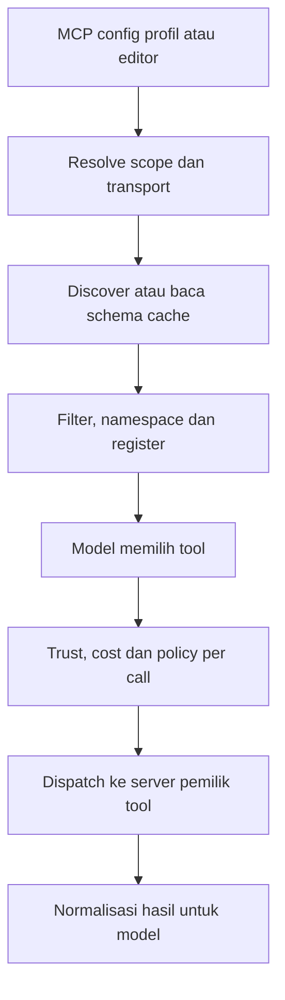

# Model Context Protocol dan konektor

MCP memberi Hermes akses ke tool dari server lokal atau jarak jauh, dengan utility untuk resource dan prompt bila server serta konfigurasi mendukungnya. Hermes menormalkan capability tersebut ke registry tool yang dipakai loop agent. Klien ACP dapat memasok server MCP tambahan untuk editor/session. Rute tersebut memiliki lifecycle dan policy terpisah dari konfigurasi profil. [Panduan MCP](https://github.com/NousResearch/hermes-agent/blob/ae2a81ccc00e9b7c06301523e5bb09608397149c/website/docs/user-guide/features/mcp.md#L569-L612), [ACP new dan rebind](https://github.com/NousResearch/hermes-agent/blob/ae2a81ccc00e9b7c06301523e5bb09608397149c/acp_adapter/gateway_server.py#L271-L297), [reattach MCP](https://github.com/NousResearch/hermes-agent/blob/ae2a81ccc00e9b7c06301523e5bb09608397149c/acp_adapter/gateway_server.py#L401-L420).

1. Discovery dapat memulai server langsung atau memakai schema cache untuk mendaftarkan tool kandidat sebelum proses server benar-benar dimulai. Cache schema belum membuktikan kemampuan menjalankan tool. `register_mcp_servers` dan `discover_mcp_tools` menjalankan registrasi/reconciliation di scope yang relevan. Transport mencakup stdio dan HTTP sesuai konfigurasi server, dengan penanganan OAuth dan environment masing-masing. [Discovery dan lazy registration](https://github.com/NousResearch/hermes-agent/blob/ae2a81ccc00e9b7c06301523e5bb09608397149c/tools/mcp_tool_discovery.py#L365-L471), [reconciliation](https://github.com/NousResearch/hermes-agent/blob/ae2a81ccc00e9b7c06301523e5bb09608397149c/tools/mcp_tool_discovery.py#L544-L698), [transport](https://github.com/NousResearch/hermes-agent/blob/ae2a81ccc00e9b7c06301523e5bb09608397149c/website/docs/user-guide/features/mcp.md#L291-L359).
2. Registrasi membuat nama ter-namespace, menerapkan allow/deny dan menyelesaikan benturan nama sebelum menulis definisi dan handler ke registry. Efek dari penggantian koneksi/profile harus membedakan schema yang sudah diiklankan dan call yang masih berwenang. [Filter dan collision](https://github.com/NousResearch/hermes-agent/blob/ae2a81ccc00e9b7c06301523e5bb09608397149c/tools/mcp_tool_registration.py#L250-L361), [registrasi](https://github.com/NousResearch/hermes-agent/blob/ae2a81ccc00e9b7c06301523e5bb09608397149c/tools/mcp_tool_registration.py#L361-L480).
3. Handler per call melihat scope dan trust metadata. Tool read-only yang diiklankan bisa diperlakukan berbeda dari write. Server untrusted dan cost/spend limit dapat meminta persetujuan sesuai policy. Tool yang memerlukan keputusan di surface tanpa approver dapat ditolak sebelum dispatch. Tool-call payload dan hasil tetap perlu diperlakukan sesuai kontrak data dan authority; annotation dari server bukan bukti otorisasi tenant. [Trust gate](https://github.com/NousResearch/hermes-agent/blob/ae2a81ccc00e9b7c06301523e5bb09608397149c/tools/mcp_tool_handlers.py#L190-L246), [call wrapper](https://github.com/NousResearch/hermes-agent/blob/ae2a81ccc00e9b7c06301523e5bb09608397149c/tools/mcp_tool_handlers.py#L833-L932), [spend dan approval](https://github.com/NousResearch/hermes-agent/blob/ae2a81ccc00e9b7c06301523e5bb09608397149c/website/docs/user-guide/features/mcp.md#L991-L1018).
4. Handler memisahkan timeout/transport failure dari tool error dan membentuk model-facing result, termasuk image kalau didukung. Parallel per server bersifat eksplisit. Editor MCP di Hermes dilampirkan ulang ketika koneksi owner diganti. [Hasil dan image](https://github.com/NousResearch/hermes-agent/blob/ae2a81ccc00e9b7c06301523e5bb09608397149c/tools/mcp_tool_handlers.py#L669-L832), [parallelism](https://github.com/NousResearch/hermes-agent/blob/ae2a81ccc00e9b7c06301523e5bb09608397149c/tools/mcp_tool_discovery.py#L819-L826), [reattach](https://github.com/NousResearch/hermes-agent/blob/ae2a81ccc00e9b7c06301523e5bb09608397149c/acp_adapter/gateway_server.py#L179-L203).

## Implikasi untuk Ngertiin

Ngertiin memakai MCP untuk ProductTools pada harness dan mendukung konektor terkelola melalui Marketplace. Operator mendaftarkan endpoint Streamable HTTP pada `NGERTIIN_MCP_SERVERS` dengan ID berawalan `mcp_`, nama, URL, pilihan `bearer_env`, serta policy `actions` berdasarkan nama tool. Endpoint memakai HTTPS, dan fixture pengembangan dapat memakai HTTP loopback. Klien membuka sesi, memuat skema melalui JSON atau SSE, lalu memeriksa katalog terbaru dan grant percakapan sebelum mengeksekusi tool. [MCP Streamable HTTP](https://modelcontextprotocol.io/specification/2025-06-18/basic/transports) · [MCP tools](https://modelcontextprotocol.io/specification/2025-06-18/server/tools) · [Konektor Ngertiin](../../apps/server/src/integrations/mcp-host.ts).

Policy operator menetapkan `mutability` dan `units` tiap aksi. Aksi tanpa policy diperlakukan sebagai write sebesar 1 unit. Pengguna memilih aksi, izin tulis, dan batas unit dalam grant. Ledger menahan unit bersama receipt dispatch sebelum call eksternal dan mempertahankannya saat hasil masih belum diketahui. Unit ini adalah batas aplikasi. [Apps execute](../../apps/server/src/integrations/service.ts) · [Verifikasi filter dan batas](evidence/mcp-02/verification.json).

Pembahasan ini tidak mengasumsikan install marketplace, OAuth eksternal, sampling, atau arbitrary editor MCP sudah menjadi scope Ngertiin. Semuanya perlu penilaian produk tersendiri. [Scope app dan skill](../architecture/scoped-apps-skills.md).

## Bukti Hermes Desktop macOS

Desktop menyediakan **Connectors** di Capabilities. Artefak memetakan renderer ke konfigurasi account/tool Gateway. Pengujian kali ini mencakup tampilan katalog dan transport gateway lokal. Efek call MCP eksternal dan revoke tetap terbuka. [Artefak Desktop](desktop-artifact.md) · [Cakupan runtime](desktop-runtime.md#cakupan-setiap-fitur).
