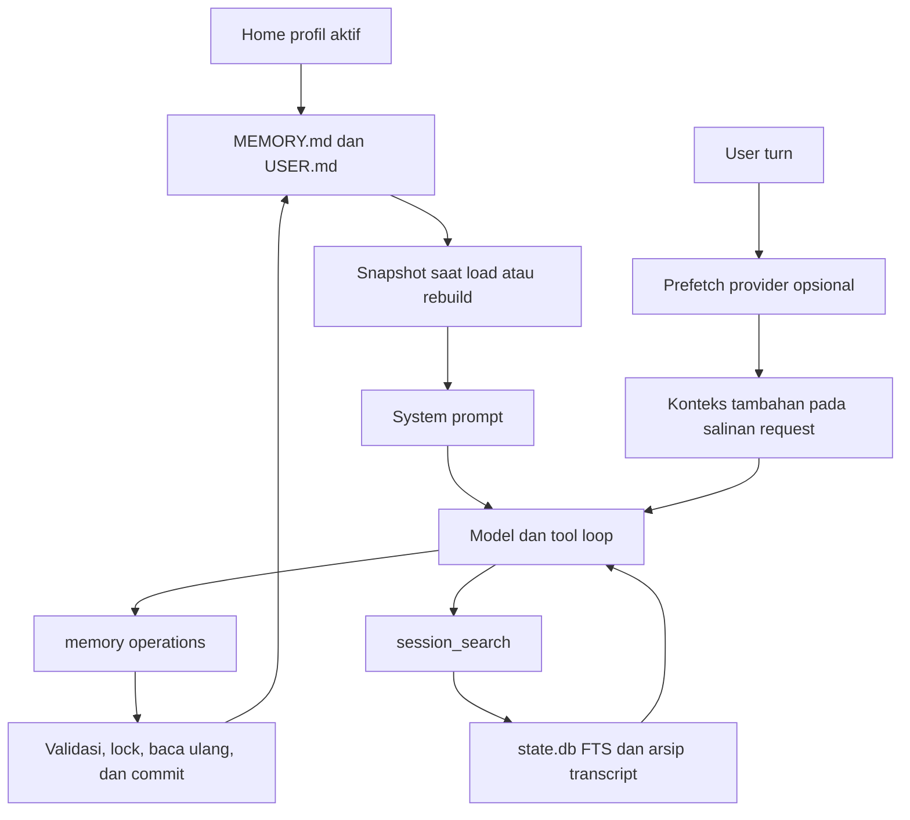

# Memory dan recall lintas sesi

Hermes memiliki tiga jalur recall. Catatan fakta yang pendek masuk ke prompt sistem, percakapan lama dicari lewat `session_search`, dan provider memori opsional dapat mengambil konteks tambahan sebelum model mulai bekerja. Panduan prompt mengarahkan prosedur yang dapat diulang ke [skills](skills.md) dan hasil pekerjaan sementara ke riwayat. [Inisialisasi memory](https://github.com/NousResearch/hermes-agent/blob/ae2a81ccc00e9b7c06301523e5bb09608397149c/agent/agent_init.py#L1154-L1230), [schema memory](https://github.com/NousResearch/hermes-agent/blob/ae2a81ccc00e9b7c06301523e5bb09608397149c/tools/memory_tool.py#L378-L433).

## Built-in store

| Aspek | Perilaku di v0.23.2 |
| --- | --- |
| Target `memory` | `<HERMES_HOME>/memories/MEMORY.md`, catatan agen tentang lingkungan, konvensi, dan temuan yang bertahan lama. Default aktif, anggaran 2.200 karakter. |
| Target `user` | `<HERMES_HOME>/memories/USER.md`, fakta dan preferensi tentang pengguna. Default aktif, anggaran 1.375 karakter. |
| Format | Entri dipisahkan oleh pemisah penuh `\n§\n`. Pembacaan membuang entri kosong dan deduplikasi mempertahankan urutan. Batas menghitung teks yang dirangkai dengan pemisah. |
| Snapshot | `load_from_disk` mengisi daftar aktif dan snapshot prompt yang difilter. Tulisan di tengah sesi durabel dan terlihat lewat hasil tool, sementara snapshot prompt stabil sampai reload atau rebuild. File edit manual yang di atas anggaran tetap dibaca dengan peringatan. |
| Ketersediaan | Flag tiap target mempersempit enum schema. Hosted policy dan safe worker dapat mematikan built-in memory. Inisialisasi subagent serta `skip_memory` punya pengecualian saat toolset memory diminta secara eksplisit. |

[Konfigurasi](https://github.com/NousResearch/hermes-agent/blob/ae2a81ccc00e9b7c06301523e5bb09608397149c/hermes_cli/config_defaults.py#L1261-L1276), [path, flag, dan schema](https://github.com/NousResearch/hermes-agent/blob/ae2a81ccc00e9b7c06301523e5bb09608397149c/tools/memory_tool.py#L38-L61), [inisialisasi dan pengecualian](https://github.com/NousResearch/hermes-agent/blob/ae2a81ccc00e9b7c06301523e5bb09608397149c/agent/agent_init.py#L1154-L1201), [snapshot dan format](https://github.com/NousResearch/hermes-agent/blob/ae2a81ccc00e9b7c06301523e5bb09608397149c/tools/memory_tool_store.py#L223-L258), [pemisah dan decoding](https://github.com/NousResearch/hermes-agent/blob/ae2a81ccc00e9b7c06301523e5bb09608397149c/tools/memory_tool_store.py#L684-L720).

### Kontrak dan algoritme perubahan

1. `memory(target, operations)` menawarkan `add`, `patch`, dan `remove`. Bentuk satu tindakan tingkat atas dan alias `new_text` masih diterima untuk kompatibilitas. `replace` ditolak di tool aktif. Replay pending lawas masih punya cabang `replace`. `patch` mengganti satu span di dalam entri, sedangkan `remove` menghapus satu entri utuh. [Dispatch](https://github.com/NousResearch/hermes-agent/blob/ae2a81ccc00e9b7c06301523e5bb09608397149c/tools/memory_tool.py#L222-L289), [replay pending](https://github.com/NousResearch/hermes-agent/blob/ae2a81ccc00e9b7c06301523e5bb09608397149c/tools/memory_tool.py#L353-L375).
2. `_find_unique_match` mencoba kecocokan satu entri penuh, lalu pencarian substring literal, lalu normalisasi tipografi dan whitespace untuk menemukan entri. Kecocokan pada beberapa isi yang berbeda mengembalikan ambiguitas. Patch tetap memerlukan span literal yang muncul sekali dalam entri dan menghasilkan perubahan. Scanner memeriksa seluruh isi hasil patch. [Matching dan patch](https://github.com/NousResearch/hermes-agent/blob/ae2a81ccc00e9b7c06301523e5bb09608397149c/tools/memory_tool_store.py#L80-L163).
3. `MemoryStore._mutate` mengambil lock untuk file target, membaca ulang bytes terbaru, dan menolak penimpaan ketika file ada tetapi gagal dibaca. `_batch` menjalankan operasi sesuai urutan di salinan lokal, menguji anggaran hasil akhir, lalu menyimpan seluruh batch dengan temporary file dan rename atomik. Batch konsolidasi yang mengosongkan target ditolak, dengan pengecualian satu operasi `remove` yang eksplisit. Deteksi entri di atas batas memberi jalur backup sebelum operasi yang berpotensi kehilangan isi luar format. [Lock dan mutasi](https://github.com/NousResearch/hermes-agent/blob/ae2a81ccc00e9b7c06301523e5bb09608397149c/tools/memory_tool_store.py#L262-L302), [baca dan commit](https://github.com/NousResearch/hermes-agent/blob/ae2a81ccc00e9b7c06301523e5bb09608397149c/tools/memory_tool_store.py#L353-L401), [batch](https://github.com/NousResearch/hermes-agent/blob/ae2a81ccc00e9b7c06301523e5bb09608397149c/tools/memory_tool_store.py#L582-L653).
4. Hasil commit membawa `success`, `done`, penggunaan anggaran, jumlah entri, dan metadata perubahan berdasarkan nomor operasi mulai dari satu, termasuk `patched_entries`, `patched_entries_after`, dan `removed_entries`. Metadata tersebut memberi dasar memetakan operasi berturut ke record asal jika storage punya identitas stabil. Status `staged` dengan `pending_id` menunjukkan usul yang belum diterapkan. [Receipt dan hasil](https://github.com/NousResearch/hermes-agent/blob/ae2a81ccc00e9b7c06301523e5bb09608397149c/tools/memory_tool_store.py#L639-L673), [stage](https://github.com/NousResearch/hermes-agent/blob/ae2a81ccc00e9b7c06301523e5bb09608397149c/tools/memory_tool.py#L64-L103).
5. `write_approval` default mati. Saat aktif, kebijakan write dapat meminta jawaban inline atau menyimpan proposal sesuai konteks. Review otomatis juga punya gate khusus untuk operasi destruktif saat approval umum mati. Proposal menyimpan isi utuh entri terpilih. Replay menolak target yang telah berubah, sehingga approval tidak mengedit kecocokan teks baru yang kebetulan mirip. Lihat [learning](learning.md) untuk pemicu review. [Gate background](https://github.com/NousResearch/hermes-agent/blob/ae2a81ccc00e9b7c06301523e5bb09608397149c/tools/memory_tool.py#L173-L217), [binding tahap approval](https://github.com/NousResearch/hermes-agent/blob/ae2a81ccc00e9b7c06301523e5bb09608397149c/tools/memory_tool.py#L64-L103), [replay](https://github.com/NousResearch/hermes-agent/blob/ae2a81ccc00e9b7c06301523e5bb09608397149c/tools/memory_tool.py#L353-L375).

## Menemukan kembali percakapan

`session_search` membaca DB sesi. Input kosong memunculkan daftar baru-baru ini, `query` menjalankan discovery, `session_id` membuka isi terbatas dari awal dan akhir, dan `session_id` dengan `around_message_id` membuka jendela di sekitar anchor. Daftar default berisi 10 sesi, discovery 3, keduanya dibatasi maksimal 10. Scroll default mengambil 5 pesan di tiap sisi anchor dengan batas 20. [Pemilihan mode](https://github.com/NousResearch/hermes-agent/blob/ae2a81ccc00e9b7c06301523e5bb09608397149c/tools/session_search_tool.py#L586-L618), [scroll dan dispatch](https://github.com/NousResearch/hermes-agent/blob/ae2a81ccc00e9b7c06301523e5bb09608397149c/tools/session_search_tool.py#L683-L752).

Discovery menggabungkan judul dengan FTS5, default memeriksa pesan `user` dan `assistant`, menempatkan hasil cron setelah percakapan interaktif, dan mendeduplikasi berdasarkan lineage. Pencarian menghindari materi yang sudah ada di active context, dengan pengecualian antara lain segmen yang telah diarsipkan oleh compaction. Hydration adaptif mengambil rincian lengkap untuk hasil teratas dan versi ringkas untuk sisanya. Span pencarian, timestamp, dan anchor memudahkan agen menemukan bukti percakapan asal. Proses yang melayani banyak profil menerapkan batas lintas profil dengan pengecualian untuk operator lokal dan profil default. Handle eksplisit terhadap profil lain dibuka read-only. [Discovery](https://github.com/NousResearch/hermes-agent/blob/ae2a81ccc00e9b7c06301523e5bb09608397149c/tools/session_search_tool.py#L444-L542), [scope profil](https://github.com/NousResearch/hermes-agent/blob/ae2a81ccc00e9b7c06301523e5bb09608397149c/tools/session_search_tool.py#L546-L583), [DB fallback dan close](https://github.com/NousResearch/hermes-agent/blob/ae2a81ccc00e9b7c06301523e5bb09608397149c/tools/session_search_tool.py#L755-L804).

## Provider memory opsional

Default `memory.provider` kosong. Satu nama provider eksternal dipilih melalui konfigurasi dan bisa hidup bersama kedua store bawaan. Inisialisasi provider dapat memasang schema tool sendiri melalui gate toolset. Pada awal turn, `_memory_turn_start_and_prefetch` meneruskan author turn dan menjalankan satu prefetch untuk prompt yang memiliki sinyal semantik. Isi recall menempel ke salinan request sebagai blok konteks, dengan snapshot `api_content` yang terpisah dari teks percakapan bersih. Ini memberi replay native bytes untuk model dan teks asli untuk riwayat pengguna. [Default dan provider](https://github.com/NousResearch/hermes-agent/blob/ae2a81ccc00e9b7c06301523e5bb09608397149c/hermes_cli/config_defaults.py#L1261-L1276), [kontrak provider](https://github.com/NousResearch/hermes-agent/blob/ae2a81ccc00e9b7c06301523e5bb09608397149c/agent/memory_provider.py#L84-L226), [prefetch dan sidecar](https://github.com/NousResearch/hermes-agent/blob/ae2a81ccc00e9b7c06301523e5bb09608397149c/agent/turn_context.py#L1060-L1113).

`MemoryManager` menangani normalisasi schema, redaksi data untuk egress, sinkronisasi background, dan hooks mulai turn, switch sesi, pre-compression, delegasi, dan write. Setiap plugin memutuskan strategi retrieval dan pengolahan sesuai implementasinya. Ketersediaan, kualitas recall, dan skema backend plugin perlu dibuktikan per provider. [Redaksi](https://github.com/NousResearch/hermes-agent/blob/ae2a81ccc00e9b7c06301523e5bb09608397149c/agent/memory_manager.py#L89-L144), [sync dan antrean background](https://github.com/NousResearch/hermes-agent/blob/ae2a81ccc00e9b7c06301523e5bb09608397149c/agent/memory_manager.py#L460-L532), [pre-compress dan write](https://github.com/NousResearch/hermes-agent/blob/ae2a81ccc00e9b7c06301523e5bb09608397149c/agent/memory_manager.py#L708-L858).

## Penerapan ke Ngertiin

Ngertiin sudah menyimpan identitas dan revisi per fakta, penanda penghapusan, dan `source_run_id`. Scope `dm_private`, `group`, dan `shared` diperiksa terhadap agent dan keanggotaan thread. Tool memory berjalan dalam scope run dengan receipt dan `command_id`. `prepareLearningContext` memasukkan recall yang menyertakan tombstone dan mengirim bagian konteks yang berubah. Recall sekarang melakukan substring case-insensitive pada record belajar yang lolos scope. Di jalur ini, pencarian teks tersebut berbeda cakupan dari FTS transcript Hermes. [Memory service](../../apps/server/src/learning/memories.ts#L6), [scope](../../apps/server/src/learning/scope.ts#L8), [tool dispatch](../../apps/server/src/learning/tools.ts#L8), [learning context](../../apps/server/src/harness/instructions.ts#L48).

Untuk meniru hasilnya, pertahankan record Ngertiin sebagai sumber fakta dan adopsi dua perilaku Hermes. Pertama, beri agen kontrak perubahan yang bisa mengoreksi beberapa fakta secara atomik dengan `expected_revision`, provenance per operasi, dan receipt replay. Kedua, sediakan recall transcript berjangkar yang memeriksa tenant, workspace, agent, thread, dan hak baca setiap hasil. Gunakan rekaman percakapan yang dapat diotorisasi sebagai corpus. Prompt pribadi, perintah, raw tool output, dan percakapan di luar scope tetap privat sesuai kontrak Ngertiin. Retrieval eksternal memiliki pilihan provider dan otorisasi egress tersendiri jika diadopsi.

| Uji kesetaraan | Hasil teramati yang dicari |
| --- | --- |
| Koreksi preferensi, hentikan run, lalu mulai ulang | Satu revisi yang sudah dikonfirmasi tetap berlaku. Pengulangan receipt memakai ID yang sama. Riwayat lama tidak menghidupkan kembali preferensi yang dihapus. |
| Dua koreksi serentak pada fakta sama | Perubahan stale memberi konflik yang jelas. Setelah reload, revisi valid dapat dibaca dan digunakan. Batch gagal tidak menyisakan perubahan sebagian. |
| Cari keputusan lama setelah compaction | Hasil menunjuk ke pesan sumber yang boleh dibaca, agen bisa membuka konteks sekitar anchor, dan jawabannya sesuai dengan keputusan asli. |
| Cari dari DM, grup lain, serta agent lain | Hanya fakta dan transcript yang berizin muncul. Perubahan membership atau grant diuji pada tahap pencarian dan pembacaan anchor. |
| Prefetch tanpa kecocokan atau provider lambat | Turn dapat berlanjut dan asal konteks yang disisipkan bisa ditelusuri dalam catatan privat. |

Fixture upstream [operasi memory](https://github.com/NousResearch/hermes-agent/blob/ae2a81ccc00e9b7c06301523e5bb09608397149c/tests/tools/test_memory_tool.py), [pencarian sesi](https://github.com/NousResearch/hermes-agent/blob/ae2a81ccc00e9b7c06301523e5bb09608397149c/tests/tools/test_session_search.py), dan [scope profil](https://github.com/NousResearch/hermes-agent/blob/ae2a81ccc00e9b7c06301523e5bb09608397149c/tests/tools/test_session_search_profile_scope.py) lulus di batch 222 tes terisolasi pada pin. Bukti ini mencakup logika fixture. Kualitas recall model dan provider eksternal memerlukan skenario lintas sesi dengan corpus yang sama.

## Bukti Hermes Desktop macOS

Desktop memperlihatkan label aktivitas memory meskipun batch dengan target di posisi salah ditolak. Setelah memakai `target` top-level, receipt sukses dan `USER.md` terisi. Chat baru memakai preferensi sintetis yang terbawa di konteks. **Memory & Context → Persistent memory** menampilkan built-in memory aktif dan pengaturan provider eksternal terpisah. [DT-07](desktop-runtime.md#memory-dan-status-tool-yang-dilihat-pengguna).
