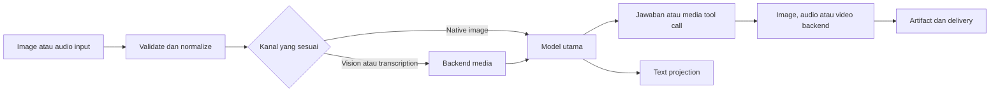

# Vision, audio dan generasi media

Hermes memperlakukan media sebagai input model, output tool, atau format delivery. Ketersediaan input gambar saat handshake belum menjamin provider utama menerima gambar dalam semua peran pesan. Kemampuan berdiri sendiri seperti vision tool, image/video generation, STT dan TTS punya registry, konfigurasi dan syarat backend masing-masing. [Vision preprocessing](https://github.com/NousResearch/hermes-agent/blob/ae2a81ccc00e9b7c06301523e5bb09608397149c/agent/vision_message_prep.py#L133-L257), [tool catalog](tools.md), [artifact intake dan output](artifacts.md).

| Kemampuan | Jalur dan kondisi |
| --- | --- |
| Vision input | Agent memeriksa kapabilitas model dan tool-message untuk mengambil keputusan pengiriman image parts. Beberapa mode memerlukan preprocessing atau fallback deskripsi. Kontrak MIME dan media intake dibatasi di jalur session. `vision_analyze` bisa menjadi jalur tool observasi terpisah. [Persiapan pesan](https://github.com/NousResearch/hermes-agent/blob/ae2a81ccc00e9b7c06301523e5bb09608397149c/agent/vision_message_prep.py#L133-L257), [vision tool](https://github.com/NousResearch/hermes-agent/blob/ae2a81ccc00e9b7c06301523e5bb09608397149c/tools/vision_tools.py#L952-L1045), [format input](https://github.com/NousResearch/hermes-agent/blob/ae2a81ccc00e9b7c06301523e5bb09608397149c/acp_adapter/content.py#L231-L282). |
| Image generation dan edit | `_handle_image_generate` memilih provider aktif dan mempersiapkan source images dalam scope. Schema dapat dibentuk dari kemampuan provider terpilih, sehingga parameter yang muncul bisa berbeda. Postprocessor mengenali file hasil yang bisa ikut delivery. [Active provider](https://github.com/NousResearch/hermes-agent/blob/ae2a81ccc00e9b7c06301523e5bb09608397149c/agent/image_gen_registry.py#L27-L47), [input dan handler](https://github.com/NousResearch/hermes-agent/blob/ae2a81ccc00e9b7c06301523e5bb09608397149c/tools/image_generation_tool.py#L791-L883), [schema](https://github.com/NousResearch/hermes-agent/blob/ae2a81ccc00e9b7c06301523e5bb09608397149c/tools/image_generation_tool.py#L884-L1040), [output](https://github.com/NousResearch/hermes-agent/blob/ae2a81ccc00e9b7c06301523e5bb09608397149c/gateway/run.py#L1413-L1488). |
| Video | Video analyze, generate dan edit mempunyai schema dan gate backend sendiri. Provider registry untuk generasi video berbeda dari inference utama. Ini capability opsional pada konfigurasi standar. [Analisis](https://github.com/NousResearch/hermes-agent/blob/ae2a81ccc00e9b7c06301523e5bb09608397149c/tools/vision_tools.py#L1050-L1205), [generasi](https://github.com/NousResearch/hermes-agent/blob/ae2a81ccc00e9b7c06301523e5bb09608397149c/tools/video_generation_tool.py), [registry](https://github.com/NousResearch/hermes-agent/blob/ae2a81ccc00e9b7c06301523e5bb09608397149c/agent/video_gen_registry.py), [toolset](tools.md). |
| Audio masuk | STT memproses input audio menjadi transcript dari backend yang tersedia. Voice turn dapat memilih route model sementara jika konfigurasi dan konteks memenuhi syarat. Route lama dipulihkan setelah turn. [Transcription](https://github.com/NousResearch/hermes-agent/blob/ae2a81ccc00e9b7c06301523e5bb09608397149c/tools/transcription_tools.py), [voice route](https://github.com/NousResearch/hermes-agent/blob/ae2a81ccc00e9b7c06301523e5bb09608397149c/agent/voice_turn_route.py#L135-L208). |
| Audio keluar | Tool TTS memilih engine, menyintesis ke file, menangani chunk dan mengembalikan media. Surface tertentu bisa melakukan streaming TTS dan memakai identitas turn untuk mencegah delivery audio lengkap ketika hasil streaming sudah dikirim. [TTS output](https://github.com/NousResearch/hermes-agent/blob/ae2a81ccc00e9b7c06301523e5bb09608397149c/tools/tts_tool.py#L377-L533), [streaming delivery](https://github.com/NousResearch/hermes-agent/blob/ae2a81ccc00e9b7c06301523e5bb09608397149c/gateway/platforms/base_streaming_tts.py#L33-L48). |

## Implikasi untuk Ngertiin

Ngertiin memakai capability harness untuk input gambar native. Konfigurasi `NGERTIIN_MEDIA_BACKENDS` menetapkan endpoint terkelola dan izin per operasi, akun, organisasi, dan thread. Pada DM berizin, tool menerima artifact yang terlihat oleh run untuk inspeksi gambar atau video MP4, transkripsi, dan revisi gambar. Generasi gambar/video dan sintesis suara memakai deskripsi atau teks dari turn dan menerbitkan file ke workspace run. Hasil revisi gambar menyimpan referensi artifact sumber. Pemilihan model chat dan billing mengikuti koneksi yang sudah dipilih pengguna. [Multimodal server](../../apps/server/src/multimodal.ts) · [Kontrak backend media](../../apps/server/src/integrations/media-contracts.ts) · [Publikasi artifact](../../apps/server/src/artifacts.ts).

Bukti Ngertiin mencakup vision native dan alternatif, transkripsi dan jawaban suara, generasi dan revisi PNG, serta analisis dan generasi MP4 dengan backend uji. Viewer dan unduhan memakai izin workspace. Analisis MP4 adalah capability opsional di DM dan memakai backend media terpilih. [Checklist dan bukti](implementation-checklist.md#channel-api-webhook-dan-output-media).

## Bukti Hermes Desktop macOS

Capability Vision, Speech-to-Text, dan Text-to-Speech memberi kontrol tersendiri. Video Analysis dan Video Generation tampil opt-in pada profil fixture. Tampilan kontrol belum membuktikan eksekusi backend media di build ini. [DT-06](desktop-runtime.md#jadwal-history-dan-konfigurasi-capability).
