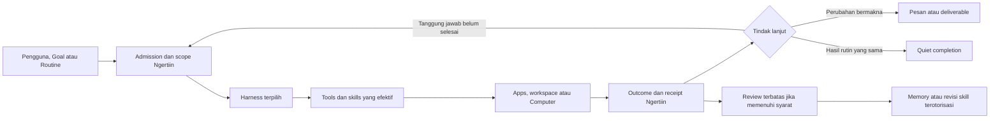

# Mewujudkan perilaku Hermes di Ngertiin

Prioritas riset ini adalah membuat perilaku yang sama terlihat dan bisa diuji oleh pengguna. Pertahankan satu authority Ngertiin untuk pekerjaan, capability dan akses. Probe jalur Hermes untuk menentukan detail yang perlu ditiru. Jalankan pekerjaan melalui harness yang sudah dipilih dengan MCP tools, skill, konteks, observasi dan receipt yang terikat run. [Lifecycle Hermes](lifecycle.md), [ACP Hermes](acp.md), [ACP Ngertiin](../architecture/acp-harnesses.md), [batas komposisi Ngertiin](../architecture/overview.md).

## Peta penerapan dari source aktif

| Perilaku yang ingin disamai | Fondasi Ngertiin | Perubahan yang layak diuji |
| --- | --- | --- |
| Agent menyelesaikan tujuan lintas turn dan tahu kapan perlu berhenti | Goal capture, Goals service, work fencing, Routine dan projection. [Kontrak lokal](../architecture/goals-routines-api.md), [instruksi Goal](../../apps/server/src/goals/instructions.ts), [scope work](../../apps/server/src/goals/work-fence.ts). | Simpan kriteria hasil, bukti relevan, keputusan step, wait dan batas budget pada outcome yang sudah diterima. Jadikan bukti, perubahan signifikan dan blocker sebagai bagian dari keputusan kelanjutan. Tambah judge hanya jika mengubah akurasi kasus konkret. [Goal Hermes](goals.md). |
| Agent bangun untuk check dan hanya mengganggu bila perlu | Satu background dispatcher, occurrence Routine, quiet outcome, linked atau standalone schedule. [Background](../../apps/server/src/background.ts), [routine admit](../../apps/server/src/lifecycle.ts#L827), [instruksi dan tools](../../apps/server/src/goals/tools.ts). | Simpan checkpoint check terakhir dan kondisi yang sudah diumumkan serta identitas trigger. Uji coalescing missed window, quiet result, notification dan resume. Pilih timer berdasarkan tujuan, semisal interval fleksibel atau waktu kalender. [Heartbeat](proactivity.md), [Cron](scheduling.md). |
| Agent membagi pekerjaan dan memverifikasi dependensi | Group routes, selected member, handoff, task projection dan retention. [Groups service](../../apps/server/src/groups/service.ts), [kontrak group](../architecture/group-collaboration-api.md). | Mulai dari worker output, input yang diizinkan, merge/approval oleh owner yang jelas dan bukti task terminal sebelum follower jalan. Delegasi sementara, board lintas profil atau dependency graph besar membutuhkan definisi produk dan scope sendiri. [Delegation](delegation.md), [Kanban](kanban.md). |
| Agen menemukan tool dan skill yang tepat tanpa membanjiri konteks | ProductTools, Composio, skills milik aplikasi, katalog inherited harness dan MCP endpoint terikat run. [Product tools](../../apps/server/src/harness/tools.ts), [skills lokal](../../apps/server/src/learning/application-skills.ts), [inherited skills](../../apps/server/src/harness/inherited-skills.ts), [app integration](../../apps/server/src/integrations/service.ts). | Mulai dari katalog ringkas berdasarkan kebutuhan, progresif membuka detail schema atau skill dan membaca file referensi saat relevan. Bandingkan discovery-first dengan daftar langsung pada intent yang sama menggunakan actual harness. Kemampuan kustom hanya muncul jika konfigurasi dan grant cocok. [Tools](tools.md), [Skills](skills.md). |
| Agent memilih API, browser atau desktop dan melaporkan hasil nyata | Tool browser terpisah dari Cua desktop input, viewer, lease, proses dan workspace artifacts. [Browser tools](../../apps/server/src/browser/tools.ts), [machine tools](../../apps/server/src/machines/tools.ts), [domain execution](../architecture/execution-domains.md). | Uji keputusan memakai primitive termurah yang memadai, beralih dari API atau DOM ke visual bila benar-benar diperlukan, lalu konfirmasi kondisi akhir. Uji takeover manusia, resume, session retention dan screenshot terikat target. [Computer Use](computer-use.md), [Artifacts](artifacts.md). |
| Performa membaik saat tugas berulang | Scoped memory, tombstones, immutable skill revision, run-based provenance dan per-turn context. [Memory service](../../apps/server/src/learning/memories.ts), [learning context](../../apps/server/src/harness/instructions.ts), [learning tools](../../apps/server/src/learning/tools.ts). | Jadwalkan kandidat review terbatas di lifecycle yang sama jika ada hasil yang layak dipelajari. Terapkan revisi dengan scope dan versi yang jelas. Ukur hasil tugas kedua dan berikutnya. Lesson yang ditulis, promosi skill dan peningkatan kualitas memerlukan bukti berbeda. [Memory](memory.md), [Learning](learning.md). |
| Pengguna tahu kapan ada pekerjaan, kebutuhan keputusan, atau hasil | Interaction journal, projected safe progress, native input dan terminal result. [Interactions](../../apps/server/src/interactions/service.ts), [ACP projection](../../apps/server/src/harness/acp/projection.ts), [run journal](../../apps/server/src/runs/interaction-journal.ts). | Gunakan status agent-attributed dan hasil yang bisa dikonfirmasi. Saat perlu bantuan, sebut keputusan yang dibutuhkan dan dampaknya. Resume harus jelas ketika konteks berubah. Prioritaskan ringkasan relevan dan kelola daftar todo melalui plan, dengan Goal yang tetap punya identity sendiri. [Interaksi](human-in-the-loop.md), [Tasks](tasks.md). |

## Skenario pembanding pertama yang diusulkan

Pakai dashboard sintetis yang dikuasai tim dan data fixture tetap. Pengguna meminta agent memantau satu metrik harian, menyampaikan perubahan yang melewati batas yang diberikan, dan jika perlu menghasilkan ringkasan CSV. Siapkan shift data, putus koneksi sementara, sesi login yang kedaluwarsa, input duplikat, dan satu jenis informasi yang memerlukan klarifikasi. Jalankan alur yang sama di Hermes dan Ngertiin melalui harness yang memang ingin dibandingkan. Buat satu expected outcome per stimulus.

| Stimulus | Bukti yang harus diambil |
| --- | --- |
| Data tidak berubah | Run benar-benar membaca versi sumber, menyimpan checkpoint baru dan tidak menambah notifikasi yang mubazir. |
| Data melewati ambang | Agent menemukan data yang benar, menjelaskan perubahannya, menyampaikan satu update, dan byte CSV sesuai data dan scope. |
| Jalur API terhalang | Agent menggunakan browser/Computer bila diizinkan, menjelaskan batas ketika perlu, dan memverifikasi kondisi setelah fallback. |
| Jaringan putus setelah operasi dimulai | Outcome unknown bisa dibedakan dari definite failure. Receipt dan sumber efek diperiksa sebelum retry. |
| Pengguna stop, lalu minta melanjutkan | Run berhenti dengan bukti yang sesuai. Goal/Routine mengikuti keputusan pengguna yang berlaku. Generation lama tidak mengirim hasil ke turn baru. |
| Kasus yang sama berulang | Jejak sumber dan prosedur bisa dipakai kembali. Bandingkan tingkat keberhasilan, jumlah tool calls, waktu ke hasil pertama, permintaan bantuan yang tepat dan kejadian retry/duplikasi dengan konfigurasi yang tercatat. |

Urutan pembuktiannya adalah single-agent Routine dengan hasil yang dapat diukur, lalu tool choice dan grounding, lalu perbaikan dari pengalaman. Setelah itu uji kebutuhan multi-agent dan scope versi yang lebih luas. Ini urutan usulan untuk membuktikan pengalaman, bukan perubahan roadmap. Pertahankan pilihan provider dan billing eksplisit, isolasi execution domain dan perlindungan agent memory. Hasil parity dinilai dari tindakan, kelanjutan kerja dan deliverable yang terlihat.

## Implikasi dari uji Desktop macOS

Pembuktian self-learning di Hermes memiliki tiga tanda yang dapat dipakai di Ngertiin. Pengguna melihat ringkasan review setelah jawaban, skill baru memiliki sumber run dan isi yang dapat diperiksa, lalu chat baru menunjukkan pemuatan skill yang benar-benar diminta dan dipakai. Gunakan ketiganya bersama hasil tugas baru. Pada Goal, simpan putusan dan alasan ketika judge gagal berulang. Pada Routine, sediakan akses dari occurrence ke hasilnya. Untuk memory, verifikasi tool receipt sebelum menggambarkan perubahan sebagai sudah tersimpan. [Hasil probe Desktop](desktop-runtime.md).
