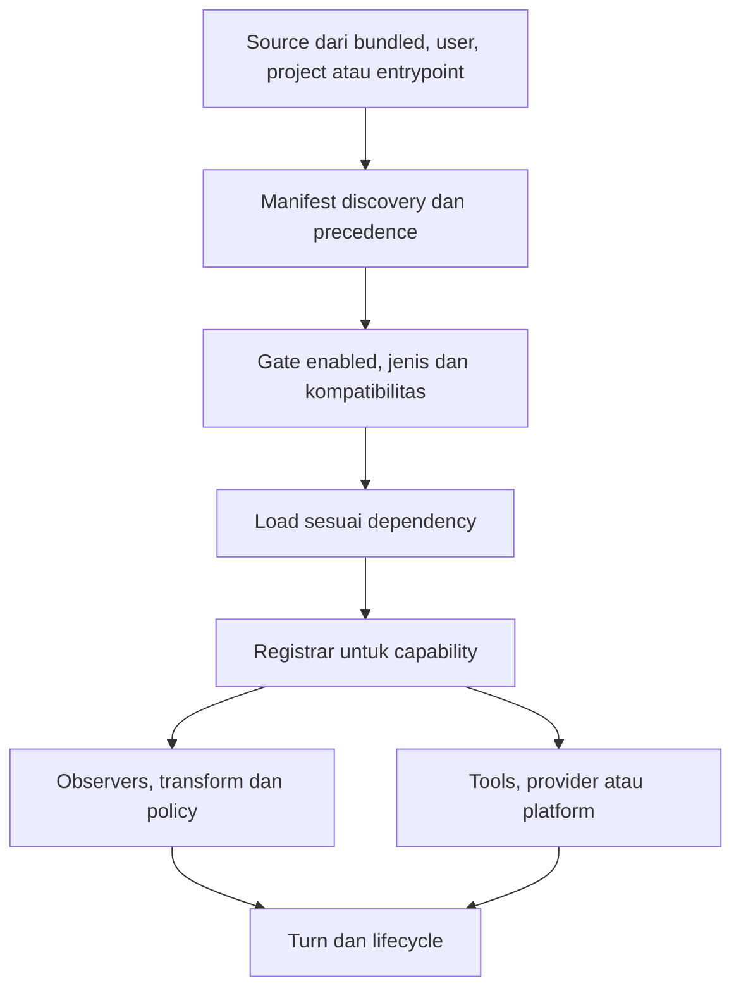

# Plugin, hooks dan middleware

Plugin Hermes adalah extension runtime. Ia dapat meregistrasikan tool, hook, command, adapter platform atau capability provider, tergantung tipe paketnya. Skill membawa petunjuk prosedural untuk agent dan MCP membawa kontrak tool/resource/server. Portable plugin dapat memaketkan skills dan konfigurasi MCP bersama. Jalur aktivasi tetap menentukan kemampuan yang benar-benar tersedia. [Tipe manifest](https://github.com/NousResearch/hermes-agent/blob/ae2a81ccc00e9b7c06301523e5bb09608397149c/hermes_cli/plugins_manifest.py#L355-L421), [plugin architecture](https://github.com/NousResearch/hermes-agent/blob/ae2a81ccc00e9b7c06301523e5bb09608397149c/website/docs/developer-guide/plugins/index.md), [instruksi skill](skills.md), [adapter MCP](mcp.md).

| Fase | Jalur source |
| --- | --- |
| Temukan | `collect_directory_manifests` mengumpulkan manifest yang relevan. `resolve_manifest_winners` menetapkan precedence untuk identitas yang bentrok. `gate_manifest` menentukan skip, deferred load atau load berdasarkan jenis, konfigurasi dan posture. Jadi isi katalog saja belum menentukan registry yang aktif. [Discovery dan resolusi](https://github.com/NousResearch/hermes-agent/blob/ae2a81ccc00e9b7c06301523e5bb09608397149c/hermes_cli/plugins_discovery.py#L190-L247), [manifest gate](https://github.com/NousResearch/hermes-agent/blob/ae2a81ccc00e9b7c06301523e5bb09608397149c/hermes_cli/plugins_discovery.py#L249-L334). |
| Pasang dan aktifkan | Perubahan set plugin melewati pemeriksaan dependency. Manifest memuat key/mode, requirements, kompatibilitas, capability dan config schema. Loader memiliki deadline dan pencatatan kegagalan. Aktivasi dapat meminta Gateway reload dan memberi alasan jika ada dependency atau lifecycle yang menghambat. [Dependency check](https://github.com/NousResearch/hermes-agent/blob/ae2a81ccc00e9b7c06301523e5bb09608397149c/hermes_cli/plugins_admission.py#L28-L83), [load](https://github.com/NousResearch/hermes-agent/blob/ae2a81ccc00e9b7c06301523e5bb09608397149c/hermes_cli/plugins_loader.py#L514-L651), [aktivasi](https://github.com/NousResearch/hermes-agent/blob/ae2a81ccc00e9b7c06301523e5bb09608397149c/hermes_cli/plugins_activation.py#L128-L247). |
| Registrasi | Plugin context menyediakan API registrasi dan scope. Registry mempunyai lane khusus seperti browser provider, cron provider, context engine, memory provider dan lainnya. Setiap jenis capability punya entrypoint dan syarat sendiri. [Registrars](https://github.com/NousResearch/hermes-agent/blob/ae2a81ccc00e9b7c06301523e5bb09608397149c/hermes_cli/plugins_registrars.py), [manifest capability](https://github.com/NousResearch/hermes-agent/blob/ae2a81ccc00e9b7c06301523e5bb09608397149c/hermes_cli/plugins_manifest.py#L162-L203), [source plugin bundled](https://github.com/NousResearch/hermes-agent/tree/ae2a81ccc00e9b7c06301523e5bb09608397149c/plugins). |
| Dispatch | Observer dan hook kebijakan punya efek berbeda. `invoke_hook` menyaring callback args, menjalankan callback dengan aturan timeout dan failure yang bergantung pada hook, lalu mengumpulkan hasil. Hooks kebijakan dapat menolak action sesuai kontrak. Plugin observer event diproses lewat worker queue. [Hook dispatch](https://github.com/NousResearch/hermes-agent/blob/ae2a81ccc00e9b7c06301523e5bb09608397149c/hermes_cli/plugins_dispatch.py#L248-L370), [event worker](https://github.com/NousResearch/hermes-agent/blob/ae2a81ccc00e9b7c06301523e5bb09608397149c/hermes_cli/plugins_dispatch.py#L438-L558), [tool-policy directive](https://github.com/NousResearch/hermes-agent/blob/ae2a81ccc00e9b7c06301523e5bb09608397149c/hermes_cli/plugins.py#L1113-L1254). |
| Ubah output | Transform yang membutuhkan seluruh teks dapat menahan stream dan memproyeksikan hasil final setelah transform. Turn memotret daftar transform saat mulai agar reload di tengah turn tidak menghilangkannya. Hasil dari transform juga punya batas persistence dan delivery tersendiri. [Held transform](https://github.com/NousResearch/hermes-agent/blob/ae2a81ccc00e9b7c06301523e5bb09608397149c/hermes_cli/plugins_dispatch.py#L567-L648), [turn snapshot](https://github.com/NousResearch/hermes-agent/blob/ae2a81ccc00e9b7c06301523e5bb09608397149c/agent/conversation_loop.py#L1693-L1697), [settlement transform](https://github.com/NousResearch/hermes-agent/blob/ae2a81ccc00e9b7c06301523e5bb09608397149c/agent/turn_finalizer.py#L561-L611). |

## Implikasi untuk Ngertiin

Extension yang dibutuhkan oleh pengguna bisa lebih dulu masuk sebagai app connection, app-owned skill, atau scoped product tool. Itu memanfaatkan jalur yang sekarang ada dan membuat ownership serta revoke dapat diperiksa. Observer outcome untuk pembelajaran dapat membaca proyeksi terotorisasi. Hook yang akan mengubah authorization, prompt, biaya, atau output perlu seam yang lebih sempit dan outcome yang jelas. Plugin Python upstream dapat menjalankan kode. Filter tool dan manifest saja tidak menjamin isolasi tenant. [Scoped apps dan skills](../architecture/scoped-apps-skills.md), [ProductTools](../../apps/server/src/harness/tools.ts), [koneksi aplikasi](../../apps/server/src/integrations/service.ts).

Uji capability hilang, manifest tidak cocok, observer lambat, revoke setelah session discovery, dan transform yang menahan delta. Jika suatu extension hasilnya berubah di tengah turn, verifikasi bahwa UI, transcript final dan policy memakai keputusan turn yang sama. Temuan halaman ini berasal dari source yang dipatok.

## Output plugin di Ngertiin

Operator mendaftarkan formatter di `NGERTIIN_OUTPUT_PLUGINS` dengan ID, versi, sumber, dependency konektor pribadi, `match_prefix`, dan `replace_prefix`. Marketplace menampilkan capability dan status dependency pada DM pribadi. Aktivasi menyimpan ID dan versi melalui `/v1/threads/:id/output-plugins` dengan revision check. Claim run memeriksa dependency pada akun pemilik DM dan memotret versi aktif. Hook mengganti prefiks literal pada awal jawaban final. Lifecycle menahan delta dan memublikasikan jawaban setelah outcome native sukses. Jika prefiks tidak cocok atau hasil melampaui batas teks, lifecycle menyimpan jawaban asli dengan status kegagalan formatter. [Aktivasi](evidence/plugin-01/verification.json) · [Transform dan fallback](evidence/plugin-02/verification.json).

## Bukti Hermes Desktop macOS

Capabilities menampilkan tab Plugins dan daftar toolsets; artifact membedakan plugin Kanban dari activation backend serta memetakan jalur setup. Pengujian fungsi plugin, callback dan output transform masih terbuka. [Artefak Desktop](desktop-artifact.md) · [Cakupan runtime](desktop-runtime.md#cakupan-setiap-fitur).
