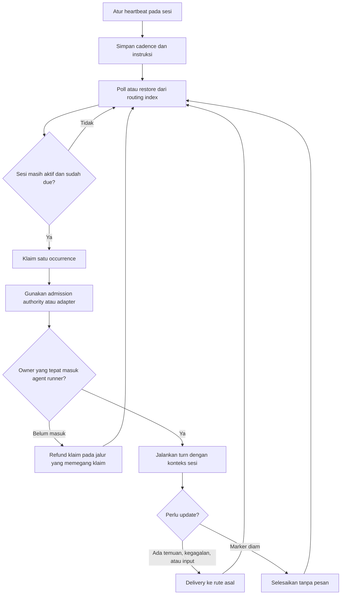

# Proaktivitas dan heartbeat

Hermes dapat memulai kerja otomatis ketika Goal masih perlu dilanjutkan, heartbeat atau loop sudah jatuh tempo, job cron menjadi due, kartu Kanban siap, atau hasil proses/delegasi memerlukan tindak lanjut. Untuk proaktivitas yang terus mengamati satu konteks percakapan, `/heartbeat` menyimpan instruksi periodik dalam sesi tersebut dan menjalankan pemeriksaan saat rutenya siap. [Goal](goals.md) · [Loop](loops.md) · [Cron](scheduling.md) · [Kanban](kanban.md) · [Delegasi](delegation.md).

## Dari command ke wake

- Handler `/heartbeat` menyelesaikan route lewat SessionStore, lalu mengatur, menjeda, melanjutkan atau menghentikan heartbeat. Interval minimal 60 detik dan poll gateway berjarak 5 detik. `HeartbeatState` menyimpan `prompt`, `interval_seconds`, status, `created_at`, `last_fired_at`, dan `fire_count` di metadata sesi SQLite. Due memakai `last_fired_at` atau `created_at` sebagai anchor. Resume memberi anchor baru supaya tick lama tidak langsung ditembakkan. [Command](https://github.com/NousResearch/hermes-agent/blob/ae2a81ccc00e9b7c06301523e5bb09608397149c/gateway/slash_commands_goals.py#L115-L168) · [State dan cadence](https://github.com/NousResearch/hermes-agent/blob/ae2a81ccc00e9b7c06301523e5bb09608397149c/hermes_cli/heartbeat.py#L20-L90) · [Metadata](https://github.com/NousResearch/hermes-agent/blob/ae2a81ccc00e9b7c06301523e5bb09608397149c/hermes_cli/heartbeat.py#L103-L149) · [Pause/resume](https://github.com/NousResearch/hermes-agent/blob/ae2a81ccc00e9b7c06301523e5bb09608397149c/hermes_cli/heartbeat.py#L185-L217).
- `HeartbeatManager.due_prompt()` masuk lock tingkat proses, memuat ulang row, mengecek status dan pasangan `last_fired_at, fire_count`, lalu memajukan anchor ke waktu saat ini dan menaikkan hitungan. Beberapa interval terlewat menjadi satu tick terbaru. `abandon_fire()` memundurkan klaim yang belum dieksekusi jika state persisten masih cocok. [Claim dan refund](https://github.com/NousResearch/hermes-agent/blob/ae2a81ccc00e9b7c06301523e5bb09608397149c/hermes_cli/heartbeat.py#L219-L257).
- Dengan session authority, `admit_heartbeat` mengecek FIFO pada logical owner dari compression root. Pending admission heartbeat yang masih ada menahan admission berikutnya. Identity menggabungkan tipe heartbeat, session ID, waktu pembuatan, dan hitungan fire. Pengecualian sebelum acceptance memanggil refund. Saat preparation, route harus masih berada pada sesi yang diharapkan atau compression tip yang cocok. Guard mengecek owner lagi sebelum agent runner. [Admission, owner dan refund](https://github.com/NousResearch/hermes-agent/blob/ae2a81ccc00e9b7c06301523e5bb09608397149c/gateway/run_heartbeat_acceptance.py#L12-L79) · [Preparation](https://github.com/NousResearch/hermes-agent/blob/ae2a81ccc00e9b7c06301523e5bb09608397149c/gateway/run_turn_prepare.py#L465-L478) · [Guard](https://github.com/NousResearch/hermes-agent/blob/ae2a81ccc00e9b7c06301523e5bb09608397149c/gateway/run_turn_setup_guard.py#L137-L155).
- Jalur adapter lokal menghormati viewer yang memiliki watchdog sendiri. Jalur adapter klasik tanpa authority menahan claim jika sesi sibuk, FIFO berisi pekerjaan, atau emergency stop aktif. Setelah dispatch adapter, callback melakukan refund jika upaya yang tepat belum masuk agent runner. Tanda eksekusi berasal dari `run_turn`; keberhasilan model dan keberhasilan delivery mempunyai arti tersendiri. [Pemilihan jalur dan watchdog](https://github.com/NousResearch/hermes-agent/blob/ae2a81ccc00e9b7c06301523e5bb09608397149c/gateway/run_goals.py#L139-L218) · [Tanda masuk runner](https://github.com/NousResearch/hermes-agent/blob/ae2a81ccc00e9b7c06301523e5bb09608397149c/gateway/run_turn.py#L209-L223).
- Startup dan poll memulihkan watch berdasarkan routing index, source asal dan profile yang dilayani. Kandidat tanpa origin atau route yang suspended dilewati. Setelah scan, watch didaftarkan hanya jika sesi tersebut masih menjadi owner route. Kompresi membawa state heartbeat ke sesi anak. Pemulihan watch memulihkan alasan untuk mengecek lagi. Status efek eksternal dari turn sebelumnya membutuhkan bukti run atau delivery tersendiri. [Restore](https://github.com/NousResearch/hermes-agent/blob/ae2a81ccc00e9b7c06301523e5bb09608397149c/gateway/run_heartbeat_restore.py#L22-L79) · [Migrasi](https://github.com/NousResearch/hermes-agent/blob/ae2a81ccc00e9b7c06301523e5bb09608397149c/hermes_cli/heartbeat.py#L260-L287).

## Diam, melapor, atau menunggu

Heartbeat memperoleh konteks sesi yang aktif, sehingga cek berikutnya dapat menggunakan keputusan dan percakapan sebelumnya. Gateway mematikan typing/tool-progress/draft rutin untuk turn heartbeat. Marker diam sebagai respons akhir dapat menahan delivery. Temuan yang perlu dilihat pengguna masih memakai route chat atau topic, tanpa mengutip command yang membuat heartbeat. Approval dan kegagalan mengikuti jalur yang tetap terlihat. [Kontrak pengguna](https://github.com/NousResearch/hermes-agent/blob/ae2a81ccc00e9b7c06301523e5bb09608397149c/website/docs/user-guide/features/heartbeat.md#L35-L54) · [Quiet turn](https://github.com/NousResearch/hermes-agent/blob/ae2a81ccc00e9b7c06301523e5bb09608397149c/gateway/run_turn.py#L2097-L2125) · [Kebijakan final](https://github.com/NousResearch/hermes-agent/blob/ae2a81ccc00e9b7c06301523e5bb09608397149c/gateway/run_turn.py#L1575-L1607).

Contoh yang sesuai adalah pemeriksaan dashboard yang hanya melapor ketika status terbaru beralih dari normal ke bermasalah. Cadence memberi kesempatan mengecek. Perubahan status harus ditentukan dari bukti terbaru dibanding checkpoint sebelumnya. Keberhasilan proaktif berarti agent membangunkan pekerjaan tanpa chat baru, membaca sumber yang sah, memilih diam jika belum ada perubahan, dan memberi satu update yang dapat ditindaklanjuti ketika perubahan terverifikasi.

## Wake karena aktivitas selesai

Hermes juga dapat meneruskan pekerjaan ketika hasil delegasi atau akhir proses background tiba. `completion_resumes_parent` membedakan result final yang dapat meneruskan parent dari notice diagnostik dan hasil manual cron. Gateway memulihkan route asal, memastikan owner, dan mencari receipt admission yang mungkin sudah tersimpan sebelum mencoba wake. Completion yang kompatibel dapat digabung agar parent memperoleh satu turn berisi hasil yang masih baru. Jika sesi lokal yang menjadi owner dimatikan dari sisi viewer, gateway masih dapat memproses completion yang memenuhi syarat sesuai policy-nya. [Kriteria wake](https://github.com/NousResearch/hermes-agent/blob/ae2a81ccc00e9b7c06301523e5bb09608397149c/tools/process_registry_notifications.py#L158-L193) · [Dedupe dan delivery claim](https://github.com/NousResearch/hermes-agent/blob/ae2a81ccc00e9b7c06301523e5bb09608397149c/gateway/run_notifications.py#L1265-L1324) · [Merge hasil](https://github.com/NousResearch/hermes-agent/blob/ae2a81ccc00e9b7c06301523e5bb09608397149c/gateway/run_notifications.py#L1372-L1417).

Tick liveness proses memiliki event identity sendiri. `prepare_heartbeat` dapat menggabungkan output satu proses ke tick yang masih mengantre, dengan penggantian yang hanya berhasil selama tick sebelumnya tetap queued. Saat terminal completion sudah teradmit, tick liveness yang terlambat dibuang. Di Ngertiin, trigger seperti ini bisa mengikuti settlement dan otorisasi process yang sudah dimiliki oleh workspace. Wake event yang masuk dari integrasi dibahas di [Gateway dan surfaces](gateway-surfaces.md). [Persiapan dan penggantian tick proses](https://github.com/NousResearch/hermes-agent/blob/ae2a81ccc00e9b7c06301523e5bb09608397149c/gateway/session_automation.py#L175-L235) · [Proses Ngertiin](../../apps/server/src/machines/processes.ts).

## Bukti eksekusi fixture

Hermes v0.23.2 pada Python 3.14.9 dan macOS ARM64, menggunakan home sementara. 43 lulus. Cakupan mencakup claim, canonical admission, batas reset/compression pada route, dan restore lintas profil setelah restart. Klaim cakupan di sini terbatas pada fixture yang dijalankan. [test_heartbeat.py](https://github.com/NousResearch/hermes-agent/blob/ae2a81ccc00e9b7c06301523e5bb09608397149c/tests/hermes_cli/test_heartbeat.py) · [test_heartbeat_acceptance.py](https://github.com/NousResearch/hermes-agent/blob/ae2a81ccc00e9b7c06301523e5bb09608397149c/tests/gateway/test_heartbeat_acceptance.py) · [test_heartbeat_execution_ownership.py](https://github.com/NousResearch/hermes-agent/blob/ae2a81ccc00e9b7c06301523e5bb09608397149c/tests/gateway/test_heartbeat_execution_ownership.py) · [test_heartbeat_watch_restore.py](https://github.com/NousResearch/hermes-agent/blob/ae2a81ccc00e9b7c06301523e5bb09608397149c/tests/gateway/test_heartbeat_watch_restore.py).

## Pemetaan ke Ngertiin

Ngertiin sudah menyediakan `heartbeat` sebagai jenis Routine berjangkar, `Background` untuk pengoperasian backend, `dueWindow` untuk coalescing, dan `routine_no_update` untuk quiet settlement dengan guard atas artefak, permintaan input dan status Goal. `Lifecycle.fireRoutine` menyatukan admission dan cursor occurrence dengan pemeriksaan agent, scope dan status pekerjaan aktif. [Kontrak jadwal](../../apps/server/src/goals/contracts.ts#L24-L41) · [Jendela due](../../apps/server/src/goals/schedule.ts#L64) · [Admission Routine](../../apps/server/src/lifecycle.ts#L827-L907) · [Quiet settlement](../../apps/server/src/goals/service.ts#L449-L464).

Untuk mendekati Hermes, gunakan Routine yang ada dengan kebijakan idle, bukti snapshot sebelumnya, dan status yang membedakan tick diklaim, run mulai, run selesai, serta publikasi. Kebijakan busy dapat memberi prioritas pada pesan pengguna yang sudah menunggu. Checkpoint perubahan sebaiknya terikat ke Routine/Goal dan sumber serta hasil yang benar-benar diamati, supaya pemeriksaan setelah restart tidak mengulang alert yang sudah diketahui.

Uji satu sesi dengan tiga interval terlewat ketika run interaktif masih berjalan. Setelah idle, harus ada satu pemeriksaan, tanpa pesan tambahan jika dashboard sama. Restart saat sebelum admission, setelah admission, dan setelah settlement. Ulangi dengan perubahan yang valid dan percobaan wake dari generation lama. Ukur waktu menuju alert, jumlah cek yang tidak perlu, duplicate publication, dan apakah pertanyaan penting tetap terlihat.

## Bukti Hermes Desktop macOS

Desktop menerima `/heartbeat 1m`, menampilkan countdown, lalu gateway benar-benar membangunkan sesi itu tanpa pesan manual tambahan. Snapshot uji mencatat `fire_count=3`. Ini melengkapi bukti source pada jalur wake. Coalescing saat sesi sibuk dan quiet publication perlu skenario berbeda. [DT-09](desktop-runtime.md#restart-loop-browser-dan-artifact).
