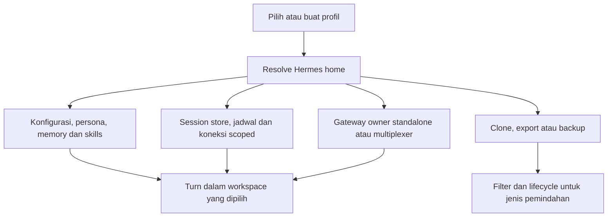

# Profil, konfigurasi dan pemindahan agent

Hermes memakai profil berbasis home sebagai identitas agent yang dapat dipilih di beberapa surface. Profil membawa konfigurasi, persona, memori, skills, sesi, jadwal, plugin, dan koneksi sesuai tindakan yang dilakukan pengguna. Profil juga merupakan batas kepemilikan Gateway. Workspace menentukan konteks kegiatan dan sandbox menentukan batas eksekusi OS. Ketiganya perlu dibaca bersama ketika menilai kemampuan agent. [Profil dan jenis identitas](https://github.com/NousResearch/hermes-agent/blob/ae2a81ccc00e9b7c06301523e5bb09608397149c/website/docs/user-guide/profiles.md#L9-L43), [workspaces dan sandboxing](https://github.com/NousResearch/hermes-agent/blob/ae2a81ccc00e9b7c06301523e5bb09608397149c/website/docs/user-guide/profiles.md#L234-L258).

## Mekanisme

| Aspek | Jalur kode |
| --- | --- |
| Pilihan profil | Nama dinormalisasi dan divalidasi, lalu dipetakan ke default home atau profil bernama. Alias CLI dan sticky active choice adalah cara memilih profil saat launch. Resolver juga dapat mengenali home yang sedang aktif. [Nama dan path](https://github.com/NousResearch/hermes-agent/blob/ae2a81ccc00e9b7c06301523e5bb09608397149c/hermes_cli/profiles.py#L370-L480), [alias dan sticky profile](https://github.com/NousResearch/hermes-agent/blob/ae2a81ccc00e9b7c06301523e5bb09608397149c/website/docs/user-guide/profiles.md#L182-L224). |
| Buat dan clone | `create_profile` memilih mode bootstrap. Blank profile bisa mendapat seed skills. Clone konfigurasi dan clone-all memiliki cakupan berbeda. Clone-all mengeluarkan history dan cron agar clone tidak mengambil alih riwayat atau menjalankan ulang jadwal sumber. Cloning koneksi messaging punya opsi khusus. [Bootstrap](https://github.com/NousResearch/hermes-agent/blob/ae2a81ccc00e9b7c06301523e5bb09608397149c/hermes_cli/profiles.py#L1312-L1433), [seeding](https://github.com/NousResearch/hermes-agent/blob/ae2a81ccc00e9b7c06301523e5bb09608397149c/hermes_cli/profiles.py#L1458-L1487), [cakupan clone](https://github.com/NousResearch/hermes-agent/blob/ae2a81ccc00e9b7c06301523e5bb09608397149c/website/docs/user-guide/profiles.md#L83-L140). |
| Jalankan | `profiles_to_serve` memilih profil yang dapat dilayani multiplexer dan memperhitungkan standalone atau parked. Lock ownership dan epoch tetap menjadi bagian dari authority profil. Isolasi profil data tidak membuktikan batas akun OS untuk proses yang menjalankan terminal. [Pemilihan serve](https://github.com/NousResearch/hermes-agent/blob/ae2a81ccc00e9b7c06301523e5bb09608397149c/hermes_cli/profiles.py#L1021-L1118), [owner lock](https://github.com/NousResearch/hermes-agent/blob/ae2a81ccc00e9b7c06301523e5bb09608397149c/gateway/runtime_ownership.py#L164-L246). |
| Pindahkan | Profile export memakai filter file dan credential scrub, lalu import memiliki jalur validasi arsip dan pemilihan home. Backup memiliki tujuan pemulihan yang lebih luas. Distribution memasang dan memperbarui paket sumber profil, dengan semantics tersendiri untuk data lokal. Cakupan tepat bergantung pada tindakan yang dipilih. [Export dan import](https://github.com/NousResearch/hermes-agent/blob/ae2a81ccc00e9b7c06301523e5bb09608397149c/hermes_cli/profiles.py#L2078-L2198), [scrubber](https://github.com/NousResearch/hermes-agent/blob/ae2a81ccc00e9b7c06301523e5bb09608397149c/hermes_cli/profiles_export_scrub.py), [backup](https://github.com/NousResearch/hermes-agent/blob/ae2a81ccc00e9b7c06301523e5bb09608397149c/hermes_cli/backup.py), [distribution](https://github.com/NousResearch/hermes-agent/blob/ae2a81ccc00e9b7c06301523e5bb09608397149c/hermes_cli/profile_distribution.py). |

## Implikasi untuk Ngertiin

Ngertiin menyediakan clone, ekspor, dan backup dari menu chat DM untuk agent personal, serta impor dari menu pembuatan agent. Paket JSON portabel membawa persona, avatar, harness, dan revisi skill aplikasi yang aktif beserta asetnya. Backup juga membawa memory milik pengguna pada profil dan definisi Routine mandiri. Paket membawa data yang diizinkan untuk agent itu. Tujuan menetapkan identitas, grant, model, akun, billing, dan workspace sendiri. Routine dari backup berawal Paused dan mengikat pilihan provider tujuan ketika pengguna mengaktifkannya. [Scoped data](../architecture/scoped-agent-data.md) · [App dan skill Team](../architecture/scoped-apps-skills.md) · [Execution domain](../architecture/execution-domains.md) · [Verifikasi restore](evidence/profile-02/verification.json).

Skenario pembuktian yang berguna memakai profil sintetis berisi persona, skill dengan referensi, catatan privat, koneksi dummy dan jadwal aktif. Periksa byte artefak export, field yang diimpor, siapa yang bisa melihatnya, tool yang benar-benar aktif, dan apakah ada pemicu tanpa persetujuan pada destination.

## Bukti Hermes Desktop macOS

Sidebar Desktop menampilkan profil default dan kontrol New profile, Import profile, Manage profiles, serta Manage gateways. Dengan identitas home dan user-data yang terpisah, salinan byte-identik berhasil menjalankan alur fixture tanpa memakai data profil aktif. Clone, import, dan pemindahan state terlindung belum dicoba. [Metode Desktop](desktop-runtime.md) · [Cakupan per fitur](desktop-runtime.md#cakupan-setiap-fitur).
