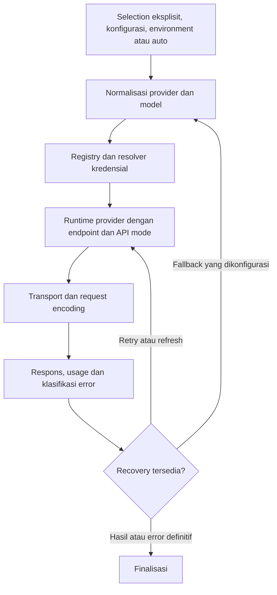

# Provider, model, kredensial dan billing

Hermes memilih provider dan transport di dalam runtime sendiri. Model ID, provider ID, endpoint, API mode, cara autentikasi dan sumber biaya adalah informasi yang berbeda. Satu provider dapat memilih API mode berdasarkan model. Satu API mode dapat dipakai oleh beberapa endpoint. Auxiliary task seperti compression, review atau title punya konfigurasi sendiri. [Arsitektur runtime](https://github.com/NousResearch/hermes-agent/blob/ae2a81ccc00e9b7c06301523e5bb09608397149c/website/docs/developer-guide/provider-runtime.md#L9-L56), [resolver](https://github.com/NousResearch/hermes-agent/blob/ae2a81ccc00e9b7c06301523e5bb09608397149c/hermes_cli/runtime_provider.py#L1215-L1259), [auxiliary task config](https://github.com/NousResearch/hermes-agent/blob/ae2a81ccc00e9b7c06301523e5bb09608397149c/agent/auxiliary_task_config.py#L24-L90).

## Jalur kode

| Bagian | Implementasi |
| --- | --- |
| Preferensi | `resolve_requested_provider` memilih argumen, provider di konfigurasi model, environment client/session atau secret profil, lalu `auto`. Konfigurasi yang disimpan mengalahkan export shell lama. [Pemilihan provider](https://github.com/NousResearch/hermes-agent/blob/ae2a81ccc00e9b7c06301523e5bb09608397149c/hermes_cli/runtime_provider.py#L545-L557). |
| Registry | `ProviderProfile` merepresentasikan identitas, default route, kredensial dan seam khusus provider. Provider plugin mendaftar ke registry. Lookup baru dapat membawa modul provider ke runtime. Direktori bundled mencakup antara lain OpenRouter, Nous, OpenAI Codex, Anthropic, Gemini, XAI, OpenCode Zen, Bedrock, Vertex, local/custom dan penyedia lainnya. Ketersediaan efektif bergantung pada distribusi, dependency, konfigurasi dan kredensial. [Profil](https://github.com/NousResearch/hermes-agent/blob/ae2a81ccc00e9b7c06301523e5bb09608397149c/providers/base.py#L142-L220), [registry](https://github.com/NousResearch/hermes-agent/blob/ae2a81ccc00e9b7c06301523e5bb09608397149c/providers/__init__.py#L146-L242), [inventaris source](https://github.com/NousResearch/hermes-agent/tree/ae2a81ccc00e9b7c06301523e5bb09608397149c/plugins/model-providers). |
| Resolusi | `resolve_runtime_provider` menjalankan guard provider disabled, alias dan custom endpoint, explicit credentials, pool, OAuth atau jenis provider terdaftar, lalu fallback resolver yang relevan. `target_model` bisa menentukan API mode. Overlay `model.openai_runtime=codex_app_server` terjadi setelah ladder, sehingga app-server menggunakan login miliknya sendiri. [Ladder dan overlay](https://github.com/NousResearch/hermes-agent/blob/ae2a81ccc00e9b7c06301523e5bb09608397149c/hermes_cli/runtime_provider.py#L1215-L1259). |
| Credential pool | Pemilihan memakai provider/model/endpoint dan status entry, termasuk batas cooldown dan entry yang sedang di-refresh atau dipakai. Pool memiliki jalur menandai entry lelah dan rotasi. Fallback lintas provider melalui chain konfigurasi adalah keputusan lain. [Selection](https://github.com/NousResearch/hermes-agent/blob/ae2a81ccc00e9b7c06301523e5bb09608397149c/agent/credential_pool_selection.py#L30-L123), [rotasi](https://github.com/NousResearch/hermes-agent/blob/ae2a81ccc00e9b7c06301523e5bb09608397149c/agent/credential_pool.py#L2170-L2245), [fallback primer](https://github.com/NousResearch/hermes-agent/blob/ae2a81ccc00e9b7c06301523e5bb09608397149c/hermes_cli/runtime_provider.py#L1331-L1378). |
| Recovery | Loop membedakan error sebelum/selepas klasifikasi, lalu memilih pemulihan seperti format-repair, pemulihan kredensial, retry atau kegagalan yang dapat ditindaklanjuti. Resolusi fallback saat startup hanya menangkap `AuthError` primer dan mencoba entri yang dikonfigurasi. Kesalahan konfigurasi primer terlihat ke caller. Primary login failure dapat tetap dibawa untuk penjelasan jika backup juga gagal. [Resolusi fallback](https://github.com/NousResearch/hermes-agent/blob/ae2a81ccc00e9b7c06301523e5bb09608397149c/hermes_cli/runtime_provider.py#L1331-L1378), [recovery loop](https://github.com/NousResearch/hermes-agent/blob/ae2a81ccc00e9b7c06301523e5bb09608397149c/agent/turn_recovery.py#L654-L814), [penjelasan auth](https://github.com/NousResearch/hermes-agent/blob/ae2a81ccc00e9b7c06301523e5bb09608397149c/agent/primary_auth_fallback.py#L113-L153). |
| Billing | Hermes membedakan blok entitlement/usage window dari kegagalan API biasa pada turn. Portal billing dan subscription memakai pembacaan serta tipe terpisah. Usage yang diterima dari provider berbeda dari entitlements atau charge yang dikonfirmasi provider. [Billing dalam turn](https://github.com/NousResearch/hermes-agent/blob/ae2a81ccc00e9b7c06301523e5bb09608397149c/agent/conversation_loop.py#L574-L685), [portal billing](https://github.com/NousResearch/hermes-agent/blob/ae2a81ccc00e9b7c06301523e5bb09608397149c/agent/billing_view.py#L220-L313), [subscription](https://github.com/NousResearch/hermes-agent/blob/ae2a81ccc00e9b7c06301523e5bb09608397149c/agent/subscription_view.py#L133-L183). |

## Implikasi untuk Ngertiin

Ngertiin mengikat harness, model, koneksi dan billing saat menerima run. Adapter menyiapkan kredensial untuk koneksi tersebut. Di **Settings → Personal → AI connections**, **Learning review model** memilih model serta akun khusus untuk review pada harness yang sama. Pengaturan awal memakai pilihan run asal. Scheduler mengikat pilihan saat mengambil review, lalu memeriksa ulang akses, akun, dan billing sebelum inferensi dan sebelum menyimpan hasil. Review menyimpan pilihan itu bersama outcome serta token yang dilaporkan Pi bila tersedia. Token yang dilaporkan dan biaya aktual merupakan bukti yang berbeda. Penolakan HTTP 401 dari transport OpenAI Completions di Pi meminta pengguna menyambungkan kembali akun yang dipilih. [Lifecycle admission](../../apps/server/src/lifecycle.ts#L449) · [Connections](../../apps/server/src/harness/connections.ts) · [Learning review](../../apps/server/src/learning/reviews.ts) · [Kontrak pilihan provider](../architecture/provider-connections.md).

Uji model terpilih dengan katalog terobservasi, token salah, quota habis, revoke saat queued, revoke saat running, retry transport dan restart. Pisahkan hasil discovery, inferensi selesai, observasi penggunaan dan bukti billing. Skenario yang best-effort tetap harus menunjukkan provider/account yang benar tanpa request ke fallback. Jalur custom endpoint dijalankan terhadap provider fixture di loopback. Perilaku provider eksternal pada halaman ini berasal dari source. [Bukti runtime](verification.md).

## Bukti Hermes Desktop macOS

Composer memperlihatkan model mock terpilih. Chat dan pekerjaan Cron mencapai provider loopback. Goal juga memakai endpoint itu untuk judge terpisah dan menampilkan hasil pause atau done sesuai jawaban fixture. Ini melengkapi bukti routing pada build Desktop. Login, quota, billing, dan entitlement belum diuji di akun nyata. [DT-05](desktop-runtime.md#jadwal-history-dan-konfigurasi-capability) · [DT-13](desktop-runtime.md#restart-loop-browser-dan-artifact).
