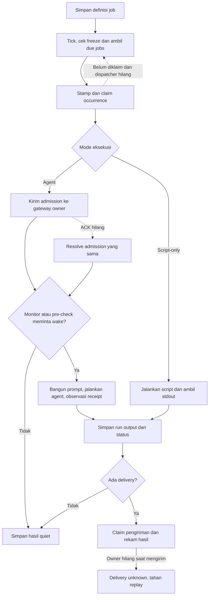

# Penjadwalan cron

Cron menyimpan job yang bisa berjalan berkali-kali ketika percakapan asal sedang tutup. Satu job mempunyai definisi, setiap fire mempunyai identitas eksekusi, dan publikasinya bisa memiliki ledger sendiri. Ini mendukung reminder, laporan berulang, serta monitor yang baru memakai model ketika temuan membutuhkan tindak lanjut. [Definisi](https://github.com/NousResearch/hermes-agent/blob/ae2a81ccc00e9b7c06301523e5bb09608397149c/cron/jobs.py#L1775-L1915) · [Eksekusi](https://github.com/NousResearch/hermes-agent/blob/ae2a81ccc00e9b7c06301523e5bb09608397149c/cron/executions.py#L248-L328) · [Delivery queue](https://github.com/NousResearch/hermes-agent/blob/ae2a81ccc00e9b7c06301523e5bb09608397149c/cron/delivery_queue.py#L89-L137).

## Definisi dan akses tool

- CLI, gateway, serta tools memakai definisi job yang sama. Nama tool yang dipresentasikan schema pin ini adalah `cronjob_manage`, dengan action `create`, `list`, `update`, `pause`, `resume`, `remove`, `run`, dan `cancel`. Run manual menerima prompt tambahan hanya untuk fire tersebut. Cancel mengendalikan run berjalan tanpa menghapus cadence. Definisi menerima prompt, named skills, script, model/provider, toolsets, workdir, context job, dan pilihan delivery. Pembuatan dapat atomik dalam keadaan paused. [Schema](https://github.com/NousResearch/hermes-agent/blob/ae2a81ccc00e9b7c06301523e5bb09608397149c/tools/cronjob_tools.py#L1063-L1148) · [Penyimpanan definisi](https://github.com/NousResearch/hermes-agent/blob/ae2a81ccc00e9b7c06301523e5bb09608397149c/cron/jobs.py#L1775-L1915).
- Parser menerima once (ISO atau `in 30m`), interval (`30m`), dan cron/calendar (ekspresi atau frasa seperti `every monday 9am`). Once default satu kali, repeat kosong pada jadwal periodik berarti berjalan terus. Timezone IANA per job dapat mematok jam lokal. Perhitungan durasi memakai waktu absolut saat melintasi DST. `grace_minutes` dan `catch_up` mengatur perlakuan slot yang tertinggal. Record job menyimpan `next_run_at`, status pekerjaan, jumlah selesai, error eksekusi, dan error delivery terpisah. [Parser dan waktu](https://github.com/NousResearch/hermes-agent/blob/ae2a81ccc00e9b7c06301523e5bb09608397149c/cron/jobs.py#L791-L914) · [Konfigurasi waktu](https://github.com/NousResearch/hermes-agent/blob/ae2a81ccc00e9b7c06301523e5bb09608397149c/cron/jobs.py#L1793-L1817) · [Record](https://github.com/NousResearch/hermes-agent/blob/ae2a81ccc00e9b7c06301523e5bb09608397149c/cron/jobs.py#L1863-L1915).
- Suggestion adalah record yang dapat diterima atau diabaikan, dengan source seperti catalog, blueprint, usage, atau integration. Menerima suggestion memanggil `create_job` yang sama. Kemunculan saran merupakan bukti kandidat otomatisasi, dan memerlukan acceptance sebelum menjadi job pada jalur ini. [Suggestion store dan acceptance](https://github.com/NousResearch/hermes-agent/blob/ae2a81ccc00e9b7c06301523e5bb09608397149c/cron/suggestions.py#L93-L192).

## Due, claim, dan settlement

Definisi default berada di `<HERMES_HOME>/cron/jobs.json` dan histori per-job di folder output. Profile override mengarahkan path yang berbeda sesuai scope. Interval ticker default 60 detik. Marker heartbeat dan keberhasilan tick memberi sinyal kesehatan ticker sendiri. Grace recurring default setengah cadence, dibatasi 120 detik hingga dua jam, dengan override per job. [Path dan ticker](https://github.com/NousResearch/hermes-agent/blob/ae2a81ccc00e9b7c06301523e5bb09608397149c/cron/jobs.py#L95-L139) · [Perhitungan grace](https://github.com/NousResearch/hermes-agent/blob/ae2a81ccc00e9b7c06301523e5bb09608397149c/cron/jobs.py#L951-L964).

Tick mengambil file lock, menghormati emergency stop dan drain, mencoba reconcile admission, memeriksa kesehatan store, membaca due jobs, dan mengirimnya ke pool. Headless tick di luar gateway menolak agent job, sedangkan script-only memiliki jalur sendiri. Untuk recurring, tick memajukan timestamp berikut sebelum dispatch agar proses yang mati di tengah pekerjaan tidak menembak terus saat restart. Due scan mencatat `pending_slot` untuk jendela setelah slot diambil dari jadwal tetapi belum memiliki fire claim. Slot bisa dipulihkan sekali menurut kebijakan keterlambatan normal, setelah owner hilang atau lease lewat. Manual fire memiliki identity sendiri agar jadwal berikutnya tetap berlaku. Claim dengan token per-acquisition mencegah runner lama menyelesaikan pekerjaan atas token yang baru. [Tick](https://github.com/NousResearch/hermes-agent/blob/ae2a81ccc00e9b7c06301523e5bb09608397149c/cron/scheduler_tick.py#L92-L204) · [Jendela pending](https://github.com/NousResearch/hermes-agent/blob/ae2a81ccc00e9b7c06301523e5bb09608397149c/cron/occurrences.py#L58-L103) · [Stamp](https://github.com/NousResearch/hermes-agent/blob/ae2a81ccc00e9b7c06301523e5bb09608397149c/cron/jobs.py#L3220-L3237) · [Reclaim slot](https://github.com/NousResearch/hermes-agent/blob/ae2a81ccc00e9b7c06301523e5bb09608397149c/cron/jobs.py#L3124-L3144) · [Fire claim dan manual](https://github.com/NousResearch/hermes-agent/blob/ae2a81ccc00e9b7c06301523e5bb09608397149c/cron/jobs.py#L2693-L2763).

Untuk agent job, `run_job` meminta gateway owner menerima run jika belum berada dalam scope eksekusi owner. `run_canonical_job` menulis journal berisi request/execution ID dan parameter, mengirim submit, menyimpan receipt, kemudian memantau progress, status, dan cancellation. Jika submit mungkin sudah commit meski ACK hilang, recovery mencari admission yang sama. Outcome yang tak bisa dipastikan diberi status unknown untuk rekonsiliasi. Ledger `executions` juga menyimpan occurrence, claim/run, dan terminal execution state. [Pemilihan jalur](https://github.com/NousResearch/hermes-agent/blob/ae2a81ccc00e9b7c06301523e5bb09608397149c/cron/scheduler.py#L2540-L2577) · [Canonical journal dan receipt](https://github.com/NousResearch/hermes-agent/blob/ae2a81ccc00e9b7c06301523e5bb09608397149c/cron/scheduler_authority.py#L55-L153) · [Execution recovery](https://github.com/NousResearch/hermes-agent/blob/ae2a81ccc00e9b7c06301523e5bb09608397149c/cron/executions.py#L410-L531).

## Konteks, kerja murah, dan delivery

Monitor menghitung SHA-256 atas output sumber yang diterima, menyimpan hash dan snapshot ketika perubahan terdeteksi, lalu memberi model diff terbatas dan observasi terbaru. Snapshot dimajukan sebelum turn agent. Akibatnya, ketika turn atau delivery berikutnya gagal, output identik pada tick berikutnya masih dapat dianggap tanpa perubahan. Kesetaraan hasil bisa memerlukan checkpoint terpisah antara observed, processed, dan published. [Hash dan batas](https://github.com/NousResearch/hermes-agent/blob/ae2a81ccc00e9b7c06301523e5bb09608397149c/cron/monitor.py#L23-L59) · [Persist sebelum inference](https://github.com/NousResearch/hermes-agent/blob/ae2a81ccc00e9b7c06301523e5bb09608397149c/cron/monitor.py#L155-L215) · [Cabang failure dan no-change](https://github.com/NousResearch/hermes-agent/blob/ae2a81ccc00e9b7c06301523e5bb09608397149c/cron/scheduler.py#L1560-L1595).

- Jalur `no_agent` berjalan sebelum konstruksi `AIAgent`. Pada agent job, monitor dapat menahan wake saat observasi belum berubah. Script pre-check dijalankan sekali. Jika berhasil dan baris stdout terakhir menyatakan `wakeAgent: false`, scheduler mencatat skip tanpa inference atau delivery. Output kosong dari pre-check sukses juga memberikan jalur skip saat perakitan prompt. [Persiapan dan skip](https://github.com/NousResearch/hermes-agent/blob/ae2a81ccc00e9b7c06301523e5bb09608397149c/cron/scheduler.py#L2236-L2288) · [Parser gate](https://github.com/NousResearch/hermes-agent/blob/ae2a81ccc00e9b7c06301523e5bb09608397149c/cron/scheduler_prompt.py#L21-L35) · [Output kosong](https://github.com/NousResearch/hermes-agent/blob/ae2a81ccc00e9b7c06301523e5bb09608397149c/cron/scheduler_prompt.py#L335-L351).
- Prompt per fire disusun dari hint dan waktu cron, instruksi persisten dan konteks run, skill yang dipilih, hasil script, output job yang dirujuk `context_from`, serta notepad per job. Skill dan runtime data tetap melewati jalur scan yang sesuai. Toolset efektif berasal dari konfigurasi cron dan per-job, dengan batas MCP tersendiri. Job biasa memperoleh konteks mandiri. Opsi attachment mengatur keterkaitan hasil ke route/sesi pengguna dan perlu dibedakan dari isi prompt agent. [Perakitan prompt](https://github.com/NousResearch/hermes-agent/blob/ae2a81ccc00e9b7c06301523e5bb09608397149c/cron/scheduler_prompt.py#L310-L391) · [Toolsets](https://github.com/NousResearch/hermes-agent/blob/ae2a81ccc00e9b7c06301523e5bb09608397149c/cron/scheduler.py#L419-L507) · [Panduan cron](https://github.com/NousResearch/hermes-agent/blob/ae2a81ccc00e9b7c06301523e5bb09608397149c/website/docs/user-guide/features/cron.md#L1-L77).
- Run menyimpan output terpisah dari pesan. Marker `[SILENT]` yang valid menahan pesan pada hasil sukses. Untuk agent fire dengan execution ID dan target outbound, queue delivery dipublikasikan di bawah fire fence. Status delivery memisahkan queueing, keberhasilan, penekanan, dan unknown. Recovery mengubah `delivering` menjadi `unknown` jika owner mati dan hasil kirim tidak sempat disimpan. [Simpan dan publish](https://github.com/NousResearch/hermes-agent/blob/ae2a81ccc00e9b7c06301523e5bb09608397149c/cron/scheduler.py#L3067-L3139) · [Delivery recovery](https://github.com/NousResearch/hermes-agent/blob/ae2a81ccc00e9b7c06301523e5bb09608397149c/cron/delivery_queue.py#L282-L325).

## Bukti eksekusi fixture

Hermes v0.23.2 pada Python 3.14.9 dan macOS ARM64, menggunakan home sementara. 83 lulus. Cakupan mencakup canonical admission, context dari job sebelumnya, catch-up, run manual, recovery setelah commit, pelepasan claim sekitar delivery, monitor dan jalur script-only. Klaim cakupan di sini terbatas pada fixture yang dijalankan. [test_cron_recovery.py](https://github.com/NousResearch/hermes-agent/blob/ae2a81ccc00e9b7c06301523e5bb09608397149c/tests/cron/test_cron_recovery.py) · [test_cron_context_from.py](https://github.com/NousResearch/hermes-agent/blob/ae2a81ccc00e9b7c06301523e5bb09608397149c/tests/cron/test_cron_context_from.py) · [test_canonical_cron.py](https://github.com/NousResearch/hermes-agent/blob/ae2a81ccc00e9b7c06301523e5bb09608397149c/tests/cron/test_canonical_cron.py) · [test_catchup_policy.py](https://github.com/NousResearch/hermes-agent/blob/ae2a81ccc00e9b7c06301523e5bb09608397149c/tests/cron/test_catchup_policy.py) · [test_manual_run_extra_fire.py](https://github.com/NousResearch/hermes-agent/blob/ae2a81ccc00e9b7c06301523e5bb09608397149c/tests/cron/test_manual_run_extra_fire.py) · [test_cron_recover_after_commit.py](https://github.com/NousResearch/hermes-agent/blob/ae2a81ccc00e9b7c06301523e5bb09608397149c/tests/cron/test_cron_recover_after_commit.py) · [test_fire_claim_lost_after_delivery.py](https://github.com/NousResearch/hermes-agent/blob/ae2a81ccc00e9b7c06301523e5bb09608397149c/tests/cron/test_fire_claim_lost_after_delivery.py) · [test_monitor_kind.py](https://github.com/NousResearch/hermes-agent/blob/ae2a81ccc00e9b7c06301523e5bb09608397149c/tests/cron/test_monitor_kind.py) · [test_cron_no_agent.py](https://github.com/NousResearch/hermes-agent/blob/ae2a81ccc00e9b7c06301523e5bb09608397149c/tests/cron/test_cron_no_agent.py).

## Pemetaan ke Ngertiin

Routine dan `Lifecycle.fireRoutine` sudah menyediakan jadwal, occurrence identity, mutu admission transaksional, scope dan coalescing. Quiet result sudah memiliki kontrak tool tersendiri. Tambahan yang paling berpengaruh pada perilaku adalah pre-check terstruktur yang murah, checkpoint per Routine, dan diagnosis yang membedakan due, skipped dengan alasan, inference, settlement, serta publication. Perluasan jadwal dapat memakai kontrak yang sudah ada untuk timezone/calendar dan menambah jenis ekspresi hanya jika use case memerlukannya. Jalankan pengecekan dasar dalam tool/connector resmi dengan grant lingkungan yang tepat. Ketika perlu interpretasi, dispatch ke harness yang ditentukan melalui admission yang sama. [Routine contract](../../apps/server/src/goals/contracts.ts#L24-L41) · [Coalescing](../../apps/server/src/goals/schedule.ts#L64-L90) · [Admission](../../apps/server/src/lifecycle.ts#L827-L907) · [Quiet tool](../../apps/server/src/goals/service.ts#L449-L464).

Skenario pembanding adalah ringkasan data mingguan dan pemeriksaan perubahan setiap jam. Periksa timezone, run manual yang mempertahankan slot berikutnya, reboot sebelum dan sesudah claim, perubahan sumber yang membuka wake, dan data tetap yang menyelesaikan occurrence tanpa inference. Pada skenario delivery, hilangkan ACK setelah pengiriman lalu periksa bahwa sistem mempertahankan hasil unknown dan menawarkan penyelesaian melalui bukti pengiriman. Cocokkan jumlah inference, update berguna, occurrence ganda, dan pelanggaran ketepatan waktu.

## Bukti Hermes Desktop macOS

Dari Scheduled jobs, Cron dibuat untuk 09.00 dengan tujuan **This desktop**. Klik **Trigger now** menghasilkan satu run history yang bisa dibuka sebagai sesi Cron, dengan output lokal. Form memuat model dan pilihan missed runs. Bukti mencakup manual trigger. Fire kalender, catch-up dan delivery eksternal belum dipicu. [DT-05](desktop-runtime.md#jadwal-history-dan-konfigurasi-capability).
