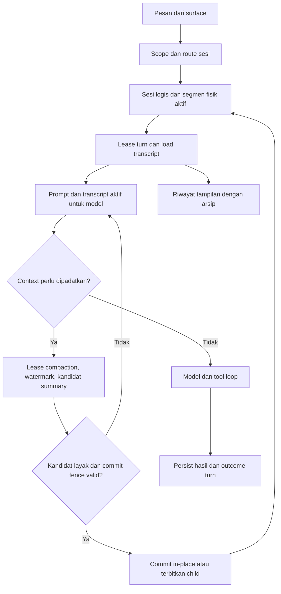

# Sesi, prompt, dan compaction

Sesi Hermes menjaga kelanjutan konteks ketika aplikasi ditutup, viewer berganti, atau transcript menjadi terlalu besar untuk model. Gateway menyelesaikan route ke sesi miliknya, DB menyimpan pesan dan lineage, sedangkan context engine menentukan bagian yang dikirim ke model. Reset pengguna dan compaction punya dampak berbeda terhadap konteks dan identitas. [Route dan single-flight](https://github.com/NousResearch/hermes-agent/blob/ae2a81ccc00e9b7c06301523e5bb09608397149c/gateway/session.py#L942-L1038), [schema](https://github.com/NousResearch/hermes-agent/blob/ae2a81ccc00e9b7c06301523e5bb09608397149c/hermes_state_common.py#L463-L580), [context engine](https://github.com/NousResearch/hermes-agent/blob/ae2a81ccc00e9b7c06301523e5bb09608397149c/agent/agent_init.py#L1751-L1782).

## Identitas, route, dan proses pemulihan

| Identitas | Fungsi |
| --- | --- |
| Profil | Menentukan home aktif, konfigurasi, prompt identitas, memory, skills, dan DB yang dibuka. Source transport bisa membawa asal berbeda dari profil eksekusi. |
| `session_key` | Route deterministik gateway berdasarkan namespace profil, platform dan jenis chat, lalu scope, chat, thread, atau participant sesuai aturan platform. DM memakai chat ID dan fallback sender. Grup non-thread biasanya per participant, thread biasanya bersama. |
| Sesi logis dan fisik | Surface dapat memegang ID logis, sementara penyimpanan mengarah ke segmen fisik terbaru. `parent_session_id` dan `end_reason` membedakan kelanjutan compaction dari batas reset atau fork. Compaction in-place memakai ID yang sama. |
| Lease turn | Kepemilikan penulis lintas proses pada root lineage compaction. Segment lama dan baru berbagi fence ketika masih satu kelanjutan. Reset eksplisit atau fork memutus walk lease. |

[Identitas route](https://github.com/NousResearch/hermes-agent/blob/ae2a81ccc00e9b7c06301523e5bb09608397149c/gateway/session_identity.py#L44-L89), [pembentukan key](https://github.com/NousResearch/hermes-agent/blob/ae2a81ccc00e9b7c06301523e5bb09608397149c/gateway/session.py#L701-L768), [alias logical ID dari ACP](https://github.com/NousResearch/hermes-agent/blob/ae2a81ccc00e9b7c06301523e5bb09608397149c/acp_adapter/gateway_server.py#L350-L357), [lineage lease](https://github.com/NousResearch/hermes-agent/blob/ae2a81ccc00e9b7c06301523e5bb09608397149c/hermes_state_compression.py#L687-L744).

`SessionStore.get_or_create_session` menyatukan panggilan tumpang tindih per route dalam proses. Implementasinya mengambil snapshot route, memeriksa tip compaction dan keadaan stale, memvalidasi kembali snapshot sebelum mengubah map, lalu menyimpan dan mengumumkan perpindahan. `state.db.gateway_routing` adalah index utama, dengan `sessions.json` sebagai import dan mirror/fallback. Penulisan index melindungi generasi yang lebih baru dari penulisan snapshot yang terlambat. [Single-flight dan route healing](https://github.com/NousResearch/hermes-agent/blob/ae2a81ccc00e9b7c06301523e5bb09608397149c/gateway/session.py#L942-L1095), [load dan import mirror](https://github.com/NousResearch/hermes-agent/blob/ae2a81ccc00e9b7c06301523e5bb09608397149c/gateway/session_persistence.py#L316-L376), [generasi penyimpanan](https://github.com/NousResearch/hermes-agent/blob/ae2a81ccc00e9b7c06301523e5bb09608397149c/gateway/session_persistence.py#L584-L624).

Route lokal atau API yang terikat receipt memiliki jalur reopen yang menjaga sesi milik pemanggil. Pada jalur lokal, memasang viewer melalui `session.resume` membaca sesi tanpa mengubah `ended_at`; reopen terjadi saat turn diterima. Route biasa yang menunjuk baris hilang, selesai, atau milik delegate diperiksa untuk recovery. `_route_reset_reason` pada pin ini hanya memeriksa suspension eksplisit. Jalan `reset_session` membuat ID baru dengan hubungan ke ID sebelumnya dan menutup predecessor sebagai `session_reset`. Idle dapat mengubah status penyimpanan atau cache, sedangkan akses pesan yang hanya kebetulan terlambat tidak memicu reset berbasis jam. [Receipt dan alasan reset](https://github.com/NousResearch/hermes-agent/blob/ae2a81ccc00e9b7c06301523e5bb09608397149c/gateway/session_lifecycle.py#L80-L169), [mount vs reopen](https://github.com/NousResearch/hermes-agent/blob/ae2a81ccc00e9b7c06301523e5bb09608397149c/gateway/session_local_recovery.py#L386-L406), [reset eksplisit](https://github.com/NousResearch/hermes-agent/blob/ae2a81ccc00e9b7c06301523e5bb09608397149c/gateway/session.py#L1206-L1236).

`SessionDB.try_acquire_session_turn_lease` menyelesaikan root, merebut lease kedaluwarsa atau PID lokal yang mati, dan menulis holder dalam transaksi yang sama. Write transcript yang membawa holder juga memeriksa holder saat transaksi. Holder lama yang sudah disalip tidak bisa flush hasil. Lock compaction terpisah untuk serialisasi antarkompresi. Ordinary append saat summary berjalan dipertahankan lewat watermark. Write destruktif dapat meminta kedua lease diperiksa. [Acquisition](https://github.com/NousResearch/hermes-agent/blob/ae2a81ccc00e9b7c06301523e5bb09608397149c/hermes_state_compression.py#L721-L744), [guard write transcript](https://github.com/NousResearch/hermes-agent/blob/ae2a81ccc00e9b7c06301523e5bb09608397149c/hermes_state_messages.py#L214-L269).

### Satu penyimpanan, proyeksi riwayat berbeda

`<HERMES_HOME>/state.db` menyimpan sesi dengan asal, model, prompt, folder kerja, lineage, usage, dan revisi. Pesan menyimpan role, timestamp, identitas, pasangan tool, disposition, dan data native untuk replay. Prompt sistem dapat disimpan berdasarkan hash di `system_prompts`. Koneksi writer memakai pengaturan database yang memilih WAL dengan fallback. [DB path](https://github.com/NousResearch/hermes-agent/blob/ae2a81ccc00e9b7c06301523e5bb09608397149c/hermes_state.py#L184-L207), [schema](https://github.com/NousResearch/hermes-agent/blob/ae2a81ccc00e9b7c06301523e5bb09608397149c/hermes_state_common.py#L463-L580), [cache prompt pada DB](https://github.com/NousResearch/hermes-agent/blob/ae2a81ccc00e9b7c06301523e5bb09608397149c/hermes_state.py#L528-L547), [pembukaan writer](https://github.com/NousResearch/hermes-agent/blob/ae2a81ccc00e9b7c06301523e5bb09608397149c/hermes_state.py#L809-L833).

`get_messages_as_conversation` memisahkan replay aktif dan tampilan arsip. Mode tampilan mendeduplikasi generasi pesan dari arsip dan ancestry sebelum memproyeksikannya. Mode live dapat memperbaiki alternation `user;user` pada salinan yang dibaca. Baris hasil restore mendapat marker durabilitas, `message_uid`, dan untuk jalur tertentu snapshot CAS, agar flush berikutnya tidak mengulang seluruh transcript. Kolom `api_content` menjaga bytes tambahan yang dikirim ke provider dan berbeda dari pesan tampilan. [Mode baca](https://github.com/NousResearch/hermes-agent/blob/ae2a81ccc00e9b7c06301523e5bb09608397149c/hermes_state_messages.py#L1522-L1539), [identitas dan data replay](https://github.com/NousResearch/hermes-agent/blob/ae2a81ccc00e9b7c06301523e5bb09608397149c/hermes_state_messages.py#L1577-L1626), [recall lintas sesi](memory.md).

### ACP sebagai surface Hermes

Entry ACP normal membuat `HermesACPAgent()` tanpa session manager, sehingga konstruktor memilih `GatewayACPAgent`. `load_session` dan `resume_session` menuju RPC `session.resume` pada gateway pemilik, mengadopsi snapshot dan mereplay pesan live dengan alias ID editor. Editor MCP atau pindah workspace melewati mutasi gateway untuk sesi yang memenuhi syarat. Konstruktor dengan session manager eksplisit memakai jalur adapter tertanam yang dapat membuat ulang AIAgent dari row berjenis `acp` dan history. Perbedaan pemilik ini penting saat menilai arti `resume` dan `cancel`. [Entrypoint](https://github.com/NousResearch/hermes-agent/blob/ae2a81ccc00e9b7c06301523e5bb09608397149c/acp_adapter/entry.py#L195-L226), [pemilihan konstruktor](https://github.com/NousResearch/hermes-agent/blob/ae2a81ccc00e9b7c06301523e5bb09608397149c/acp_adapter/server.py#L284-L302), [RPC load dan resume](https://github.com/NousResearch/hermes-agent/blob/ae2a81ccc00e9b7c06301523e5bb09608397149c/acp_adapter/gateway_server.py#L350-L425), [restore tertanam](https://github.com/NousResearch/hermes-agent/blob/ae2a81ccc00e9b7c06301523e5bb09608397149c/acp_adapter/session.py#L473-L517), [pemetaan ACP](acp.md).

## Prompt, kepribadian dan cache

| Tier | Isi yang dirakit |
| --- | --- |
| `stable` | Identitas dari `SOUL.md` di home profil agen atau identitas bawaan, pengarahan dasar, bagian coding yang stabil, dan skills yang dipatok untuk auto-load. |
| `context` | Pesan sistem pemanggil, instruksi proyek, dan snapshot workspace. Pemilihan instruksi proyek mengambil keluarga pertama yang tersedia, yaitu `HERMES.md` atau `.hermes.md`, rantai `AGENTS.md`, `CLAUDE.md`, lalu aturan Cursor. Dalam rantai `AGENTS.md`, setiap direktori mengutamakan `AGENTS.override.md`. |
| `volatile` | Indeks skill, snapshot memory, provider memory, bagian plugin, profil, timestamp, dan runtime hints. `ephemeral_system_prompt` masuk saat request dan tidak menjadi bagian snapshot ini. |

[Identitas dan workspace](https://github.com/NousResearch/hermes-agent/blob/ae2a81ccc00e9b7c06301523e5bb09608397149c/agent/system_prompt.py#L563-L569), [loader SOUL](https://github.com/NousResearch/hermes-agent/blob/ae2a81ccc00e9b7c06301523e5bb09608397149c/agent/prompt_builder.py#L1520-L1559), [rantai project context](https://github.com/NousResearch/hermes-agent/blob/ae2a81ccc00e9b7c06301523e5bb09608397149c/agent/prompt_builder.py#L1621-L1649), [precedence](https://github.com/NousResearch/hermes-agent/blob/ae2a81ccc00e9b7c06301523e5bb09608397149c/agent/prompt_builder.py#L1754-L1785), [tier lengkap](https://github.com/NousResearch/hermes-agent/blob/ae2a81ccc00e9b7c06301523e5bb09608397149c/agent/system_prompt.py#L751-L826).

Urutan stabil ke volatil memaksimalkan prefix yang bisa dipakai kembali. Restore dapat memakai bytes prompt yang disimpan dan hanya mengembalikan pemisah cache bila bagian stable hasil rebuild benar-benar merupakan prefix. Compaction normal menyegarkan schema tool dan prompt pada batas commit, lalu memory dan plugin dimuat kembali. Kompresi terlepas dengan scope tool dikurangi dapat mempertahankan prompt lama agar snapshot sesi utama tidak terganti konfigurasi sementara. [Validasi restore](https://github.com/NousResearch/hermes-agent/blob/ae2a81ccc00e9b7c06301523e5bb09608397149c/agent/system_prompt.py#L829-L876), [rebuild dan jalur pengecualian](https://github.com/NousResearch/hermes-agent/blob/ae2a81ccc00e9b7c06301523e5bb09608397149c/agent/conversation_compression.py#L3048-L3085).

## Compaction

1. Jalur otomatis menilai tekanan token sebelum request atau sesudah tool call. Default rasio 0,50, dengan floor kenaikan menjadi 0,75 pada model ber-window di bawah 512K dan penyesuaian model/provider. Konfigurasi dapat memberi batas token absolut, maksimum percobaan default tiga, dan checkpoint opsional. Data usage provider diprioritaskan saat tersedia. `/compress` paksa memiliki jalur cooldown tersendiri. [Default](https://github.com/NousResearch/hermes-agent/blob/ae2a81ccc00e9b7c06301523e5bb09608397149c/hermes_cli/config_defaults.py#L564-L608), [preflight](https://github.com/NousResearch/hermes-agent/blob/ae2a81ccc00e9b7c06301523e5bb09608397149c/agent/turn_preflight.py#L57-L118), [tekanan pasca-tool](https://github.com/NousResearch/hermes-agent/blob/ae2a81ccc00e9b7c06301523e5bb09608397149c/agent/turn_preflight.py#L245-L296).
2. `compress_context` mengambil lease dan snapshot, lalu built-in `ContextCompressor.compress` memilih bagian lama yang layak diringkas. Default tail mode `lean` menargetkan 2,5% context window dengan floor 10K dan cap 25K sebelum aturan pelestarian, serta menahan pesan user terbaru dan batas pasangan tool. Bentuk konteks baru menggabungkan handoff summary dan tail yang masih diperlukan. Ringkasan bisa berasal dari auxiliary model, hasil yang sudah dipersiapkan, atau fallback deterministik ketika jalur konfigurasi mengizinkan. [Lease dan snapshot](https://github.com/NousResearch/hermes-agent/blob/ae2a81ccc00e9b7c06301523e5bb09608397149c/agent/conversation_compression.py#L4010-L4061), [tail](https://github.com/NousResearch/hermes-agent/blob/ae2a81ccc00e9b7c06301523e5bb09608397149c/agent/context_compressor.py#L4796-L4848), [algoritme summary](https://github.com/NousResearch/hermes-agent/blob/ae2a81ccc00e9b7c06301523e5bb09608397149c/agent/context_compressor.py#L5245-L5360).
3. Kandidat yang tidak maju atau dibatalkan sebelum commit mengembalikan konteks sebelumnya. Default `in_place=True` memasukkan summary baru dan menandai baris yang dipadatkan sebagai arsip, dengan watermark dan coverage untuk menjaga append yang masuk ketika summary sedang dihitung. Tail yang disalin diperlakukan sebagai generasi yang diusung agar tidak muncul ganda pada tampilan dan recall. Jalur rotasi legacy menutup parent, menerbitkan child, menyimpan handoff, dan memindah route lokal dalam satu transaksi. [Fence sebelum commit](https://github.com/NousResearch/hermes-agent/blob/ae2a81ccc00e9b7c06301523e5bb09608397149c/agent/conversation_compression.py#L4086-L4136), [commit in-place](https://github.com/NousResearch/hermes-agent/blob/ae2a81ccc00e9b7c06301523e5bb09608397149c/agent/conversation_compression.py#L3539-L3639), [publish child dan watermark](https://github.com/NousResearch/hermes-agent/blob/ae2a81ccc00e9b7c06301523e5bb09608397149c/hermes_state_compression.py#L375-L486).
4. Pada mode `codex_app_server`, Codex memegang thread model. Hermes menyerahkan kompresi lewat jalur native, dengan mode otomatis default `native`. Jika konfigurasi mewajibkan checkpoint transcript pra-kompresi yang backend itu tidak dapat buktikan, operasi berhenti dengan error checkpoint. Ini contoh batas yang juga relevan saat memetakan Hermes ke banyak harness ACP. [Default provider-native](https://github.com/NousResearch/hermes-agent/blob/ae2a81ccc00e9b7c06301523e5bb09608397149c/hermes_cli/config_defaults.py#L658-L672), [dispatch dan checkpoint](https://github.com/NousResearch/hermes-agent/blob/ae2a81ccc00e9b7c06301523e5bb09608397149c/agent/conversation_compression.py#L3992-L4009).

## Penerapan ke Ngertiin

Ngertiin sudah memiliki binding `thread_id` dan `agent_id` dengan ID native, generasi koneksi, akun, dan revisi agent/workspace. Binding yang memiliki run belum settled menahan pergantian. `AcpSession.open` memisahkan `session/load` dan `session/new`, menegosiasikan kemampuan load, dan menerima replay sebelum prompt aktif agar replay tidak menerbitkan efek. Proyeksi ACP juga sudah mengolah event compaction dengan summary yang dibatasi dan direduksi. Recovery menginspeksi run unknown dengan bukti binding/ID native serta backoff. [Binding](../../apps/server/src/lifecycle.ts#L568), [session ACP](../../apps/server/src/harness/acp/session.ts#L113), [proyeksi compaction](../../apps/server/src/harness/acp/projection.ts#L95), [RunRecovery](../../apps/server/src/harness/recovery.ts#L75).

Pertahankan aturan satu otoritas dengan memetakan ID percakapan stabil, binding generation, dan pergantian konteks ke event privat. Biarkan masing-masing harness melakukan kompresi native. Ketika binding diganti, `historyContext` sudah menyiapkan riwayat percakapan publik yang dibatasi 40.000 karakter serialisasi pada jalur perubahan konteks yang dicakupnya. Tambahkan checkpoint handoff app-owned yang merujuk pesan pengguna, status Goal/Task, file, keputusan, dan outcome yang berizin jika jumlah pesan terbatas menghilangkan detail penting. Checkpoint itu menjadi input pembuka sesi pengganti melalui mekanisme yang dinegosiasikan per harness. Gunakan `prepareLearningContext` untuk fakta baru dan tombstone, dengan prefix stabil yang bisa dimanfaatkan jika protokol mendukung. [History replacement](../../apps/server/src/harness/instructions.ts#L99), [konteks run](../../apps/server/src/harness/instructions.ts#L48), [kontrak ownership](../architecture/acp-harnesses.md).

| Uji kesetaraan | Hasil teramati yang dicari |
| --- | --- |
| Tutup UI, restart server, dan lanjutkan percakapan yang sama | Satu binding valid dimuat kembali. Pesan dan hasil tool yang sudah terbit tetap tunggal; agent menemukan keputusan sebelumnya. |
| Model setengah jalan lalu compaction pada riwayat panjang | Tujuan terbaru, keputusan, dan pasangan tool yang diperlukan bertahan. Riwayat lama tetap bisa dicari lewat jalur yang berizin. |
| Interrupt saat compaction dan append bersamaan saat summary berlangsung | Pagar commit menolak hasil yang datang setelah percobaan dibatalkan sebelum commit. Append yang diotorisasi bertahan dengan posisi kronologis dan tanpa duplikasi. |
| Load gagal pada harness tertentu atau workspace/agent diganti | Status pemulihan mencerminkan bukti native. Sesi pengganti memakai handoff yang sah dan tidak merutekan ulang efek yang sudah settle. |
| Ubah preferensi lalu resume | Revisi baru sampai ke model pada batas yang didefinisikan tiap profile. Material yang terhapus tidak berasal ulang dari snapshot lama. |

Fixture upstream [system prompt restore](https://github.com/NousResearch/hermes-agent/blob/ae2a81ccc00e9b7c06301523e5bb09608397149c/tests/agent/test_system_prompt_restore.py), [compression lineage guard](https://github.com/NousResearch/hermes-agent/blob/ae2a81ccc00e9b7c06301523e5bb09608397149c/tests/hermes_state/test_compression_lineage_guard.py), dan [session turn lease](https://github.com/NousResearch/hermes-agent/blob/ae2a81ccc00e9b7c06301523e5bb09608397149c/tests/hermes_state/test_session_turn_lease.py) lulus dalam batch 222 tes terisolasi pada pin. Bukti ini mencakup fixture prompt dan transaksi, dengan kualitas summary, model replay, dan perilaku semua surface tetap memerlukan pengamatan end-to-end.

Batch tambahan berisi 67 tes lulus, termasuk [watermark commit](https://github.com/NousResearch/hermes-agent/blob/ae2a81ccc00e9b7c06301523e5bb09608397149c/tests/hermes_state/test_compression_watermark_commit.py) dan [kontinuitas summary](https://github.com/NousResearch/hermes-agent/blob/ae2a81ccc00e9b7c06301523e5bb09608397149c/tests/agent/test_context_compressor_summary_continuity.py).

## Bukti Hermes Desktop macOS

Setelah restart app terpaket dan gateway fixture, history memuat kembali jawaban 584 dan ringkasan `Loaded skill`. Pengaturan Context & compression menyediakan context engine, Auto-Compression, threshold, target, serta timeout model. Probe mengonfirmasi replay dan permukaan konfigurasi. Compaction aktual belum dipicu. [DT-08](desktop-runtime.md#restart-loop-browser-dan-artifact).
