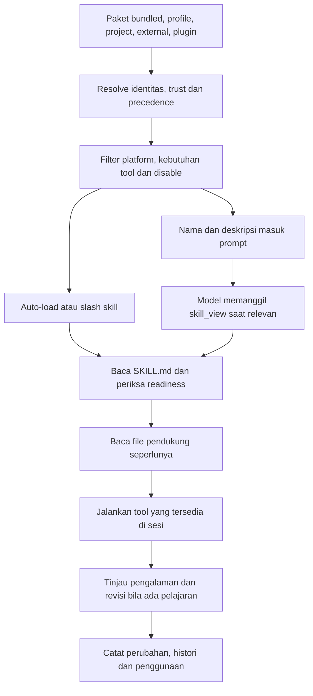

# Skills dan pembelajaran prosedur

Hermes memperlakukan skill sebagai paket instruksi yang dapat dibaca, dipakai ulang, dan direvisi. Nama serta deskripsi masuk ke indeks prompt. Model memuat isi dan lampiran ketika relevan. Skill dapat mendeskripsikan dependensi atau kebutuhan akses, sedangkan izin tindakan tetap ditentukan oleh runtime tool. [Indeks prompt](https://github.com/NousResearch/hermes-agent/blob/ae2a81ccc00e9b7c06301523e5bb09608397149c/agent/prompt_builder.py#L1303-L1367), [jalur aktivasi](https://github.com/NousResearch/hermes-agent/blob/ae2a81ccc00e9b7c06301523e5bb09608397149c/tools/skills_tool.py#L634-L736).

## Paket bawaan yang benar-benar di-seed

Probe release dengan `HERMES_HOME` kosong mengembalikan **44 bundled**, seluruhnya disalin pada sinkronisasi pertama. Angka ini menghitung paket dengan `SKILL.md` yang lolos enumerator, sebelum filter sesi. Direktori cache, arsip, dan `SKILL.md` di bawah file pendukung paket dikecualikan. Profil opt-out hanya men-seed `hermes-agent` dari kategori `autonomous-ai-agents`. [Algoritme enumerasi](https://github.com/NousResearch/hermes-agent/blob/ae2a81ccc00e9b7c06301523e5bb09608397149c/tools/skills_sync.py#L172-L184), [exclusions](https://github.com/NousResearch/hermes-agent/blob/ae2a81ccc00e9b7c06301523e5bb09608397149c/agent/skill_utils.py#L26-L56), [essential](https://github.com/NousResearch/hermes-agent/blob/ae2a81ccc00e9b7c06301523e5bb09608397149c/agent/skill_utils.py#L278-L293), [seeding](https://github.com/NousResearch/hermes-agent/blob/ae2a81ccc00e9b7c06301523e5bb09608397149c/tools/skills_sync.py#L398-L453).

| Kategori | Nama paket |
| --- | --- |
| [Apple](https://github.com/NousResearch/hermes-agent/tree/ae2a81ccc00e9b7c06301523e5bb09608397149c/skills/apple) | `apple-notes`, `apple-reminders`, `findmy`, `imessage` |
| [Autonomous AI agents](https://github.com/NousResearch/hermes-agent/tree/ae2a81ccc00e9b7c06301523e5bb09608397149c/skills/autonomous-ai-agents) | `claude-code`, `codex`, `computer-use`, `hermes-agent` |
| [Creative](https://github.com/NousResearch/hermes-agent/tree/ae2a81ccc00e9b7c06301523e5bb09608397149c/skills/creative) | `architecture-diagram`, `ascii-video`, `baoyu-infographic`, `claude-design`, `humanizer`, `manim-video`, `p5js`, `popular-web-designs`, `songwriting-and-ai-music` |
| [DevOps](https://github.com/NousResearch/hermes-agent/tree/ae2a81ccc00e9b7c06301523e5bb09608397149c/skills/devops) | `sdlc-review` |
| [Email](https://github.com/NousResearch/hermes-agent/tree/ae2a81ccc00e9b7c06301523e5bb09608397149c/skills/email) | `email-inbox-triage`, `himalaya` |
| [Media](https://github.com/NousResearch/hermes-agent/tree/ae2a81ccc00e9b7c06301523e5bb09608397149c/skills/media) | `youtube-content` |
| [Note taking](https://github.com/NousResearch/hermes-agent/tree/ae2a81ccc00e9b7c06301523e5bb09608397149c/skills/note-taking) | `obsidian` |
| [Productivity](https://github.com/NousResearch/hermes-agent/tree/ae2a81ccc00e9b7c06301523e5bb09608397149c/skills/productivity) | `document-to-action-items`, `google-workspace`, `maps`, `meeting-action-items`, `microsoft-office`, `pdf`, `product-price-monitor`, `teams-meeting-pipeline`, `weekly-review-planning` |
| [Research](https://github.com/NousResearch/hermes-agent/tree/ae2a81ccc00e9b7c06301523e5bb09608397149c/skills/research) | `arxiv`, `competitor-news-monitor`, `grounded-citations` |
| [Social media](https://github.com/NousResearch/hermes-agent/tree/ae2a81ccc00e9b7c06301523e5bb09608397149c/skills/social-media) | `xurl` |
| [Software development](https://github.com/NousResearch/hermes-agent/tree/ae2a81ccc00e9b7c06301523e5bb09608397149c/skills/software-development) | `codebase-inspection`, `dogfood`, `github`, `requesting-code-review`, `simplify-code`, `spike`, `systematic-debugging`, `test-driven-development` |
| [Web](https://github.com/NousResearch/hermes-agent/tree/ae2a81ccc00e9b7c06301523e5bb09608397149c/skills/web) | `blocked-page-recovery` |

Sync memakai `.bundled_manifest` dan hash paket. Paket yang belum ditawarkan disalin jika nama tersebut tersedia. Paket pristine yang berubah di upstream diperbarui. Revisi lokal, penghapusan yang tercatat, dan suppression Curator dipertahankan. Sync memiliki jalur recovery untuk direktori yang dipindah atau backup penggantian yang tertinggal. Collision dengan salinan external dapat mengalihkan pemakaian ke salinan itu. [Penanganan file lokal](https://github.com/NousResearch/hermes-agent/blob/ae2a81ccc00e9b7c06301523e5bb09608397149c/tools/skills_sync.py#L285-L382), [iterasi manifest](https://github.com/NousResearch/hermes-agent/blob/ae2a81ccc00e9b7c06301523e5bb09608397149c/tools/skills_sync.py#L398-L453).

## Katalog optional resmi

Enumerator upstream menghasilkan **141 paket optional**. Ini adalah inventaris path release yang dapat ditawarkan melalui katalog. Profil kosong memerlukan instalasi paket yang dipilih sebelum indeks sesi mencantumkannya. Sumber plugin, proyek, direktori eksternal, registry komunitas, dan skill buatan agent menambah katalog sesuai konfigurasi. [Tree optional](https://github.com/NousResearch/hermes-agent/tree/ae2a81ccc00e9b7c06301523e5bb09608397149c/optional-skills), [enumerator optional](https://github.com/NousResearch/hermes-agent/blob/ae2a81ccc00e9b7c06301523e5bb09608397149c/tools/skills_sync_optional.py#L91-L113), [entry hub](https://github.com/NousResearch/hermes-agent/blob/ae2a81ccc00e9b7c06301523e5bb09608397149c/hermes_cli/skills_hub.py#L88-L92).

| Kategori | Nama paket |
| --- | --- |
| [autonomous-ai-agents](https://github.com/NousResearch/hermes-agent/tree/ae2a81ccc00e9b7c06301523e5bb09608397149c/optional-skills/autonomous-ai-agents) | `agent-merge-conflict-arbiter`, `antigravity-cli`, `blackbox`, `dynamic-workflow`, `grok`, `opencode`, `openhands` |
| [blockchain](https://github.com/NousResearch/hermes-agent/tree/ae2a81ccc00e9b7c06301523e5bb09608397149c/optional-skills/blockchain) | `evm`, `hyperliquid`, `solana` |
| [communication](https://github.com/NousResearch/hermes-agent/tree/ae2a81ccc00e9b7c06301523e5bb09608397149c/optional-skills/communication) | `one-three-one-rule` |
| [creative](https://github.com/NousResearch/hermes-agent/tree/ae2a81ccc00e9b7c06301523e5bb09608397149c/optional-skills/creative) | `ai-presenter-video`, `anatomy`, `archify`, `ascii-art`, `auteur`, `baoyu-article-illustrator`, `baoyu-comic`, `brag`, `brag-slim`, `comfyui`, `concept-diagrams`, `creative-ideation`, `design-md`, `draw-your-font`, `dream-loop`, `excalidraw`, `heartmula`, `hyperframes`, `impeccable`, `ip-as-logo`, `kanban-video-orchestrator`, `meme-generation`, `mono-color`, `pixel-art`, `pretext`, `simple-english`, `sketch`, `social-media-content-calendar`, `system-atlas`, `tldraw-offline`, `unreal-mcp` |
| [data-science](https://github.com/NousResearch/hermes-agent/tree/ae2a81ccc00e9b7c06301523e5bb09608397149c/optional-skills/data-science) | `jupyter-notebook` |
| [devops](https://github.com/NousResearch/hermes-agent/tree/ae2a81ccc00e9b7c06301523e5bb09608397149c/optional-skills/devops) | `actual-setup`, `docker-management`, `hermes-s6-container-supervision`, `inference-sh-cli`, `pinggy-tunnel`, `setup-wizard-generator`, `watchers` |
| [dogfood](https://github.com/NousResearch/hermes-agent/tree/ae2a81ccc00e9b7c06301523e5bb09608397149c/optional-skills/dogfood) | `adversarial-ux-test` |
| [email](https://github.com/NousResearch/hermes-agent/tree/ae2a81ccc00e9b7c06301523e5bb09608397149c/optional-skills/email) | `agentmail` |
| [finance](https://github.com/NousResearch/hermes-agent/tree/ae2a81ccc00e9b7c06301523e5bb09608397149c/optional-skills/finance) | `3-statement-model`, `comps-analysis`, `dcf-model`, `excel-author`, `lbo-model`, `merger-model`, `polymarket`, `pptx-author`, `stocks` |
| [gaming](https://github.com/NousResearch/hermes-agent/tree/ae2a81ccc00e9b7c06301523e5bb09608397149c/optional-skills/gaming) | `minecraft-modpack-server`, `pokemon-player` |
| [health](https://github.com/NousResearch/hermes-agent/tree/ae2a81ccc00e9b7c06301523e5bb09608397149c/optional-skills/health) | `fitness-nutrition`, `neuroskill-bci` |
| [mcp](https://github.com/NousResearch/hermes-agent/tree/ae2a81ccc00e9b7c06301523e5bb09608397149c/optional-skills/mcp) | `fastmcp`, `mcp-oauth-remote-gateway`, `mcporter` |
| [media](https://github.com/NousResearch/hermes-agent/tree/ae2a81ccc00e9b7c06301523e5bb09608397149c/optional-skills/media) | `gif-search`, `songsee` |
| [mlops](https://github.com/NousResearch/hermes-agent/tree/ae2a81ccc00e9b7c06301523e5bb09608397149c/optional-skills/mlops) | `accelerate`, `axolotl`, `chroma`, `dspy`, `evaluating-llms-harness`, `faiss`, `flash-attention`, `lambda-labs`, `llama-cpp`, `modal`, `nemo-curator`, `obliteratus`, `peft`, `pytorch-fsdp`, `pytorch-lightning`, `saelens`, `segment-anything-model`, `serving-llms-vllm`, `simpo`, `slime`, `tensorrt-llm`, `torchtitan`, `unsloth` |
| [payments](https://github.com/NousResearch/hermes-agent/tree/ae2a81ccc00e9b7c06301523e5bb09608397149c/optional-skills/payments) | `stripe-link-cli`, `stripe-projects` |
| [productivity](https://github.com/NousResearch/hermes-agent/tree/ae2a81ccc00e9b7c06301523e5bb09608397149c/optional-skills/productivity) | `box`, `canvas`, `decision-questionnaire`, `here-now`, `live-dashboard`, `memento-flashcards`, `property-listings`, `shop`, `siyuan`, `telephony` |
| [research](https://github.com/NousResearch/hermes-agent/tree/ae2a81ccc00e9b7c06301523e5bb09608397149c/optional-skills/research) | `bioinformatics`, `blogwatcher`, `darwinian-evolver`, `domain-intel`, `drug-discovery`, `gitnexus-explorer`, `llm-wiki`, `osint-investigation`, `parallel-cli`, `qmd`, `research-paper-writing`, `rss-feeds`, `scrapling` |
| [security](https://github.com/NousResearch/hermes-agent/tree/ae2a81ccc00e9b7c06301523e5bb09608397149c/optional-skills/security) | `1password`, `godmode`, `oss-forensics`, `sherlock`, `unbroker`, `web-pentest` |
| [smart-home](https://github.com/NousResearch/hermes-agent/tree/ae2a81ccc00e9b7c06301523e5bb09608397149c/optional-skills/smart-home) | `openhue` |
| [social-media](https://github.com/NousResearch/hermes-agent/tree/ae2a81ccc00e9b7c06301523e5bb09608397149c/optional-skills/social-media) | `reddit-reading` |
| [software-development](https://github.com/NousResearch/hermes-agent/tree/ae2a81ccc00e9b7c06301523e5bb09608397149c/optional-skills/software-development) | `ast-grep`, `code-wiki`, `grill-me`, `hermes-agent-skill-authoring`, `inspecting-hermes-desktop-dom`, `node-inspect-debugger`, `pr-lens`, `python-debugpy`, `rest-graphql-debug`, `subagent-driven-development` |
| [web-development](https://github.com/NousResearch/hermes-agent/tree/ae2a81ccc00e9b7c06301523e5bb09608397149c/optional-skills/web-development) | `cloudflare-temporary-deploy`, `har-derived-api-client`, `page-agent`, `publish-site`, `scrollcraft` |

## Discovery dan aktivasi

1. `get_skill_search_roots` memberi urutan proyek Git yang dipercaya, direktori skill profil, `skills.create_dir`, lalu `skills.external_dirs`. Konflik dalam tier yang sama menghasilkan ambiguity, kecuali salinan terbukti identik dan peringkat path menghasilkan satu pilihan. Plugin memperoleh namespace `<plugin>:<skill>`. Root proyek yang belum dipercaya tidak menambah paket ke indeks aktif. [Urutan root dan resolusi](https://github.com/NousResearch/hermes-agent/blob/ae2a81ccc00e9b7c06301523e5bb09608397149c/agent/skill_utils.py#L403-L520), [trust proyek](https://github.com/NousResearch/hermes-agent/blob/ae2a81ccc00e9b7c06301523e5bb09608397149c/agent/skill_utils.py#L556-L659), [plugin](https://github.com/NousResearch/hermes-agent/blob/ae2a81ccc00e9b7c06301523e5bb09608397149c/hermes_cli/plugins_content.py#L32-L89).
2. `parse_frontmatter` memisahkan YAML dari body Markdown, menangani BOM, dan mencoba pemisahan sederhana ketika YAML malformed. `platforms` memfilter OS. `environments` mengatur relevansi penawaran. `metadata.hermes` bisa menyertakan `requires_tools`, `requires_toolsets`, `fallback_for_tools`, `fallback_for_toolsets`, `session_platforms`, opsi config, tags, dan related skills. Indeks melihat toolset dan tool yang tersedia serta nama yang dinonaktifkan. Mekanisme filter indeks dan validasi explicit load memiliki fungsi berbeda. [Parser dan OS](https://github.com/NousResearch/hermes-agent/blob/ae2a81ccc00e9b7c06301523e5bb09608397149c/agent/skill_utils.py#L71-L116), [kondisi](https://github.com/NousResearch/hermes-agent/blob/ae2a81ccc00e9b7c06301523e5bb09608397149c/agent/skill_utils.py#L728-L768), [filter indeks](https://github.com/NousResearch/hermes-agent/blob/ae2a81ccc00e9b7c06301523e5bb09608397149c/agent/prompt_builder.py#L1175-L1193).
3. `build_skills_system_prompt` membangun indeks kategoris dari scan, manifest/cache dan plugin rows. Posture coding dapat menyingkat beberapa kategori menjadi daftar nama. Model diberi arahan eksplisit untuk memuat skill yang cocok, termasuk saat ia merasa sudah memahami tugas. `skills_list(category?)` mengembalikan katalog tambahan. `skill_view(name, file_path?)` memuat isi skill atau file pendukung relatif, dengan kategori/path untuk membedakan collision. File pendukung tetap di dalam paket dan dimuat sesuai kebutuhan. [Katalog dan cache](https://github.com/NousResearch/hermes-agent/blob/ae2a81ccc00e9b7c06301523e5bb09608397149c/agent/prompt_builder.py#L1375-L1480), [prompt](https://github.com/NousResearch/hermes-agent/blob/ae2a81ccc00e9b7c06301523e5bb09608397149c/agent/prompt_builder.py#L1303-L1367), [kode list](https://github.com/NousResearch/hermes-agent/blob/ae2a81ccc00e9b7c06301523e5bb09608397149c/tools/skills_tool.py#L305-L333), [lookup](https://github.com/NousResearch/hermes-agent/blob/ae2a81ccc00e9b7c06301523e5bb09608397149c/tools/skills_tool.py#L634-L688).
4. Saat `skill_view` membuka paket utama, hasil memuat `content`, `linked_files`, metadata dan status setup. Kebutuhan environment yang belum ada dapat memicu konfigurasi lewat callback pada surface yang mendukungnya. Runtime dapat mendaftarkan nama env atau file kredensial yang memenuhi aturan untuk sandbox, dengan guard terpisah untuk kredensial yang dikelola Hermes. Untuk `deps`, jalur ini memanggil `pm.ensure` saat aktivasi dan tetap mengembalikan skill ketika dependency gagal disiapkan. `inline_shell` pada body off secara default. Pembacaan identik pada sesi yang sama bisa memakai stub untuk menghemat context. Fork background review membaca salinan penuh agar read-before-write tetap tercatat. [Readiness](https://github.com/NousResearch/hermes-agent/blob/ae2a81ccc00e9b7c06301523e5bb09608397149c/tools/skills_tool.py#L485-L544), [activation](https://github.com/NousResearch/hermes-agent/blob/ae2a81ccc00e9b7c06301523e5bb09608397149c/tools/skills_tool.py#L687-L734), [dedup dan usage](https://github.com/NousResearch/hermes-agent/blob/ae2a81ccc00e9b7c06301523e5bb09608397149c/tools/skills_tool.py#L779-L806), [config](https://github.com/NousResearch/hermes-agent/blob/ae2a81ccc00e9b7c06301523e5bb09608397149c/hermes_cli/config_defaults.py#L1396-L1437).
5. Pengguna juga bisa memuat skill lewat slash command atau preload CLI/TUI. `skills.auto_load` memasukkan blok penuh dari profil aktif ketika prompt sesi pertama disusun, dengan default kosong. Cron dapat me-load skill yang dipilih sebagai bagian dari konteks pekerjaannya. Setelah skill berada di konteks, eksekusi prosedur tetap bergantung pada respons model dan tool yang tersedia. [Slash, preload dan auto-load](https://github.com/NousResearch/hermes-agent/blob/ae2a81ccc00e9b7c06301523e5bb09608397149c/agent/skill_commands.py#L948-L1074), [build prompt sesi](https://github.com/NousResearch/hermes-agent/blob/ae2a81ccc00e9b7c06301523e5bb09608397149c/agent/system_prompt.py#L323-L347).

## Install, revisi, dan rollback

| Perubahan | Alur yang ditemukan |
| --- | --- |
| Install dari hub | Pencarian mengambil bundle, taruh di quarantine, jalankan scan, konfirmasi sesuai surface, lalu install dan simpan provenance melalui hub lock. Quarantine dibuang setelah resolusi. [Install](https://github.com/NousResearch/hermes-agent/blob/ae2a81ccc00e9b7c06301523e5bb09608397149c/hermes_cli/skills_hub.py#L906-L994) |
| Buat atau revisi oleh agent | `skill_manage` mendukung `create`, `patch` berbasis replacement atau rewrite, `write_file`, `remove_file`, `delete`. `edit` adalah alias lama. Mutation memakai lock nama, validasi path/frontmatter, guard skill locked dan pemeriksaan target. Jika `skills.write_approval` aktif, mutation seluruhnya masuk pending, dan approval menjalankan payload yang disimpan. Default off. [Route mutation](https://github.com/NousResearch/hermes-agent/blob/ae2a81ccc00e9b7c06301523e5bb09608397149c/tools/skill_manager_tool.py#L683-L748), [lock dan ledger](https://github.com/NousResearch/hermes-agent/blob/ae2a81ccc00e9b7c06301523e5bb09608397149c/tools/skill_manager_tool.py#L788-L853), [guard](https://github.com/NousResearch/hermes-agent/blob/ae2a81ccc00e9b7c06301523e5bb09608397149c/tools/skill_manager_guards.py#L213-L266) |
| Batch | `operations` memvalidasi batch dan mengambil snapshot semua target di bawah lock. Kegagalan meminta rollback target bernilai awal dan menghapus paket baru dari batch. Penghapusan hanya diizinkan sebagai satu operasi tersendiri. Jika rollback sendiri gagal, snapshot dipertahankan. [Batch](https://github.com/NousResearch/hermes-agent/blob/ae2a81ccc00e9b7c06301523e5bb09608397149c/tools/skill_manager_batch.py#L219-L301) |
| Aktivitas dan audit | Pemakaian, perubahan, provenance, dan penggunaan terakhir memasok Curator. Mutation berhasil mencatat ledger sebelum/sesudah bila bisa, menghapus cache prompt, dan memperbarui usage. Ledger diaktifkan secara default bersamaan dengan batas ukuran. [Post-mutation](https://github.com/NousResearch/hermes-agent/blob/ae2a81ccc00e9b7c06301523e5bb09608397149c/tools/skill_manager_tool.py#L751-L785), [config ledger](https://github.com/NousResearch/hermes-agent/blob/ae2a81ccc00e9b7c06301523e5bb09608397149c/hermes_cli/config_defaults.py#L1429-L1441) |

Trust sumber, dukungan platform, dependency siap, dan akses tool adalah pemeriksaan terpisah. Foreground skill management menerima perubahan in-place pada skill existing yang lolos guard. Pada pin ini tes `test_patch_external_skill_writes_in_place` menunjukkan external lookup dapat menjadi target patch, walaupun komentar konfigurasi menggambarkan external dirs sebagai read-only. Fork review juga dapat memperbaiki skill yang sudah dibaca selama guard mengizinkan, dengan kebijakan penghapusan lebih ketat. Perbedaan ini penting karena Ngertiin membatasi revisi agent pada skill milik aplikasi. [Komentar config](https://github.com/NousResearch/hermes-agent/blob/ae2a81ccc00e9b7c06301523e5bb09608397149c/hermes_cli/config_defaults.py#L1396-L1409), [guard source](https://github.com/NousResearch/hermes-agent/blob/ae2a81ccc00e9b7c06301523e5bb09608397149c/tools/skill_manager_guards.py#L166-L266), [tes perilaku](https://github.com/NousResearch/hermes-agent/blob/ae2a81ccc00e9b7c06301523e5bb09608397149c/tests/tools/test_skill_manager_tool.py#L948-L1000).

## Belajar dari eksekusi

Default skill review jatuh tempo setelah 10 iterasi yang memanggil tool, selama `skill_manage` tersedia. Finalizer dapat menjalankan fork background dengan konteks giliran yang baru selesai. Prompt fork mencari koreksi pengguna, langkah reusable yang sudah terbukti, atau instruksi skill yang kedaluwarsa. Whitelist menahan tool yang tidak diperlukan, dan patch harus didahului pembacaan target pada review yang sama. Ketika pengguna kembali mengirim turn, parent bisa menghentikan fork yang berjalan. Cakupan review dan ambient skill instruction mendorong perubahan prosedur berbasis pengalaman. Kualitas perubahan tetap bergantung pada model dan pelajaran yang dipilih. [Ambang](https://github.com/NousResearch/hermes-agent/blob/ae2a81ccc00e9b7c06301523e5bb09608397149c/agent/agent_init.py#L1230-L1246), [eligibility](https://github.com/NousResearch/hermes-agent/blob/ae2a81ccc00e9b7c06301523e5bb09608397149c/agent/review_signals.py#L33-L50), [prompt review](https://github.com/NousResearch/hermes-agent/blob/ae2a81ccc00e9b7c06301523e5bb09608397149c/agent/background_review.py#L512-L620), [whitelist](https://github.com/NousResearch/hermes-agent/blob/ae2a81ccc00e9b7c06301523e5bb09608397149c/agent/background_review.py#L1192-L1243), [preemption](https://github.com/NousResearch/hermes-agent/blob/ae2a81ccc00e9b7c06301523e5bb09608397149c/agent/background_review.py#L195-L235).

Curator default aktif pada interval tujuh hari dengan ambang idle dua jam. Ia menggunakan aktivitas terbaru untuk menandai stale setelah 14 hari dan mengarsipkan setelah 30 hari, dengan pengecualian bagi skill pinned, locked dan dipakai cron. Prune bundled dan konsolidasi LLM default off. Arsip dipulihkan melalui Curator. Jalur konsolidasi mengelola backup dan dapat menulis ulang referensi cron ke skill pengganti. Metrik penggunaan menentukan housekeeping, sedangkan perbaikan kualitas perlu diukur pada task berikutnya. [Default Curator](https://github.com/NousResearch/hermes-agent/blob/ae2a81ccc00e9b7c06301523e5bb09608397149c/hermes_cli/config_defaults.py#L1444-L1470), [transisi](https://github.com/NousResearch/hermes-agent/blob/ae2a81ccc00e9b7c06301523e5bb09608397149c/agent/curator.py#L198-L252), [referensi cron](https://github.com/NousResearch/hermes-agent/blob/ae2a81ccc00e9b7c06301523e5bb09608397149c/agent/curator.py#L666-L676), [admission Curator](https://github.com/NousResearch/hermes-agent/blob/ae2a81ccc00e9b7c06301523e5bb09608397149c/agent/curator.py#L1176-L1208).

## Penerapan di Ngertiin

Ngertiin sudah mempunyai paket application-owned yang di-hash dan berversi, assignment yang pin versi, serta inventaris inherited/native sesuai binding. `skillInstructions` menaruh identitas paket dalam konteks per run. `ngertiin.read_skill` dan `ngertiin.read_harness_skill` membuka isi berdasarkan identitas yang benar. Tool learning menambahkan scope ke command receipt sehingga replay lintas thread ditolak. [Paket dan assignment](../../apps/server/src/learning/application-skills.ts#L20), [inventaris binding](../../apps/server/src/harness/inherited-skills.ts#L116), [instruksi per run](../../apps/server/src/harness/inherited-skills.ts#L154), [tool learning](../../apps/server/src/learning/tools.ts#L8).

Agent personal baru menerima paket aplikasi bawaan `document-to-action-items` pada versi 1 yang langsung aktif. Paket muncul di **Marketplace → Skills → Available** sebagai **Built-in**. Pembuatan agent, paket, revisi, dan assignment berada dalam transaksi yang sama. [Definisi paket](../../apps/server/src/learning/built-in-skills.ts) · [Verifikasi](evidence/skill-01/verification.json).

**Marketplace → Skills → Recommended** menawarkan paket opsional `connected-app-status-brief`. Pengguna mengaktifkannya untuk agent yang dipilih. Panel **Setup** mengikuti akses aksi di percakapan tersebut. Workflow mencari aksi baca yang diizinkan dan menyatakan status belum terverifikasi ketika sumber belum bisa dibaca. [Definisi paket](../../apps/server/src/learning/optional-skills.ts) · [Verifikasi](evidence/skill-02/verification.json).

Pada paket application-owned, agent dapat meminta `view: "overview"` untuk membaca instruksi dan daftar path referensi. Ia menggunakan `asset_path` pada identitas dan versi yang sama untuk membuka satu referensi. [Kontrak pembacaan](../../apps/server/src/learning/contracts.ts) · [Verifikasi chat dan Routine](evidence/skill-03/verification.json).

Padankan workflow Hermes dengan keunggulan yang sudah ada. Gunakan deskripsi berbasis pemicu dan batas paket yang dapat dibaca progresif. Uji agent memilih skill PDF jika input PDF relevan, meminta asset yang tepat, dan melihat kebutuhan setup dengan rute credential milik Ngertiin. Seed skill menurut kesiapan backend dan cakupan produk. Inventaris lengkap di atas membantu pemilihan. Revisi otomatis, jika dipilih, bisa menjadi versi kandidat application-owned dari bukti run, dengan review dan evaluasi yang berjalan melalui lifecycle serta koneksi harness aktif. Pergantian assignment mencatat revisi sumber dan versi sebelumnya untuk pemulihan. Scope DM, group, dan Team tetap ditegakkan oleh service pemilik data. [Scope learning](../../apps/server/src/learning/scope.ts), [read inherited](../../apps/server/src/learning/application-skills.ts#L299), [instruksi](../../apps/server/src/harness/instructions.ts#L48).

Skenario parity yang diusulkan memakai satu tugas ekstraksi action items terbatas pada fixture, lalu satu follow-up dengan format dan kasus tepi serupa. Rekam skill yang dipilih, versi dan asset yang dibaca, kebenaran output, serta pemilihan ulang prosedur setelah versi kandidat dipasang. Ulangi saat tool prasyarat tidak tersedia dan saat skill inherited memiliki nama serupa. Ukur metode, hasil serta isolasi. Counter review dan status `stale` sendiri hanya menunjukkan mekanisme pemeliharaan berlangsung.

## Verifikasi

Probe source release menyalin 44 paket ke home baru, mendapati 141 path paket optional, dan menyalin hanya `hermes-agent` pada profil opt-out. Kedua inventaris di dokumen dicocokkan dengan output enumerator. Tes `test_skills_sync.py`, `test_skills_tool_profile_scope.py`, dan `test_skill_manager_tool.py` menghasilkan **123 passed** dengan OS home sementara dan `HERMES_HOME` disiapkan fixture upstream. Percobaan awal dengan `HERMES_HOME` dipasang sebelum pytest menghasilkan satu kegagalan guard I/O pada path import-time. Rerun lewat isolasi bawaan upstream lulus penuh. Katalog layanan eksternal dan efektivitas review berbasis model belum diukur dalam probe ini. [Tes sync](https://github.com/NousResearch/hermes-agent/blob/ae2a81ccc00e9b7c06301523e5bb09608397149c/tests/tools/test_skills_sync.py), [tes profile scope](https://github.com/NousResearch/hermes-agent/blob/ae2a81ccc00e9b7c06301523e5bb09608397149c/tests/tools/test_skills_tool_profile_scope.py), [tes manager](https://github.com/NousResearch/hermes-agent/blob/ae2a81ccc00e9b7c06301523e5bb09608397149c/tests/tools/test_skill_manager_tool.py).

## Bukti Hermes Desktop macOS

Desktop menunjukkan beda antara skill yang muncul sebagai hasil review dan skill yang benar-benar dimuat pada turn. `hx-paginated-report` dibuat lewat review otomatis, kemudian `skill_view` mengembalikan isi skill kepada provider di chat baru. Aktivitas UI memuat nama skill dan file yang dibaca sesudahnya. [DT-01/02](desktop-runtime.md#self-learning-dari-dua-sesi).
