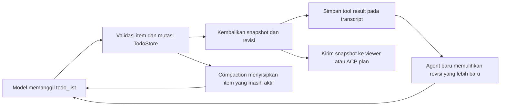

# Task list dalam sesi

`todo_list` adalah checklist yang dapat diubah model selama bekerja. Ia menyimpan prioritas, status, dan subtugas. Checklist membantu harness mempertahankan rencana saat turn berganti atau konteks dikompresi. Kartu yang dapat dikerjakan profil lain dan memiliki lease ada di [Kanban](kanban.md). Tanggung jawab yang perlu berjalan lintas turn berada pada [Goal](goals.md). [Kontrak todo](https://github.com/NousResearch/hermes-agent/blob/ae2a81ccc00e9b7c06301523e5bb09608397149c/tools/todo_tool.py#L222-L288).

## Kontrak model dan state

- Schema menawarkan `todo_list(todos?, merge=false)`. Tanpa argumen, hasilnya snapshot saat ini. Dengan daftar, default menggantikan semua item, sedangkan merge memperbarui field yang diberikan berdasarkan `id` dan menambah item baru. Menulis daftar kosong dengan mode replace menghapus checklist. Alias lama `todo` digunakan untuk kompatibilitas replay. Tool tidak memiliki prasyarat eksternal. [Tool dan schema](https://github.com/NousResearch/hermes-agent/blob/ae2a81ccc00e9b7c06301523e5bb09608397149c/tools/todo_tool.py#L201-L288).
- Item berisi `id`, `content`, dan status `pending | in_progress | completed | cancelled`, dengan `parent` opsional. Store menghitung `summary` per status dan mengirim seluruh daftar dengan revision monoton yang hanya naik bila ada perubahan isi. Item duplikat mengikuti kemunculan terakhir. Parent yang hilang atau bersiklus dibersihkan. Batas implementasi adalah 256 item, 4.000 karakter per deskripsi, dan 512.000 karakter untuk satu hasil todo yang dapat direplay. Validasi yang gagal membatalkan mutasi. [Store](https://github.com/NousResearch/hermes-agent/blob/ae2a81ccc00e9b7c06301523e5bb09608397149c/tools/todo_tool.py#L9-L100) · [Validasi dan parent](https://github.com/NousResearch/hermes-agent/blob/ae2a81ccc00e9b7c06301523e5bb09608397149c/tools/todo_tool.py#L134-L198) · [Hasil tool](https://github.com/NousResearch/hermes-agent/blob/ae2a81ccc00e9b7c06301523e5bb09608397149c/tools/todo_tool.py#L201-L219).
- Schema mengarahkan model menggunakan checklist untuk pekerjaan kompleks minimal tiga langkah, menguraikan seluruh item ketika user meminta semua, dan menandai selesai setelah verifikasi. Instruksi satu item `in_progress` adalah arahan model. Store memvalidasi status, menaikkan langkah aktif pertama ke depan item pending pada checklist datar, dan mempertahankan authored order untuk daftar bertingkat. Kode ini tidak menjalankan subtugas otomatis. [Urutan](https://github.com/NousResearch/hermes-agent/blob/ae2a81ccc00e9b7c06301523e5bb09608397149c/tools/todo_tool.py#L186-L198) · [Arahan model](https://github.com/NousResearch/hermes-agent/blob/ae2a81ccc00e9b7c06301523e5bb09608397149c/tools/todo_tool.py#L227-L242).

## Compaction, resume, dan presentasi

- Agent baru memulai dengan `TodoStore` in-memory. Saat hidrasi, ia berjalan mundur pada replay history, memeriksa tool result yang dipasangkan dengan assistant call dan ID yang tepat, memeriksa batas ukuran, lalu memulihkan revisi terbaru bila lebih besar dari state in-memory. Snapshot kosong yang sah ikut menimpa state lama. [Inisialisasi](https://github.com/NousResearch/hermes-agent/blob/ae2a81ccc00e9b7c06301523e5bb09608397149c/agent/agent_init.py#L1110-L1114) · [Hydration](https://github.com/NousResearch/hermes-agent/blob/ae2a81ccc00e9b7c06301523e5bb09608397149c/run_agent.py#L1048-L1114).
- Saat compaction, store memformat pending dan in-progress serta ancestor yang masih diperlukan sebagai konteks. `_fold_todo_snapshot` mengganti snapshot lama jika store sudah authoritative. Bila body skill yang menaungi checklist dipangkas, runtime bisa menyisipkan pengingat untuk memuat ulang skill. Ini mempertahankan panduan kerja bersama daftar langkah. [Format](https://github.com/NousResearch/hermes-agent/blob/ae2a81ccc00e9b7c06301523e5bb09608397149c/tools/todo_tool.py#L102-L131) · [Compaction](https://github.com/NousResearch/hermes-agent/blob/ae2a81ccc00e9b7c06301523e5bb09608397149c/agent/conversation_compression.py#L2974-L3024).
- Viewer memperoleh snapshot revisioned lewat event `todo.updated`. Resume gateway dapat memproyeksikan snapshot dari history atau DB meski transcript tidak dikirim. Hermes ACP yang dikendalikan gateway mengubah snapshot itu menjadi `sessionUpdate: plan`. Mapping ACP meratakan item, mengisi priority medium, dan membawa cancelled sebagai status completed dengan prefix penjelas. Jalur ACP in-process pada pin ini masih memeriksa literal alias `todo`. Perilaku tool rename di mode tersebut perlu dibuktikan dengan pemanggilan nama schema yang aktual. [Viewer event](https://github.com/NousResearch/hermes-agent/blob/ae2a81ccc00e9b7c06301523e5bb09608397149c/tui_gateway/tool_progress.py#L352-L378) · [Resume](https://github.com/NousResearch/hermes-agent/blob/ae2a81ccc00e9b7c06301523e5bb09608397149c/gateway/session_controls.py#L120-L140) · [ACP gateway](https://github.com/NousResearch/hermes-agent/blob/ae2a81ccc00e9b7c06301523e5bb09608397149c/acp_adapter/gateway_reply.py#L76-L93) · [Mapping dan callback](https://github.com/NousResearch/hermes-agent/blob/ae2a81ccc00e9b7c06301523e5bb09608397149c/acp_adapter/events.py#L25-L52) · [Callback in-process](https://github.com/NousResearch/hermes-agent/blob/ae2a81ccc00e9b7c06301523e5bb09608397149c/acp_adapter/events.py#L287-L297).

## Bukti eksekusi fixture

Hermes v0.23.2 pada Python 3.14.9 dan macOS ARM64, menggunakan home sementara. 52 lulus. Cakupan mencakup perubahan snapshot dan revision, parent bertingkat, resume yang memulihkan todo terbaru, dan event snapshot TUI. Klaim cakupan di sini terbatas pada fixture yang dijalankan. [test_todo_tool.py](https://github.com/NousResearch/hermes-agent/blob/ae2a81ccc00e9b7c06301523e5bb09608397149c/tests/tools/test_todo_tool.py) · [test_todo_nested.py](https://github.com/NousResearch/hermes-agent/blob/ae2a81ccc00e9b7c06301523e5bb09608397149c/tests/tools/test_todo_nested.py) · [test_resume_todo_state.py](https://github.com/NousResearch/hermes-agent/blob/ae2a81ccc00e9b7c06301523e5bb09608397149c/tests/gateway/test_resume_todo_state.py) · [test_todo_state_events.py](https://github.com/NousResearch/hermes-agent/blob/ae2a81ccc00e9b7c06301523e5bb09608397149c/tests/tui_gateway/test_todo_state_events.py).

## Pemetaan ke Ngertiin

Ngertiin menerima ACP `plan`, named `plan_update`, dan `plan_removed` di `AcpProjection`. Plan diproyeksikan sebagai progress native dengan ID pada level daftar serta item text, priority, dan status. Komponen conversation menampilkannya sebagai informasi baca-saja. Saat ini kontrak proyeksi yang diperiksa belum memiliki revisi snapshot, parent, ID item, atau status cancelled. [Projection](../../apps/server/src/harness/acp/projection.ts#L42-L74) · [Kontrak progress](../../apps/server/src/runs/native-progress.ts#L3-L21) · [UI](../../apps/web-client/src/features/conversation/components/native-progress-details.tsx#L50-L79).

Perilaku yang paling mudah ditransfer adalah snapshot plan yang terlihat saat harness sedang bekerja dan muncul kembali setelah reconnect atau compaction. Pertahankan status native pada horizon bukti yang tersedia. Tambahkan versi proyeksi jika sumber memancarkan snapshot yang dapat datang tidak berurutan. Tambahkan hierarki atau pembatalan hanya bila harness memberikan identitas dan semantik tersebut. Tool/plan progress cukup untuk checklist, sedangkan admission dan progress antar-agent tetap memakai lifecycle yang ada.

Uji pekerjaan dengan satu langkah induk dan tiga subtugas, termasuk langkah yang dibatalkan. Amati plan yang terlihat sebelum dan sesudah compaction, reconnect sesaat setelah update, dua snapshot tiba tidak berurutan, dan refresh setelah daftar dikosongkan. Periksa bukti yang disampaikan harness sebelum menampilkan item selesai.

Probe terpisah melalui proses ACP dan Gateway upstream mengeksekusi `todo_list` sebagai tool deferred dengan provider fixture loopback. ACP mengirim Plan, model menerima hasil todo revision 1, lalu SQLite menyimpan tool result dan jawaban final dalam session yang sama. [Rincian probe](verification.md).

## Bukti Hermes Desktop macOS

Model fixture memilih `todo_list` lewat bridge `tool_call`. Sesudah jawaban selesai, Desktop menampilkan **Previous tasks 1/2** di atas composer. Membukanya memperlihatkan dua langkah dari tool result revision 1, dengan satu completed dan satu in progress. [DT-04](desktop-runtime.md#goal-dan-tugas-dalam-sesi).
