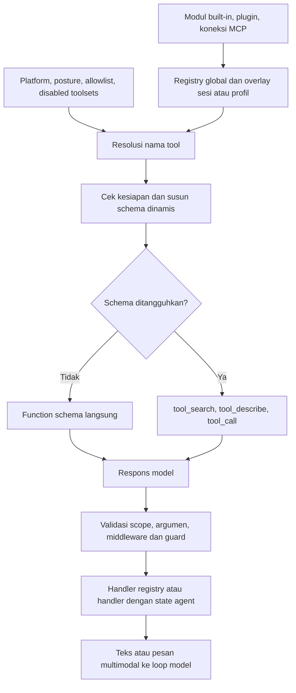

# Tools dan pemilihan kemampuan

Hermes v0.23.2 menyusun kemampuan model dalam beberapa langkah. Registrasi menentukan tool yang dikenal proses. Toolset menentukan kandidat untuk sesi. Pemeriksaan kesiapan memutuskan schema yang tersedia. Tool Search bisa menangguhkan sebagian schema sampai dibutuhkan. Dispatch memeriksa scope, argumen, dan guard sebelum meneruskan efek. Kelima langkah ini menjelaskan mengapa dua sesi pada mesin yang sama bisa memperlihatkan katalog berbeda. [Pin sumber](https://github.com/NousResearch/hermes-agent/tree/ae2a81ccc00e9b7c06301523e5bb09608397149c), [resolver](https://github.com/NousResearch/hermes-agent/blob/ae2a81ccc00e9b7c06301523e5bb09608397149c/model_tools.py#L522-L566), [dispatch](https://github.com/NousResearch/hermes-agent/blob/ae2a81ccc00e9b7c06301523e5bb09608397149c/model_tools.py#L906-L1008).

## Inventaris built-in

Probe `discover_builtin_tools()` pada source release dengan `HERMES_HOME` baru mengimpor 42 modul dan menemukan **68 entri registry built-in**. Daftar di bawah menggunakan nama schema pada pin. Kolom jalur menunjuk deklarasi schema, handler dan `check_fn`. Schema eksternal berubah menurut plugin, server MCP, scope profil, dan surface. [Discovery](https://github.com/NousResearch/hermes-agent/blob/ae2a81ccc00e9b7c06301523e5bb09608397149c/tools/registry.py#L84-L175).

| Kelompok | Nama tool | Jalur deklarasi |
| --- | --- | --- |
| Web | `web_search`, `web_extract` | [web_tools.py](https://github.com/NousResearch/hermes-agent/blob/ae2a81ccc00e9b7c06301523e5bb09608397149c/tools/web_tools.py#L506-L577) |
| Terminal | `terminal`, `process_manage` | [terminal_tool.py](https://github.com/NousResearch/hermes-agent/blob/ae2a81ccc00e9b7c06301523e5bb09608397149c/tools/terminal_tool.py#L1719-L1886), [process_registry.py](https://github.com/NousResearch/hermes-agent/blob/ae2a81ccc00e9b7c06301523e5bb09608397149c/tools/process_registry.py#L2559-L2713) |
| File | `read_file`, `write_file`, `patch`, `search_files` | [file_tools.py](https://github.com/NousResearch/hermes-agent/blob/ae2a81ccc00e9b7c06301523e5bb09608397149c/tools/file_tools.py#L1300-L1449) |
| Eksekusi Python | `execute_code` | [code_execution_tool.py](https://github.com/NousResearch/hermes-agent/blob/ae2a81ccc00e9b7c06301523e5bb09608397149c/tools/code_execution_tool.py#L869-L950) |
| Browser | `browser_exec`, `browser_cdp`, `browser_dialog`, `browser_vault` | [browser_exec](https://github.com/NousResearch/hermes-agent/blob/ae2a81ccc00e9b7c06301523e5bb09608397149c/tools/browser_use_cli.py#L998-L1055), [CDP](https://github.com/NousResearch/hermes-agent/blob/ae2a81ccc00e9b7c06301523e5bb09608397149c/tools/browser_cdp_tool.py#L450-L513), [dialog](https://github.com/NousResearch/hermes-agent/blob/ae2a81ccc00e9b7c06301523e5bb09608397149c/tools/browser_dialog_tool.py#L72-L104), [vault](https://github.com/NousResearch/hermes-agent/blob/ae2a81ccc00e9b7c06301523e5bb09608397149c/tools/browser_vault_tool.py#L657-L744) |
| Desktop OS | `computer_use` | [schema](https://github.com/NousResearch/hermes-agent/blob/ae2a81ccc00e9b7c06301523e5bb09608397149c/tools/computer_use/schema.py#L17-L204), [registrasi](https://github.com/NousResearch/hermes-agent/blob/ae2a81ccc00e9b7c06301523e5bb09608397149c/tools/computer_use_tool.py#L1-L22) |
| Media umum | `vision_analyze`, `image_generate`, `text_to_speech` | [vision](https://github.com/NousResearch/hermes-agent/blob/ae2a81ccc00e9b7c06301523e5bb09608397149c/tools/vision_tools.py#L952-L1045), [image](https://github.com/NousResearch/hermes-agent/blob/ae2a81ccc00e9b7c06301523e5bb09608397149c/tools/image_generation_tool.py#L1054-L1061), [TTS](https://github.com/NousResearch/hermes-agent/blob/ae2a81ccc00e9b7c06301523e5bb09608397149c/tools/tts_tool.py#L644-L697) |
| Media opt-in | `video_analyze`, `video_generate`, `xai_video_edit`, `xai_video_extend` | [analisis video](https://github.com/NousResearch/hermes-agent/blob/ae2a81ccc00e9b7c06301523e5bb09608397149c/tools/vision_tools.py#L1050-L1205), [generate](https://github.com/NousResearch/hermes-agent/blob/ae2a81ccc00e9b7c06301523e5bb09608397149c/tools/video_generation_tool.py#L367-L380), [edit/extend](https://github.com/NousResearch/hermes-agent/blob/ae2a81ccc00e9b7c06301523e5bb09608397149c/tools/xai_video_tools.py#L59-L126) |
| Skills | `skills_list`, `skill_view`, `skill_manage` | [read/list](https://github.com/NousResearch/hermes-agent/blob/ae2a81ccc00e9b7c06301523e5bb09608397149c/tools/skills_tool.py#L741-L807), [manage](https://github.com/NousResearch/hermes-agent/blob/ae2a81ccc00e9b7c06301523e5bb09608397149c/tools/skill_manager_tool.py#L852-L949) |
| Konteks dan koordinasi | `todo_list`, `memory`, `session_search`, `delegate_task`, `clarify`, `cronjob_manage` | [todo](https://github.com/NousResearch/hermes-agent/blob/ae2a81ccc00e9b7c06301523e5bb09608397149c/tools/todo_tool.py#L332-L336), [memory](https://github.com/NousResearch/hermes-agent/blob/ae2a81ccc00e9b7c06301523e5bb09608397149c/tools/memory_tool.py#L468-L479), [recall](https://github.com/NousResearch/hermes-agent/blob/ae2a81ccc00e9b7c06301523e5bb09608397149c/tools/session_search_tool.py#L950-L960), [delegate](https://github.com/NousResearch/hermes-agent/blob/ae2a81ccc00e9b7c06301523e5bb09608397149c/tools/delegate_tool.py#L980-L996), [clarify](https://github.com/NousResearch/hermes-agent/blob/ae2a81ccc00e9b7c06301523e5bb09608397149c/tools/clarify_tool.py#L154-L225), [cron](https://github.com/NousResearch/hermes-agent/blob/ae2a81ccc00e9b7c06301523e5bb09608397149c/tools/cronjob_tools.py#L1241-L1290) |
| Kanban | `kanban_show`, `kanban_list`, `kanban_complete`, `kanban_block`, `kanban_schedule`, `kanban_request_review`, `kanban_request_changes`, `kanban_heartbeat`, `kanban_comment`, `kanban_attach`, `kanban_attach_url`, `kanban_attachments`, `kanban_create`, `kanban_unblock`, `kanban_link` | [kanban_tools.py](https://github.com/NousResearch/hermes-agent/blob/ae2a81ccc00e9b7c06301523e5bb09608397149c/tools/kanban_tools.py#L1310-L1337). `kanban_schedule` datang dari anggota registry kategori `kanban` walau absen di daftar core statis. `kanban_list` dan `kanban_unblock` memakai gate orkestrator. |
| Koneksi | `manage_connections` | [connectors/tool.py](https://github.com/NousResearch/hermes-agent/blob/ae2a81ccc00e9b7c06301523e5bb09608397149c/tools/connectors/tool.py#L17-L163) |
| Desktop, proyek, katalog dan onboarding | `annotate_preview`, `close_terminal`, `desktop_preview`, `drive_preview`, `focus_pane`, `gui_tour`, `react_to_message`, `read_terminal`, `read_window_below`, `set_theme`, `show_tip`, `desktop_project`, `manage_catalog`, `setup_beat` | [daftar surface](https://github.com/NousResearch/hermes-agent/blob/ae2a81ccc00e9b7c06301523e5bb09608397149c/toolsets.py#L128-L149), [onboarding](https://github.com/NousResearch/hermes-agent/blob/ae2a81ccc00e9b7c06301523e5bb09608397149c/tools/setup_beat_tool.py#L208-L214), [catalog](https://github.com/NousResearch/hermes-agent/blob/ae2a81ccc00e9b7c06301523e5bb09608397149c/tools/connectors/tool.py#L166-L172) |
| Platform pesan | `discord`, `discord_admin`, `feishu_doc_read`, `feishu_drive_add_comment`, `feishu_drive_list_comment_replies`, `feishu_drive_list_comments`, `feishu_drive_reply_comment` | [Discord](https://github.com/NousResearch/hermes-agent/blob/ae2a81ccc00e9b7c06301523e5bb09608397149c/tools/discord_tool.py#L602-L662), [Feishu doc](https://github.com/NousResearch/hermes-agent/blob/ae2a81ccc00e9b7c06301523e5bb09608397149c/tools/feishu_doc_tool.py#L36-L70), [Feishu drive](https://github.com/NousResearch/hermes-agent/blob/ae2a81ccc00e9b7c06301523e5bb09608397149c/tools/feishu_drive_tool.py#L148-L194) |
| Pencarian X opt-in | `x_search` | [x_search_tool.py](https://github.com/NousResearch/hermes-agent/blob/ae2a81ccc00e9b7c06301523e5bb09608397149c/tools/x_search_tool.py#L301-L342) |

Tiga schema sintetik `tool_search`, `tool_describe`, dan `tool_call` dihasilkan saat assembly. `stt` punya konfigurasi transkripsi input sendiri dengan nol schema. `context_engine` dapat menambah schema dari engine aktif. Alias historis seperti `cronjob` dan `process` dipetakan saat dispatch dan katalog menampilkan nama baru. Pengiriman jawaban berasal dari lifecycle platform. Toolset inti tidak mendeklarasikan `send_message`. [Schema bridge](https://github.com/NousResearch/hermes-agent/blob/ae2a81ccc00e9b7c06301523e5bb09608397149c/tools/tool_search.py#L274-L331), [konfigurasi STT](https://github.com/NousResearch/hermes-agent/blob/ae2a81ccc00e9b7c06301523e5bb09608397149c/hermes_cli/tools_config.py#L108-L115), [context engine](https://github.com/NousResearch/hermes-agent/blob/ae2a81ccc00e9b7c06301523e5bb09608397149c/agent/agent_init.py#L1964-L2001), [alias](https://github.com/NousResearch/hermes-agent/blob/ae2a81ccc00e9b7c06301523e5bb09608397149c/model_tools.py#L631-L642), [platform bundles](https://github.com/NousResearch/hermes-agent/blob/ae2a81ccc00e9b7c06301523e5bb09608397149c/toolsets.py#L183-L231).

## Katalog yang efektif

- `discover_builtin_tools` mencari panggilan `registry.register` di modul top-level `tools/*.py` dan `tools/<package>/tool.py`, termasuk loop registrasi. Cache berdasarkan waktu modifikasi dan ukuran file. Registry menyimpan nama, kategori, schema, handler async/sync, `check_fn`, batas output, floor deadline, dan metadata. Overlay membatasi API yang terdaftar untuk profil/sesi. Plugin memerlukan izin operator untuk mengganti built-in lintas kategori atau menimpa entri global. MCP diinisialisasi oleh entry point, memakai filter dan registrasi per-scope. [Discovery](https://github.com/NousResearch/hermes-agent/blob/ae2a81ccc00e9b7c06301523e5bb09608397149c/tools/registry.py#L84-L175), [entry](https://github.com/NousResearch/hermes-agent/blob/ae2a81ccc00e9b7c06301523e5bb09608397149c/tools/registry.py#L216-L243), [registrasi](https://github.com/NousResearch/hermes-agent/blob/ae2a81ccc00e9b7c06301523e5bb09608397149c/tools/registry.py#L840-L933), [entry points](https://github.com/NousResearch/hermes-agent/blob/ae2a81ccc00e9b7c06301523e5bb09608397149c/model_tools.py#L150-L166), [MCP](https://github.com/NousResearch/hermes-agent/blob/ae2a81ccc00e9b7c06301523e5bb09608397149c/tools/mcp_tool_registration.py#L250-L400).
- `_get_platform_tools` menyelesaikan pilihan platform dan plugin/MCP. Pilihan eksplisit `[]` menahan merge default, `no_mcp` menonaktifkan merge MCP, dan `agent.disabled_toolsets` dievaluasi terakhir pada granularity tool. CLI dan cron kosong-konfigurasi memakai kategori core yang sama. ACP mulai dari posture coding tanpa `clarify`, lalu membaca `platform_toolsets.acp` dan server MCP yang relevan. API server juga meniadakan TTS, clarify, computer dan Kanban pada bundle default. Webhook memilih web, vision dan clarify. Desktop menambah kapabilitas GUI per sesi yang berasal dari renderer. Discord/Discord Admin, video, X, Kanban, dan plugin tertentu opt-in pada baseline. Kredensial xAI dapat mengaktifkan `x_search` melalui override konfigurasi. Feishu memperoleh kategori dokumen dan komentar ketika platform cocok. [Resolver](https://github.com/NousResearch/hermes-agent/blob/ae2a81ccc00e9b7c06301523e5bb09608397149c/hermes_cli/tools_config.py#L468-L521), [precedence](https://github.com/NousResearch/hermes-agent/blob/ae2a81ccc00e9b7c06301523e5bb09608397149c/hermes_cli/tools_config.py#L572-L650), [MCP merge](https://github.com/NousResearch/hermes-agent/blob/ae2a81ccc00e9b7c06301523e5bb09608397149c/hermes_cli/tools_config.py#L737-L769), [bundles](https://github.com/NousResearch/hermes-agent/blob/ae2a81ccc00e9b7c06301523e5bb09608397149c/toolsets.py#L168-L232), [ACP](https://github.com/NousResearch/hermes-agent/blob/ae2a81ccc00e9b7c06301523e5bb09608397149c/acp_adapter/session.py#L521-L563), [GUI scope](https://github.com/NousResearch/hermes-agent/blob/ae2a81ccc00e9b7c06301523e5bb09608397149c/tui_gateway/agent_factory.py#L324-L361).
- `get_tool_definitions` meminta registry mengecek kandidat, menjalankan override schema dinamis lalu opsi deferral. Kesiapan `web_search` dan `web_extract` memerlukan backend web yang lolos probe. `vision_analyze` bisa meneruskan gambar ke main model atau auxiliary vision. Image generation membutuhkan backend siap dan schema-nya mengikuti kemampuan backend. TTS memeriksa provider yang dipilih atau jalur instalasi saat pertama dipakai. Browser dan desktop use memeriksa paket/driver atau backend yang melayani sesi. Hosted scope juga punya allowlist tingkat tool yang berlaku saat schema disajikan dan saat handler diakses. [Penyusunan schema](https://github.com/NousResearch/hermes-agent/blob/ae2a81ccc00e9b7c06301523e5bb09608397149c/model_tools.py#L522-L566), [registry check](https://github.com/NousResearch/hermes-agent/blob/ae2a81ccc00e9b7c06301523e5bb09608397149c/tools/registry.py#L1016-L1044), [web](https://github.com/NousResearch/hermes-agent/blob/ae2a81ccc00e9b7c06301523e5bb09608397149c/tools/web_tools.py#L483-L504), [vision](https://github.com/NousResearch/hermes-agent/blob/ae2a81ccc00e9b7c06301523e5bb09608397149c/tools/vision_tools.py#L934-L958), [image](https://github.com/NousResearch/hermes-agent/blob/ae2a81ccc00e9b7c06301523e5bb09608397149c/tools/image_generation_tool.py#L584-L609), [TTS](https://github.com/NousResearch/hermes-agent/blob/ae2a81ccc00e9b7c06301523e5bb09608397149c/tools/tts_tool.py#L612-L623), [hosted scope](https://github.com/NousResearch/hermes-agent/blob/ae2a81ccc00e9b7c06301523e5bb09608397149c/tools/hosted_tool_policy.py#L73-L105).

## Tool Search dan eksekusi

Pada pin ini `auto` aktif ketika ada tool yang dapat ditangguhkan atau connector tersedia. Ambang 5% context mengatur anggaran listing, dibatasi lagi 4.000 token estimasi. Listing turun dari ringkasan katalog menjadi daftar nama atau bridge saja. Deferral default mencakup `computer_use`, `session_search`, `image_generate`, `todo_list`, `process_manage`, `cronjob_manage`, `browser_vault`, `text_to_speech`, `manage_connections` dan sejumlah tool Desktop. `clarify` dan `browser_exec` tetap langsung pada default ketika tersedia. MCP serta tool di luar daftar core dan kategori GUI bisa ikut deferred. [Default lengkap](https://github.com/NousResearch/hermes-agent/blob/ae2a81ccc00e9b7c06301523e5bb09608397149c/hermes_cli/config_defaults.py#L1937-L1975), [klasifikasi dan aktivasi](https://github.com/NousResearch/hermes-agent/blob/ae2a81ccc00e9b7c06301523e5bb09608397149c/tools/tool_search.py#L129-L225), [assembly](https://github.com/NousResearch/hermes-agent/blob/ae2a81ccc00e9b7c06301523e5bb09608397149c/tools/tool_search.py#L347-L383).

Model mengirim `tool_search(queries, limit?)` untuk mencari katalog sesi dengan pemeringkatan lexical, `tool_describe(names)` untuk schema lengkap, lalu `tool_call(calls)` untuk menjalankan nama yang tersedia. Satu panggilan bridge lokal menerima satu tool yang mendasari. Batch berisi beberapa panggilan dibatasi pada connector. Guard sesi, validasi argumen dan middleware tetap berlaku ketika bridge meneruskan call. Nama connector managed menggunakan bentuk `connectors__<connector>__<tool>` dan bergantung gateway layanan. [Pencarian katalog](https://github.com/NousResearch/hermes-agent/blob/ae2a81ccc00e9b7c06301523e5bb09608397149c/tools/tool_search_catalog.py#L93-L215), [resolusi call](https://github.com/NousResearch/hermes-agent/blob/ae2a81ccc00e9b7c06301523e5bb09608397149c/tools/tool_search.py#L582-L619), [dispatch ulang](https://github.com/NousResearch/hermes-agent/blob/ae2a81ccc00e9b7c06301523e5bb09608397149c/model_tools.py#L727-L774), [gating connector](https://github.com/NousResearch/hermes-agent/blob/ae2a81ccc00e9b7c06301523e5bb09608397149c/model_tools.py#L942-L977).

`handle_function_call` normalisasi alias, menjalankan middleware request, guard pre-call, handler, observasi post-call dan transformasi hasil. Registry melakukan validasi argumen, menjembatani coroutine ke event loop yang sesuai, membatasi payload error, serta mengizinkan string dan envelope multimodal. `todo_list`, `memory`, `session_search`, dan `delegate_task` punya cabang dispatch di loop karena memerlukan state agent. Approval efek ditentukan pada guard/pelaksana yang sesuai dengan jenis tool. [Dispatcher](https://github.com/NousResearch/hermes-agent/blob/ae2a81ccc00e9b7c06301523e5bb09608397149c/model_tools.py#L779-L1008), [registry dispatch](https://github.com/NousResearch/hermes-agent/blob/ae2a81ccc00e9b7c06301523e5bb09608397149c/tools/registry.py#L1046-L1101), [handler khusus](https://github.com/NousResearch/hermes-agent/blob/ae2a81ccc00e9b7c06301523e5bb09608397149c/agent/tool_dispatch_helpers.py#L113-L231).

## Penerapan di Ngertiin

`ProductTools.issue` menerbitkan token scope run dengan owner, organization, connection, agent, thread, binding dan revisi grant. Wrapper native dan `ngertiin.describe_tools` memperoleh skema dari katalog efektif yang memperhitungkan workspace, profil browser, dan grant konektor. Dispatcher memvalidasi kembali identitas, skema, resource, serta guard interaksi sebelum menjalankan aksi. [ProductTools](../../apps/server/src/harness/tools.ts) · [MCP](../../apps/server/src/harness/mcp.ts) · [Katalog sesi native](../../apps/server/src/harness/session-tools.ts).

`ngertiin.web_search` dan `ngertiin.web_extract` tersedia pada katalog sesi ketika backend Firecrawl dikonfigurasi. Gunakan `FIRECRAWL_API_KEY` untuk layanan hosted dan `FIRECRAWL_API_URL` untuk base URL yang dikelola sendiri. Halaman yang berhasil dibaca disimpan sebagai sumber run dan muncul sebagai tautan di chat. [Kontrak pencarian](https://docs.firecrawl.dev/api-reference/endpoint/search) · [Kontrak ekstraksi](https://docs.firecrawl.dev/api-reference/endpoint/scrape).

Untuk meniru perilaku yang berguna, gunakan katalog ringkas bagi kemampuan yang jarang dipakai dan schema langsung bagi tindakan inti seperti meminta input atau mengambil attachment. Terapkan pilot pada tool produk dengan banyak aksi, misalnya komputer atau koneksi. Bridge pencarian hanya mengembalikan kandidat yang tersedia untuk scope aktif. Pemanggilan hasil pencarian tetap melewati jalur MCP, grant, dan receipt yang sama. Native toolset tetap dinilai per profil Codex, Claude, OpenCode, Pi atau Muse beserta jalur autentikasinya. Ketersediaan fitur yang sama di setiap model perlu diperiksa melalui sesi aktual. [Computer catalog](../../apps/server/src/machines/tools.ts#L36), [connector tools](../../apps/server/src/integrations/tools.ts), [profile policy](../../apps/server/src/harness/acp/profiles.ts), [catalog policy](../../apps/server/src/harness/catalog-policy.ts).

Skenario parity yang diusulkan memakai dua fixture dokumen dengan scope berbeda dan satu koneksi dummy. Agent harus menemukan kemampuan yang tepat, membaca schema saat perlu, menjalankan tool satu kali, menjelaskan hasil dari output, dan menolak nama yang tersembunyi atau grant yang dicabut antara pencarian dan call. Ulangi lintas harness. Log privat mencatat tool, result dan keputusan otorisasi. Percakapan pengguna menampilkan tindakan dan hasil yang relevan.

## Verifikasi

Probe registry memakai release checkout dan home sementara dengan environment bersih. Semua 68 nama di tabel cocok dengan entri terdaftar. Suite `test_registry.py`, `test_toolsets.py`, `test_tool_search.py`, dan `test_gui_surface_toolsets.py` menghasilkan **114 passed**. Cakupan meliputi resolusi konfigurasi, discovery, validasi argumen deferred dan isolasi katalog sesi. Pemanggilan provider media, akun managed connector, dan reliabilitas pilihan model belum diukur. [Tes registry](https://github.com/NousResearch/hermes-agent/blob/ae2a81ccc00e9b7c06301523e5bb09608397149c/tests/tools/test_registry.py), [tes bridge](https://github.com/NousResearch/hermes-agent/blob/ae2a81ccc00e9b7c06301523e5bb09608397149c/tests/tools/test_tool_search.py), [tes GUI](https://github.com/NousResearch/hermes-agent/blob/ae2a81ccc00e9b7c06301523e5bb09608397149c/tests/tui_gateway/test_gui_surface_toolsets.py).

Pada probe ACP dengan profil kosong dan provider fixture loopback, request model pertama benar-benar membawa 18 schema. Schema langsung yang terlihat ialah `browser_exec`, `delegate_task`, `execute_code`, `memory`, `patch`, `read_file`, `search_files`, `skill_manage`, `skill_view`, `skills_list`, `terminal`, `vision_analyze`, `web_extract`, `web_search` dan `write_file`. Tiga sisanya adalah bridge `tool_search`, `tool_describe` dan `tool_call`. Ketika fixture meminta `todo_list` melalui `tool_call`, tool mengembalikan revision 1 dan ACP memproyeksikan checklist sebagai Plan. Hasil ini menunjukkan deferral bekerja pada konfigurasi tersebut. [Rincian probe](verification.md).

## Bukti Hermes Desktop macOS

Capabilities pada profil fixture menampilkan 23 kelompok tool, sedangkan request chat membawa 19 schema dan request Cron 18. Todo dipanggil melalui bridge dan tampil sebagai Previous tasks. Browser dan write file benar-benar memberi hasil. Jumlah katalog UI, schema efektif, dan hasil dispatch perlu dibaca bersama. [DT-04](desktop-runtime.md#goal-dan-tugas-dalam-sesi) · [DT-06](desktop-runtime.md#jadwal-history-dan-konfigurasi-capability).
