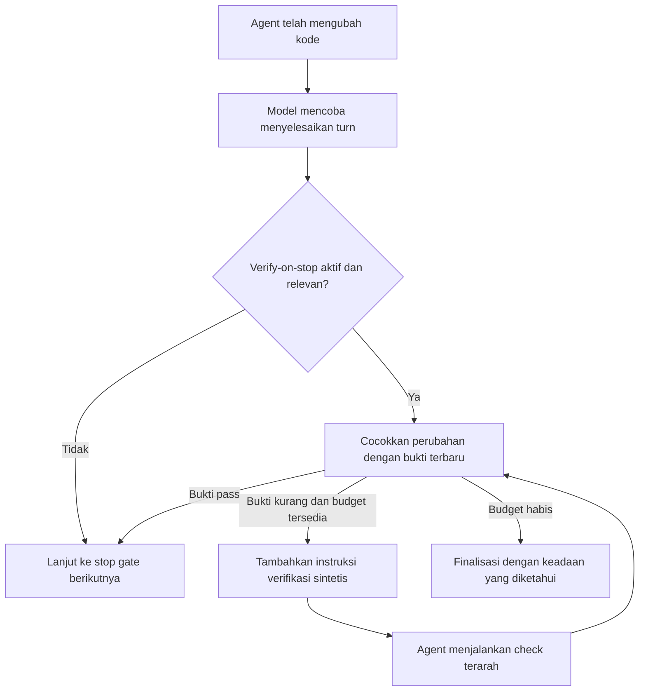

# Verifikasi hasil dan bukti riset

Hermes punya mekanisme yang memeriksa hasil coding sebelum turn berakhir. Mekanisme ini berbeda dari Goal judge dan settlement task Kanban, walaupun ketiganya dapat melanjutkan sebuah turn yang hendak berhenti. Bukti di halaman ini juga mencatat bagian yang dijalankan untuk riset, agar temuan source dan hasil eksekusi dapat dibandingkan.



## Mekanisme Hermes

- `verify_on_stop_enabled` memakai env, lalu konfigurasi `agent.verify_on_stop`. Default off. Nilai `auto` mengaktifkan surface coding dan meniadakan jalur pada messaging sesuai kode. `build_verify_on_stop_nudge` memeriksa path kode, workspace dan status bukti. Dokumen seperti Markdown murni dikecualikan. Default batas nudge adalah dua. Nudge meminta check terarah atau penjelasan blocker. [Konfigurasi](https://github.com/NousResearch/hermes-agent/blob/ae2a81ccc00e9b7c06301523e5bb09608397149c/agent/verification_stop.py#L62-L88), [kriteria](https://github.com/NousResearch/hermes-agent/blob/ae2a81ccc00e9b7c06301523e5bb09608397149c/agent/verification_stop.py#L169-L213).
- `verification_evidence` dapat mengklasifikasikan command yang dikenal, merekam exit status dan mengikat bukti dengan edit workspace. `hermes verify` punya recipe yang bisa mendeteksi build/test/start dan readiness. Bukti exit command perlu dikaitkan dengan perubahan dan scope percobaan. [Rekam evidence](https://github.com/NousResearch/hermes-agent/blob/ae2a81ccc00e9b7c06301523e5bb09608397149c/agent/verification_evidence.py#L553-L628), [edit dan status](https://github.com/NousResearch/hermes-agent/blob/ae2a81ccc00e9b7c06301523e5bb09608397149c/agent/verification_evidence.py#L708-L807), [recipe detection](https://github.com/NousResearch/hermes-agent/blob/ae2a81ccc00e9b7c06301523e5bb09608397149c/agent/verify/recipes.py#L283-L296), [runner](https://github.com/NousResearch/hermes-agent/blob/ae2a81ccc00e9b7c06301523e5bb09608397149c/agent/verify/runner.py#L218-L264).
- `apply_stop_gates` memproses diagnostik LSP terlambat yang relevan, verify-on-stop, `pre_verify` plugin, lalu guard Kanban. Nudge dipasang sebagai input internal dan menjalankan iterasi berikutnya. Fallback final menjaga respons yang sudah dapat ditampilkan bila anggaran habis. Completion task tetap ditentukan oleh lifecycle luar. [Stop gates](https://github.com/NousResearch/hermes-agent/blob/ae2a81ccc00e9b7c06301523e5bb09608397149c/agent/turn_stop_gates.py#L134-L223), [budget fallback](https://github.com/NousResearch/hermes-agent/blob/ae2a81ccc00e9b7c06301523e5bb09608397149c/agent/turn_finalizer.py#L125-L197).

## Bukti yang dijalankan pada 18 November 2026

Source upstream dijalankan pada macOS ARM64 dengan CPython 3.14.9 dan dependency dari `uv.lock`. Environment dan home untuk probe/tes bersifat sementara. Fixture memakai test fence upstream dan provider stub pada loopback untuk alur ACP secara langsung. Checkout sumber berada di luar repository Ngertiin. Profil dan kredensial pengguna tidak digunakan. [Test fence](https://github.com/NousResearch/hermes-agent/blob/ae2a81ccc00e9b7c06301523e5bb09608397149c/tests/conftest.py#L1430-L1495), [lock](https://github.com/NousResearch/hermes-agent/blob/ae2a81ccc00e9b7c06301523e5bb09608397149c/uv.lock).

| Bukti | Hasil | Batas |
| --- | --- | --- |
| ACP stdio dari entrypoint upstream pada profil kosong | `initialize` mengembalikan wire v1, image prompt, load, resume/list/fork dan terminal setup. Manifest source yang dilaporkan wire adalah `0.0.0`. | Handshake saja tanpa panggilan provider. |
| ACP stdio plus Gateway foreground dengan provider lokal buatan | `session/new` berhasil. Provider fixture melihat bridge `tool_call`, menjalankan `todo_list`, dan menerima kembali hasil berisi satu task completed, revision 1. ACP mengirim `tool_call`, `tool_call_update`, `plan`, teks final dan `end_turn`. SQLite sesudah proses shutdown menunjukkan satu admission `terminal/completed` generation 1 dan urutan row user, assistant tool-call, tool, assistant. | Bukti end-to-end wiring dan persistence dari kode upstream. Model fixture diprogram memilih tool. Kemampuan model nyata memilih tool, billing dan parity Ngertiin belum diukur. |
| Lifecycle dan ACP fixtures | 69 lulus, mencakup terminal receipt, queue unknown, replay gap, cancel, retry, settlement recovery, tool call persistence, budget race dan API interrupt. | Komponen yang disubstitusi per tes tetap fixture. |
| Goal, heartbeat, Loops, Todo, Kanban, Delegation dan Cron | 558 lulus, 1 skip khusus Linux pada tiga batch, 36 file tes berbeda. Lihat [Goal](goals.md), [Heartbeat](proactivity.md), [Loops](loops.md), [Tasks](tasks.md), [Kanban](kanban.md), [Delegation](delegation.md), dan [Cron](scheduling.md). | Fixture menguji jalur kondisional dan penyimpanan sesuai file masing-masing. |
| Tool registry dan katalog skill | 114 tes tools lulus. 123 tes skills lulus. Probe source menemukan 42 modul built-in, 68 registry entry, 44 seed skills yang benar-benar disalin, dan 141 paket optional. [Tools](tools.md), [Skills](skills.md). | Jumlah katalog tidak membuktikan semua capability tersedia pada satu session atau bekerja dengan provider eksternal. |
| Browser dan Computer | 114 tes fixture lulus pada pemilihan backend, CUA, lease, browser ladder dan lifecycle. Probe `browser_exec` pada Brave headless yang diluncurkan dari profil kosong membuka `about:blank`, mengubah DOM, lalu membaca ulang judul dan isi. Hasil `success: true`, exit code 0. [Computer Use](computer-use.md). | Probe membuktikan browser lokal dan CDP. GUI desktop, takeover manusia langsung dan pilihan aksi oleh model belum diuji secara live. |
| Memory, Learning dan Sessions | 289 lulus pada dua batch terisolasi dengan memory scope, recall, review, Curator, prompt, lease, session repair dan compaction. [Memory](memory.md), [Learning](learning.md), [Sessions](sessions.md). | Tes persistence dan pembatasan review tidak mengukur kualitas lesson atau hasil yang dihasilkan model. |

Tes lifecycle yang dijalankan dapat direproduksi dari checkout yang dipatok dengan command berikut. Jalankan di area scratch dengan home sementara dan tanpa environment kredensial.

```bash
uv sync --locked --group dev --extra acp --python 3.14 --no-install-project
.venv/bin/python -m pytest -q -m 'not live and not allow_network' \
  tests/acp_adapter/test_gateway_{terminal_receipt_claim,queued_unknown,replay_gap,cancel_admission,submit_retry}.py \
  tests/gateway/test_live_settlement_recovery.py \
  tests/agent/test_{tool_call_incremental_persistence,iteration_budget_race,turn_api_call_interrupt}.py
```

Untuk mengulang probe proses, jalankan provider lokal OpenAI Chat Completions yang pertama meminta `tool_call` dengan nama `todo_list` dan satu item, lalu mengembalikan teks tetap setelah memperoleh tool result. Arahkan konfigurasi provider custom di home yang kosong ke loopback, jalankan `python -m hermes_cli.main gateway run --quiet`, lalu buka `python -m acp_adapter` sebagai subprocess stdio. Biarkan stdin terbuka selama RPC `initialize`, `session/new` dan `session/prompt`. Cocokkan Plan, result dan receipt hanya untuk session target. Angka penggunaan yang muncul pada probe adalah angka fixture.

## Batas penerapan ke Ngertiin

Ngertiin dapat menguji keberhasilan berdasarkan receipt yang sudah dimilikinya, termasuk run outcome, artifact bytes, app tool results, jadwal dan interaksi. Bukti spesifik dan state yang belum terpenuhi dapat dipakai untuk Goal continuation atau dihubungkan kembali ke run via harness terpilih. Kebijakan global yang menahan setiap respons sampai ada tes tidak dibutuhkan. Pilih bukti yang sesuai dengan hasil yang dituntut, misalnya membaca record yang benar untuk research, validasi byte untuk deliverable, atau observasi UI untuk aksi komputer. [Outcome evidence lokal](../../apps/server/src/goals/evidence.ts), [skenario pembanding](ngertiin.md).

## Bukti Hermes Desktop macOS

Probe berikutnya menggunakan salinan Hermes Desktop dengan ASAR identik, profil uji, dan provider fixture loopback. Log, hasil tool, REA SQLite, dan workflow UI memperkuat bukti pada self-learning, Goal, Cron, Loop, memory, browser, dan Artifacts. Coverage masing-masing tercatat di [laporan runtime](desktop-runtime.md) dan [pemetaan artefak](desktop-artifact.md).
