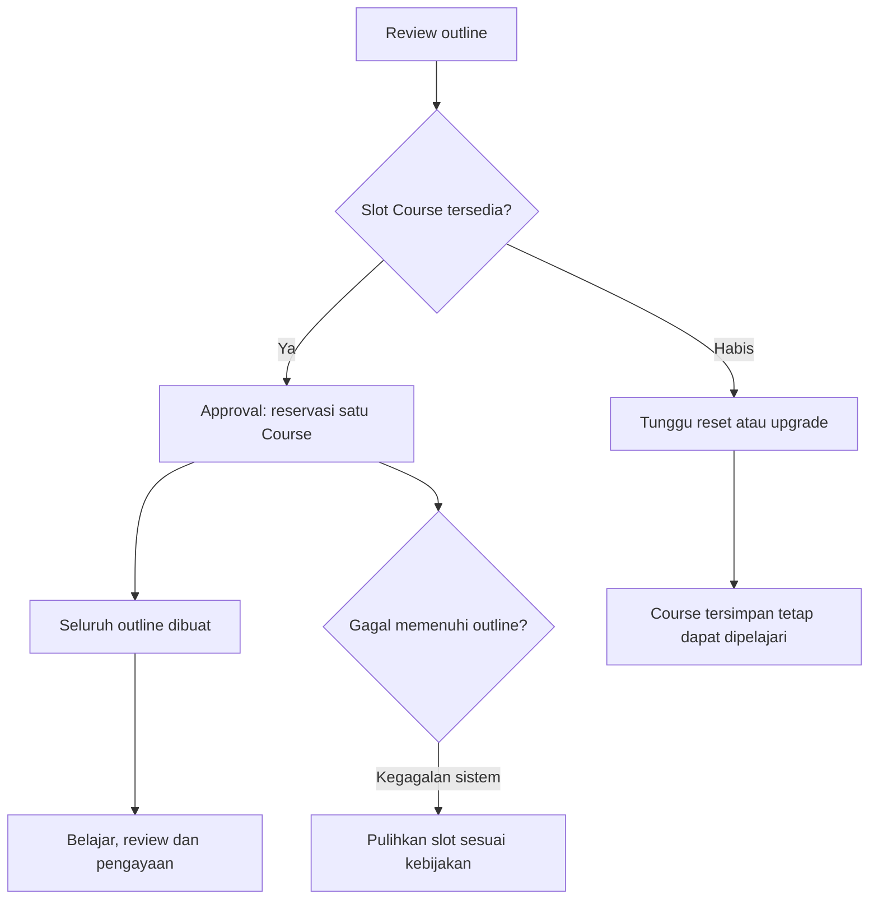

# 01 · Produk & Paket

Sumber: [Notion](https://app.notion.com/p/3f8abdd618738122878dde3cb0661765)

<!-- notion-content:start -->
## Arah produk

Ngertiin adalah SaaS belajar untuk pelajar SMA dan mahasiswa dengan materi serta tujuan belajar sendiri. Satu agent personal menemani pengguna lintas topik dan Course. Proyek production baru melanjutkan standar prototipe `ngerti.in`, memakai akun dan data baru.

## Visi jangka panjang

Ngertiin berkembang menjadi agent belajar personal yang proaktif: memahami tujuan belajar pengguna, mengingat konteks lintas percakapan dan Course, mengambil inisiatif yang relevan, serta melanjutkan pekerjaan belajar di background. Agent memilih kapan hasil atau saran layak disampaikan, dengan kontrol pengguna atas tindakan dan tingkat proaktivitas.

Pola kerja [Muse AI](https://muse.ai/), [Grok Bot](https://x.ai/bot), [Hermes Agent](https://hermes-agent.nousresearch.com/), dan [OpenClaw](https://openclaw.ai/) menjadi referensi untuk arah pengembangan ini. Referensi tersebut menginspirasi perilaku agent; kesetaraan seluruh fitur dan kemampuan bukan target v1.

## Scope v1

- Onboarding interaktif menuju Course pertama.
- Main chat, side chat, dan panel agent dalam Course; pada HP memakai drawer.
- Composer dengan file, pencarian konteks, pemilihan sumber dan outline melalui HITL.
- Course, Lesson, Practice per node, pengayaan opsional, flashcard tersimpan, dan streak.
- Soul yang dipersonalisasi, memory aktif, serta pesan proaktif per thread.
- Free dan Plus sejak peluncuran.

Practice mandiri, Exam builder, fitur Notes, dan migrasi data prototipe berada di luar v1.

V1 membuktikan pengalaman belajar end-to-end serta fondasi agent personal sesuai backlog yang telah disepakati. Agent pada akhir v1 memiliki soul, memory, tools belajar, dan proaktivitas terbatas dalam konteks belajar. Kelulusan v1 mengikuti acceptance criteria backlog, bukan keluasan kemampuan agent referensi.

Kemampuan agent yang lebih luas dikembangkan bertahap setelah fondasi v1 terbukti, berdasarkan kebutuhan pengguna dan evaluasi kualitas serta biaya. Visi jangka panjang tidak menambah scope atau mengubah prioritas backlog v1.

## Paket

| Per 30 hari | Free | Plus |
| --- | --- | --- |
| Harga | Rp0 | Rp49.000 |
| Course baru | 1 | 5 |
| Chat pengguna | 100 pesan | 300 pesan |
| Materi baru | 100 halaman ekuivalen | 200 halaman ekuivalen |

Baseline sementara untuk diuji. Normalisasi halaman lintas format, storage, dan biaya Course diselesaikan sebelum harga dipublikasikan.

Fitur, model, dan kualitas sama pada kedua paket. Satu Course mencakup seluruh outline yang disetujui; jumlah node dan aktivitas mengikuti kebutuhan belajar. Practice, flashcard, dan pengayaan tujuan yang sama tetap bagian Course.

## Kuota dan akses

Course dihitung sekali. Resume dan retry sistem tidak menagih Course kembali. Kebijakan periode, pembatalan, refund, dan downgrade diputuskan pada tiket billing.
<!-- notion-content:end -->
