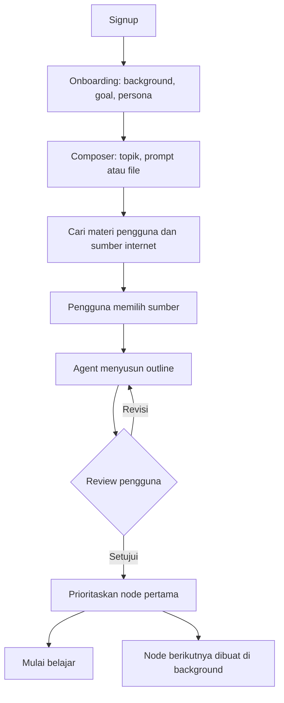
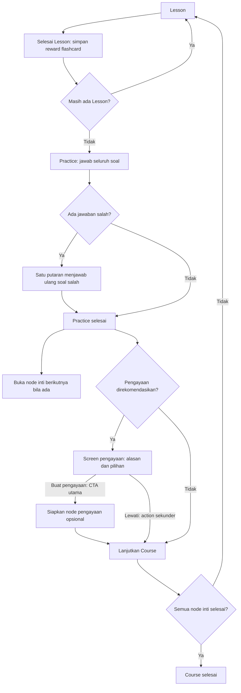
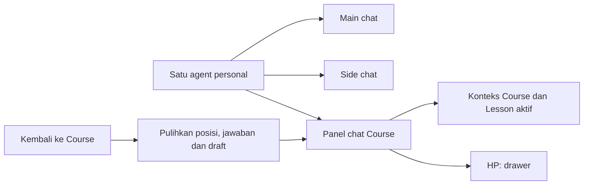
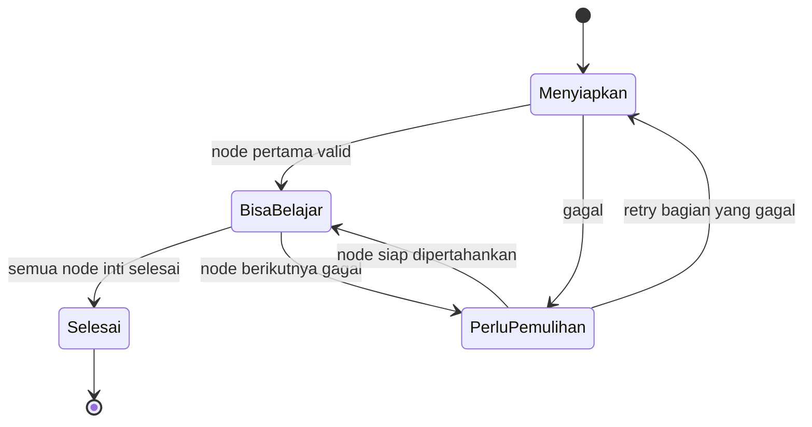

# 02 · User Flow

Sumber: [Notion](https://app.notion.com/p/3f8abdd6187381fda2dbea043a840c5a)

<!-- notion-content:start -->
## Membuat Course pertama

Tour kontekstual menunjukkan kemampuan composer dan attachment. Pengguna membuat Course nyata sebagai demo. Sumber dipilih pengguna; Course berdiri mandiri dari Study Space.

## Menyelesaikan node

Node berikutnya tetap terbuka setelah Practice selesai walaupun nilai rendah. Pengayaan tidak mengubah progress inti dan tidak memakai slot Course baru. Flashcard tersimpan untuk review; streak berasal dari aktivitas belajar valid.

### Screen pengayaan

Jika pengayaan direkomendasikan, tampilkan step/screen tersendiri dalam rangkaian penyelesaian Practice, dengan pola presentasi seperti screen streak dan flashcard. Screen muncul setelah seluruh soal dan putaran ulang jawaban salah selesai.

- Tampilkan konsep yang perlu diperkuat dan manfaat pengayaan secara singkat.
- **Buat pengayaan**: tombol utama yang menonjol; klik menyetujui tawaran dan memulai pembuatan node opsional.
- **Lewati**: action sekunder yang jelas; pengguna melanjutkan Course tanpa membuat pengayaan.

## Agent dan kembali belajar

Membuka chat mempertahankan sesi belajar. Slash command menuju flow yang sama dan tetap memakai HITL; nama command difinalkan pada implementasi.

## Loading dan recovery

Browser ditutup: job tetap berjalan. Koneksi putus: pulihkan state. Reward, jawaban, dan progress tidak digandakan. Sumber belum memadai: minta konteks tambahan sambil mempertahankan input. Outline lama tetap terlihat selama revisi.
<!-- notion-content:end -->
