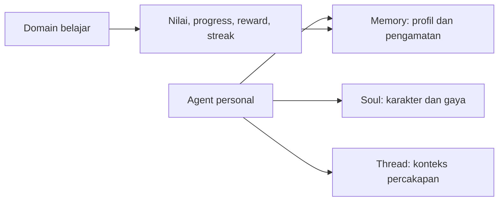
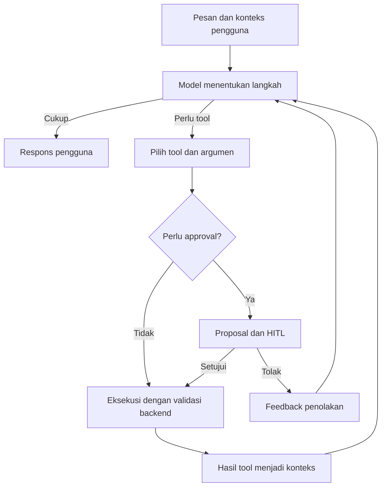
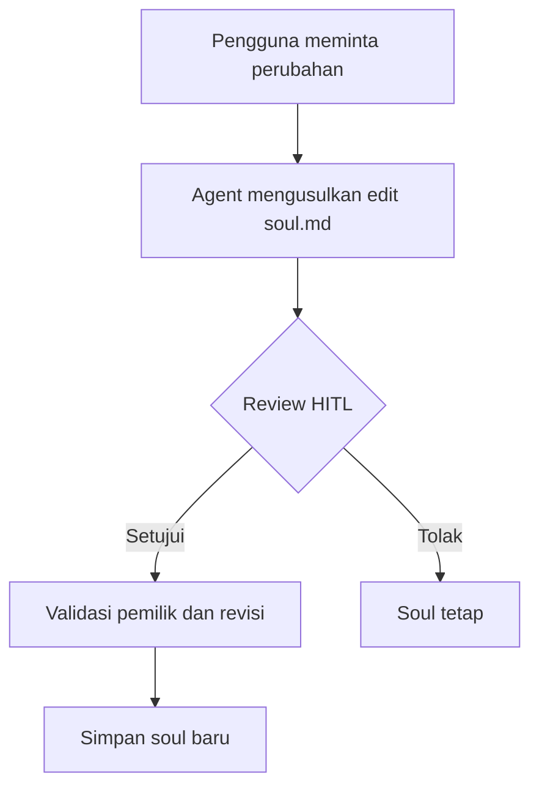
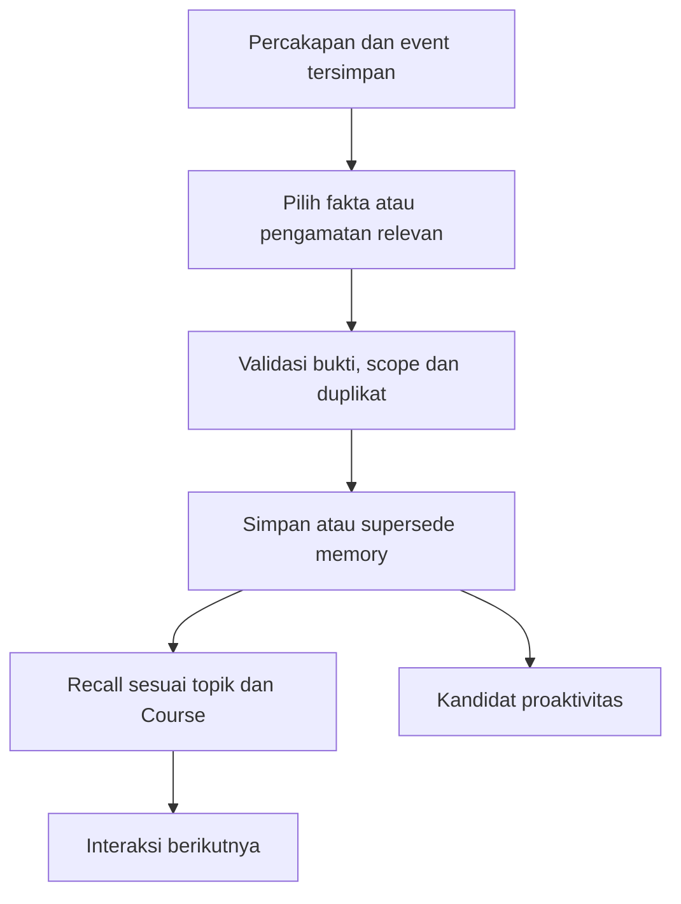
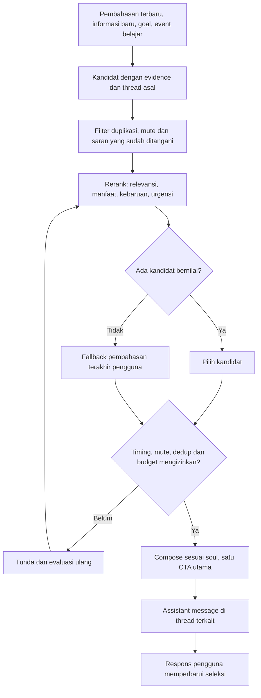

# 03 · Agent

Sumber: [Notion](https://app.notion.com/p/3f8abdd6187381658b61f4283ee83428)

<!-- notion-content:start -->
## Visi agent dan batas v1

Visi jangka panjang adalah agent belajar personal yang proaktif dengan pola kerja yang terinspirasi Muse AI, Grok Bot, Hermes Agent, dan OpenClaw: memahami tujuan, menjaga konteks, mengambil inisiatif yang relevan, dan melanjutkan pekerjaan di background dengan kontrol pengguna. Arah produk dijelaskan pada [01 · Produk & Paket](01-produk-dan-paket.md).

Spesifikasi di halaman ini menetapkan fondasi dan kemampuan v1 sesuai backlog. Proaktivitas v1 dibatasi pada konteks belajar, tools domain, budget, timing, dan approval yang dijelaskan di bawah. Kesetaraan keluasan kemampuan dengan produk referensi bukan kriteria kelulusan v1; kemampuan lebih luas dikembangkan bertahap setelah fondasi ini terbukti.

## Satu agent, soul dan memory berbeda tanggung jawab

Soul dan memory berlaku lintas thread milik pengguna. Fakta belajar tetap dimiliki domain aplikasi. Catatan berarti history, event, progress dan percakapan penting.

## Percakapan dan tools dinamis

Percakapan memakai LangChain `create_agent` dengan runtime LangGraph. Model menentukan kapan menjawab, mencari konteks, atau memanggil tool berikutnya berdasarkan hasil yang diperoleh. Percakapan dapat berjalan tanpa tool; urutan pemanggilan tool tidak ditentukan per topik.

Recall memory, membaca progress, dan pencarian sumber dapat berjalan otomatis dalam budget. Memory diperbarui melalui tool domain; perubahan soul dan Course mengikuti HITL. Tools tersedia sesuai konteks dan izin pengguna, dengan batas iterasi dan biaya.

Workflow yang panjang memakai execution ID tersendiri dan job background; chat menyimpan thread dan konteksnya sendiri. Proposal tertunda tidak menahan worker atau mengunci seluruh agent personal. Backend tetap memiliki approval, revision, kuota, dan otorisasi.

## Soul: pasif dengan HITL

Soul memakai Markdown dan revisi tersimpan di PostgreSQL. Backend menerapkan tepat isi yang disetujui. Memory atau job proaktif tidak mengubah soul; usulan persona yang ditolak tidak menjadi instruksi memory.

## Memory: aktif dan berbukti

Simpan profil ringkas, pengamatan belajar dengan evidence, serta history terpisah. Ambil konteks sesuai kebutuhan. Koreksi dan forgetting pengguna harus bertahan terhadap pengambilan ulang dari sumber yang sama. Detail UI dan budget memory berada pada tiket terkait.

## Proaktivitas dinamis per thread

- Maksimum **dua pesan proaktif per hari per pengguna, total lintas thread**.
- Quiet hours **21.00–07.00**; tidak mengirim saat pengguna fokus.
- Follow-up side chat masuk ke side chat itu; konteks Course masuk ke thread terkait. Pengingat umum dapat memakai main chat.
- Fallback memakai pembahasan terakhir pengguna dan tetap tunduk pada timing, mute, serta pencegahan pengulangan.
- Kandidat tidak dibroadcast ke beberapa thread. Informasi baru memiliki sumber yang dapat diperiksa.
- Pesan memiliki badge dan mute. Aktivitas atau perubahan Course ditawarkan melalui HITL.

Pemicu belajar tetap mencakup streak terancam, node selesai, dua hari absen, H-7 ujian jika jadwal diketahui, dan kondisi mentok. Timezone, focus detection, cooldown, ranking, serta jadwal evaluasi diselesaikan pada tiket proaktivitas.
<!-- notion-content:end -->
