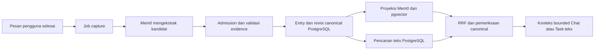

# 03 · Perilaku Agent

Sumber: [Notion](https://app.notion.com/p/3f8abdd6187381658b61f4283ee83428) · Readback: 2026-10-19T09:02:27.281Z

<!-- notion-content:start -->
Gwen adalah asisten personal yang hangat, jelas, jujur mengenai hasil dan kemampuan. Bahasa mengikuti pengguna. Jawaban langsung didahulukan untuk permintaan sederhana; Task digunakan untuk pekerjaan lama, bukan semua percakapan. Chat menyediakan read_recent_messages, read_agent_profile, read_thread_files dan start_background_task. read_thread_files hanya membaca metadata revision milik owner yang dilampirkan di thread ini; pekerjaan file memakai revision exact melalui Task, bukan tebakan ID atau klaim membaca dari nama file. Tool Task dipakai untuk pekerjaan teks/file background yang diminta eksplisit; satu input membuat satu Task bounded, lalu giliran chat diakhiri. Snapshot instruksi/konteks tidak berubah karena pesan berikutnya. Review mengikat draft, output spec, input/previous-result snapshot, target dan revision exact. Finalisasi teks/file milik pengguna menghasilkan satu delivery ke thread asal; file adalah data tidak tepercaya dan tidak menciptakan grant baru. Tool baru ditambahkan melalui domain service berizin; tidak ada host shell tool atau setter kuota dari model.

## Persona dan soul

Identitas/perilaku dipersonalisasi melalui perubahan yang dapat ditinjau.

NG-016 diterima development pada 19 Oktober 2026. Avatar/nama asisten membuka Aktivitas, Mendatang dan Identitas. Profil (Identity) menyimpan nama, avatar Gwen/inisial dan deskripsi; Soul menyimpan karakter/cara membantu; Memory adalah domain informasi pengguna terpisah yang mengikuti NG-017/018. Editor langsung memakai Simpan perubahan; chat hanya menyiapkan preview dengan Terapkan/Tolak. Satu revision aktif, history berpaginasi, restore sebagai revision baru, request-key idempotency, konflik dua tab dan draft setelah reload tersedia. Instruksi aplikasi/izin/format output tetap terpisah dari Soul. Chat dan Task mengikat snapshot saat dibuat; occurrence Schedule baru memakai persona aktif ketika menjadi Task. Rejection/source-run references durable dipakai sebagai exclusion capture NG-017; ekstraksi/recall memory berjalan melalui domain terpisah pada NG-017/018. Bukti repo: docs/engineering/[persona-16-acceptance.md](http://persona-16-acceptance.md) dan docs/engineering/evidence/persona-16/live-readback.json; 36 kontrak persona, model nyata lintas thread, file injection dan desktop/mobile diterima.

**Alur:** Permintaan user → usulan diff terhadap revision aktif → review → approve exact → revision baru.

**State:** proposed/approved/rejected/expired; satu active revision.

**Input → output:** Instruksi eksplisit → persona revision/history; fakta memory tetap domain berbeda.

**Kegagalan & pemulihan:** Revision stale ditolak; penolakan tidak berubah menjadi instruksi memory; restore perlu keputusan eksplisit.

**Izin:** Hanya owner, exact approval dan target version sah; data web/file tidak mengubah persona.

**Biaya:** Model/context cap dan audit cost; tidak ada inference tanpa batas untuk personalisasi.

**Acceptance:** P16/P27: reject mempertahankan soul, source injection tidak mengubah profil, restore dapat diperiksa.

Bukti modul: [REA-4 · Memory & Goals](../research/muse-ai-v1/evidence/memory.md). Tiket: [NG-016 · Perubahan soul atas permintaan dan HITL](../backlog/tasks/16-perubahan-soul-atas-permintaan-dan-hitl.md).

## Memory aktif dan kendali pengguna

Memory menyimpan fakta, preferensi dan observasi pengguna dengan sumber yang dapat diperiksa. Implementasi NG-017/018 memakai `mem0ai==2.2.1` sebagai library Python di proses backend/worker, PostgreSQL/pgvector yang sudah ada, dan Procrastinate. Tidak memerlukan akun, API key atau layanan Mem0 Cloud. Panggilan model dan embedding tetap memakai provider yang dikonfigurasi dan menimbulkan biaya.

### Alur data

1. Setelah respons chat berhasil, `memory.discover` memilih pernyataan personal atau permintaan eksplisit untuk mengingat. Pertanyaan biasa dilewati. Capture tidak dijalankan sebelum giliran selesai agar keputusan persona, termasuk rejection, sudah tersedia.
2. Backend memverifikasi owner dari autentikasi, capture setting, revisi/hash sumber, exclusion persona, secret dan perintah forget. API capture juga menerima file/result revision exact milik owner; file/result tidak otomatis ditangkap dan tidak memiliki tombol capture pada UI V1 ini. Assistant output dan web bukan sumber personal memory.
3. Mem0 mengekstrak paling banyak lima kandidat dari input maksimal 6.000 UTF-8 bytes. Kandidat terisolasi per owner/job dalam collection `ngertiin_memory_candidates_v1`. Hasil extraction belum tersedia untuk recall. Satu batch admission memeriksa kutipan sumber exact, jenis, confidence, key atribut dan apakah fakta baru, koreksi atau perubahan dunia. LLM mengusulkan makna; code menentukan legalitas write.
4. Transaksi pendek memeriksa ulang lease, generation, sumber dan suppression. `memory_entries`, `memory_revisions` dan `memory_evidence` menjadi sumber kebenaran. Entry memuat owner, jenis, confidence, status dan waktu; evidence memuat ID/revisi/hash sumber dan kutipan exact. Confidence di bawah 0,85 atau konflik yang belum jelas tetap candidate dan tidak masuk prompt.
5. Outbox memproyeksikan revisi aktif melalui Mem0 `add(infer=False)` ke `ngertiin_memory_active_v1`, tanpa ekstraksi ulang. Metadata menyimpan ID entry/revisi aplikasi. Record SDK dapat dibangun ulang dan bukan otoritas domain. Kandidat staging dibersihkan sesudah job; recovery juga membersihkan kandidat orphan setelah tiga menit.

### Recall dan penggunaan oleh agent

Sebelum Chat dan Task teks, aplikasi menggabungkan kandidat semantic Mem0, kandidat full-text PostgreSQL yang dicari secara independen, dan profil inti kecil. Full-text memakai konfigurasi `simple` dan `ts_rank_cd`; penggabungan memakai Reciprocal Rank Fusion. Bahasa Indonesia/English diteruskan ke embedding yang sama; tidak memerlukan model NLP bahasa Inggris tambahan.

Setiap hasil dihidrasi kembali dari canonical: owner harus sesuai, revision masih current/active, waktu berlaku sah, tidak suppressed dan sedikitnya satu evidence masih tersedia dengan hash yang sama. Stale/orphan vector tidak boleh masuk prompt. Kegagalan semantic search menggunakan full-text/profil inti yang masih sah. Akun tanpa entry aktif tidak melakukan embedding recall.

Envelope konteks dibatasi 4.000 UTF-8 bytes, termasuk label dan metadata, sebagai batas token konservatif. Chat menyediakan `read_user_memories`; `remember_current_message` hanya mengakui pending dan menunggu turn selesai. Memory adalah data, tidak mengubah Soul, izin tool, saldo atau status Task.

Run/Task menyimpan referensi revision dan generation yang dipakai. Referensi diperiksa sebelum model/tool, progress dan publication. Koreksi/forget menghentikan pekerjaan aktif yang memakai revision lama, menghapus draft, approval tertunda dan snapshot draft revisi tersebut serta checkpoint yang terlacak, dan mencegah saver ber-lease lama menulis kembali. Riwayat untuk model menyaring source turn yang dikecualikan dan jawaban dengan lineage memory yang dicabut. Snapshot instruksi/izin Task tetap utuh; hasil yang sudah dikirim tidak ditarik kembali. Retry Task memakai revision baru dan menyusun ulang draft dengan konteks yang masih sah.

### Kendali pengguna dan lifecycle

Avatar/nama asisten → **Identitas → Ingatan tentangmu** menyediakan daftar berpaginasi, jenis/status, kutipan dan label sumber, edit, riwayat, forget serta capture toggle. Revision stale mendapat 409 dan meminta data terbaru. Request key mengembalikan receipt yang sama pada retry exact; key dengan isi berbeda ditolak. Browser menyimpan fingerprint/key retry, bukan salinan teks ingatan di sessionStorage.

| Tindakan | Hasil |
| --- | --- |
| Koreksi informasi salah | Revisi lama `corrected`; revisi baru aktif dengan evidence editor. Informasi salah tidak dianggap kebenaran historis. |
| Fakta benar kemudian berubah | Revisi lama `historical` dan `valid_to`; versi baru berlaku kini. Riwayat tersedia untuk inspeksi; recall otomatis hanya mengambil fakta yang berlaku kini. |
| Sumber hilang/berubah | Dukungan sumber itu tidak sah. Fakta tetap dapat dipakai hanya jika evidence independen lain masih sah. UI menandai sumber tidak tersedia. |
| Lupakan | Segera cabut penggunaan dan tambah suppression; hapus plaintext entry/revision, kutipan evidence, payload capture serta checkpoint konteks yang terlacak. Outbox menghapus proyeksi pencarian. Pending cleanup terlihat dan tidak menunda revocation. |
| Capture off | Blok job baru serta commit hasil job in-flight melalui generation fence. Ingatan lama dan seluruh kontrol tetap tersedia. Tidak menghapus ingatan lama. |

Source revision yang telah dilupakan dikecualikan dari capture ulang. Kemunculan biasa dalam sumber baru juga tidak membatalkan suppression atribut. Permintaan baru dari pesan pengguna yang secara eksplisit mengatakan **“ingat lagi” / “remember again”**, dengan evidence baru yang lolos admission, dapat membuka suppression atribut tersebut. Edit langsung juga merupakan keputusan eksplisit owner.

Forget tidak menghapus chat/file/result asli, jawaban yang sudah terkirim, backup atau semua turunan arbitrer yang tidak terlacak. Penghapusan sumber menggunakan operasi sumber tersendiri. Backup mengikuti retention operasional; restore tidak boleh menghilangkan suppression/tombstone sebelum traffic memory dilayani.

### Operasi, biaya dan pemulihan

Jalankan `make install`, `make migrate`, lalu restart worker. Migration incremental `0008_personal_memory` tidak mereset data. Konfigurasi/default ada di `.env.example`: extraction `gpt-5-mini`, embedding `text-embedding-3-small`, dimensi 1.536. Adapter extraction menggunakan JSON terbatasi, output maksimal 2.000 token dan transport yang sama dengan meter biaya. Embedding model/dimensi diikat fingerprint registry; perubahan konfigurasi indeks ditolak dan memerlukan rebuild terencana, bukan mencampur embedding lama dan baru.

`memory_cost_events` mereservasi setiap HTTP attempt sebelum request, termasuk admission dan embedding. Batas konservatif: 160.000 unit/job, 250.000 unit/akun/hari dan 2.500.000 unit/global/hari UTC. Usage provider yang terkonfirmasi mengganti reservasi; unknown outcome tetap menahan estimasi, tidak diasumsikan gratis. Ledger tidak menyimpan prompt/teks memory. Angka ini merupakan internal token units, bukan harga USD atau SKU pelanggan. Inspect/edit/forget/capture-off tidak menggunakan allowance chat atau inference.

Capture: lease tiga menit, timeout attempt 150 detik, maksimal tiga attempts; extraction/admission yang sudah tersimpan diteruskan saat retry. Index: lease 90 detik, maksimal lima attempts; delete diprioritaskan. Maintenance memulihkan lease expired dan outbox. Sesudah batas attempts, operator perlu meninjau penyebab dan mengantrekan ulang operation yang tepat; UI tidak menyebut cleanup selesai selama masih pending.

Mem0 telemetry dimatikan sebelum import. History SQLite SDK memakai `:memory:` per operation dan ditutup eksplisit, termasuk saat delete, sehingga tidak meninggalkan history SDK plaintext pada disk. Secret gate bersifat best effort; bukan janji deteksi semua rahasia. LLM admission juga memerlukan evaluasi kualitas berkelanjutan dan tidak menjamin setiap inferensi benar.

Verifikasi: `make memory-inspect`; trial provider nyata: `uv run --project apps/backend python scripts/inspect_memory.py --live`. Inspector memakai database disposable; lihat `docs/engineering/memory-17-acceptance.md` untuk bukti dan batas environment.

Bukti modul: [REA-4 · Memory & Goals](../research/muse-ai-v1/evidence/memory.md). Tiket: [NG-017 · Memory aktif capture evidence dan recall](../backlog/tasks/17-memory-aktif-capture-evidence-dan-recall.md) · [NG-018 · Pengaturan inspeksi dan koreksi memory](../backlog/tasks/18-pengaturan-untuk-inspeksi-dan-koreksi-memory.md).

## Goals dan langkah berikutnya

Tujuan umum memberi konteks dan bukti kemajuan tanpa menjadi izin eksekusi.

**Alur:** User menyebut target → review success criteria → simpan → optional task/schedule → evaluasi evidence → user pause/ubah/selesaikan.

**State:** active/paused/completed/archived; optimistic revision.

**Input → output:** Target/horizon optional/evidence → next action dan progress bertaut task.

**Kegagalan & pemulihan:** Task gagal tidak menyelesaikan goal; target berubah memerlukan replan eksplisit; pause berlaku untuk inisiatif berikutnya.

**Izin:** Goal owner-scoped; tindakan eksternal dan schedule mengikuti izin tersendiri.

**Biaya:** Parent goal/task/account budget membatasi child tasks; evaluasi progress dibatasi.

**Acceptance:** P17/P09: banyak task untuk satu goal, kegagalan, perubahan target serta pause teruji.

NG-038 diterima development 19 Oktober 2026. PostgreSQL menyimpan Goal, revisi immutable, bukti dan proposal 30 menit. revision mengontrol konflik; plan_revision berubah saat target/kriteria/horizon berubah. Edit next action/nama/budget mempertahankan bukti. Readback memeriksa sumber Task/Result exact; sumber berubah/hilang tidak dihitung terpenuhi. Completion memerlukan seluruh kriteria dan keputusan pengguna. GoalRef pada Task/Jadwal mengikat target yang ditinjau; pause/complete/archive menahan pekerjaan berikutnya tanpa membatalkan Task yang sudah dibuat. Parent cap total default 360.000 unit token-work membatasi Task/hasil turunan bersama batas akun/global; bukan harga komersial. Evaluasi panel tidak memanggil model. Implementasi: `docs/engineering/goals-runtime.md`; penerimaan: `docs/engineering/goals-38-acceptance.md`.

Bukti modul: [REA-4 · Memory & Goals](../research/muse-ai-v1/evidence/memory.md). Tiket: [NG-038 · Goals umum dengan evidence progress](../backlog/tasks/38-goals-umum-dengan-evidence-progress.md).

## Tools permission dan approval

Agent mengusulkan aksi; backend menentukan legalitas scope, target dan revision.

**Alur:** Model proposes → backend validate owner/grant/budget → exact review bila diperlukan → execute → reconcile outcome.

**State:** proposed/allowed/waiting_user/executing/succeeded/failed/unknown/revoked.

**Input → output:** Typed args, target/version, idempotency key → result/error/evidence.

**Kegagalan & pemulihan:** Stale grant/approval ditolak; unknown external effect direkonsiliasi sebelum retry; cancellation fences worker lama.

**Izin:** Read/reversible sandbox actions mengikuti scoped grant; external writes memerlukan izin eksplisit yang cocok target/risiko; tidak menjalankan nama fungsi dari client.

**Biaya:** Per-tool/task/account hard cap; provider retry tetap dicatat meski product charge dipulihkan.

**Acceptance:** P04/P05/P08/P09/P10/P27; input file/web tetap data dan tidak menciptakan grant.

Bukti modul: [REA-5 · Permissions](../research/muse-ai-v1/evidence/permissions.md). Tiket: [NG-033 · Task background dan approval umum](../backlog/tasks/33-task-background-dan-approval-umum.md) · [NG-035 · Eksekusi kode dalam sandbox](../backlog/tasks/35-eksekusi-kode-dalam-sandbox.md) · [NG-036 · Browser VNC live desktop dan takeover](../backlog/tasks/36-browser-vnc-live-desktop-dan-takeover.md).

## Proaktivitas dan delivery

Agent boleh menawarkan bantuan yang relevan tanpa membanjiri pengguna.

NG-019 diterima development 19 Oktober 2026. LLM `gpt-6-luna` membentuk usulan; Jev `jev-1.13.0` menilai relevance/benefit/timing (Score), novelty/grounding/needs-input (Noul); code memeriksa sumber, minimum per dimensi, dedup dan memilih paling banyak satu kandidat atau no-op. Evidence memory/Goal/Task-result dan konteks percakapan mengikat owner, revision/hash, expiry dan thread. Laporan pengguna bukan verifikasi independen; budget token-work bukan uang. Horizon bebas tidak menjadi deadline.

Marker event transactional, Procrastinate, receipt idempotent, lease dan reservation per stage membatasi evaluasi. Koreksi/forget memory, perubahan/pause Goal atau sumber dihapus mempurge konteks kandidat yang terlacak dan memagari worker lama. Satu attempt generasi dan satu Jev maksimal; unknown cost tidak diasumsikan gratis. Default pratinjau akun nonaktif; sarana inspeksi ada di `/dev/system` dan endpoint diagnostics owner-scoped. NG-019 sendiri tidak memberi grant atau membuat Task; delivery otomatis kini mengikuti NG-020 dan preferensi produk.

Penerimaan: 68 kontrak, worker/provider nyata Indonesia/English, desktop/320px, usage terkonfirmasi dan regresi domain terkait. Rincian repo: `docs/engineering/proactivity-runtime.md`, `docs/engineering/proactivity-19-acceptance.md`, `docs/engineering/evidence/proactivity-19/`. Threshold konservatif masih memerlukan kalibrasi lebih luas. Quiet hours, jeda fokus/snooze, intensitas, mute thread/Goal serta cap pesan atomik diterapkan pada delivery NG-020. Riset Muse mendukung aspek keputusan; model dan algoritma backend Muse belum diketahui.

NG-020 diterima development pada 19 Oktober 2026. Setelah penjelasan onboarding, akun baru ditawari Normal; delivery memerlukan penyimpanan pilihan. Pratinjau NG-019 bukan consent produk, dan pilihan Nonaktif dipertahankan. Chat dapat membaca dan mengubah intensitas akun/thread/Goal serta jeda dari instruksi langsung pengguna saat ini; kontrol UI memakai state/revision/receipt yang sama. Kontrol tidak mengubah Soul, memory, Task, jadwal atau grant eksternal.

Kandidat informatif boleh tanpa action/pertanyaan; needs_input harus memuat pertanyaan spesifik. Sebelum pengiriman, backend memeriksa sumber/revision/hash, watermark konteks, target thread, preferensi terbaru, quiet hours IANA, scope/jeda, minimum semantik, dedup lintas thread dan cap gabungan. Pesan mandiri, event, receipt dan pemakaian cap ditulis atomik; retry/race tidak menggandakan pesan. Navigasi menunjukkan unread; pesan menampilkan waktu dan alasan relevansi. Lineage yang dicabut tidak direhidrasi ke konteks model.

Kebijakan awal Ngertiin, bukan angka Muse: ceiling per 24 jam berjalan Lebih tenang/Normal/Lebih aktif adalah 1/3/6 pesan dengan jarak minimum 12/4/1 jam. Override scope tidak menaikkan cap total akun. Jam tenang awal 22.00–08.00 mengikuti timezone yang ditinjau; intensitas bukan target cadence. Hasil Task/Jadwal yang memang diminta tetap tersimpan melalui jalur delivery tersendiri dan tidak diduplikasi sebagai pesan proaktif.

Bukti NG-020: 105 kontrak PostgreSQL disposable, regresi Scheduler82/Task55/Memory62/Goals74/File47/quota46, check/build serta browser Clerk desktop1440/mobile320. Chat nyata mengurangi saran thread dan mematikan saran global. Fixture positif terkontrol dikirim satu kali oleh worker saat browser about:blank pukul 16.58 WITA; pesan informatif tetap terbaca setelah kembali. Dua evaluasi provider nyata memilih no-op; kualitas seleksi positif belum dibuktikan oleh fixture delivery terkontrol. Kalibrasi luas tetap NG-041. Bukti repo: `docs/engineering/proactivity-delivery-runtime.md`, `docs/engineering/proactivity-20-acceptance.md`, `docs/engineering/evidence/proactivity-20/`. Audit diakhiri dengan proaktivitas nonaktif dan Goal fixture diarsipkan.

**Alur:** Evidence memory/goal/result → candidate/rank → no-op atau policy → dedup → kirim ke thread asal.

**State:** candidate/eligible/snoozed/expired/delivered/discarded; delivery pending/sent/failed.

**Input → output:** Evidence, relevansi, expiry, preferences → satu usulan/hasil yang punya alasan.

**Kegagalan & pemulihan:** Tidak ada kandidat layak berarti diam; quiet hours/mute/cap dicek ulang saat kirim; dua worker tidak menggandakan pesan.

**Izin:** Opt-in kontrol user, mute/snooze; proaktivitas tidak memberi izin aksi eksternal baru.

**Biaya:** Global daily cap atomik dan evaluation budget; hasil Schedule yang diminta punya policy delivery terpisah.

**Acceptance:** P21/P22/P23: no-op sah, cap lintas thread, kandidat basi dibuang, scheduled result tetap tersimpan.

Bukti modul: [REA-2 · Task & Scheduler](../research/muse-ai-v1/evidence/task.md). Tiket: [NG-019 · Kandidat proaktif dinamis dan reranking](../backlog/tasks/19-kandidat-proaktif-dinamis-dan-reranking.md) · [NG-020 · Delivery proaktif per thread dan batas global](../backlog/tasks/20-delivery-proaktif-per-thread-dan-batas-global.md).

## Tool komputasi NG-035

`start_background_task` mendukung `use_computation=true` untuk Python offline atas permintaan eksplisit pengguna. Model mengusulkan pekerjaan; backend menentukan owner, input exact, output spec, budget dan legalitas dispatch. Shell/supervisor terkontrol berada dalam adapter, bukan eksekusi host atau tool mutasi domain milik model.

Isi file, sampel, error dan histori adalah data tidak tepercaya. Input tidak dijalankan sebagai script dan tidak memberikan akses profil/memory/jadwal, file lain, secret atau web. Candidate dan ringkasan berasal dari eksekusi nyata; exit0 saja belum sukses sampai hasil lengkap tervalidasi, dipersist dan cleanup terkonfirmasi.

Review mengikat revision hasil, terpisah dari scoped grant komputasi. Retry publication tidak menghitung ulang program; unknown resource/receipt direkonsiliasi lebih dahulu. Implementasi dan bukti: [NG-035 · Eksekusi kode dalam sandbox](../backlog/tasks/35-eksekusi-kode-dalam-sandbox.md) serta `docs/engineering/sandbox-35-acceptance.md`. Browser/action eksternal tetap mengikuti NG-036 dan izin terpisah.

## Tool browser dan private takeover NG-036

`start_background_task(use_browser=true)` membuat Task browser terpisah dari Python. Backend mengambil URL otomatis hanya dari permintaan pengguna asli; URL model yang berbeda memerlukan proposal. click/type/key selalu ditahan sebelum dispatch. Approval mengikat action, control version dan fingerprint target/konteks yang diperiksa lagi; review hasil akhir tetap terpisah.

Model hanya menerima screenshot transient saat control agent. Selama handoff/human tidak ada observasi baru; gateway input backend dibatasi menurut lease. Login/password/OTP/file/iframe meminta bantuan manusia. Profil/cookie tidak memiliki tool ekspor dan tidak dipasang pada Python. Return menunggu channel lama tertutup, mengambil layar baru dan mencatat control_return agar agent menilai perubahan tanpa mengulang permintaan login yang sudah selesai.

Unknown action receipt tidak pernah diputar ulang otomatis. Workspace menunggu cleanup dan pemeriksaan manusia; pengakuan outcome mengakhiri Task lama. Candidate yang tersimpan setelah interupsi tetap memerlukan konfirmasi stop sebelum dipublikasikan. Implementasi dan penerimaan [NG-036 · Browser VNC live desktop dan takeover](../backlog/tasks/36-browser-vnc-live-desktop-dan-takeover.md) serta `docs/engineering/computer-36-acceptance.md`; 47 kontrak dan walkthrough login/Logout nyata.
<!-- notion-content:end -->
