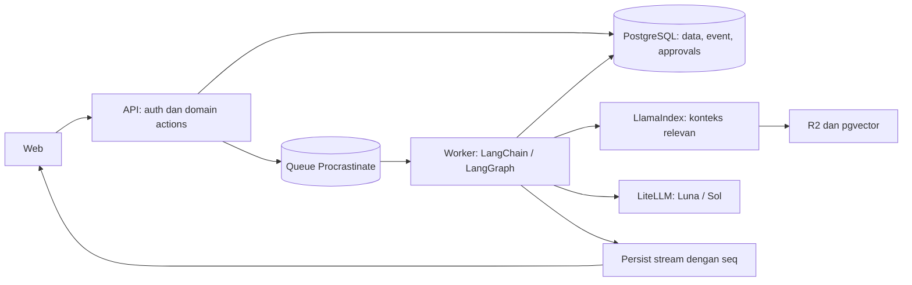
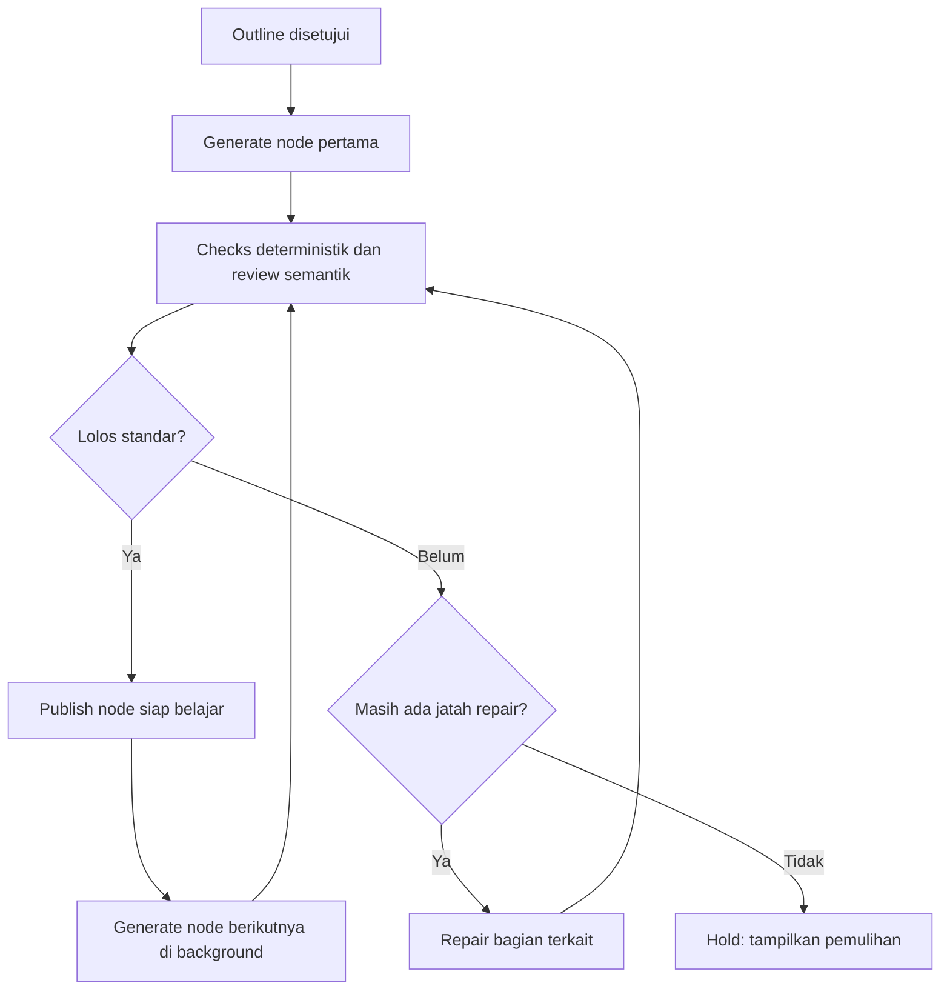
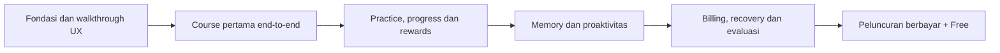

# 04 · Arsitektur & Delivery

Sumber: [Notion](https://app.notion.com/p/3f8abdd6187381198256f4ee69db1e78)

<!-- notion-content:start -->
## Prinsip delivery

Arsitektur mendukung arah jangka panjang agent belajar personal yang proaktif, sebagaimana dijelaskan pada [01 · Produk & Paket](01-produk-dan-paket.md). Implementasi v1 mengikuti backlog dan acceptance criteria yang telah disepakati; kesiapan memperluas kemampuan agent tidak mengharuskan seluruh kemampuan produk referensi dibangun pada v1.

Pemilihan teknologi mempertimbangkan ruang pengembangan jangka panjang dan keterbacaan kode. Tambahkan kemampuan serta infrastruktur ketika kebutuhan dan manfaatnya terbukti. Kelulusan v1 diukur dari alur belajar, fondasi agent personal, dan proaktivitas terbatas yang berfungsi sesuai backlog.

## Stack acuan

| Bagian | Pilihan |
| --- | --- |
| Web | TanStack Start + React |
| API dan auth | FastAPI + SQLModel + Alembic; Clerk |
| Worker | Procrastinate |
| Agent dan retrieval | LangChain create_agent + LangGraph; LlamaIndex |
| Data dan storage | PostgreSQL 16 + pgvector; Cloudflare R2 |
| Model gateway | LiteLLM |
| Observability dan checks | LangSmith + structlog; Ruff + pytest/anyio |

Pembagian monorepo difinalkan pada tiket fondasi.

## Agent dinamis dan workflow terstruktur

- **LangChain** `create_agent` menjalankan percakapan personal: model memilih tool, argumen, dan urutan langkah sesuai kebutuhan, atau langsung menjawab.
- **LangGraph custom** menjalankan pipeline terstruktur seperti generation Course, validasi, repair, dan publikasi.

Agent LangChain menggunakan runtime LangGraph; keduanya berbagi kemampuan checkpoint dan pause/resume. Urutan tool dalam percakapan tidak dikunci menjadi workflow per topik.

Perilaku percakapan dan agent loop: [03 · Agent](03-agent.md). [Acuan framework](https://docs.langchain.com/oss/python/langchain/overview).

## Eksekusi durable

Data aplikasi memiliki approval, revision, kuota, dan progress. Checkpoint melanjutkan pekerjaan. Identitas akun berasal dari auth server; read/write/job dibatasi pada pemiliknya.

## Generasi dan quality gate

Port standar Lesson/soal dari prototipe dengan rubric dan fixture. Kedalaman, grounding, jawaban, ambiguitas dan variasi format diperiksa sebelum publish; bagian valid dipertahankan saat repair. Batas repair menghentikan loop tanpa menerbitkan hasil gagal.

## Model dan biaya

| Model | Tugas awal |
| --- | --- |
| GPT-6 Luna | Chat rutin, analisis materi, draf Lesson/soal, kandidat memory |
| GPT-6.1 Sol | Perencanaan Course, review semantik, repair dan penalaran sulit |

Routing sama untuk Free dan Plus. Target generasi **sekitar Rp2.000/Course belum terbukti**. Benchmark prototipe mengindikasikan Rp1.500–Rp3.400/node untuk teks; biaya lifecycle dan human review tetap perlu diukur sebelum publikasi paket.

## Urutan delivery

P0 diperlukan untuk peluncuran; P1 peningkatan setelah alur inti. Tiket menjadi tempat acceptance criteria, dependencies, dan keputusan implementasi. Status Done mensyaratkan verifikasi perilaku; estimasi biaya dan SLA harus dibuktikan dengan data.
<!-- notion-content:end -->
