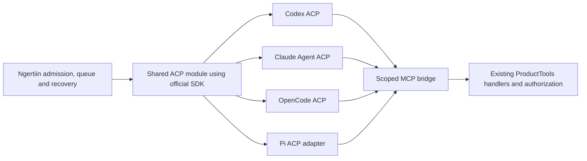

# ACP harness integration brainstorming

Date: 2026-11-16. Status: source-backed proposal; no harness installation, login, inference, or native acceptance was performed. Targets: Codex, Claude Agent, OpenCode, and Pi through ACP. This document does not change existing milestone acceptance or retire Muse.

## Recommended shape

**Use one ACP client and one scoped MCP bridge across the four harnesses. Reuse the SDK's protocol types and behavior; retain Ngertiin's durable application lifecycle.** The goals are cheaper harness integration and fewer locally maintained protocol implementations. Matching schemas alone does not establish adapter reliability.

- Start with ACP wire v1 and a pinned official TypeScript SDK. SDK 2.x does not mean ACP wire v2. Each agent may use a different SDK release; test the negotiated wire contract rather than forcing matching dependency versions. Use one consistent client entrypoint and opt into unstable features/extensions explicitly; draft v2 is not a prerequisite. [SDK entrypoints](https://agentclientprotocol.github.io/typescript-sdk/).
- Reuse the existing [`HarnessAdapter` / `HarnessClient`](../../apps/server/src/harness/client.ts) seam initially. Add one `harness/acp/` module for SDK connections, session operations, and a single projection into product events. Remove duplicated protocol interfaces inside that module; simplify the outer interface where it adds no product behavior.
- Profiles own launch/version selection, private process context, authentication, and named extensions. New harnesses should add a profile and verification, rather than another prompt/stream/cancel state machine. Ngertiin still owns process cleanup and execution-domain placement.
- Generalize the existing [`MuseTools` proxy](../../apps/server/src/harness/muse/tools.ts) into the shared session tool bridge. Keep native transport credentials separate from the per-run ProductTools lease; a mutable active-run pointer alone cannot attribute delayed calls safely. The existing Muse SDK adapter remains outside this migration.
- Keep harness identity (`codex`, `claude`, `opencode`, `pi`), transport (`acp`), and model provider separate. OpenCode/Pi are multi-provider harnesses: account, provider, model, and billing selection must remain explicit and frozen per run.

## Implementation modules and interfaces

These are proposed file responsibilities, not additional frameworks or files created by this research:

| Module | Responsibility and existing seam |
| --- | --- |
| `harness/acp/adapter.ts` | Implements the existing `HarnessAdapter`; creates a scoped SDK peer and returns `HarnessClient`. Reuse SDK operations internally instead of defining another full ACP interface. |
| `harness/acp/connection.ts` | Owns the process tree, allowlisted environment, streams, redaction, deadlines, and process generation. Reuse a lane connection only when turn/tool correlation is proved; otherwise rotate the process with fresh MCP configuration. Scope SDK helper lifetimes deliberately. |
| `harness/acp/projection.ts` | One mapping from SDK updates/results to bounded product events and interaction views. Provider-specific metadata is handled by negotiated extension hooks. |
| `harness/acp/profiles.ts` | Four launch/auth profiles: executable and runtime pins, private directories, allowed settings sources, instruction delivery, and supported extensions. No per-profile queue or streaming loop. |
| `harness/session-tools.ts` | Shared MCP session proxy extracted from `MuseTools`, forwarding through the existing `ProductTools` lease and authorization. |

Reuse [`AccountService` / `HarnessAccounts`](../../apps/server/src/harness/accounts.ts) for connection management, extending their provider registry. Authentication stays provider-specific; requests to authenticate, connect a provider, or alter credentials must not be inferred from ordinary agent output.

Extend existing records rather than adding a second run journal:

| Record | Required integration data |
| --- | --- |
| Connection / admitted selection | Existing owner, organization/actor, grants, account and billing, plus an explicit provider ID where the harness is multi-provider. Keep credentials in private storage. |
| Native binding | Harness and transport, adapter/runtime version, negotiated protocol, ACP session ID, process generation, and instruction/workspace revision. Retain any observed provider-native session ID separately. |
| Run / dispatch | Reuse `run.id`, `dispatch_token`, and `authority_epoch` as the application attempt identity. Add transport correlation only where needed; provider turn IDs remain nullable. Never expose dispatch credentials in ACP metadata, logs, or UI. |

## One request lifecycle for all profiles

1. **Prepare:** resolve the admitted connection, agent/thread, grants, and execution domain. Provision private native state and the MCP proxy before starting the pinned executable.
2. **Initialize and authenticate:** negotiate ACP v1/capabilities, then use the selected connection's supported auth path. Background jobs return an actionable login-required state instead of starting an interactive login. Keep installation, login, catalog, inference, and product-tool readiness separate.
3. **Open or restore:** create a session or explicitly load the authorized binding, supplying current MCP configuration and instructions. Verify ownership/generation before load; process restart does not authorize a different account or native transcript.
4. **Discover and configure:** read returned `configOptions` and apply only allowed, advertised selections before the prompt. If no standalone catalog exists, use a private discovery session without inference, then close it. A session's model projection must not silently replace an account-wide catalog. Validate input modalities/settings before dispatch; do not silently discard unsupported attachments. Mid-run picker changes apply to later work.
5. **Dispatch:** reserve the existing run/token/epoch, attach fresh scoped memory, skills, references, and attachments, activate its tool lease, and send one `session/prompt` per lane. First correlated processing evidence can advance the run without fabricating a provider turn ID.
6. **Project:** process streamed updates and interactions in order. Admit MCP effects only through the captured current lease; reject stale callbacks and preserve response ordering, including a product self-stop receipt before transport interruption.
7. **Settle:** flush final updates, persist the terminal observation, and revoke/drain the run's tool lease. Keep the process open only if old work cannot acquire the next run's privileges; otherwise close it before explicit reload with fresh MCP configuration. Cancel intent, a confirmed stopped turn, and surviving background work remain separately observable.
8. **Recover:** after lost acknowledgement, retain `unknown` and revoke privileges. Explicitly reload with fresh configuration; reconcile using matching native/effect receipts when available. Replayed conversation text is not proof that an external effect did or did not happen.

The operations above use the [ACP session contract](https://agentclientprotocol.com/protocol/v1/session-setup), [prompt/cancel contract](https://agentclientprotocol.com/protocol/v1/prompt-turn), and [config options](https://agentclientprotocol.com/protocol/v1/session-config-options). Readiness, leases, persistence, and admission are Ngertiin implementation responsibilities.

### Instructions, skills, and catalog ownership

Preserve [`sessionInstructions` and `runLearningContext`](../../apps/server/src/harness/instructions.ts). Use a negotiated system-prompt capability when supported; otherwise use a verified profile-specific instruction route. Do not assume every ACP peer accepts a universal system-prompt field or silently downgrade application instructions to ordinary user text. Codex's pinned [append-only instruction implementation](https://github.com/agentclientprotocol/codex-acp/blob/f3208913693bd4d5171d6c6b9be5ec1ff96c6431/src/ClientSystemPrompt.ts) and Claude's hook below have different behavior.

When instructions must change immediately, create a fresh native session and binding with authorized retained context, or use a supported compaction/update path and verify application. Merely replacing a binding while resuming the same native session is insufficient. Keep application skills pinned and editable by their owner; inherited harness skills stay separately attributed and read-only. ACP command discovery is not proof of a complete skill inventory. Continue explicit attachment reads and artifact publication; a native resource URI or diff is not automatically an authorized downloadable artifact.

Extend [`assertScopedCatalog`](../../apps/server/src/harness/catalog-policy.ts) for all four profiles. Allow only server-provisioned native MCP/settings needed by the integration; reject ambient host/project/ancestor credentials, hooks, and plugin catalogs that bypass app grants. For Pi's file-config route, introduce a narrow trusted configuration exception rather than weakening the whole catalog policy.

## Replace abstractions and expose harness features

| Current Ngertiin implementation | ACP adoption | Expected result / limit |
| --- | --- | --- |
| [retired `CodexRpc`](../development/history.md#retired-codex-execution--2026-11-16): framing, pending responses, routing | Official SDK streams and typed requests/notifications | Remove protocol plumbing from ACP execution; preserve launch, shutdown, redaction, and deadlines. |
| Separate native session/prompt/cancel mappings | Standard session operations and terminal prompt response | One mapping for ACP harnesses. History replay and execution-outcome reconciliation remain distinct. |
| Native message/tool parsers and [`NativeEvent`](../../apps/server/src/harness/contracts.ts) mapping | SDK session updates, content blocks, and tool-call types | One product-event projector, including partial-update merging. Reasoning, commands, and raw observations remain private. |
| Hand-authored capability defaults | Initialization negotiation plus observed integration support | Derive supported operations from the peer and verification; retain `unknown` when evidence is missing. |
| Model/reasoning selectors and mappings | Agent-provided `configOptions` and updates | Generate compatible selectors. Retain account catalogs, authorization, and frozen provider selection. |
| Muse-specific approval/question wire shapes | Permission requests and elicitation | Generic interaction presentation/responses; preserve the durable journal, stale-answer checks, and cancellation behavior. |
| Codex dynamic-tool wrapper and native MCP injection | Session `mcpServers`, with supported HTTP or stdio transport | One bridge/catalog for existing Goals, memory, artifact, collaboration, and machine tools. ACP does not supply product handlers. |
| Custom discovery of native commands | `available_commands_update` | Offer advertised compact/review commands through normal admission; exclude commands that bypass product lifecycle ownership. |
| Limited progress/context observations | Agent plans, usage, compaction, and session metadata updates | Add progressive disclosure for steps, reported context/usage, and compaction. Missing usage stays unknown; an agent plan does not create a Goal. |

Protocol sources: [sessions and MCP](https://agentclientprotocol.com/protocol/v1/session-setup), [updates and cancellation](https://agentclientprotocol.com/protocol/v1/prompt-turn), [initialization](https://agentclientprotocol.com/protocol/v1/initialization), [configuration](https://agentclientprotocol.com/protocol/v1/session-config-options), [permissions](https://agentclientprotocol.com/protocol/v1/tool-calls), [elicitation](https://agentclientprotocol.com/protocol/v1/elicitation), [commands](https://agentclientprotocol.com/protocol/v1/slash-commands), and [plans](https://agentclientprotocol.com/protocol/v1/agent-plan). These contracts do not guarantee every adapter implements them.

### Product presentation

Onboarding shows separate installation, auth, catalog, inference, and tool-readiness observations. The model picker consumes permitted `configOptions`; changes still use the existing selection command and optimistic revision checks. Permission/elicitation requests use generic, bounded interaction views with durable submission fingerprints, rather than exposing SDK payloads to the browser. Cancel pending requests when their attempt ends; never grant an obsolete option after reconnect.

Use safe tool status/diffs for activity and Focus, and reported usage for optional context information. Preserve message boundaries and final-answer semantics where supplied; do not concatenate history replay, repeated snapshots, and live deltas into duplicate answers. Resource links still require authorized artifact publication or a scoped viewer mapping. Keep technical warnings in actionable error views, native thoughts private, and the selected Ngertiin agent as the conversation's speaker even when the harness reports subagents. Native commands/plans may enrich the UI without creating Goals or another scheduler.

Keep Ngertiin's queue, scheduler, Goals/Routine, organization authorization, connection vault, billing selection, artifact persistence, and effect receipts. Native history can assist recovery; it does not replace the product database or prove unknown external effects. Forks, subagents, steering, and native autonomous goals stay capability-specific; introduce them only when their semantics fit the application lifecycle.

## Upstream baselines

These published-package baselines are candidates, not tested Ngertiin dependencies. Pin adapter, runtime, and SDK independently, including resolved versions and binary hashes. Use installed commands rather than floating `npx ...@latest` at runtime.

| Target | Candidate and launch | Source revision / compatibility |
| --- | --- | --- |
| Codex | `@agentclientprotocol/codex-acp@2.6.0`; installed `codex-acp` | npm gitHead [`f320891`](https://github.com/agentclientprotocol/codex-acp/tree/f3208913693bd4d5171d6c6b9be5ec1ff96c6431); package depends on Codex `^0.166.0`. Resolve and pin the actual binary rather than relying on that range. |
| Claude | `@agentclientprotocol/claude-agent-acp@0.107.0`; installed `claude-agent-acp` | npm gitHead [`c5c120d`](https://github.com/agentclientprotocol/claude-agent-acp/blob/c5c120dba9c15bd88ea5d355fa3b77d1fc341392/package.json); exact dependencies ACP SDK `2.6.0`, Claude Agent SDK `0.3.323`, Node >=22. Verify the resolved Claude binary separately. |
| OpenCode | `opencode-ai@1.19.5`; installed `opencode acp` | tag [`810c0eb`](https://github.com/anomalyco/opencode/tree/810c0eba1a7348036f8bdf61e6632d0c36c6876c), built-in ACP implementation. |
| Pi, upstream candidate | Registry `pi-acp@0.0.34` from `svkozak/pi-acp`; installed `pi-acp` | npm gitHead [`b0581c9`](https://github.com/svkozak/pi-acp/tree/b0581c9c1d675e634234674484247008b03d69b4); launches an independently installed Pi CLI through RPC. Keep this candidate in the comparison. |
| Pi, alternative | `@openma/pi-acp@0.1.8`; installed `openma-pi-acp` | npm gitHead [`ffea89d`](https://github.com/openma-ai/pi-acp/tree/ffea89d285ea6d8219a4b86f23429f4ebf5e644e); community-owned in-process adapter, Pi SDK family `^1.1.0`, ACP SDK `^1.4.0`, Node >=22.19. Pin resolved versions. |

The [ACP registry entry](https://github.com/agentclientprotocol/registry/blob/f241f201f209895c93d0db07b601555ebc3e76a1/pi-acp/agent.json) identifies `svkozak/pi-acp`, making it the upstream candidate to evaluate first. Two gaps require adaptation: its [implementation](https://github.com/svkozak/pi-acp/blob/b0581c9c1d675e634234674484247008b03d69b4/src/acp/agent.ts#L254-L284) stores supplied MCP servers without forwarding them, and [prompt completion](https://github.com/svkozak/pi-acp/blob/b0581c9c1d675e634234674484247008b03d69b4/src/acp/agent.ts#L889-L900) maps a Pi error to `end_turn` unless cancelled. These are integration tasks, not grounds for rejecting the project. Its [README](https://github.com/svkozak/pi-acp/blob/04d0a15d6bb42bb65cce5c9caedcdcb2cdcb6905/README.md#limitations) explicitly offers `pi-mcp-adapter` as an MCP route. Openma remains a comparison candidate with direct MCP forwarding; choose after the same native cohort, accounting for patch/dependency maintenance.

## Integration decisions requiring explicit proof

- **Codex authentication:** ordinary ChatGPT/key login exists, but Ngertiin's external-token delivery and refresh callback need a focused adapter hook. Retain the selected connection authority and ephemeral lane storage. These paths were checked in the pinned [auth methods](https://github.com/agentclientprotocol/codex-acp/blob/f3208913693bd4d5171d6c6b9be5ec1ff96c6431/src/CodexAuthMethod.ts) and [native callbacks](https://github.com/agentclientprotocol/codex-acp/blob/f3208913693bd4d5171d6c6b9be5ec1ff96c6431/src/CodexAppServerClient.ts#L251-L305).
- **Claude execution:** the release's v1 implementation accepts client [MCP servers](https://github.com/agentclientprotocol/claude-agent-acp/blob/c5c120dba9c15bd88ea5d355fa3b77d1fc341392/src/mcp-servers.ts), load/resume/fork, config options, permissions, elicitation, and negotiated subagent observations. Its [steering](https://github.com/agentclientprotocol/claude-agent-acp/blob/c5c120dba9c15bd88ea5d355fa3b77d1fc341392/src/v1/acp-agent.ts#L2940-L3010) requires `idleBehavior: "promptRequired"` to keep idle admission host-owned. [Result mapping](https://github.com/agentclientprotocol/claude-agent-acp/blob/c5c120dba9c15bd88ea5d355fa3b77d1fc341392/src/result-end.ts) distinguishes errors/refusal/truncation. Native background commands, and some negotiated background subagents, [can survive parent interrupt](https://github.com/agentclientprotocol/claude-agent-acp/blob/c5c120dba9c15bd88ea5d355fa3b77d1fc341392/src/v1/acp-agent.ts#L9970-L9982); revoke run tools and explicitly reconcile/stop retained work. Public ACP session identity can remain stable while a context reset creates another native session, so retain observed native identity separately.
- **Claude authentication/settings:** default to an explicitly selected `ANTHROPIC_API_KEY` lane until another supported path is established. The adapter [offers terminal subscription/Console login](https://github.com/agentclientprotocol/claude-agent-acp/blob/c5c120dba9c15bd88ea5d355fa3b77d1fc341392/src/auth-methods.ts), but [Anthropic requires prior approval for third-party claude.ai login/rate-limit access](https://code.claude.com/docs/en/agent-sdk/overview#get-started). Use private `CLAUDE_CONFIG_DIR` and allowlisted env. SDK [options default to user/project/local settings](https://github.com/agentclientprotocol/claude-agent-acp/blob/c5c120dba9c15bd88ea5d355fa3b77d1fc341392/src/v1/acp-agent.ts#L9966-L10005); explicitly constrain inherited settings, skills, hooks, and native tools through server-owned [`_meta.claudeCode.options`](https://github.com/agentclientprotocol/claude-agent-acp/blob/c5c120dba9c15bd88ea5d355fa3b77d1fc341392/src/new-session-meta.ts). Never forward arbitrary renderer options. Prefer the negotiated unstable top-level [`systemPrompt`](https://github.com/agentclientprotocol/claude-agent-acp/blob/c5c120dba9c15bd88ea5d355fa3b77d1fc341392/src/client-system-prompt.ts); `_meta.systemPrompt` is an adapter-specific fallback. A changed prompt on resume may wait for compaction; use a fresh native session when immediate application is required. Verify account identity, containment, and reload with fresh MCP configuration.
- **Optional controls:** Codex and Openma [advertise steering](https://github.com/agentclientprotocol/codex-acp/blob/f3208913693bd4d5171d6c6b9be5ec1ff96c6431/docs/steering.md) through `_session/steering`; negotiate idle behavior so the host owns new-turn admission. OpenCode steering and newer elicitation features were not established in the [pinned agent interface](https://github.com/anomalyco/opencode/blob/810c0eba1a7348036f8bdf61e6632d0c36c6876c/packages/opencode/src/acp/agent.ts). Retain FIFO when steering is unavailable. [Openma features](https://github.com/openma-ai/pi-acp/blob/ffea89d285ea6d8219a4b86f23429f4ebf5e644e/README.md).
- **OpenCode isolation:** the [MCP registration implementation](https://github.com/anomalyco/opencode/blob/810c0eba1a7348036f8bdf61e6632d0c36c6876c/packages/opencode/src/acp/service.ts#L1010-L1077) calls `sdk.mcp.add({directory, name, config})`. Give each lane an isolated process, native home and control cwd; verify those contain its registrations and discovery. Its [CLI](https://github.com/anomalyco/opencode/blob/810c0eba1a7348036f8bdf61e6632d0c36c6876c/packages/opencode/src/cli/cmd/acp.ts) calls `Server.listen`; inspect listener configuration and cleanup rather than assuming stdio means no internal HTTP listener.
- **Pi tools solution:** for `svkozak/pi-acp`, evaluate a pinned Pi runtime's [native MCP configuration](https://github.com/earendil-works/pi/blob/main/packages/coding-agent/docs/mcp.md) or the README-supported extension, using only the lane's private configuration. This startup configuration is not automatic forwarding of ACP `mcpServers`; add a focused forwarding hook if that contract is required. Fix runtime-error propagation separately. Openma already [registers MCP servers](https://github.com/openma-ai/pi-acp/blob/ffea89d285ea6d8219a4b86f23429f4ebf5e644e/src/acp/mcp.ts#L107-L162) through Pi extensions [loaded into its runtime](https://github.com/openma-ai/pi-acp/blob/ffea89d285ea6d8219a4b86f23429f4ebf5e644e/src/acp/session.ts#L258-L283). Neither route has a verified Ngertiin product-tool round trip yet.
- **Pi accounts:** use a private `--agent-dir`/`PI_CODING_AGENT_DIR` and session directory. Openma provides terminal/provider-key/OAuth methods, but stores native credentials and model defaults in its agent directory. Account sharing across private lanes and centralized refresh need an explicit design and proof; do not copy a global authenticated home.
- **Pi restart/failure:** Openma [propagates prompt failures](https://github.com/openma-ai/pi-acp/blob/ffea89d285ea6d8219a4b86f23429f4ebf5e644e/src/acp/session.ts#L693-L716). Explicitly load/resume with MCP servers after restart: its [implicit restore](https://github.com/openma-ai/pi-acp/blob/ffea89d285ea6d8219a4b86f23429f4ebf5e644e/src/acp/agent.ts#L222-L235) omits them. Session persistence alone does not establish restored product-tool access.
- **Version discipline:** current [OpenCode documentation](https://opencode.ai/docs/cli/acp/) differs from release 1.19.5 source on SSE capability and server transport. Reconcile pinned behavior before adopting documented features.

## Semantics to settle before cutover

1. **Execution identity.** The [broker](../../apps/server/src/harness/broker.ts) currently requires native acceptance and a native run ID, while [`Lifecycle.started`](../../apps/server/src/lifecycle.ts) already permits an omitted native ID. ACP v1 does not guarantee a provider turn ID/start acknowledgement. Reuse the persisted run/dispatch token/authority epoch; adapt broker events, terminal validation, controls, and receipt reconciliation to tolerate a nullable native turn ID. First correlated processing evidence can establish observed start; a local RPC ID never proves native acceptance. A lost response stays `unknown`. Use a narrowly scoped native receipt hook if the adapter exposes insufficient reconciliation data, without creating a second execution path or authorizing blind replay.
2. **Leases across turns.** A session credential identifies a lane, not the originating turn. Use a fresh authenticated MCP endpoint/token bound immutably to each run, or trusted adapter-supplied immutable turn correlation. Capturing whichever run is active when a call arrives cannot identify an old-turn call arriving late. Reauthorize at the effect and revoke on stop/revocation; old clients must never receive the next run's credentials. If these properties cannot be proved, close/drain the old process and explicitly resume with fresh MCP configuration before admitting another run. Cover both in-flight calls and calls not yet received.
3. **Credentials and local tools.** ACP client filesystem/terminal capabilities do not control tools the harness runs directly. Place its whole process tree in the authorized execution domain or prove confined product-tools-only execution. A private domain alone does not hide auth files from same-user model-controlled shell tools; credential containment is a blocker until proved. Preserve the [connection authority](../architecture/provider-connections.md) and [execution-domain rules](../architecture/execution-domains.md), including child processes and internal listeners.
4. **Completion.** Map stop reasons and errors deliberately. Sending cancel records intent; require terminal confirmation. Disconnect, refusal, truncated output, and adapter errors must not become generic success. Conformance includes failure behavior and stop-versus-completion races.

For the MCP bridge, negotiation and tool discovery may happen before a prompt. `tools/call` requires the bound active dispatch and current grants. Its first call must not deadlock waiting for a native turn ID that ACP never supplies. Keep the run identity server-derived, not chosen by model arguments. Reuse existing command/effect receipts; cancellation cannot undo an already committed effect. Extend the current [MCP gateway](../../apps/server/src/harness/mcp.ts) only where transport compatibility requires it.

Keep native background tasks/subagents under explicit product accounting before enabling them in a profile. A cancelled parent turn does not settle those tasks or transfer ownership to a future run. Existing application machine processes retain their own scoped handles and cancellation semantics.

## Practical implementation sequence

1. **Probe all four harnesses.** Exercise initialize, real inference, one scoped MCP call, explicit reload, cancel, provider failure, and account isolation. Record versions, advertised/observed features, and skips. Resolve the Codex auth hook, Claude auth/configuration path, and Pi adapter choice before claiming parity.
2. **Build the shared SDK module.** Implement ACP connection/session handling, one product-event projector, and the four launch/auth profiles. Validate with at least two different harnesses before freezing the interface. Reuse SDK types internally; retain only application-specific types. Keep extensions negotiated and pinned.
3. **Unify tools and execution receipts.** Extract the shared MCP bridge, preserve handlers/grants, and implement attempt identity plus stale-call fencing. Update affected backend contracts before UI consumption.
4. **Register harnesses end to end.** Extend harness enums in `contracts/base.ts` and `harness/contracts.ts`, availability/runtime/update profiles, provider selection, API export, and web onboarding/model picker. Replace two-provider branches in `HarnessAccounts` and `CredentialContexts` with profile lookups so new keys cannot accidentally use Muse's credential route. Preserve the existing `muse` path. Regenerate the consumer contract before UI consumption; extend scoped data checks where metadata changes authorization. Verify existing Codex history compatibility before migration.
5. **Adopt feature projections progressively.** First preserve chat, tools, model selection, resume, interactions, and stop. Then expose advertised plans, usage, commands, compaction, and safe diffs. Verify ordering, replay deduplication, partial-update merging, and secret/reasoning filtering.
6. **Cut over and remove replaced paths.** Run the shared cohort below across all four profiles, with both Pi adapter candidates compared before choosing one. Switch Codex explicitly after parity and drain active work before changing bindings. Preserve app conversation IDs and retained evidence; create a deliberate replacement binding if native history cannot be loaded compatibly. Delete obsolete execution parsers/mappers once no binding uses them, retaining native account-management code needed by the auth hook. No silent native fallback.

## Verification and completion criteria

| Cohort | Required observation |
| --- | --- |
| Shared core, each profile | Handshake, model/config selection, completed inference, one useful product-tool receipt, and explicit reload without duplicating published messages. |
| Isolation and auth | Distinct private lanes/accounts, selected provider/billing preserved, credentials inaccessible to model tools, revocation fencing late callbacks, and expiry surfaced without fallback. |
| Tool lifecycle | Discovery before a run; rejection outside its lease; an old-turn call arriving after a new run starts still rejected; self-stop receipt delivered before interruption. |
| Controls and recovery | Cancel racing completion, dead process, lost acknowledgement, restart with fresh MCP config, and unresolved effects retained as unknown. Observe surviving background work explicitly. |
| Instructions/catalogs | Changed persona/workspace instructions actually apply; private memory/skills stay scoped; ambient MCP/hooks/plugins cannot expand app grants. Include Claude's delayed instruction application. |
| Protocol and UI | Adapter errors are failures, partial tool updates merge, replay/live output stays ordered, thoughts/secrets remain private, and unsupported optional controls stay unavailable. |
| Migration and maintenance | Existing required Codex behavior retained; native and ACP bindings do not silently interchange; one SDK upgrade reruns the same cohort against all profiles. |

Record pass/fail/skip/unknown per profile with source/runtime versions and setup. Fixture results, native login, inference, useful tool execution, and real API web/Tauri journeys remain separate evidence. Missing credentials may prevent a test, but never count as a pass or a ready profile. This research has not executed the cohort.
