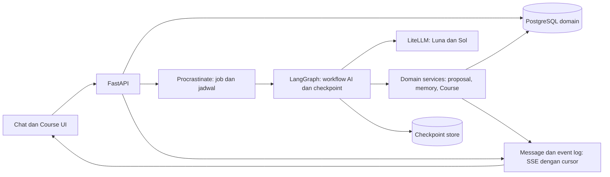

# Pemilihan runtime agent Ngertiin

Tanggal riset: 13 Oktober 2026. Sumber: dokumentasi resmi dan sumber kode pihak pertama. Keputusan lanjutan dicatat di bawah dan telah diselaraskan dengan Notion; perbandingan ini belum merupakan hasil pengujian runtime.

## Keputusan lanjutan yang disetujui

Percakapan personal memakai LangChain `create_agent`, dengan model memilih tools dan urutannya secara dinamis atau langsung menjawab. Agent LangChain berjalan di atas runtime LangGraph. Pipeline generation, validasi, repair, dan publikasi memakai workflow LangGraph custom; Procrastinate menangani job dan jadwal. [LangChain overview](https://docs.langchain.com/oss/python/langchain/overview), [Agent loop](https://docs.langchain.com/oss/python/langchain/agents).

Keputusan, diagram loop, dan acceptance criteria telah dicatat pada [Arsitektur](https://app.notion.com/p/3f8abdd6187381198256f4ee69db1e78), [Agent](https://app.notion.com/p/3f8abdd6187381658b61f4283ee83428), dan [tiket Chat personal](https://app.notion.com/p/3f8abdd61873816d8b15ed7b7b1b82a9).

## Rekomendasi

**LangGraph tetap menjadi baseline yang tepat untuk v1 Ngertiin. Alternatif utama yang layak adalah PydanticAI + DBOS.** Alasan mempertahankan LangGraph adalah kebutuhan menjalankan, menghentikan, memeriksa, dan melanjutkan workflow AI bertahap dengan checkpoint; bukan karena personal agent, soul, memory, atau HITL hanya bisa dibuat dengannya.

Untuk stack yang sudah direncanakan, gunakan LangGraph untuk workflow AI dan Procrastinate untuk pengiriman job serta jadwal. Hindari membuat seluruh aplikasi sebagai satu graph. LangGraph juga mempunyai Functional API: kode Python biasa dengan entrypoint dan task, memakai runtime checkpoint yang sama dengan Graph API. Pilih Graph API ketika shared state, percabangan, atau penggabungan kerja paralel memang membantu. [Functional API](https://docs.langchain.com/oss/python/langgraph/functional-api), [Choosing APIs](https://docs.langchain.com/oss/python/langgraph/choosing-apis).

PydanticAI + DBOS dapat menjadi pilihan lebih sesuai jika kita memilih agent loop dan kontrak bertipe sebagai pusat implementasi, lalu memakai satu engine workflow untuk recovery, antrean, dan jadwal. DBOS menggantikan Procrastinate dalam alternatif ini; jangan menambahkannya hanya sebagai engine ketiga yang melakukan tugas sama. Ini penilaian desain, bukan klaim bahwa salah satu framework selalu lebih sederhana.

## Kebutuhan yang menentukan pilihan

Agent Ngertiin adalah satu identitas personal, tetapi mempunyai banyak thread percakapan dan beberapa workflow yang dapat berjalan bersamaan. Pengguna dapat meninggalkan persetujuan outline atau soul selama berjam-jam sambil tetap berbicara pada thread lain. Course harus menghasilkan node pertama lebih dahulu, menjalankan node lain di background, memperbaiki hasil secara terbatas, dan mempertahankan hasil yang sudah valid saat worker gagal.

| Kebutuhan | LangGraph + Procrastinate | PydanticAI + DBOS | Pemilik aturan produk |
| --- | --- | --- | --- |
| Tool dan hasil terstruktur | State dan kontrak tool dapat ditentukan aplikasi | Kontrak input/output bertipe menjadi bagian inti | Schema dan validasi aplikasi |
| Persetujuan tertunda | Interrupt dan resume melalui checkpoint | Deferred tools; approval/result dapat diselesaikan pada run berikutnya atau workflow durable | Proposal, otorisasi, revision check di DB |
| Recovery proses | Checkpoint/task replay; queue memicu kembali workflow | Durable workflow mereplay hasil step yang selesai | Idempotency dan publikasi domain |
| Generate → review → repair → publish | Cocok sebagai workflow dengan batas tahap eksplisit | Cocok sebagai fungsi workflow dengan step durable | Standar pedagogi dan repair budget |
| Banyak thread, memory bersama | Checkpointer dan cross-thread store merupakan konsep terpisah | Conversation tersimpan dan memory namespace merupakan konsep terpisah | Identitas pengguna dan scope akses |
| Proaktivitas | Jadwal/job di Procrastinate; workflow kandidat di LangGraph bila perlu | Jadwal/queue/workflow dapat berada di DBOS | Relevansi, reranking, quiet hours, mute, kuota global |
| Streaming dan reconnect | Library streaming tetap perlu transport/API aplikasi | Streaming durable perlu konfigurasi handler/transport | Message/event log dan cursor untuk frontend |

Tabel adalah pemetaan kebutuhan Ngertiin terhadap kemampuan yang didokumentasikan, bukan skor benchmark. Rincian kemampuan dan batasnya ada di bawah.

## Apa yang LangGraph berikan

LangGraph menyimpan checkpoint state per execution thread. Store terpisah dapat menyimpan informasi lintas thread. Checkpoint membantu resume, inspeksi, dan replay, tetapi tidak menggantikan data domain seperti Course, nilai, kuota, persetujuan, atau soul revision. [Persistence](https://docs.langchain.com/oss/python/langgraph/persistence).

Untuk tahap Course yang mahal, evaluasi durability mode `sync`: checkpoint disimpan sebelum tahap berikutnya. Mode `async` mempunyai jendela kehilangan checkpoint saat proses mati; `exit` tidak menyimpan checkpoint antara langkah. Pending writes juga mempertahankan hasil cabang paralel yang sudah selesai saat cabang lain gagal. [Checkpointers](https://docs.langchain.com/oss/python/langgraph/checkpointers).

Interrupt dapat menghentikan workflow sampai input tersedia. Saat dilanjutkan, node yang terinterupsi berjalan kembali dari awal. Karena itu, efek samping sebelum interrupt harus idempotent atau dipindahkan setelah persetujuan. Persetujuan Ngertiin tetap perlu memvalidasi proposal yang diterbitkan server, kepemilikan pengguna, versi yang disetujui, dan apakah tindakan sudah dieksekusi. [Interrupts](https://docs.langchain.com/oss/python/langgraph/interrupts).

Bedakan library LangGraph yang ditanamkan dalam FastAPI dari Agent Server. Agent Server menyediakan queue, persistence, dan cron sebagai layanan runtime; kemampuan layanan itu tidak otomatis ada dalam deployment library mandiri kita. [Agent Server](https://docs.langchain.com/langsmith/agent-server).

Dengan Procrastinate, recovery setelah worker mati mendadak perlu dikonfigurasi. Dokumentasi menyediakan tugas retry untuk stalled jobs; PostgreSQL queue saja tidak berarti workflow otomatis dipanggil kembali dari checkpoint. [Retry stalled jobs — kode/dokumentasi resmi](https://github.com/procrastinate-org/procrastinate/blob/main/docs/howto/production/retry_stalled_jobs.md?plain=true).

## PydanticAI sudah memenuhi HITL modern

PydanticAI menerima tipe output Python/Pydantic, memvalidasi hasil, dan mendukung output validator. Itu cocok untuk kontrak outline, Lesson, soal, dan memory observation. Lolos schema tidak membuktikan mutu pedagogi; semantic review dan standar soal tetap pekerjaan aplikasi. [Output](https://pydantic.dev/docs/ai/core-concepts/output/).

PydanticAI mendukung tool yang membutuhkan approval dan tool yang dieksekusi eksternal. Run dapat mengembalikan `DeferredToolRequests`, lalu dijalankan kembali setelah backend menyediakan `DeferredToolResults`. Conversation menyimpan history beserta pending request; menyimpan messages saja tidak mempertahankan seluruh metadata penundaan. Deferred tools menahan eksekusi sampai caller memasok approval pengguna; backend tetap memvalidasi identitas, otorisasi, dan revisi proposal. [Deferred Tools](https://pydantic.dev/docs/ai/tools-toolsets/deferred-tools/).

Conversation dapat diserialisasi ke database aplikasi. `StepPersistence` menambah snapshot, event trail, dan ledger efek samping; backend PostgreSQL tersedia. Namun checkpoint setelah step selesai berbeda dari recovery di tengah step: dokumentasi mengarahkan kebutuhan terakhir ke durable execution. Fitur Harness ini menggunakan versi 0.x dengan kemungkinan perubahan API antarrilis minor; core PydanticAI memiliki kebijakan versi yang lebih ketat. [Persistence](https://pydantic.dev/docs/ai/core-concepts/persistence/), [Step Persistence](https://pydantic.dev/docs/ai/harness/step-persistence/), [Version Policy](https://pydantic.dev/docs/ai/project/version-policy/).

PydanticAI juga mempunyai memory notebook Markdown, bounded injection, read/search, namespace dari aplikasi, serta `PostgresMemoryStore` dengan compare-and-swap dan idempotency. Ini dapat membantu penyimpanan memory, tetapi kita tetap perlu mendesain evidence, scope, koreksi, dan forgetting Ngertiin. Soul harus memakai tool proposal tersendiri; jangan memperlakukan soul sebagai notebook yang bebas ditulis agent. [Memory](https://pydantic.dev/docs/ai/harness/memory/).

Integrasi `LiteLLMProvider` tersedia untuk proxy LiteLLM melalui Chat Completions. Dukungan schema, tool call, streaming, dan model Luna/Sol pada konfigurasi nyata tetap perlu diuji; adanya adapter tidak membuktikan seluruh perilaku provider sudah cocok. [Compatible APIs / LiteLLM](https://pydantic.dev/docs/ai/models/compatible-apis/).

## Alternatif durable yang adil

**PydanticAI + DBOS** menyediakan durable model/tool execution, antrean PostgreSQL, batas concurrency, dan penjadwalan. DBOS memulihkan workflow dari step terakhir yang selesai. Step yang terputus dapat dijalankan lagi; efek eksternal tetap membutuhkan idempotency. Transaksi yang menggunakan integrasi datasource DBOS mempunyai jaminan lebih kuat daripada pemanggilan API eksternal biasa. [PydanticAI DBOS integration](https://pydantic.dev/docs/ai/capabilities/durable_execution/dbos/), [DBOS queues](https://docs.dbos.dev/python/reference/queues), [Scheduling](https://docs.dbos.dev/python/tutorials/scheduled-workflows), [Workflow guarantees](https://docs.dbos.dev/python/tutorials/workflow-tutorial).

Streaming dari model step ke workflow dibuffer. Live delivery tetap tersedia melalui durability event handler; side effect handler dapat diulang ketika step dipulihkan, sehingga penyimpanan event perlu idempotent. [DBOS integration — streaming](https://pydantic.dev/docs/ai/capabilities/durable_execution/dbos/).

DBOS mendukung komunikasi durable untuk menunggu input dan stream yang disimpan. Untuk recovery lintas executor serta high availability, dokumentasi merekomendasikan Conductor sebagai control plane. Maka deployment production perlu mengevaluasi mekanisme recovery tersebut, bukan hanya menambahkan decorator. [Workflow communication](https://docs.dbos.dev/python/tutorials/workflow-communication), [DBOS architecture](https://docs.dbos.dev/architecture).

**PydanticAI + Temporal** layak ketika workflow lintas layanan, deployment versioning, atau operasi durable yang lebih luas menjadi kebutuhan. Integrasinya menjalankan model/tool dalam activities dan orchestration dalam workflow, serta memerlukan Temporal server. Payload dan perubahan schema menjadi kontrak durable. Streaming di dalam workflow dibuffer, tetapi dokumentasi terbaru menyediakan live handler dan Workflow Streams dengan offset untuk reconnect. Jadi integrasi ini bisa mendukung streaming; tetap ada batas activity/workflow yang perlu didesain. Untuk v1 dengan PostgreSQL dan sedikit layanan, saya belum merekomendasikan tambahan operasional ini. [Temporal integration](https://pydantic.dev/docs/ai/capabilities/durable_execution/temporal/).

**PydanticAI + Procrastinate tanpa durable engine** juga mungkin jika setiap tahap Course dicatat dan dipulihkan oleh aplikasi. Namun antrean job dan conversation yang tersimpan tidak otomatis memulihkan run yang mati di tengah tool atau model request. Memilihnya berarti aplikasi mengambil lebih banyak tanggung jawab recovery. [Durable execution](https://pydantic.dev/docs/ai/capabilities/durable_execution/overview/).

## Batas tanggung jawab yang disarankan

Diagram menunjukkan baseline yang direkomendasikan. Alternatif PydanticAI + DBOS mengganti kotak queue dan workflow dengan DBOS orchestration yang menjalankan PydanticAI. DB domain dan event log tetap diperlukan.

Conversation ID pengguna dan execution ID workflow harus dibedakan. Sebuah proposal soul atau Course generation tidak boleh mengunci seluruh personal agent. State jangka panjang soul/memory tidak harus berada dalam graph state; ambil konteks yang relevan untuk setiap run. Ini keputusan desain Ngertiin.

Untuk approval tertunda, simpan proposal dan state yang terparkir, lalu akhiri eksekusi job aktif. Endpoint approval memvalidasi DB dan menjadwalkan fase lanjutan. Dengan begitu, pengguna yang belum memilih tidak menahan slot worker atau kapasitas generation. Queue dan workflow tidak boleh mempunyai retry tanpa batas yang saling berlapis.

## Cara mengunci keputusan sebelum implementasi luas

Uji satu irisan yang sama pada baseline, lalu gunakan alternatif bila bukti implementasi menunjukkan beban yang lebih rendah:

1. Soul proposal ditunda, worker direstart, approval atas revision lama ditolak, dan side chat tetap dapat digunakan.
2. Generation node pertama selesai; worker mati saat review node berikutnya; hasil siap dipakai kembali dan publikasi tidak duplikat.
3. Browser terputus ketika respons streaming; reconnect menampilkan pesan yang konsisten tanpa mengirim ulang action.
4. Dua worker mengirim kandidat proaktif ke thread berbeda; batas dua pesan per hari tetap berlaku secara atomik.

Nilai kode yang harus kita pelihara, perilaku recovery, kemudahan inspeksi, dan pengulangan panggilan model. Framework tidak menentukan kualitas pedagogi atau biaya LLM dengan sendirinya; routing model, konteks, dan retry budget yang memengaruhinya.

Kesimpulan riset: tidak ada kebutuhan yang mengharuskan kita berpindah dari LangGraph. PydanticAI + DBOS adalah alternatif serius untuk dipilih secara sadar sebagai arsitektur berbeda, bukan pengganti yang pasti lebih tepat hanya karena agent Ngertiin bersifat personal dan proaktif.
