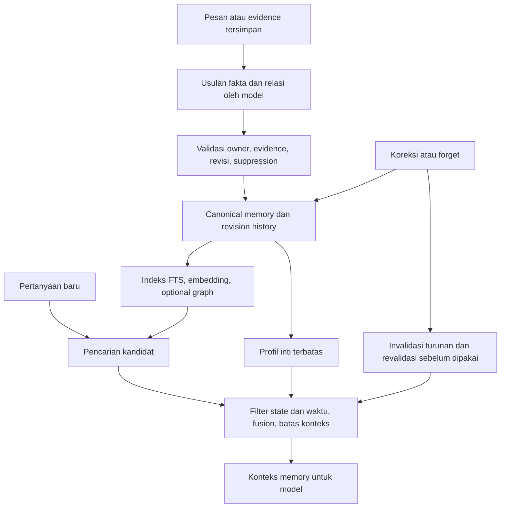

# Algoritma memori agent untuk Ngertiin

Tanggal riset: 19 Oktober 2026. Status: **usulan arsitektur dan rencana evaluasi; belum diimplementasikan**. Riset memakai paper, dokumentasi resmi, serta kode upstream. Tidak menjalankan benchmark atau menguji runtime library yang dibandingkan. Riset ini tidak mengubah scope/status tiket Notion dan tidak membuktikan implementasi backend Muse.

Keputusan lanjutan: pengguna memilih Mem0 OSS sebagai library. [Rencana integrasi final](./memory-mem0-plan-2026-10-19.md) menerapkan kontrak evidence/revisi, hybrid recall dan suppression di bawah dengan Mem0 sebagai engine internal; perbandingan algoritma di dokumen ini tetap menjadi catatan riset.

## Keputusan yang disarankan

Untuk NG-017, mulai dengan **fakta terstruktur yang memiliki evidence dan revisi, profil inti berukuran kecil, serta retrieval gabungan full-text dan embedding**. Tambahkan penanganan waktu sejak awal. Uji graph temporal sebagai pembanding pada pertanyaan yang membutuhkan relasi lintas informasi; adopsi bila memberikan peningkatan terukur dengan biaya yang layak. Ini rekomendasi berdasarkan kebutuhan Ngertiin, bukan hasil benchmark lokal.

Memori yang baik memerlukan keputusan tentang **apa yang ditulis, bagaimana perubahan diterapkan, apa yang dicari, dan kapan hasilnya boleh dipakai**. Memilih vector database atau graph database hanya menjawab sebagian masalah. Mem0, A-MEM, dan Zep memperlihatkan bahwa embedding, struktur graph, LLM, serta kode biasa dapat bekerja bersama dalam satu pipeline. [Mem0 §2](https://arxiv.org/html/2504.19413v1#S2), [A-MEM §3](https://arxiv.org/html/2502.12110v11#S3), [Zep](https://arxiv.org/abs/2501.13956).

## Pisahkan empat keputusan

| Keputusan | Pertanyaan | Pilihan yang relevan |
| --- | --- | --- |
| Representasi | Apa yang disimpan? | Transkrip/episode, fakta dan preferensi, profil inti, ringkasan, entity/relation, prosedur hasil pengalaman. |
| Penulisan dan pemeliharaan | Apa yang layak diingat, digabung, dikoreksi, atau dilupakan? | Perintah pengguna, ekstraksi LLM, deduplikasi, aturan state, consolidation, decay, kebijakan yang dipelajari. |
| Retrieval | Bagaimana kandidat ditemukan? | Exact lookup, full-text/BM25, dense embedding, rank fusion, reranker, graph traversal/PageRank, pencarian bertahap. |
| Admission dan penggunaan | Kandidat mana yang sah dan berguna untuk konteks ini? | Owner/scope, revisi/status/waktu, suppression, provenance, relevansi tugas, diversifikasi, batas token/biaya. |

**Semantic memory** adalah isi berupa pengetahuan/fakta; **semantic search** adalah metode pencarian berbasis makna. Keduanya berbeda. **LangGraph** mengatur alur eksekusi agent; keberadaannya tidak berarti aplikasi sudah mempunyai knowledge graph untuk retrieval. Tabel di atas adalah sintesis desain, bukan satu taksonomi yang diwajibkan sebuah library.

## Keluarga algoritma dan batasnya

| Keluarga | Mekanisme utama | Berguna untuk | Batas untuk personal memory |
| --- | --- | --- | --- |
| Profil inti dan lookup terstruktur | Fakta terpilih langsung dimuat atau dibaca menurut key. | Nama panggilan, bahasa, preferensi stabil yang perlu selalu tersedia. | Ruang terbatas; profil bisa basi atau terlalu luas bila pemeliharaannya lemah. |
| Full-text/lexical | Indeks kata, token, ranking seperti BM25 atau ranking FTS PostgreSQL. | Nama, kode proyek, istilah teknis, frasa spesifik. | Parafrasa dan campuran bahasa dapat luput. |
| Dense semantic search | Embedding query dan memory; cosine/dot-product; exact search atau ANN. | Kesamaan makna meski kata berbeda. | Kemiripan bukan kebenaran, kesetaraan fakta, atau validitas waktu. |
| Hybrid retrieval | Gabungkan lexical+dense, lalu fusion/reranking. | Menyeimbangkan parafrasa dan pencocokan istilah. | Kualitas tetap bergantung pada kandidat, filter, dan pemilihan konteks. |
| Multi-path recall seperti Hindsight | Semantic, keyword, graph, temporal; fusion dan reranking. | Menggabungkan fakta, pengalaman, dan konteks waktu. | Jalur lebih banyak menambah biaya; fakta gagal diekstrak dapat tidak ditemukan. |
| Managed facts seperti Mem0 | LLM mengekstrak kandidat dan mengatur perubahan pada kumpulan fakta. | Preferensi/fakta lintas sesi dengan pengurangan duplikasi. | Kebijakan update berbeda antarversi; kesalahan ekstraksi dapat menetap. |
| Hierarki konteks seperti MemGPT/Letta | Core selalu terlihat; riwayat/arsip dibawa ke konteks lewat tools. | Kontinuitas dan pengelolaan context window. | Agent dapat gagal mencari atau mengedit memory yang tepat. |
| Recency/importance/reflection | Skor relevansi, waktu, kepentingan; refleksi dari episode. | Memilih pengalaman penting dan pola lintas episode. | Refleksi adalah inferensi; reinforcement dapat memperkuat kekeliruan. |
| Graph temporal | Entity, fact edges, provenance, rentang waktu, hybrid search+traversal. | Siapa terkait apa, perubahan status, pertanyaan multi-hop/as-of. | Entity resolution dan konflik semantik tetap bisa salah. |
| Graph diffusion seperti HippoRAG | Entity linking lalu Personalized PageRank untuk menilai passage. | Rantai evidence yang tersebar. | Graph dari ekstraksi dapat keliru; traversal berlebihan menambah noise. |
| Ringkasan hierarkis seperti RAPTOR/GraphRAG | Kelompokkan informasi lalu buat ringkasan bertingkat. | Tema global dan konteks panjang. | Detail dapat hilang; koreksi/forget harus menjangkau ringkasan turunan. |

Sumber mekanisme: [pgvector](https://github.com/pgvector/pgvector#hybrid-search), [Mem0](https://arxiv.org/html/2504.19413v1#S2), [MemGPT](https://arxiv.org/html/2310.08560v2#S2), [Generative Agents](https://arxiv.org/html/2304.03442v2#S4), [MemoryBank](https://arxiv.org/html/2305.10250v3#S2), [A-MEM](https://arxiv.org/html/2502.12110v11#S3), [Zep](https://arxiv.org/abs/2501.13956), [HippoRAG](https://arxiv.org/abs/2405.14831), [RAPTOR](https://arxiv.org/html/2401.18059v1#S3), [GraphRAG](https://arxiv.org/abs/2404.16130).

### Managed facts: Mem0 dan perubahan versi

Paper Mem0 April 2025 memisahkan extraction dan update. LLM membaca pesan baru dengan ringkasan serta pesan terkini. Tiap kandidat dibandingkan dengan fakta terdekat melalui embedding; LLM mengusulkan ADD, UPDATE, DELETE, atau NOOP. Varian graph menambahkan entity/relation, pencarian embedding pada entity/triple, serta eksplorasi relasi. [Paper §2.1–2.2](https://arxiv.org/html/2504.19413v1#S2).

**Jangan menganggap algoritma paper sama dengan produk terbaru.** Dokumentasi `add` yang diperiksa pada tanggal riset menjelaskan penyimpanan additive. Kode `main` juga memakai `ADDITIVE_EXTRACTION_PROMPT`, batch embedding dan hash deduplication. Karena itu, kemampuan menyelesaikan kontradiksi atau forget harus diverifikasi terhadap versi yang benar-benar dipakai. Expiry di dokumentasi menyembunyikan hasil dari pencarian tertentu, sementara pembacaan berdasarkan ID masih dapat mengembalikannya; expiry bukan bukti penghapusan menyeluruh. [Dokumentasi add](https://docs.mem0.ai/core-concepts/memory-operations/add), [source upstream](https://github.com/mem0ai/mem0/blob/main/mem0/memory/main.py).

Pelajaran untuk Ngertiin: pisahkan usulan semantik dari transaksi perubahan state; jangan menyerahkan kontrak koreksi/forget produk kepada asumsi tentang SDK.

### Hierarki konteks: MemGPT dan Letta

MemGPT membagi prompt menjadi instruksi, working context, dan antrean pesan. Riwayat berada di recall storage; arsip berisi informasi tambahan. Agent memakai function calls untuk memindahkan informasi ke konteks. Queue manager memberi peringatan kapasitas, melakukan eviction, dan membangun ringkasan rekursif. Ini arsitektur pengelolaan konteks, bukan satu algoritma pencarian. [MemGPT §2](https://arxiv.org/html/2310.08560v2#S2).

Dokumentasi Letta V1 menjelaskan memory blocks yang selalu berada dalam prompt dan bisa diedit lewat tools/API, termasuk blok read-only. Halaman ini sekarang berlabel SDK legacy; konsepnya berguna, tetapi tidak membuktikan kesetaraan semua API SDK terbaru. [Letta memory blocks](https://docs.letta.com/v1-sdk/memory/memory-blocks).

Pelajaran: profil pendek yang selalu tersedia dapat digabungkan dengan arsip yang dicari saat diperlukan. Memuat seluruh riwayat pada setiap jawaban tidak diperlukan.

### Pengalaman, refleksi, dan decay

Generative Agents menggabungkan skor recency, importance, dan relevance; relevance memakai cosine embedding, importance diusulkan LLM, lalu kombinasi skor dihitung dengan kode. Refleksi menjadi memory baru dengan pointer ke observasi pendukung. Paper juga melaporkan kegagalan retrieval dan penambahan detail yang tidak benar. Bobot pada kode upstream tidak persis sama dengan konfigurasi paper; parameter perlu dicatat saat reproduksi. [Paper §4 dan §7.2](https://arxiv.org/html/2304.03442v2#S4), [kode retrieve](https://github.com/joonspk-research/generative_agents/blob/main/reverie/backend_server/persona/cognitive_modules/retrieve.py).

MemoryBank memakai conversation records, ringkasan harian/global, user portrait, serta dense retrieval melalui FAISS. Model decay-nya `R = exp(-t/S)`; akses ulang memperbesar `S` dan mereset `t`. Paper menyatakan model tersebut merupakan penyederhanaan eksploratif. [MemoryBank §2](https://arxiv.org/html/2305.10250v3#S2), [implementasi resmi](https://github.com/zhongwanjun/MemoryBank-SiliconFriend).

Untuk Ngertiin, decay dapat menurunkan prioritas informasi yang sementara. **Decay tidak menggantikan koreksi atau permintaan forget**, dan akses berulang tidak boleh dianggap bukti fakta semakin benar. Fakta stabil yang dikonfirmasi pengguna membutuhkan perlakuan berbeda dari dugaan atau aktivitas sesaat. Ini usulan kebijakan produk.

### A-MEM: organisasi note yang berkembang

A-MEM membuat note berisi isi, waktu, keyword, tags, context, embedding, dan links. Embedding memilih kandidat note terkait; LLM memutuskan links dan dapat merevisi context/atribut note lama. Retrieval tetap dimulai dari query embedding; paper juga menjelaskan akses note terkait. Kualitas organisasi bergantung pada model yang menghasilkan deskripsi dan hubungan. [A-MEM v11 §3 dan §6](https://arxiv.org/html/2502.12110v11#S3), [implementasi penulis](https://github.com/WujiangXu/A-mem-sys).

Pelajaran: hubungan antar-note dapat memperkaya konteks. Untuk produk, revisi hasil consolidation perlu menyimpan hubungan ke evidence asal dan versi sebelumnya agar bisa diaudit atau dibatalkan; hal ini merupakan rancangan Ngertiin, bukan jaminan yang dibuktikan paper.

### RAPTOR: ringkasan bertingkat

RAPTOR mengulang embedding, clustering, dan summarization hingga membentuk hierarki. Paper memakai UMAP untuk reduksi dimensi serta Gaussian Mixture Models untuk soft clustering; retrieval dapat menelusuri layer atau mencari seluruh node lintas layer. [RAPTOR §3](https://arxiv.org/html/2401.18059v1#S3), [implementasi resmi](https://github.com/parthsarthi03/raptor).

Relevansinya terutama untuk riwayat/dokumen panjang dan pertanyaan yang membutuhkan gambaran besar. Untuk Ngertiin, ringkasan adalah view turunan: koreksi satu fakta dapat membuat beberapa parent summaries basi. Pemeliharaan hierarki harus masuk perhitungan biaya.

### Hindsight: beberapa jalur recall dalam satu sistem

Hindsight merupakan contoh dekat dengan kebutuhan ini: paper membedakan world facts, agent experiences, beliefs/opinions, dan observations hasil sintesis. Recall menggabungkan semantic, keyword, graph, serta temporal candidates melalui RRF dan cross-encoder. Source code dan dokumentasi terbuka membantu memeriksa mekanismenya. Paper Desember 2025 dan produk terkini telah berkembang, sehingga terminologi keduanya perlu dibedakan. [Paper](https://arxiv.org/abs/2512.12818), [repo resmi](https://github.com/vectorize-io/hindsight).

Dokumentasi retrieval menjelaskan budget pencarian terpisah dari `max_tokens` hasil; batas tersebut menghitung teks memory, bukan seluruh metadata, dan memiliki fallback yang dapat melampaui nominal ketika tidak ada hasil yang muat. Dokumentasi observations menjelaskan invalidasi turunan setelah sumber dihapus. Ini kontrak dokumentasi, belum uji runtime kami, dan tidak membuktikan semantic forget tahan re-ingest. Penyimpanan PostgreSQL memberi contoh bahwa graph memory tidak selalu membutuhkan layanan graph database terpisah. [Retrieval](https://hindsight.vectorize.io/developer/retrieval), [observations](https://hindsight.vectorize.io/developer/observations), [storage](https://hindsight.vectorize.io/developer/storage).

### Pola operasional dari implementasi terbuka

OpenClaw menjelaskan core/episodic tiers, aturan provenance/promotion, consolidation berbantuan model yang dibatasi, serta recall cepat yang dapat ditingkatkan ke pencarian agentic. Search menggabungkan semantic dan lexical scores, dapat memakai recency/importance serta MMR untuk keragaman. Dated episodes dapat meluruh, sementara curated evergreen memory diperlakukan berbeda. Ini menunjukkan bahwa semantic search adalah komponen dalam sistem yang lebih luas. [Architecture](https://docs.openclaw.ai/concepts/memory-architecture), [search](https://docs.openclaw.ai/concepts/memory-search).

Hermes memberi pembanding lebih sederhana: bounded core memory dan pencarian session dengan FTS5. [Dokumentasi resmi](https://hermes-agent.nousresearch.com/docs/user-guide/features/memory). Keduanya menjadi contoh desain, bukan bukti bahwa konfigurasi atau jaminannya cocok tanpa evaluasi Ngertiin.

Untuk baseline hybrid Ngertiin, gunakan FTS native PostgreSQL dan vector search, lalu **RRF** sebagai titik awal penggabungan ranking. RRF menjumlahkan kontribusi `1 / (c + rank)` dari setiap daftar, sehingga skor lexical dan vector tidak harus berada pada skala yang sama. `ts_rank_cd` native PostgreSQL bukan BM25; BM25 memerlukan backend/extension yang sesuai. Setelah itu uji MMR untuk mengurangi kandidat berulang atau cross-encoder yang menilai pasangan query–memory bila manfaatnya menutup biaya. MMR menyeimbangkan relevansi terhadap query dan kemiripan dengan hasil yang sudah dipilih; decay mengubah prioritas waktu. Keduanya tidak menetapkan kebenaran fakta. [pgvector hybrid search](https://github.com/pgvector/pgvector#hybrid-search), [OpenClaw search](https://docs.openclaw.ai/concepts/memory-search).

## GraphRAG bukan satu algoritma

| Pendekatan | Representasi dan pencarian | Kesesuaian yang perlu diuji |
| --- | --- | --- |
| Microsoft GraphRAG | Entity/relation/claim; Leiden communities; LLM community reports; global map-reduce. Local search menggabungkan graph dengan raw text. | Menjawab tema lintas korpus dan pertanyaan entity tertentu. |
| Zep/Graphiti | Episodes, entity/fact graph, temporal metadata; embedding/full-text/BFS dan reranking. | Fakta pengguna yang berubah dan relasi lintas sesi. |
| HippoRAG | OpenIE triples, synonym edges, entity linking; Personalized PageRank memberi skor passage. | Menemukan beberapa evidence yang terhubung untuk multi-hop QA. |

Microsoft GraphRAG mengutamakan query global melalui community summaries; local search memiliki jalur lain. Dokumentasi terbaru juga menyediakan incremental update, sehingga keliru menyebutnya hanya mampu rebuild total. Namun incremental update tidak otomatis membuktikan jaminan koreksi/forget. [Paper](https://arxiv.org/abs/2404.16130), [query overview](https://microsoft.github.io/graphrag/query/overview/), [CLI update](https://microsoft.github.io/graphrag/cli/).

Zep membedakan waktu fakta berlaku di dunia (`valid_at`, `invalid_at`) dari waktu sistem mengetahui/menggantinya (`created_at`, `expired_at`). Konflik dideteksi dengan bantuan LLM; pencarian graph tetap memakai semantic dan lexical retrieval. Graphiti menyediakan implementasi terbuka untuk pembaruan incremental. [Zep §2–3](https://arxiv.org/abs/2501.13956), [Graphiti](https://github.com/getzep/graphiti).

HippoRAG memperlihatkan alternatif algoritmik yang lebih spesifik: embedding membantu entity linking, kemudian **Personalized PageRank** menyebarkan skor dari entity query untuk meranking passage asal. Perhitungan graph tersebut deterministik dengan graph, seed, dan parameter tetap; graph/seed dari ekstraksi dapat salah. Repo kini juga memuat HippoRAG2, yang merupakan metode lanjutan tersendiri. [Paper NeurIPS 2024](https://arxiv.org/abs/2405.14831), [repo penulis](https://github.com/OSU-NLP-Group/HippoRAG).

Contoh kebutuhan Ngertiin: “Siapa PIC proyek yang memakai vendor yang dulu kita ganti?” memerlukan beberapa relasi. Sebaliknya, “pakai bahasa apa untuk menjawabku?” biasanya dapat dilayani oleh profil inti. Graph layak dipakai ketika jenis pertanyaan pertama cukup penting dan hasil evaluasinya mendukung.

## Mana yang dikerjakan model, mana yang dikerjakan kode

| Bagian | Peran model/statistik | Peran kode aplikasi yang disarankan |
| --- | --- | --- |
| Capture | Mengusulkan fakta, lingkup waktu, entity dan konflik semantik. | Memvalidasi evidence, owner, izin sumber, idempotency dan batas biaya. |
| Koreksi | Mengusulkan bahwa pernyataan baru menggantikan fakta tertentu. | Menerapkan revisi atomik; menolak update pada versi basi; mencatat rentang waktu. |
| Retrieval | Menghasilkan embedding, query rewrite atau rerank. | Menjalankan FTS/vector/graph, filter owner/status/waktu, fusion dan token budget. |
| Consolidation | Mengusulkan ringkasan, hubungan, atau penggabungan. | Menyimpan dependency ke evidence; mencegah siklus/revisi tak sah; membatasi pekerjaan. |
| Forget | Menafsirkan maksud dan kandidat target pada permintaan bebas. | Menerapkan suppression/penghapusan, invalidasi turunan dan pemeriksaan ulang saat recall/retry. |

Tabel ini merupakan rekomendasi desain. Model mengusulkan keputusan yang membutuhkan pemahaman bahasa; kode mengendalikan perubahan yang sudah teridentifikasi. Kode deterministik tidak membuat penafsiran “lupakan proyek A” otomatis tepat. Ketika cakupannya ambigu dan berdampak luas, produk perlu memperlihatkan target yang dimaksud sebelum penghapusan.

## Kontrak lifecycle yang perlu dimiliki Ngertiin

Bagian ini adalah usulan produk, belum implementasi dan belum bukti jaminan library mana pun.

1. **Evidence dan interpretasi terpisah.** Fakta eksplisit pengguna, observasi, dan inferensi model memiliki label asal berbeda. Jangan mengangkat instruksi dari file/web menjadi aturan perilaku pengguna. Memory tidak memberikan izin tindakan dan tidak menggantikan state Task/File/Result.
2. **Koreksi berbeda dari perubahan dunia nyata.** “Nama yang tadi salah” membuat klaim lama tidak benar, termasuk secara historis; “pindah kantor bulan lalu” membuat fakta lama benar hanya sampai waktu tertentu. Waktu berlaku berbeda dari waktu ingesti. Query current-state menyingkirkan versi lama; query historis hanya memakai versi yang memang pernah benar dan masih diizinkan.
3. **Source deletion dan semantic forget berbeda.** Hapus satu sumber dapat mengurangi support suatu fakta; sumber lain mungkin mendukung fakta yang sama. Forget berdasarkan orang/topik perlu menjangkau fakta dan turunannya sesuai cakupan pengguna.
4. **Penghapusan menjangkau turunan dan konteks aktif.** Vector, graph edges, summaries, core profile, cache, raw recent chat/history, checkpoints, serta snapshot konteks/Task perlu diinvalidasi atau diperiksa ulang. Memfilter indeks saja tidak cukup. Turunan basi sebaiknya langsung tidak dipakai, lalu dibangun ulang secara asynchronous.
5. **Retry tidak menghidupkan kembali informasi.** Worker lama, reindex, replay riwayat dan consolidation harus memeriksa versi/suppression saat commit dan sebelum pemakaian. Kebijakan dapat mengizinkan event remember baru yang eksplisit dari owner untuk membuka suppression; evidence lama saja tidak cukup. Penanda suppression sendiri dapat sensitif; simpan representasi minimal dengan kebijakan retensi yang jelas.
6. **Poisoning diperiksa pada write dan read.** MINJA menunjukkan bahwa interaksi query dapat meracuni memory persisten dalam sistem yang diteliti. Owner/scope dan pembatasan sumber tetap diperlukan sekalipun skor relevansinya tinggi. [MINJA, NeurIPS 2025](https://proceedings.neurips.cc/paper_files/paper/2025/hash/42a97bbd9844d2bf68596730af80bcdf-Abstract-Conference.html).

Lulus kontrak aplikasi ini berarti informasi tidak lagi dipakai pada jalur aplikasi yang diuji. Itu tidak setara dengan certified unlearning, penghapusan semua backup, atau penarikan informasi yang sudah pernah dikeluarkan ke pihak lain.

Dokumentasi provenance OpenClaw juga menyebut batas pelacakan: cakupan penghapusan bergantung pada sumber/indeks yang dilacak; paraphrase tanpa provenance dan backup memerlukan penanganan lain. Klaim ini tidak diterjemahkan menjadi jaminan universal untuk Ngertiin. [Memory provenance](https://docs.openclaw.ai/concepts/memory-provenance).

## Kesesuaian dengan Ngertiin saat ini

Kontrak aktif berada pada [Agent](../product/03-agent.md), [NG-017](../backlog/tasks/17-memory-aktif-capture-evidence-dan-recall.md), serta [NG-018](../backlog/tasks/18-pengaturan-untuk-inspeksi-dan-koreksi-memory.md). Backend sudah mencantumkan [dependency pgvector](../../apps/backend/pyproject.toml) dan [extension vector pada baseline](../../apps/backend/migrations/versions/0001_v1_baseline.py); ini kesiapan penyimpanan, bukan bukti runtime memory selesai. [Persona store](../../apps/backend/src/ngertiin/persona/store.py) menyediakan sambungan exclusion yang perlu dihormati oleh memory.

Graph ringan melalui tabel relasional adalah opsi algoritmik Ngertiin, bukan klaim bahwa Graphiti SDK mendukung PostgreSQL sebagai adapter drop-in. Pilihan algoritma, library, dan deployment perlu dinilai terpisah. Batas token aplikasi sebaiknya menghitung seluruh payload yang dimasukkan ke prompt, termasuk provenance/metadata dan cadangan konteks, bukan hanya teks memory.

## PoC pembanding sebelum keputusan final

Gunakan tiga konfigurasi dengan extractor, reader, korpus, dan anggaran yang sama:

| Konfigurasi | Isi | Pertanyaan yang dijawab eksperimen |
| --- | --- | --- |
| A | Profil inti + fakta/revisi/evidence + FTS. | Seberapa jauh baseline sederhana sudah memenuhi kebutuhan? |
| B | A + embedding dan hybrid fusion; reranker hanya jika diperlukan. | Apakah parafrasa dan campuran bahasa meningkat dengan biaya yang layak? |
| C | B + entity/relation temporal dan perluasan graph terbatas. | Apakah multi-hop/as-of meningkat tanpa merusak precision, latency, dan lifecycle? |

Buat dua jalur evaluasi: **retrieval saja** memakai kumpulan fakta tetap agar perbedaan algoritma terisolasi; **end-to-end** mengingesti percakapan secara kronologis untuk mengukur capture, update, dan jawaban bersama-sama. Terapkan **no-lookahead**: query pada suatu checkpoint hanya boleh melihat evidence yang sudah tersedia saat itu, termasuk untuk pembentukan ringkasan, graph, dan embedding kandidat. Pengayaan graph dan consolidation masuk biaya ingesti, termasuk token input/output, storage, dan rebuild.

Dataset publik yang berguna:

- [LongMemEval, ICLR 2025](https://arxiv.org/abs/2410.10813) menguji extraction, multi-session reasoning, temporal reasoning, knowledge updates dan abstention; [repo](https://github.com/xiaowu0162/LongMemEval) memisahkan evaluasi retrieval dari jawaban.
- [LoCoMo, ACL 2024](https://github.com/snap-research/locomo) memberi conversation histories dan evidence dialog IDs untuk QA lintas sesi. Data sintetis yang ditinjau manusia tetap perlu dilengkapi kasus produk.
- [MemoryAgentBench, ICLR 2026](https://github.com/HUST-AI-HYZ/MemoryAgentBench) relevan untuk incremental ingestion dan conflict resolution. Ini tidak menjamin forget atau propagation deletion.
- [EvalMem, preprint September 2026](https://arxiv.org/abs/2609.22231) memisahkan encoding, native retrieval, dan oracle-evidence generation. Berguna untuk mencari penyebab kegagalan; hasil preprint dan judge tetap memiliki batas.

Kasus lokal wajib mencakup bahasa Indonesia, Inggris, serta campuran istilah kode; alias, negasi, preferensi sementara/permanen; perintah remember; parafrasa; current-state versus as-of; koreksi terlambat; pertanyaan tanpa jawaban; multi-hop yang membutuhkan seluruh evidence; explicit forget per fakta/topik; retry/reindex/replay; stale worker bersamaan; dua owner; dan instruksi berbahaya dalam sumber.

Ukur extraction/provenance precision, evidence Recall@K serta MRR/nDCG, kelengkapan evidence multi-hop, correct-revision rate, grounded answer accuracy/abstention, stale-fact errors, capture/query p50/p95, token/panggilan/biaya ingesti dan query, serta pertumbuhan storage. Pisahkan tuning dan held-out cases; audit sebagian penilaian model secara manual. Jangan menetapkan `K=10` sebagai konstanta universal: kandidat tambahan dapat menambah evidence sekaligus distraksi.

**Gate aplikasi:** nol kebocoran antar-owner dan nol evidence yang sudah di-forget atau superseded untuk query current-state setelah commit pada skenario yang diuji, termasuk retry/concurrency. Ini gate pada finite test set, bukan bukti matematis semua kemungkinan. Graph baru diadopsi bila memberi peningkatan berarti pada kategori yang dibutuhkan dengan budget yang disepakati. QA publik tidak menggantikan pengujian lifecycle.

## Tahap eksekusi yang disarankan

1. Tetapkan kontrak jenis memory, evidence, revisi/waktu, kontrol pengguna, serta definisi source deletion versus forget; cocokkan dengan NG-017 dan batas UI NG-018.
2. Buat corpus kecil representatif dan harness pembanding A/B/C dengan laporan kualitas serta biaya. Tahap ini menilai algoritma; belum memilih graph database permanen.
3. Implementasikan canonical store dan enforcement lebih dahulu; pilih retrieval berdasarkan hasil PoC. Indeks dan ringkasan menjadi turunan yang bisa dibangun ulang.
4. Integrasikan capture asynchronous serta recall ke chat/Task, lalu walkthrough browser untuk remember lintas thread, koreksi, dan forget. Uji lifecycle dengan inspector deterministik yang sesuai.
5. Catat bukti acceptance dan batas runtime. Setelah pekerjaan benar-benar diterima, jalankan workflow status Notion/readback/view dan targeted mirror sesuai proses repository.

## Batas bukti dan arah yang belum diaudit penuh

- Tidak ada akses ke backend Muse. Riset ini membandingkan metode publik untuk kebutuhan Ngertiin; nama operasi Muse tidak dipakai untuk menebak algoritma internalnya.
- Paper membuktikan hasil pada setup masing-masing. Generative Agents menargetkan simulasi perilaku; RAPTOR/GraphRAG/HippoRAG banyak mengevaluasi dokumen/QA; Mem0 dan Zep adalah riset vendor. Skornya tidak menjadi ranking universal.
- Paper dan implementation head dapat berbeda; Mem0 menunjukkan perbedaan konkret. URL `main` dan dokumentasi hidup harus dipin ke commit/release saat PoC.
- Pencarian juga menemukan [AgeMem](https://arxiv.org/abs/2601.01885), yang mempelajari operasi memory lewat reinforcement learning, serta pendekatan lebih baru seperti [MAGMA](https://arxiv.org/abs/2601.03236), [LiCoMemory](https://arxiv.org/abs/2511.01448), [AdaMem](https://arxiv.org/abs/2606.21144), dan [MemGate](https://arxiv.org/abs/2606.06054). Pada riset ini kandidat tersebut baru ditelaah pada abstract/metadata; jangan menganggap mekanisme atau keunggulannya telah direproduksi.
- Belum ada hasil eksperimen lokal untuk menentukan embedding model, dimensi, tokenizer FTS multilingual, ukuran candidate pool, nilai fusion, reranker, decay, graph traversal, atau budget produksi.

## Rerun dan jejak riset

Workflow: `research`, `firecrawl-research-papers`, `firecrawl-research-index`. Discovery memakai semantic paper search dan perluasan references dari anchor Mem0; bagian algoritma utama diverifikasi melalui `read-paper`, lalu dicocokkan dengan paper/dokumentasi/kode primer. Temuan graph dan evaluasi ditelaah pada jalur riset paralel sebelum digabungkan ke laporan ini.

Scratch JSON berada pada `.firecrawl/memory-research-20261019/` dan bukan bagian kontrak produk. File discovery/metode: `managed-memory-discovery.json`, `managed-memory-family.json`, `mem0-method-verification.json`, `amem-method-verification.json`, `memgpt-method-verification.json`, `generative-agents-method-verification.json`; graph: `graph-discovery.json`, `graph-related.json`, `graph-*-body.json`; evaluasi: `eval-*.json`. Semua klaim keputusan di atas tetap menyertakan tautan sumber primer sehingga tidak bergantung pada ringkasan tool.
