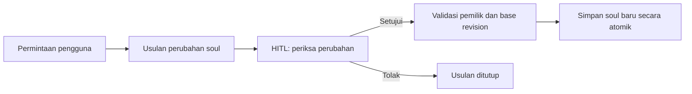
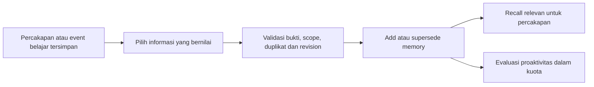

# Soul dan active memory: OpenClaw, Hermes, dan usulan Ngertiin

Tanggal riset: 13 Oktober 2026. Status: riset pendukung; bukan bukti implementasi. Keputusan yang disepakati tercatat pada [Agent](../product/03-agent.md); rincian alternatif di sini tetap bahan riset.

Sumber utama adalah dokumentasi resmi dan kode yang dipin ke commit:

- [OpenClaw `06001d846eefe470e7e9d04f10d4981355497ca8`](https://github.com/openclaw/openclaw/commit/06001d846eefe470e7e9d04f10d4981355497ca8).
- [Hermes `63d0b94120027d487c9a5235b9ec64b696af1b26`](https://github.com/NousResearch/hermes-agent/commit/63d0b94120027d487c9a5235b9ec64b696af1b26).

Verifikasi berupa pembacaan dokumentasi dan kode, tanpa menjalankan kedua runtime. Detail konfigurasi dan perilaku dapat berubah setelah commit tersebut. Riset dibagi antara OpenClaw dan Hermes melalui skill Research; penemuan sumber juga menggunakan [Firecrawl search skill](/Users/vitoandareasmanik/.agents/skills/firecrawl-search/SKILL.md).

## Keputusan pengguna yang menjadi batas rancangan

- Satu agent personal menemani pengguna lintas topik dan Course.
- Soul mengatur kepribadian agent. Penulisannya pasif: pengguna meminta perubahan, agent mengusulkan, pengguna memutuskan melalui HITL.
- Memory boleh diperbarui aktif berdasarkan percakapan penting, history, progres, dan event belajar.
- Tidak ada fitur Notes yang tersirat dari istilah catatan.
- Course berdiri mandiri. Memory personal lintas Course membantu personalisasi, sementara sumber pembelajaran dipilih melalui HITL.
- Agent dapat proaktif memberikan semangat, saran, atau menyiapkan aktivitas dalam batas kuota. Perubahan Course tetap memerlukan persetujuan.

Keputusan terakhir tentang soul menggantikan ide sebelumnya bahwa agent dapat mengubah kepribadian permanen secara proaktif.

## Temuan OpenClaw

### Pemisahan identitas, profil, dan pengalaman

`SOUL.md` berisi suara dan kepribadian; `USER.md` berisi profil/preferensi; `MEMORY.md` menjadi ringkasan jangka panjang; berkas harian `memory/YYYY-MM-DD.md` menampung konteks episodik. Detail historis diambil melalui pencarian. `DREAMS.md` menjadi laporan konsolidasi untuk dibaca manusia. [Memory overview](https://docs.openclaw.ai/concepts/memory), [Soul guide](https://docs.openclaw.ai/concepts/soul).

Template soul bawaan mengizinkan agent mengembangkan berkasnya dan memberi tahu pengguna setelah berubah. Itu berbeda dari kebutuhan Ngertiin berupa permintaan pengguna dan persetujuan sebelum perubahan berlaku. [Template SOUL resmi](https://docs.openclaw.ai/reference/templates/SOUL), [template pada commit yang diperiksa](https://github.com/openclaw/openclaw/blob/06001d846eefe470e7e9d04f10d4981355497ca8/docs/reference/templates/SOUL.md).

### Capture, konsolidasi, dan recall

Sebelum percakapan dipadatkan, memory flush memberi kesempatan menyimpan konteks yang belum tercatat. Target file default adalah catatan harian, dengan append-only; soul dan ringkasan inti diperlakukan read-only dalam flush. Kode membatasi tools yang tersedia pada turn tersebut. [Pembentukan flush plan](https://github.com/openclaw/openclaw/blob/06001d846eefe470e7e9d04f10d4981355497ca8/extensions/memory-core/src/flush-plan.ts), [proyeksi tool flush](https://github.com/openclaw/openclaw/blob/06001d846eefe470e7e9d04f10d4981355497ca8/src/agents/agent-tools.memory-flush.ts).

Konsolidasi background bernama dreaming memisahkan kandidat episodik dari memory terkurasi. Metadata asal membantu menolak promosi konten eksternal atau scaffolding. Konsolidasi dapat menggabungkan duplikat dan mengganti fakta lama; hasil yang tidak valid memakai fallback. Writer memeriksa versi konten sebelum publication. Ini memberi contoh konkret capture → validasi → konsolidasi, dengan referensi bukti dan perlindungan terhadap update bersamaan. [Memory architecture](https://docs.openclaw.ai/concepts/memory-architecture), [consolidateMemory](https://github.com/openclaw/openclaw/blob/06001d846eefe470e7e9d04f10d4981355497ca8/extensions/memory-core/src/dreaming-consolidation.ts), [commitMemoryContent](https://github.com/openclaw/openclaw/blob/06001d846eefe470e7e9d04f10d4981355497ca8/extensions/memory-core/src/short-term-promotion-memory-write.ts).

Recall menggunakan pencarian dan pembacaan terbatas. Cara memasukkan memory ke prompt bergantung pada harness: dokumentasi saat ini menjelaskan native Codex dapat mengambil `MEMORY.md` lewat tools, sedangkan jalur lain memakai bootstrap dengan budget. Berkas harian umumnya dicari ketika relevan. Karena itu, klaim bahwa semua memory selalu dimasukkan ke setiap prompt terlalu luas. [System prompt](https://docs.openclaw.ai/concepts/system-prompt), [memory_get implementation](https://github.com/openclaw/openclaw/blob/06001d846eefe470e7e9d04f10d4981355497ca8/extensions/memory-core/src/memory-read-tool.ts).

## Temuan Hermes Agent

### Soul terpisah dari memory

Hermes membaca `SOUL.md` dari home agent, sehingga identitas mengikuti instance lintas proyek. `USER.md` dan `MEMORY.md` dikelola terpisah melalui tool memory; perubahan memory tidak menulis berkas soul. Dokumentasi juga membedakan soul permanen dari overlay `/personality`. [File responsibilities](https://hermes-agent.nousresearch.com/docs/user-guide/which-file-does-what), [Personality & SOUL.md](https://hermes-agent.nousresearch.com/docs/user-guide/features/personality), [load_soul_md](https://github.com/NousResearch/hermes-agent/blob/63d0b94120027d487c9a5235b9ec64b696af1b26/agent/prompt_builder.py#L1644-L1688).

Konvensi user-authored tersebut tidak membuktikan kebijakan HITL Ngertiin. Guard umum untuk instruction files mengecualikan home aktif; kebutuhan explicit-request → proposal → approval harus menjadi kontrak backend Ngertiin sendiri. [Protected instruction file guard](https://github.com/NousResearch/hermes-agent/blob/63d0b94120027d487c9a5235b9ec64b696af1b26/tools/file_tools_write_guards.py#L177-L253).

### Memory kecil dan operasi eksplisit

Default store memiliki batas 2.200 karakter untuk `MEMORY.md` dan 1.375 untuk `USER.md`, keduanya dapat dikonfigurasi. Tool menerima `add`, `replace`, `remove`, atau batch atomik. Duplikat persis tidak ditambahkan ulang. Budget terlampaui menghasilkan error agar agent memadatkan isi dengan sengaja. [MemoryStore](https://github.com/NousResearch/hermes-agent/blob/63d0b94120027d487c9a5235b9ec64b696af1b26/tools/memory_tool_store.py#L141-L222), [memory tool](https://github.com/NousResearch/hermes-agent/blob/63d0b94120027d487c9a5235b9ec64b696af1b26/tools/memory_tool.py#L243-L323).

Penulisan mengambil lock, membaca ulang isi terkini, lalu melakukan publication atomik. Lock menjaga konsistensi file; identitas pengguna tetap memerlukan batas tersendiri. Snapshot prompt dan live state untuk tool dibedakan. [Lock dan mutation implementation](https://github.com/NousResearch/hermes-agent/blob/63d0b94120027d487c9a5235b9ec64b696af1b26/tools/memory_tool_store.py#L224-L335).

### Update aktif dan history recall

Agent dapat menulis memory saat mengerjakan percakapan. Secara terpisah, interval default 10 user turns meminta review background setelah respons selesai. Review dapat memutuskan tidak ada yang perlu disimpan. Tool dispatch dibatasi; replace/remove tanpa pendampingan manusia masuk staging meskipun approval umum memory dimatikan. [Memory initialization](https://github.com/NousResearch/hermes-agent/blob/63d0b94120027d487c9a5235b9ec64b696af1b26/agent/agent_init.py#L1296-L1338), [background review](https://github.com/NousResearch/hermes-agent/blob/63d0b94120027d487c9a5235b9ec64b696af1b26/agent/background_review.py#L1079-L1195), [background delete gate](https://github.com/NousResearch/hermes-agent/blob/63d0b94120027d487c9a5235b9ec64b696af1b26/tools/memory_tool.py#L171-L210).

History dicari melalui `session_search` menggunakan pesan SQLite dan FTS5. Hasil tetap dibatasi ukuran dan dapat dilanjutkan lewat scroll/read. Tool lokal dapat memilih profile; SaaS perlu menentukan akun dari execution context yang dipercaya server. [session_search implementation](https://github.com/NousResearch/hermes-agent/blob/63d0b94120027d487c9a5235b9ec64b696af1b26/tools/session_search_tool.py#L434-L477).

### Dokumentasi dan source tidak selalu sama persis

- Dokumentasi menyebut snapshot memory tetap selama sesi; kode memuat ulang memory ketika prompt diinvalidasi setelah kompresi. [Prompt invalidation](https://github.com/NousResearch/hermes-agent/blob/63d0b94120027d487c9a5235b9ec64b696af1b26/agent/system_prompt.py#L809-L826).
- Dokumentasi memuat contoh diary pekerjaan untuk memory. Guidance kode terbaru membatasi memory selalu tersedia pada fakta lintas tugas; progres sementara diarahkan ke history. Entries ditulis sebagai fakta deklaratif. [build_memory_guidance](https://github.com/NousResearch/hermes-agent/blob/63d0b94120027d487c9a5235b9ec64b696af1b26/agent/prompt_builder.py#L192-L230).
- Dokumentasi menyebut pesan tanpa truncation; kode membatasi isi pesan pada read path, termasuk batas 2.000 karakter. [Message shaping](https://github.com/NousResearch/hermes-agent/blob/63d0b94120027d487c9a5235b9ec64b696af1b26/tools/session_search_tool.py#L237-L252), [Persistent Memory documentation](https://hermes-agent.nousresearch.com/docs/user-guide/features/memory).

## Usulan implementasi Ngertiin

Bagian berikut adalah adaptasi untuk produk ini, bukan fitur yang sudah diimplementasikan atau salinan persis salah satu framework.

### Model penyimpanan

Gunakan Markdown sebagai format soul yang dapat dibaca pengguna. PostgreSQL menjadi sumber kebenaran dokumen dan revisinya agar API serta beberapa worker dapat mengakses state konsisten. `soul.md` dapat menjadi tampilan/edit/export dari dokumen tersebut.

| Data | Isi | Penulis |
| --- | --- | --- |
| Soul | Identitas, nada, karakter, gaya mendampingi | Backend setelah HITL atas permintaan pengguna |
| Profil memory | Background, tujuan, preferensi yang dinyatakan pengguna | Agent melalui tool memory terbatas |
| Learning memory | Pengamatan belajar dengan scope topik/Course dan bukti | Agent atau job memory |
| History/event | Percakapan, hasil penilaian, completion, reward, streak | Domain aplikasi yang memiliki tindakan tersebut |

History disimpan lengkap sesuai kebijakan produk; memory menjadi pilihan fakta dan pengamatan yang bernilai untuk pendampingan. Skor, mastery, reward, dan streak tetap dimiliki domain aplikasi. Job memory membaca fakta tersebut dan tidak mempunyai izin mengubahnya.

Bentuk tabel awal yang bisa dipertimbangkan:

- `agent_profiles`: pemilik, isi soul aktif, revision.
- `agent_soul_changes`: request/message asal, base revision, isi sebelumnya, isi usulan, status dan keputusan pengguna.
- `agent_memories`: pemilik, kind, scope, isi, referensi bukti, asal pengamatan, observed time, revision, active/superseded state.

Nama dan schema final ditentukan pada perencanaan implementasi. Scope global berarti lintas Course milik pengguna yang sama.

### Alur soul

Agent memiliki `propose_soul_change`, yang hanya membuat usulan berdasarkan request pengguna. Backend menentukan pemilik dari auth context dan menghubungkan request asal; model tidak memilih user ID atau memberi approval sendiri. Keputusan yang disetujui berlaku untuk tepat isi yang diperiksa. Approval stale memerlukan usulan baru; retry keputusan yang sama idempotent.

Soul awal dibentuk dari pilihan onboarding yang dikonfirmasi. Perubahan setelahnya mengikuti alur di atas. Job background/proaktif tidak mendapatkan kemampuan mengusulkan atau menerapkan perubahan soul atas inisiatif sendiri.

Memory tetap berupa fakta/pengamatan. Permintaan perubahan persona yang belum disetujui atau sudah ditolak tidak boleh disimpan sebagai instruksi pengganti soul. Policy aplikasi, hak tool, kuota, dan keharusan HITL tetap dikendalikan server.

### Alur memory aktif

Trigger awal: preferensi/tujuan baru dari percakapan, koreksi pengguna, Practice yang dinilai, atau perubahan progres belajar yang relevan. Event disimpan terlebih dahulu. Update sederhana dapat dilakukan agent pada turn terkait; rangkaian event yang ramai dibatch dalam job background. Maintenance memiliki budget dan memberi prioritas pada interaksi pengguna.

Setiap entry menyimpan referensi pesan/event asal dan tanggal pengamatan. Bedakan pernyataan pengguna, fakta aplikasi, dan inferensi agent. Satu jawaban salah menjadi pengamatan sementara; label kemampuan yang lebih luas memerlukan bukti yang sesuai. Hasil baru dapat supersede pengamatan lama secara reversible.

Pencarian web dan isi materi dipakai sebagai knowledge untuk Course. Teks instruksi dari sumber tersebut tidak memiliki otoritas untuk mengubah profil pengguna atau soul. Backend memeriksa hubungan bukti dengan akun dan konteks; timestamp/asal otoritatif ditentukan dari records sumber.

Tools awal yang dapat dipertimbangkan:

| Tool | Tanggung jawab |
| --- | --- |
| `memory_search` | Mencari memory yang relevan dengan query dan scope yang diizinkan |
| `memory_get` | Membaca entry dan bukti yang diizinkan |
| `memory_write` | Add/update/supersede entry melalui kontrak terstruktur |
| `history_search` | Mencari percakapan dan event historis yang relevan |
| `propose_soul_change` | Membuat usulan perubahan soul atas permintaan pengguna |

Persetujuan soul merupakan tindakan UI/API milik pengguna. Agent runtime menggunakan tools domain tersebut; penulisan soul tidak dilakukan melalui tool filesystem umum.

### Recall dan konteks setiap run

Setiap run mengambil snapshot soul yang disetujui, profil inti berbudget, dan memory topik/Course yang relevan. Detail tambahan diambil melalui search/get. Seluruh history tidak disalin ke prompt.

Perubahan yang disimpan tersedia pada run berikutnya tanpa meminta pengguna membuat chat baru. Tool update pada run berjalan mengembalikan state terbaru agar agent mengetahui hasil tulisannya. Run yang sudah berlangsung tetap memakai snapshot yang konsisten. Pilihan budget harus diukur terhadap penggunaan bahasa Indonesia dan biaya; angka default Hermes bukan target Ngertiin.

Memory curation dan proaktivitas memiliki tanggung jawab terpisah. Memory menyediakan konteks; policy proaktivitas mengecek relevansi, waktu, pekerjaan yang sudah disiapkan, preferensi pengguna, dan kuota sebelum membuat aktivitas atau menampilkan pesan.

### Konsistensi production

Semua read/write menggunakan pemilik dari execution context server. Job memakai identitas akun dan referensi event yang tersimpan. Gunakan transaksi dan expected revision agar update lama tidak menimpa koreksi baru. Idempotency mengikuti event serta jenis operasi; satu event dapat menghasilkan beberapa fakta berbeda tanpa menduplikasinya pada retry.

Pengguna dapat melihat, mengoreksi, dan meminta agent melupakan memory. Jika entry dilupakan, proses recall dan re-extraction perlu menghormati keputusan tersebut agar sumber yang sama tidak langsung menghidupkannya kembali.

## Acceptance yang perlu dibuktikan saat implementasi

1. Update memory dan job proaktif tidak dapat mengubah soul revision.
2. Usulan soul memerlukan request pengguna; pending/rejected changes tidak memengaruhi persona aktif melalui memory.
3. Approval hanya menerapkan isi yang diperiksa, aman terhadap retry dan konflik revision.
4. Search/get/write menolak bukti atau entry milik akun lain.
5. Retry event tidak menggandakan memory, reward, streak, atau aktivitas proaktif.
6. Inferensi agent tidak dapat menulis skor/mastery/completion sebagai fakta aplikasi.
7. Memory baru tersedia pada turn berikutnya; memory tidak relevan tidak membengkakkan konteks lintas Course.
8. Kegagalan job memory mempertahankan history/event asli dan tidak membatalkan completion belajar yang sudah sah.
9. Koreksi dan forgetting pengguna bertahan setelah refresh, retry, dan background curation.

Parameter yang masih perlu dibahas: budget memory inti dan retrieval, interval/batching update, bentuk UI inspeksi memory, serta kebijakan memadatkan pengamatan yang sudah tidak relevan. Rancangan ini tidak memerlukan sistem dreaming lengkap atau provider memory tambahan untuk membuktikan loop v1.
